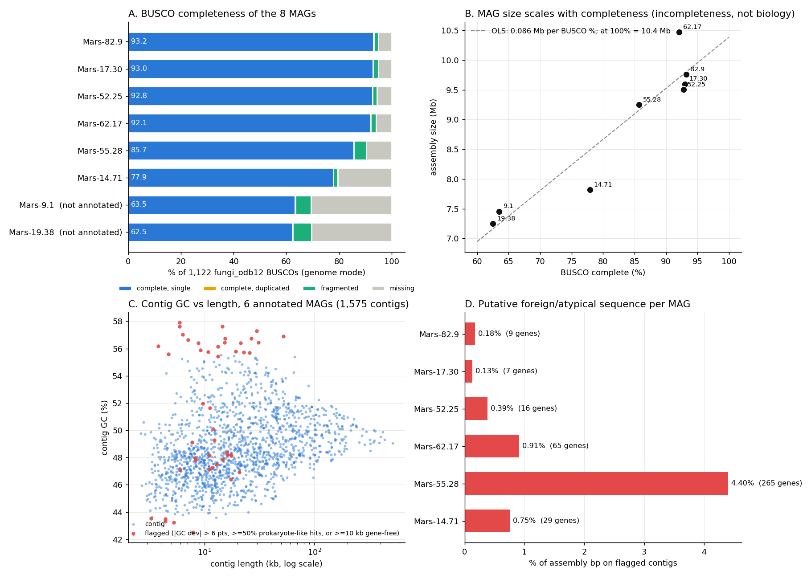
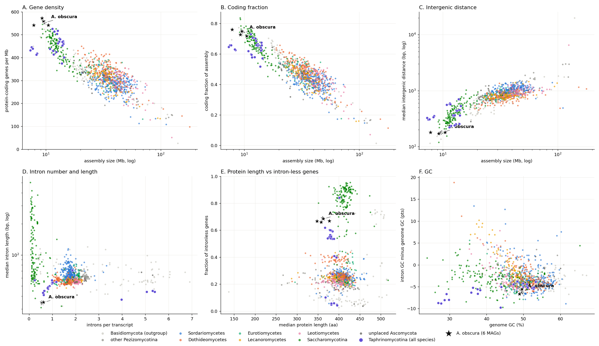
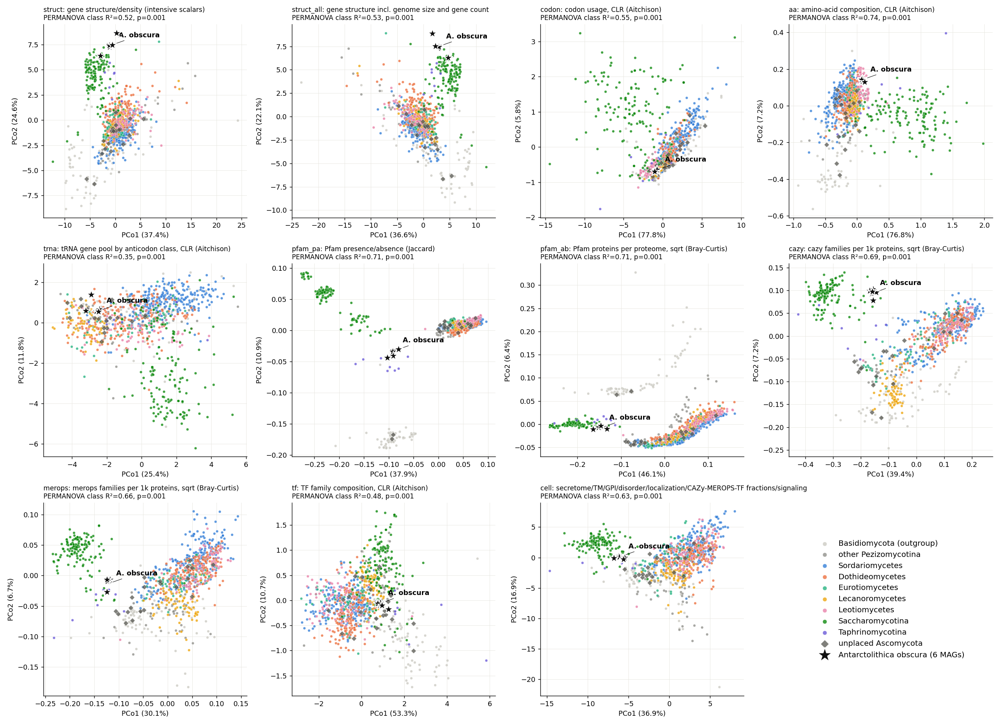
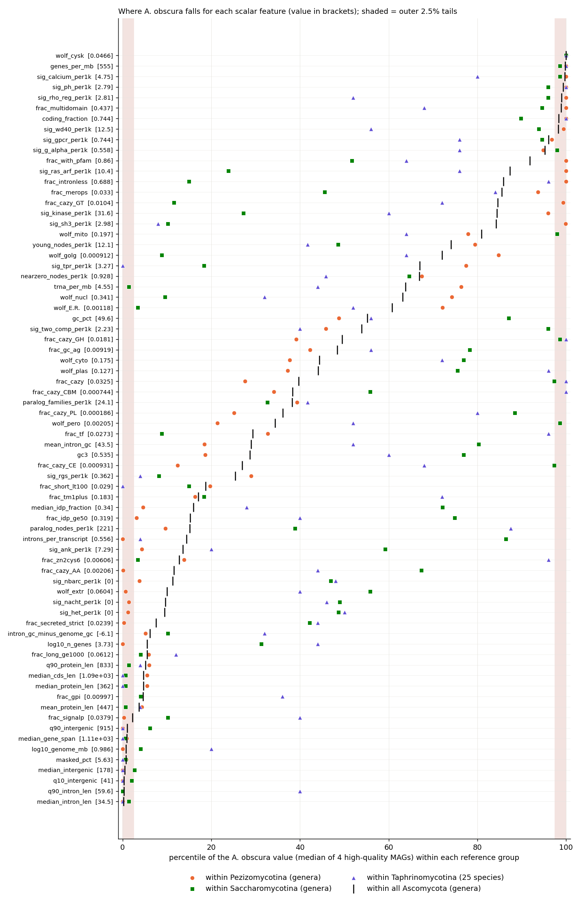
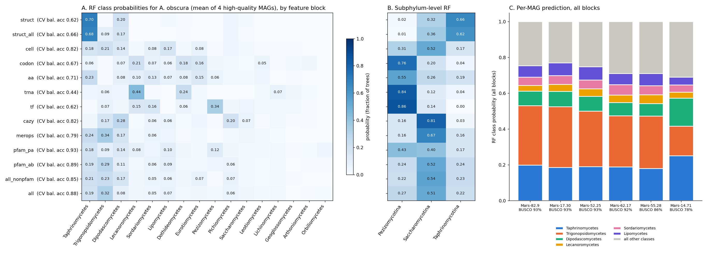
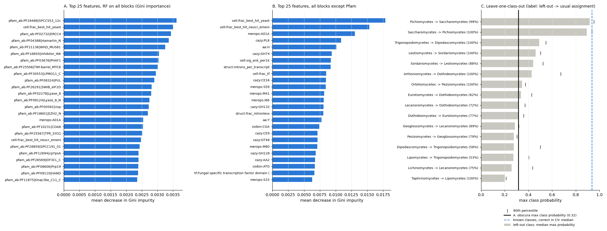
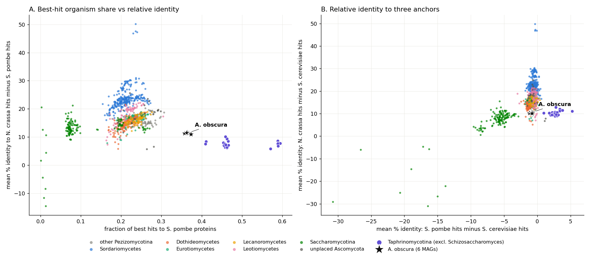
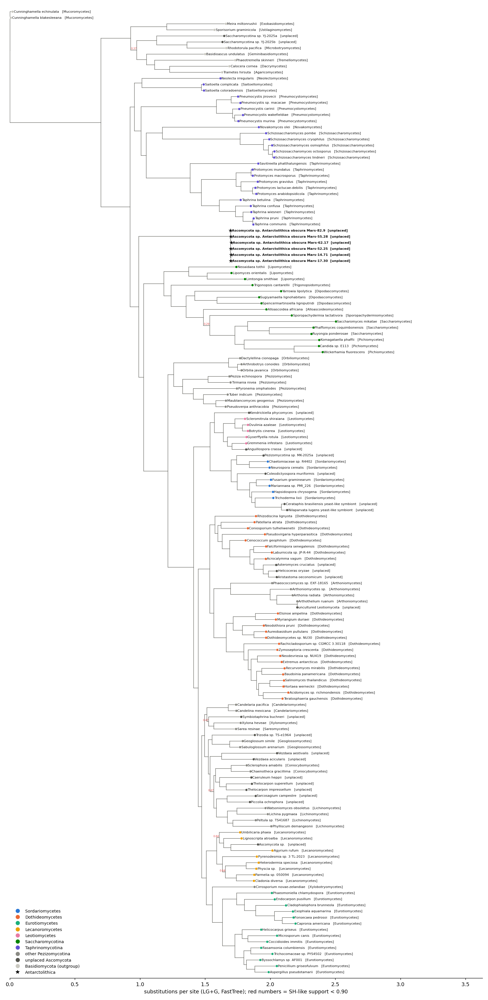

# *Antarctolithica obscura* (Ascomycota sp., NCBI taxid 3698444) compared with the Ascomycota in BFD

> **Provenance.** Written by a Fable agent on 2026-11-10 (analysis C in [../../FUNCTIONAL_ANALYSES.md](../../FUNCTIONAL_ANALYSES.md)). Figures are in `figs/`, result CSVs and trees in `results/`, and the scripts in `scripts/` (paths set by `AO_BASE`). HPCC was in maintenance, so everything ran locally, including a reduced phylogenomic analysis in place of nf_phyling. The 7.6 GB working directory (data, alignments, venv) was not committed. Only 6 of the 8 MAGs have annotations. Citations marked "citation to verify" have not been checked.

Analysis date 2026-11-10. Data: BFD parquet snapshot (species table built 2026-11-06), atlas intermediates, MotherDuck `bfd`. All statistics were run on the local workstation because SLURM on the HPCC was under a maintenance reservation for the whole session. Scripts are in `scripts/`, result tables in `results/` (both next to this file).

## Summary

- ***A. obscura* does not belong to any Ascomycota class in BFD.** In a 300-marker, 159-taxon phylogeny the 6 MAGs form one clade that is sister to Saccharomycotina + Pezizomycotina, branching after Taphrinomycotina (SH-like support 1.0; the same placement is recovered in all 6 robustness runs, support 0.996-1.0; limits in section 9.2). None of the proposed affinities (Dothideomycetes, Chaetothyriales, Arthoniomycetes, Lecanoromycetes, Lichinomycetes) is supported by any feature block.
- **The feature profile is a mosaic, as expected for a lineage outside the trained classes.** Genome architecture resembles Taphrinomycetes (*Taphrina*, *Protomyces*); gene content resembles small-genome early Saccharomycotina (Lipomycetes, Dipodascomycetes, Trigonopsidomycetes) and Taphrinomycetes; codon usage, the tRNA pool and the TF repertoire resemble Pezizomycotina. The random forest on all blocks gives a maximum class probability of 0.32 (Trigonopsidomycetes), against a median of 0.94 for correctly classified genomes of known classes and 0.20-0.49 for classes deliberately left out of training (except the two sister yeast classes).
- **The genome is small because it is compact, not because the MAGs are incomplete.** The 4 best MAGs are 9.5-10.5 Mb at 92-93 % BUSCO; extrapolation to 100 % gives about 10.4 Mb. Gene density (555 genes/Mb), coding fraction (0.74), median intergenic distance (178 bp) and median intron length (34.5 bp) are within the most extreme 0.5 % of 891 Ascomycota genera, and these measures do not depend on completeness. It is the smallest non-*Pneumocystis* genome among the non-Saccharomycotina Ascomycota in the set.
- **Distinctive content.** Complete absence of the Pezizomycotina toolkit (HET, NACHT/NB-ARC, hydrophobins, NRPS, reducing PKS, tyrosinase, scytalone dehydratase, LPMO AA9, cutinase, GH55/GH128/GT69, peptidase S53, C5 DNA methyltransferase); a one-copy-per-anticodon tRNA set (44-46 genes); few transposon-derived proteins. Retained or expanded: 4 photolyase/cryptochrome genes, UVDE, 2 opsins, 3 phytoene-synthase-family genes, trehalose synthesis, and expansions of phytanoyl-CoA dioxygenase (PhyH, 21 copies), sulfatases (14.5), GH38 alpha-mannosidases (5), enolase-superfamily MR/MLE (7) and GT90.
- **MAG quality.** The MAGs are one species (median protein identity 99.2-99.7 %) but different genotypes (15-38 % identical proteins). Only 6 of 8 are annotated. Contamination is low except Mars-55.28 (4.4 % of bp on high-GC contigs carrying a second fungus). Gene annotation under-calls genes: of 44 "universal" families absent from all 6 proteomes, 33 are present in the assembly by translated search.
- **Confidence.** High that it is outside every sampled Pezizomycotina class and that the genome is compact. Moderate for the exact branching point: 7 of 7 FastTree runs agree, but all use one fast method with site-homogeneous models and no bootstrap, and deep Ascomycota nodes are sensitive to model choice.

## 1. Data quality and consistency of the 8 MAGs

*Figure 1. A: BUSCO (fungi_odb12, genome mode). B: assembly size against completeness. C: contig GC against length for the 6 annotated MAGs. D: share of each assembly on flagged contigs.*

| MAG | LOCUSTAG | size Mb | contigs | N50 kb | GC % | BUSCO C % | dup % | frag % | missing % | genes | flagged bp % | median AAI vs 82.9 | identical proteins vs 82.9 |
|---|---|---|---|---|---|---|---|---|---|---|---|---|---|
| Mars-82.9 | FF1FC3B3 | 9.76 | 89 | 181 | 49.6 | 93.2 | 0.1 | 1.8 | 5 | 5,387 | 0.18 | ref |  |
| Mars-17.30 | F46C92EF | 9.6 | 124 | 128 | 49.6 | 93 | 0 | 1.9 | 5.1 | 5,359 | 0.13 | 99.6 | 28% |
| Mars-52.25 | F7B4B958 | 9.51 | 166 | 91.8 | 49.6 | 92.8 | 0.1 | 1.6 | 5.6 | 5,314 | 0.39 | 99.6 | 27% |
| Mars-62.17 | F7E47E53 | 10.5 | 363 | 46.7 | 49.4 | 92.1 | 0.1 | 2 | 6 | 5,668 | 0.91 | 99.2 | 15% |
| Mars-55.28 | FA7C05DE | 9.25 | 620 | 20.5 | 49.5 | 85.7 | 0 | 4.7 | 9.6 | 5,294 | 4.40 | 99.7 | 38% |
| Mars-14.71 | F1D0D74C | 7.82 | 213 | 63.4 | 48.9 | 77.9 | 0 | 1.7 | 20.4 | 4,232 | 0.75 | 99.7 | 32% |
| Mars-9.1 | FD4728EA | 7.46 | 644 | 14.4 | 48.5 | 63.5 | 0.1 | 5.9 | 30.7 | not annotated |  |  |  |
| Mars-19.38 | F3948469 | 7.25 | 735 | 11.5 | 48.7 | 62.5 | 0.2 | 7.1 | 30.4 | not annotated |  |  |  |

- **Annotation coverage.** Mars-9.1 and Mars-19.38 were skipped by the annotation pipeline (`predict.skipped_too_small`). They have assembly, BUSCO and telomere rows only. Every protein-based result uses 6 MAGs.
- **Same species, different genotypes.** Median amino-acid identity to Mars-82.9 is 99.2-99.7 %, and only 15-38 % of proteins are identical. The MAGs are therefore not copies of one assembly, but they are one lineage and are treated as repeated measurements (section 2.1).
- **Consistency across blocks.** The median distance between the 4 high-quality MAGs is below the median nearest-neighbour distance between reference genera in every block, and far below the distance from *A. obscura* to its nearest reference genus:

| block | AO_HQ_pairwise_median | AO_all6_pairwise_max | ref_nearest_neighbour_median | AO_to_nearest_ref | ref_all_pairs_median |
|---|---|---|---|---|---|
| struct | 0.643 | 4.49 | 1.27 | 2.28 | 5.19 |
| struct_all | 0.661 | 4.56 | 1.45 | 2.36 | 5.73 |
| codon | 0.0469 | 0.314 | 0.479 | 0.859 | 2.74 |
| aa | 0.0137 | 0.055 | 0.0719 | 0.266 | 0.328 |
| trna | 1.43 | 4.07 | 2.74 | 1.97 | 5.72 |
| pfam_pa | 0.0407 | 0.165 | 0.0627 | 0.221 | 0.154 |
| pfam_ab | 0.0331 | 0.134 | 0.0583 | 0.147 | 0.156 |
| cazy | 0.0407 | 0.111 | 0.0772 | 0.195 | 0.287 |
| merops | 0.0241 | 0.103 | 0.0584 | 0.134 | 0.167 |
| tf | 0.425 | 1.06 | 0.572 | 0.892 | 1.8 |
| cell | 1.67 | 3.87 | 2.86 | 5.9 | 8.6 |

- **Contamination.** SwissProt best hits are 83 % fungal in every MAG; the prokaryote-like share (4.3-5.0 %) is at the 30th percentile of Ascomycota genera, so there is no bacterial signal above the fungal background. Flagged contigs:

| strain | contigs | total_mb | gc_wmean | gc_sd_contigs | flagged_contigs | flagged_kb | flagged_pct_bp | genes_on_flagged | hits_fungi_pct | hits_prok_like_pct |
|---|---|---|---|---|---|---|---|---|---|---|
| Mars-14.71 | 213 | 7.82 | 49.1 | 1.68 | 5 | 58.9 | 0.754 | 29 | 83.9 | 4.28 |
| Mars-17.30 | 124 | 9.6 | 49.6 | 1.54 | 1 | 12.8 | 0.133 | 7 | 83 | 4.87 |
| Mars-52.25 | 166 | 9.51 | 49.6 | 1.83 | 2 | 36.6 | 0.386 | 16 | 83.4 | 4.88 |
| Mars-55.28 | 620 | 9.25 | 49.5 | 2.99 | 31 | 407 | 4.4 | 265 | 83.1 | 4.9 |
| Mars-62.17 | 363 | 10.5 | 49.4 | 2.11 | 6 | 95.6 | 0.913 | 65 | 83.4 | 4.73 |
| Mars-82.9 | 89 | 9.76 | 49.6 | 1.24 | 1 | 17.2 | 0.177 | 9 | 83 | 5 |

  Mars-55.28 carries 31 contigs (407 kb, 265 genes) at 56-57 % GC whose genes hit fungal proteins, and it alone has HET domains (5), PS-DH (7) and 27 P450s where the other MAGs have 0, 0 and 10-13. This is a second fungus in the bin. Mars-62.17 has 6 such contigs (96 kb), which fits its larger size (10.47 Mb). The recurrent 12-20 kb contigs with "prokaryote-like" hits in the other MAGs carry low-identity metabolic genes (sugar-acid dehydratase, transporter) at normal GC and gene density and are not contamination.
- **Annotation completeness is lower than assembly completeness.** With the BUSCO fungi_odb10 HMMs run on the proteomes (section 2.7), the 4 high-quality MAGs have 696-703 single-copy markers and 52-58 missing of 758, against a median of 31 missing in Taphrinomycetes and 3-10 in the large Pezizomycotina classes. 34 markers are missing from all 6 proteomes. The translated-search check (section 7.3) shows that most such "absences" are unannotated genes, so the true gene count is above the 5,300-5,700 predicted.

## 2. Methods and the reasoning behind each choice

### 2.1 Comparison set and units of replication

- **Source.** BFD parquet snapshot (species table built 2026-11-06) through the atlas intermediates in `atlas_data/` (A2 gene-structure statistics, A4 protein summary, A5 CAZy/MEROPS/TF/secretome/tRNA/WoLF PSORT/IDP/WGD, A7 Pfam genome matrix, labels). The 500M-row tables were not re-aggregated. The only raw table read in full was `swissprot_best`, filtered to the comparison set.
- **Genomes.** Ascomycota species representatives (atlas `is_representative`: best BUSCO, then N50) passing the atlas filters Q-ann, Q-busco-rel (BUSCO complete at or above the 25th percentile of the class), Q-dup (duplicated <= 10 %) and Q-n50 (N50 >= 50 kb). Classes with fewer than 15 qualifying species (all Taphrinomycotina classes, Arthoniomycetes, Lichinomycetes and others) were kept under a relaxed rule (annotated, duplicated <= 10 %, BUSCO >= 80 %) so that the small candidate classes are not lost. At most 5 species per genus were kept. Result: 1,806 classified Ascomycota species (891 genus units: 736 Pezizomycotina, 147 Saccharomycotina, 8 Taphrinomycotina), 22 unplaced Ascomycota (CLASS NULL), 77 Basidiomycota genus representatives as an outgroup for scale, and the 6 annotated *A. obscura* MAGs; 1,911 genomes in total.
- **Unit of replication.** Ordination, PERMANOVA, percentiles and Kruskal-Wallis use one genome per genus (best BUSCO, then N50), following the atlas convention, because species of one genus are not independent observations (Hurlbert 1984). Taphrinomycotina has only 8 genera in BFD, so percentiles "within Taphrinomycotina" use all 25 species and are labelled as such. Random forests are trained on species (more data per class) but cross-validated with whole genera held out (section 2.6).
- **The MAGs are one lineage.** The 6 annotated MAGs are repeated measurements of one species. They are never used as replicates in a test of "*A. obscura* versus class X", and no such p-value is reported. They show measurement consistency and sensitivity to completeness. The reported *A. obscura* value is the median (scalars) or mean profile (compositions) of the 4 high-quality MAGs (BUSCO 92.1-93.2 %).

### 2.2 Handling MAG incompleteness and contamination

- **Intensive features.** Genome size and gene count scale with completeness, so the main structure block excludes them (a second variant, `struct_all`, includes them for comparison). Every count block is expressed per 1,000 predicted proteins or as a composition, so a MAG missing 7 % of its genes is not penalised as long as the missing genes are a random sample.
- **Absence calls.** A family is called absent only if it is absent from all 6 annotated MAGs, and present only if found in all 4 high-quality MAGs. The MAGs share an assembly and binning method, so their gaps are not independent. Candidate losses were therefore re-checked by translated search (DIAMOND blastx, ultra-sensitive; Buchfink et al. 2015) of the MAG scaffolds with the *Saitoella complicata* protein that carries the missing Pfam domain. This separates "not in the assembly" from "in the assembly but not annotated".
- **Thinning test.** To measure how incompleteness affects classification, the protein counts of held-out reference genomes were binomially thinned to 93 % and 75 % (the completeness range of the MAGs) before prediction.
- **Empirical gradient.** The 6 MAGs span 78-93 % BUSCO, and each was predicted separately.
- **Contamination screen.** Per contig: length, GC, gene density and the taxonomy of SwissProt best hits. SwissProt organisms were classed as Fungi (genus in BFD or in a synonym list), other Eukaryota (a list of model animal, plant and protist genera) or "prokaryote/virus/unclassified" (everything else). The third class over-counts prokaryotes, but the same rule is applied to every reference fungus, so the comparison is relative. Contigs were flagged if GC deviated by more than 6 points from the MAG mean (contig >= 3 kb), if >= 50 % of >= 4 hits were prokaryote-like, or if >= 10 kb carried no gene.
- **Strain relatedness.** DIAMOND blastp best hits (>= 90 % coverage both ways) of each MAG proteome against Mars-82.9, and counts of identical protein md5 checksums between MAGs (MotherDuck `gene_proteins`).

### 2.3 Feature blocks and transformations

| Block | Features | Transformation | Distance | Reason |
|---|---|---|---|---|
| struct | 23 intensive gene-structure scalars: genes/Mb, coding fraction, gene span, CDS and protein length quantiles, introns per transcript, intron-less fraction, intron length (median, q90), intron GC, GC-AG fraction, intergenic distance (q10, median, q90, mean), GC, tRNA/Mb | log10 for lengths and densities, then z-score against Ascomycota genus units, clipped at +-8 | Euclidean | Mixed units need standardisation; logs make length distributions symmetric. |
| struct_all | struct + log10 genome size, log10 gene count, tRNA count, masked % | same | Euclidean | Shows how much the answer depends on size. |
| codon | 61 sense-codon frequencies | centred log-ratio (CLR), pseudocount 1e-5 | Euclidean on CLR (Aitchison distance) | Frequencies sum to 1; distances on raw proportions are distorted by the constant-sum constraint (Aitchison 1982; Gloor et al. 2017). |
| aa | 20 amino-acid frequencies | CLR | Aitchison | Same. |
| trna | tRNA gene counts in 62 amino-acid x anticodon classes | CLR, pseudocount 0.5 | Aitchison | Composition of the pool matters, not copy number, which varies more than 10-fold. |
| pfam_pa | 7,061 Pfam families present in >= 1 % of genomes | presence/absence | Jaccard (Jaccard 1912) | Gene-content similarity ignoring copy number; shared absences carry no information. |
| pfam_ab | same families, proteins per family per 1,000 proteins | square root | Bray-Curtis (Bray & Curtis 1957) | Abundance-sensitive; the square root damps large families (Legendre & Gallagher 2001). |
| cazy, merops | 186 CAZy and 124 MEROPS families per 1,000 proteins | square root | Bray-Curtis | Same. |
| tf | 20 TF families | CLR, pseudocount 0.5 | Aitchison | Composition of the TF repertoire. |
| cell | 51 scalars: SignalP, strict secretome, GPI, TM (>= 1, >= 2 helices), disorder (median, fraction >= 50 %), WoLF PSORT localisation fractions, CAZy class fractions, MEROPS/TF/Zn2Cys6 fractions, Pfam coverage, multidomain fraction, signalling and NLR Pfam sets per 1,000 proteins | z-score, clipped | Euclidean | Mixed units. |
| swissprot | share of best hits by organism; mean % identity of best hits to *S. pombe*, *S. cerevisiae*, *N. crassa*, *A. nidulans* | scalars | univariate | A tree-free placement signal: which reference proteome a genome's proteins resemble. |

TargetP (125 genomes) and Infernal/Rfam (14 genomes) were excluded for coverage. WGD/paralog statistics exist only for species representatives (one MAG, Mars-82.9) and are reported univariately. The atlas signalling/NLR Pfam-set table also covered representatives only, so those sets were recomputed from the Pfam matrix for all genomes.

### 2.4 Ordination, PERMANOVA and position of the MAGs

- **PCoA** (classical multidimensional scaling; Gower 1966) with `lib/ordination.py::pcoa` from the repo. PCoA accepts any distance matrix, so one method serves the Jaccard, Bray-Curtis, Aitchison and Euclidean blocks. It is used for display only.
- **PERMANOVA** (Anderson 2001), `lib/ordination.py::permanova`, 999 label permutations, one-way with CLASS as the factor and, separately, subphylum. Design: genus units only; the 14 classes with >= 5 genera; at most 40 genera per class drawn at random (seed 0) to limit imbalance, giving 355 genera. *A. obscura* and the unplaced genomes are not in the test. R2 = SS_among / SS_total. PERMANOVA responds to unequal dispersion in unbalanced designs (Anderson & Walsh 2013). The ratio of the largest to the smallest class dispersion is reported and is large for several blocks, so the p-values are a screen and R2 is the quantity read.
- **Position.** Distances are computed in the full feature space, not in two PCoA axes. For each class: distance from the *A. obscura* profile to the class centroid (from the distance matrix, d2 = mean d2(x, members) minus the within-class mean squared distance / 2), the median distance of the class's own members to that centroid, their ratio, and the percentage of members farther from the centroid than *A. obscura* ("typicality"). A ratio near 1 and a typicality well above 0 % mean it would pass as a member.

### 2.5 Univariate tests

- **Percentile and robust z.** For each scalar: the percentile of the *A. obscura* value within Ascomycota, Pezizomycotina, Saccharomycotina (genus units) and Taphrinomycotina (species), and a robust z-score (difference from the group median divided by 1.4826 x MAD; Leys et al. 2013), because many genome traits are skewed.
- **Kruskal-Wallis** (Kruskal & Wallis 1952) across the classes with >= 5 genera, with epsilon-squared = (H - k + 1)/(n - k) as effect size (Tomczak & Tomczak 2014; citation to verify). A rank test is used because class distributions are not normal and variances differ. Following the atlas, it is a screening statistic and the effect size is read first. With hundreds of genera every p-value is tiny, and they are not interpreted.

### 2.6 Random forest

- **Why random forest** (Breiman 2001). It handles thousands of correlated features of mixed scale without tuning and gives class probabilities (fraction of trees) and feature importances.
- **Targets.** (i) CLASS, for the 16 classes with >= 8 species in the set (1,779 species); (ii) subphylum (Pezizomycotina, Saccharomycotina, Taphrinomycotina).
- **Hyperparameters** (scikit-learn; Pedregosa et al. 2011): 500 trees, `max_features='sqrt'`, `min_samples_leaf=1`, `class_weight='balanced_subsample'` (classes range from 8 to 555 species), `random_state=0`. No tuning was done, so performance is not fitted to this set.
- **Cross-validation.** 5-fold `StratifiedGroupKFold` with genus as the group, so no genus is split between training and test. Grouped CV avoids optimistic estimates when samples are phylogenetically clustered (Roberts et al. 2017). Reported: balanced accuracy (mean per-class recall) and macro-F1, because plain accuracy is dominated by Sordariomycetes.
- **Importance.** Mean decrease in Gini impurity from the model fitted on all data, and permutation importance (Breiman 2001) for the 30 highest-Gini features of each block: the drop in balanced accuracy on a genus-grouped 25 % hold-out when the feature is shuffled, mean of 3 shuffles. Gini importance is biased toward features with many split points and toward correlated groups (Strobl et al. 2007); permutation importance on held-out data is the check. Where many features carry the same signal (Pfam), single-feature permutation importance is small by construction.
- **Novelty calibration (leave-one-class-out).** A classifier must assign every genome to a training class. To learn how a genome from an untrained class is scored, each class in turn was removed from training and its members predicted (300 trees). Their maximum class probabilities are compared with that of *A. obscura*.
- **Robustness.** Per-MAG predictions across the completeness gradient; thinning (section 2.2); `struct` with and without genome size.

### 2.7 Phylogenomic placement

SLURM on the HPCC was under a maintenance reservation for the whole session (jobs stay pending with "ReqNodeNotAvail, Reserved for maintenance"), so `workflows/run_phyling.sh` (nf_phyling) could not be launched and no heavy work was run on the login node. A reduced version of the same pipeline was run on the local workstation: 159 proteomes (6 MAGs; all 25 Taphrinomycotina species; 22 unplaced Ascomycota; representatives of every Pezizomycotina and Saccharomycotina class, with extra rock-inhabiting Dothideomycetes and Chaetothyriales; 7 Basidiomycota; 2 Mucoromycota as root). `hmmsearch` (HMMER 3.3.2; Eddy 2011) with the 758 BUSCO fungi_odb10 profiles and the BUSCO score cutoffs (Simão et al. 2015; Manni et al. 2021); best hit per marker; a marker is dropped for a taxon if a second hit scores >= 85 % of the best. Markers single-copy in >= 85 % of taxa and in >= 3 of the 4 high-quality MAGs (up to 300, by occupancy) were aligned with MAFFT --auto (Katoh & Standley 2013), trimmed with trimAl -gappyout (Capella-Gutiérrez et al. 2009) and concatenated, and a tree was inferred with FastTree 2 under LG+Gamma (Price et al. 2010; Le & Gascuel 2008). Support values are FastTree SH-like local supports, which are less conservative than bootstraps.

## 3. Genome size, gene density and gene structure

*Figure 3. Genus units of the comparison set; all 25 Taphrinomycotina species; the 6 annotated MAGs.*

| feature | A. obscura (HQ median) | min of 6 | max of 6 | Pezizo. median | Saccharo. median | Taphrino. median | Taphrinomycetes median | pct in Asco. | pct in Pezizo. | pct in Saccharo. | pct in Taphrino. | robust z vs Pezizo. | KW eps2 |
|---|---|---|---|---|---|---|---|---|---|---|---|---|---|
| log10_genome_mb | 0.986 | 0.893 | 1.02 | 1.56 | 1.09 | 1.1 | 1.11 | 0.786 | 0 | 4.08 | 20 | -5.05 | 0.534 |
| log10_n_genes | 3.73 | 3.63 | 3.75 | 4.04 | 3.75 | 3.77 | 3.8 | 5.5 | 0 | 31.3 | 44 | -3.38 | 0.48 |
| genes_per_mb | 555 | 541 | 572 | 304 | 448 | 453 | 481 | 99.8 | 100 | 98.6 | 100 | 5.53 | 0.537 |
| coding_fraction | 0.744 | 0.719 | 0.761 | 0.446 | 0.67 | 0.646 | 0.659 | 98.3 | 100 | 89.8 | 100 | 4.41 | 0.528 |
| median_intergenic | 178 | 171 | 180 | 895 | 382 | 362 | 349 | 0.449 | 0 | 2.72 | 0 | -3.84 | 0.63 |
| q10_intergenic | 41 | 41 | 43 | 291 | 103 | 125 | 69 | 0.337 | 0 | 2.04 | 0 | -4.93 | 0.551 |
| q90_intergenic | 915 | 801 | 968 | 3.04e+03 | 1.34e+03 | 1.28e+03 | 1.24e+03 | 1.01 | 0 | 6.12 | 0 | -2.37 | 0.633 |
| median_gene_span | 1.11e+03 | 1.07e+03 | 1.16e+03 | 1.36e+03 | 1.27e+03 | 1.22e+03 | 1.18e+03 | 0.898 | 0.951 | 0.68 | 0 | -4.24 | 0.417 |
| median_cds_len | 1.09e+03 | 1.05e+03 | 1.13e+03 | 1.22e+03 | 1.24e+03 | 1.15e+03 | 1.14e+03 | 4.66 | 5.5 | 0.68 | 0 | -2.42 | 0.198 |
| median_protein_len | 362 | 348 | 377 | 405 | 414 | 381 | 380 | 4.66 | 5.5 | 0.68 | 0 | -2.42 | 0.198 |
| frac_long_ge1000 | 0.0612 | 0.0499 | 0.0735 | 0.0743 | 0.0824 | 0.0678 | 0.063 | 5.5 | 5.84 | 4.08 | 12 | -1.43 | 0.204 |
| introns_per_transcript | 0.556 | 0.545 | 0.627 | 1.8 | 0.186 | 0.986 | 0.664 | 14.4 | 0 | 86.4 | 4 | -4.98 | 0.623 |
| frac_intronless | 0.688 | 0.66 | 0.692 | 0.247 | 0.851 | 0.54 | 0.591 | 85.9 | 100 | 15 | 96 | 12.6 | 0.533 |
| median_intron_len | 34.5 | 34 | 35 | 58 | 84 | 48 | 47 | 0.224 | 0 | 1.36 | 0 | -3.96 | 0.54 |
| q90_intron_len | 59.6 | 57 | 146 | 120 | 474 | 64 | 64 | 0.337 | 0 | 0 | 40 | -2.4 | 0.424 |
| mean_intron_gc | 43.5 | 42.3 | 44 | 46.5 | 38.2 | 42.9 | 45.9 | 29 | 18.5 | 80.3 | 52 | -0.787 | 0.429 |
| intron_gc_minus_genome_gc | -6.1 | -6.67 | -5.56 | -3.57 | -2.79 | -5.21 | -4.89 | 6.17 | 5.16 | 10.2 | 32 | -1.34 | 0.126 |
| frac_gc_ag | 0.00919 | 0.00744 | 0.0106 | 0.00959 | 0.00507 | 0.00809 | 0.00912 | 48.4 | 42.3 | 78.2 | 56 | -0.159 | 0.295 |
| gc_pct | 49.6 | 48.9 | 49.6 | 49.7 | 41.6 | 47.3 | 50.9 | 55.2 | 48.8 | 87.1 | 56 | -0.0207 | 0.432 |
| gc3 | 0.535 | 0.52 | 0.537 | 0.598 | 0.435 | 0.505 | 0.551 | 28.7 | 18.6 | 76.9 | 60 | -0.811 | 0.552 |
| masked_pct | 5.63 | 5.04 | 5.9 | 11.5 | 12.7 | 11.7 | 7.84 | 0.786 | 0.815 | 0.68 | 0 | -1.25 | 0.0921 |
| n_trna | 44.5 | 35 | 46 | 114 | 162 | 57 | 56 | 9.76 | 11.7 | 0 | 20 | -0.922 | 0.465 |
| trna_per_mb | 4.55 | 4.22 | 4.73 | 2.95 | 12.8 | 5 | 4.04 | 63.7 | 76.4 | 1.36 | 44 | 0.826 | 0.586 |

*Columns: median of the 4 high-quality MAGs; range over the 6 annotated MAGs; subphylum medians; percentile of the A. obscura value within each group; robust z against Pezizomycotina; Kruskal-Wallis epsilon-squared across the 14 classes with >= 5 genera.*

**Is the small genome real?**

1. Assembly size rises 0.086 Mb per BUSCO point across the 8 MAGs (Figure 1B), which is the incompleteness effect. Extrapolated to 100 % it gives 10.4 Mb; the 4 best MAGs average 9.83 Mb. Complete Taphrinomycetes genomes score only 90-93 % on fungi_odb12, so the best MAGs may already be near complete.
2. Density measures do not depend on how much of the genome was recovered, and all are extreme: 555 genes/Mb (above 99.8 % of Ascomycota genera; Taphrinomycotina median 453, Saccharomycotina 448, Pezizomycotina 304), coding fraction 0.74, median intergenic distance 178 bp (Pezizomycotina 895, Taphrinomycotina 363), 10th-percentile intergenic distance 41 bp.
3. Fragmentation would lower, not raise, measured gene density (genes are lost at contig ends), and the range over the 6 MAGs is narrow (541-572 genes/Mb) across N50 values from 20 to 181 kb.
4. Repeat content is 5-6 % (below 99 % of Ascomycota genera) and transposon-derived Pfam domains are absent. MAG binning does lose repeats, so the repeat figure is a lower bound; the gene-space compaction is not affected.

Conclusion: a real compact genome of roughly 10-10.5 Mb. The unannotated genes found in section 7.3 mean that true gene density is higher still.

**Gene structure.** 0.56 introns per transcript and 69 % intron-less genes, between Saccharomycotina (0.19; 85 %) and Taphrinomycotina (0.99; 54 %) and far from Pezizomycotina (1.80; 25 %). Introns are among the shortest in the set (median 34.5 bp, 0.2nd percentile of Ascomycota, 90th percentile 60 bp; Pezizomycotina 58 and 120). Proteins are short (median 362 aa, 5th percentile of Ascomycota). The combination of few, very short introns with short intergenic regions is closest to *Protomyces* and *Taphrina* (Figure 3D).

**tRNA genes.** 44-46 tRNA genes in the high-quality MAGs, each of 44 anticodon classes present once (Pezizomycotina median 113.5 genes, Saccharomycotina 162, Taphrinomycotina 57). tRNA-Val(UAC) (codon GTA) is absent from all 6 MAGs and present in >= 90 % of Pezizomycotina. A strictly single-copy tRNA set is unusual for a free-living fungus; MAG binning can lose multi-copy loci, so copy number is a lower bound, but the same set is recovered in 4 independent MAGs.

**Telomeres and paralogs.** Terminal telomere tracts were found in 2 of 8 MAGs (3 tracts), all the canonical TTAGGG/CCCTAA repeat; MAG contigs rarely end in telomeres, so nothing follows about chromosome number. Paralog statistics exist only for Mars-82.9:

| feature | A. obscura (HQ median) | min of 6 | max of 6 | Pezizo. median | Saccharo. median | Taphrino. median | Taphrinomycetes median | pct in Asco. | pct in Pezizo. | pct in Saccharo. | pct in Taphrino. | robust z vs Pezizo. | KW eps2 |
|---|---|---|---|---|---|---|---|---|---|---|---|---|---|
| paralog_nodes_per1k | 221 | 221 | 221 | 286 | 231 | 203 | 202 | 15.1 | 9.6 | 38.9 | 87.5 | -1.17 | 0.229 |
| young_nodes_per1k | 12.1 | 12.1 | 12.1 | 4.43 | 12.2 | 13.8 | 6.41 | 74 | 79.4 | 48.6 | 41.7 | 1.62 | 0.201 |
| nearzero_nodes_per1k | 0.928 | 0.928 | 0.928 | 0.326 | 0.505 | 1.07 | 0.494 | 66.9 | 67.5 | 64.6 | 45.8 | 1.25 | 0.045 |
| paralog_families_per1k | 24.1 | 24.1 | 24.1 | 27.2 | 29.3 | 25.8 | 24.7 | 38.3 | 39.4 | 32.6 | 41.7 | -0.277 | 0.185 |
| identical_groups | 0 | 0 | 0 | 1 | 0 | 2.5 | 1 | 24.6 | 23.7 | 29.5 | 16.7 | -0.674 | 0.0438 |
| telomere_tracts | 0 | 0 | 2 | 6 | 0 | 3 | 7 | 17.3 | 10.9 | 49 | 16 | -0.674 | 0.286 |

  221 paralog nodes per 1,000 genes (15th percentile of Ascomycota), no identical-copy groups, no hybrid flag, and 12 young nodes per 1,000 genes (74th percentile). There is no whole-genome-duplication signal.

## 4. Codon usage, amino-acid composition and tRNA pool

Genome GC 49.6 % and GC3 0.535 are unremarkable (55th and 29th percentile of Ascomycota). Largest CLR deviations from Pezizomycotina (robust z), with the same comparison against the other subphyla:

| block | feature | AO | Pezizo_median | Saccharo_median | Taphrino_median | z_Pezizo | z_Saccharo | z_Taphrino |
|---|---|---|---|---|---|---|---|---|
| aa | P | 0.0491 | 0.0608 | 0.0461 | 0.0492 | -5.03 | 0.406 | -0.0931 |
| aa | T | 0.0556 | 0.0603 | 0.0568 | 0.0577 | -3.65 | -0.979 | -0.433 |
| aa | L | 0.0952 | 0.0879 | 0.0937 | 0.0972 | 3.19 | -0.206 | -1.49 |
| aa | M | 0.0242 | 0.0217 | 0.0195 | 0.0214 | 2.59 | 1.79 | 2.2 |
| aa | F | 0.0397 | 0.0363 | 0.0437 | 0.0377 | 2.43 | -1.6 | 0.383 |
| aa | C | 0.0132 | 0.0119 | 0.0111 | 0.0135 | 2.07 | 2.07 | -0.391 |
| codon | TTT | 0.0212 | 0.0128 | 0.0228 | 0.0205 | 2.44 | -0.666 | -0.116 |
| codon | CCT | 0.0121 | 0.0148 | 0.0137 | 0.0142 | -2.08 | -1.23 | -0.818 |
| codon | TTC | 0.0184 | 0.0234 | 0.0199 | 0.0159 | -2.07 | -1.12 | 0.127 |
| codon | ACC | 0.0139 | 0.019 | 0.0135 | 0.0125 | -1.95 | -0.327 | 0.211 |
| codon | AAC | 0.0162 | 0.0223 | 0.0232 | 0.0169 | -1.76 | -1.92 | -0.445 |
| codon | ATC | 0.0204 | 0.0257 | 0.0199 | 0.0217 | -1.7 | -0.374 | -0.377 |
| trna | Thr_ACT | 0.75 | 3 | 6 | 2 | -2.3 | -3.97 | -1.2 |
| trna | Asp_GAC | 1 | 5 | 8 | 2 | -2.3 | -4.21 | -1.87 |
| trna | Val_GTA | 0 | 2 | 1 | 1 | -2.05 | -2.07 | -5.87 |
| trna | Asn_AAC | 1 | 4 | 6 | 2 | -1.99 | -3.02 | -0.811 |
| trna | Ser_TCT | 0.75 | 3 | 5 | 1 | -1.93 | -3.11 | -1.68 |
| trna | Gly_GGC | 1 | 5 | 9 | 2 | -1.9 | -3.72 | -1.32 |

- **Amino acids.** Low proline and threonine and high leucine, methionine and phenylalanine relative to Pezizomycotina (|z| 2.4-5.0), but within the Taphrinomycotina and Saccharomycotina ranges (|z| < 1.6 for the same residues). Lower proline goes with the lower intrinsic disorder (section 6).
- **Codons.** No single codon deviates by more than 2.5 robust SD from Pezizomycotina; the profile is Pezizomycotina-like with weaker GC3 bias (more TTT, ATT; fewer TTC, ACC, AAC).
- **tRNA pool.** Composition falls inside the Lecanoromycetes, Lichinomycetes and Arthoniomycetes clouds (typicality 100 %), because those lichen-forming classes also have small, nearly single-copy tRNA sets (Lecanoromycetes median 43 genes). This is convergence on a minimal pool, not evidence of relationship; the block has the weakest class signal (PERMANOVA R2 0.35, RF balanced accuracy 0.44).

## 5. Ordination and PERMANOVA

*Figure 2. PCoA of each feature block (one point per genus; stars = the 6 MAGs).*

| block | n_features | n_genera | n_classes | pseudoF_class | R2_class | p_class | pseudoF_subphylum | R2_subphylum | p_subphylum | dispersion_ratio | PCo1_pct | PCo2_pct |
|---|---|---|---|---|---|---|---|---|---|---|---|---|
| struct | 23 | 355 | 14 | 28.1 | 0.518 | 0.001 | 188 | 0.348 | 0.001 | 4.08 | 37.4 | 24.6 |
| struct_all | 27 | 355 | 14 | 29.2 | 0.526 | 0.001 | 198 | 0.36 | 0.001 | 4.1 | 36.6 | 22.1 |
| codon | 61 | 355 | 14 | 31.8 | 0.548 | 0.001 | 173 | 0.329 | 0.001 | 18.7 | 77.8 | 5.78 |
| aa | 20 | 355 | 14 | 76.2 | 0.744 | 0.001 | 472 | 0.572 | 0.001 | 7.95 | 76.8 | 7.24 |
| trna | 62 | 355 | 14 | 14.1 | 0.349 | 0.001 | 52.1 | 0.129 | 0.001 | 2.26 | 25.4 | 11.8 |
| pfam_pa | 7061 | 355 | 14 | 65.7 | 0.715 | 0.001 | 366 | 0.509 | 0.001 | 13 | 37.9 | 10.9 |
| pfam_ab | 7061 | 355 | 14 | 64.5 | 0.711 | 0.001 | 416 | 0.541 | 0.001 | 3.77 | 46.1 | 6.41 |
| cazy | 186 | 355 | 14 | 57.8 | 0.688 | 0.001 | 295 | 0.455 | 0.001 | 6.3 | 39.4 | 7.18 |
| merops | 124 | 355 | 14 | 51.3 | 0.662 | 0.001 | 302 | 0.461 | 0.001 | 3.08 | 30.1 | 6.74 |
| tf | 20 | 355 | 14 | 24.2 | 0.48 | 0.001 | 83.1 | 0.191 | 0.001 | 2.26 | 53.3 | 10.7 |
| cell | 51 | 355 | 14 | 43.9 | 0.626 | 0.001 | 228 | 0.393 | 0.001 | 2.93 | 36.9 | 16.9 |

*PERMANOVA on 355 genera in 14 classes (<= 40 genera per class), 999 permutations. dispersion_ratio = largest/smallest mean distance to class centroid.*

- CLASS explains 35-74 % of the variance depending on the block; amino-acid composition (0.74), Pfam content (0.71) and CAZy (0.69) carry the most class signal, the tRNA pool the least. All p = 0.001 (the minimum with 999 permutations). Dispersion differs between classes by 2- to 19-fold, so part of each pseudo-F reflects spread (Anderson & Walsh 2013).
- *A. obscura* was not part of the test. Its position relative to each class, in the full feature space:

| block | nearest 1 | nearest 2 | nearest 3 |
|---|---|---|---|
| struct | Taphrinomycetes (ratio 2.06; 0% of members farther) | Dipodascomycetes (ratio 2.02; 4% of members farther) | Lipomycetes (ratio 2.79; 0% of members farther) |
| struct_all | Taphrinomycetes (ratio 2.08; 0% of members farther) | Dipodascomycetes (ratio 2.00; 8% of members farther) | Lipomycetes (ratio 2.79; 14% of members farther) |
| codon | Lecanoromycetes (ratio 2.42; 4% of members farther) | Geoglossomycetes (ratio 3.97; 0% of members farther) | Eurotiomycetes (ratio 1.35; 20% of members farther) |
| aa | Taphrinomycetes (ratio 1.17; 0% of members farther) | Leotiomycetes (ratio 2.91; 1% of members farther) | Eurotiomycetes (ratio 2.49; 0% of members farther) |
| trna | Lecanoromycetes (ratio 0.53; 100% of members farther) | Lichinomycetes (ratio 0.67; 100% of members farther) | Arthoniomycetes (ratio 0.63; 100% of members farther) |
| pfam_pa | Lipomycetes (ratio 2.97; 0% of members farther) | Taphrinomycetes (ratio 2.75; 0% of members farther) | Dipodascomycetes (ratio 2.50; 0% of members farther) |
| pfam_ab | Lipomycetes (ratio 2.83; 0% of members farther) | Dipodascomycetes (ratio 2.30; 0% of members farther) | Trigonopsidomycetes (ratio 2.45; 0% of members farther) |
| cazy | Dipodascomycetes (ratio 1.84; 0% of members farther) | Lipomycetes (ratio 2.01; 0% of members farther) | Pichiomycetes (ratio 3.62; 1% of members farther) |
| merops | Dipodascomycetes (ratio 2.39; 0% of members farther) | Trigonopsidomycetes (ratio 2.40; 0% of members farther) | Lipomycetes (ratio 4.30; 0% of members farther) |
| tf | Pezizomycetes (ratio 1.00; 50% of members farther) | Lecanoromycetes (ratio 1.45; 15% of members farther) | Candelariomycetes (ratio 1.93; 0% of members farther) |
| cell | Lipomycetes (ratio 2.03; 0% of members farther) | Dipodascomycetes (ratio 2.19; 0% of members farther) | Taphrinomycetes (ratio 2.41; 0% of members farther) |

*ratio = distance of A. obscura to the class centroid / median distance of the class's own members to it. Classes with >= 3 genera.*

| block | nearest_genus_units |
|---|---|
| struct | Protomyces arabidopsidicola [Taphrinomy]; Casaregolazyma lundiana [Dipodascom]; Diddensiella caesifluorescens [Dipodascom]; Taphrina wiesneri [Taphrinomy]; Trichomonascaceae sp. VP_10 [Dipodascom] |
| struct_all | Protomyces arabidopsidicola [Taphrinomy]; Casaregolazyma lundiana [Dipodascom]; Diddensiella caesifluorescens [Dipodascom]; Taphrina wiesneri [Taphrinomy]; Trichomonascaceae sp. VP_10 [Dipodascom] |
| codon | Lobaria immixta [Lecanoromy]; Trichocomaceae sp. PYS4502 [Eurotiomyc]; Eurotiales sp. R13A2 [Eurotiomyc]; Eurotiales sp. R3503 [Eurotiomyc]; Pseudocyphellaria aurata [Lecanoromy] |
| aa | Taphrina wiesneri [Taphrinomy]; Conoideocrella luteorostrata [Sordariomy]; Cladobotryum sp. ATHUM 6904 [Sordariomy]; Zelopaecilomyces penicillatus [Sordariomy]; Hypomyces rosellus [Sordariomy] |
| trna | Groenewaldozyma tartarivorans [Dipodascom]; Lichinales sp. [Lichinomyc]; Trichoglossum hirsutum [Geoglossom]; Teloschistes peruensis [Lecanoromy]; Protomyces arabidopsidicola [Taphrinomy] |
| pfam_pa | Saitoella complicata [Saitoellom]; Kockiozyma suomiensis [Lipomycete]; Dipodascopsis uninucleata [Lipomycete]; Babjevia anomala [Lipomycete]; Myxozyma sirexii [Lipomycete] |
| pfam_ab | Trigonopsis cantarellii [Trigonopsi]; Dipodascopsis uninucleata [Lipomycete]; Novakomyces olei [Novakomyce]; Daia tannicola [Dipodascom]; Zygoascus polysorbophilus [Dipodascom] |
| cazy | Casaregolazyma lundiana [Dipodascom]; Daia tannicola [Dipodascom]; Trichomonascaceae sp. B5901 [Dipodascom]; Trichomonascaceae sp. VP_10 [Dipodascom]; Diddensiella caesifluorescens [Dipodascom] |
| merops | Blastobotrys adeninivorans [Dipodascom]; Sporopachydermia lactativora [Sporopachy]; Diddensiella caesifluorescens [Dipodascom]; Spencermartinsiella ligniputridi [Dipodascom]; Daia tannicola [Dipodascom] |
| tf | Maublancomyces geogenius [Pezizomyce]; Icmadophila ericetorum [Lecanoromy]; Berkeleyomyces rouxiae [Sordariomy]; Phialophoropsis hubbardii [Sordariomy]; Terfezia boudieri [Pezizomyce] |
| cell | Novakomyces olei [Novakomyce]; Kockiozyma suomiensis [Lipomycete]; Myxozyma sirexii [Lipomycete]; Onygena corvina [Eurotiomyc]; Grinbergsozyma bentonensis [Dipodascom] |

- In no block except the tRNA pool and TF composition does *A. obscura* fall inside a class: its distance to the nearest centroid is 1.8-3 times the typical member distance, and usually no member is farther out.
- The nearest classes change with the block: Taphrinomycetes for structure and amino acids; Lipomycetes, Dipodascomycetes, Trigonopsidomycetes and Taphrinomycetes for Pfam, CAZy, MEROPS and cell-biology scalars; Lecanoromycetes, Eurotiomycetes and Pezizomycetes for codons, tRNA and TFs.
- In the Pfam presence/absence ordination (Figure 2) it lies with the non-*Schizosaccharomyces* Taphrinomycotina, between the Saccharomycotina and Pezizomycotina clouds, and its nearest single genome is *Saitoella complicata*.

## 6. Proteome-level features

*Figure 4. Percentile of the A. obscura value within each reference group for every scalar feature.*

| feature | A. obscura (HQ median) | min of 6 | max of 6 | Pezizo. median | Saccharo. median | Taphrino. median | Taphrinomycetes median | pct in Asco. | pct in Pezizo. | pct in Saccharo. | pct in Taphrino. | robust z vs Pezizo. | KW eps2 |
|---|---|---|---|---|---|---|---|---|---|---|---|---|---|
| frac_signalp | 0.0379 | 0.0372 | 0.0394 | 0.085 | 0.045 | 0.0459 | 0.061 | 2.24 | 0.272 | 10.2 | 40 | -2.58 | 0.515 |
| frac_secreted_strict | 0.0239 | 0.0231 | 0.025 | 0.0636 | 0.0248 | 0.0303 | 0.0426 | 7.52 | 0.272 | 42.2 | 44 | -2.35 | 0.521 |
| frac_gpi | 0.00997 | 0.00756 | 0.0106 | 0.0147 | 0.0157 | 0.013 | 0.0137 | 4.6 | 4.35 | 4.08 | 36 | -1.83 | 0.332 |
| frac_tm1plus | 0.183 | 0.179 | 0.185 | 0.196 | 0.193 | 0.179 | 0.183 | 17.1 | 16.3 | 18.4 | 72 | -1.16 | 0.157 |
| median_idp_fraction | 0.34 | 0.336 | 0.345 | 0.404 | 0.325 | 0.349 | 0.361 | 15.9 | 4.62 | 72.1 | 28 | -2.18 | 0.434 |
| frac_idp_ge50 | 0.319 | 0.306 | 0.329 | 0.396 | 0.292 | 0.337 | 0.357 | 15.3 | 3.12 | 74.8 | 40 | -2.51 | 0.46 |
| wolf_nucl | 0.341 | 0.338 | 0.358 | 0.318 | 0.482 | 0.384 | 0.33 | 63.2 | 74.2 | 9.52 | 32 | 0.62 | 0.593 |
| wolf_mito | 0.197 | 0.185 | 0.2 | 0.178 | 0.132 | 0.168 | 0.211 | 80.9 | 77.9 | 98 | 64 | 0.898 | 0.408 |
| wolf_cyto | 0.175 | 0.174 | 0.179 | 0.181 | 0.146 | 0.156 | 0.169 | 44.3 | 37.6 | 76.9 | 72 | -0.312 | 0.381 |
| wolf_extr | 0.0604 | 0.0591 | 0.0619 | 0.118 | 0.0583 | 0.0691 | 0.0957 | 9.99 | 0.679 | 55.8 | 40 | -2.79 | 0.581 |
| wolf_plas | 0.127 | 0.124 | 0.127 | 0.13 | 0.115 | 0.114 | 0.116 | 44.1 | 37.2 | 75.5 | 96 | -0.299 | 0.297 |
| wolf_cysk | 0.0466 | 0.044 | 0.0476 | 0.0281 | 0.00891 | 0.0249 | 0.0265 | 100 | 100 | 100 | 100 | 4.28 | 0.463 |
| frac_cazy | 0.0325 | 0.032 | 0.0347 | 0.0401 | 0.0259 | 0.0257 | 0.0278 | 39.7 | 27.6 | 97.3 | 100 | -0.76 | 0.57 |
| frac_cazy_GH | 0.0181 | 0.0173 | 0.0198 | 0.0195 | 0.0104 | 0.0122 | 0.014 | 49.5 | 39.1 | 98.6 | 100 | -0.283 | 0.572 |
| frac_cazy_GT | 0.0104 | 0.0101 | 0.0113 | 0.00735 | 0.0124 | 0.01 | 0.01 | 84.6 | 99.3 | 11.6 | 72 | 2.66 | 0.481 |
| frac_cazy_AA | 0.00206 | 0.00204 | 0.00265 | 0.00779 | 0.00192 | 0.00244 | 0.00267 | 11.6 | 0.136 | 67.3 | 44 | -1.51 | 0.557 |
| frac_merops | 0.033 | 0.0303 | 0.0343 | 0.0278 | 0.0333 | 0.0317 | 0.032 | 85.5 | 93.6 | 45.6 | 84 | 1.65 | 0.494 |
| frac_tf | 0.0273 | 0.0251 | 0.0284 | 0.0301 | 0.0326 | 0.0237 | 0.0247 | 29.3 | 32.7 | 8.84 | 96 | -0.366 | 0.391 |
| frac_zn2cys6 | 0.00606 | 0.00473 | 0.0064 | 0.00909 | 0.0101 | 0.00453 | 0.00494 | 12.8 | 13.9 | 3.4 | 96 | -0.892 | 0.401 |
| frac_with_pfam | 0.86 | 0.846 | 0.871 | 0.727 | 0.858 | 0.817 | 0.795 | 91.8 | 100 | 51.7 | 64 | 2.71 | 0.575 |
| frac_multidomain | 0.437 | 0.422 | 0.462 | 0.336 | 0.41 | 0.403 | 0.391 | 98.9 | 100 | 94.6 | 68 | 3.36 | 0.528 |
| sig_kinase_per1k | 31.6 | 29.5 | 33.1 | 21.4 | 34 | 30.1 | 28.6 | 84.4 | 95.9 | 27.2 | 60 | 2.68 | 0.448 |
| sig_ras_arf_per1k | 10.4 | 8.98 | 10.9 | 5.86 | 11 | 9.87 | 9.79 | 87.3 | 100 | 23.8 | 76 | 4.01 | 0.464 |
| sig_calcium_per1k | 4.75 | 4.59 | 5.2 | 2.39 | 3.36 | 4.11 | 4 | 99.7 | 100 | 98.6 | 80 | 5.1 | 0.369 |
| sig_wd40_per1k | 12.5 | 12.2 | 12.8 | 6.49 | 10.3 | 12.2 | 11.1 | 98.2 | 99.5 | 93.9 | 56 | 4.49 | 0.456 |
| sig_het_per1k | 0 | 0 | 0.882 | 4.98 | 0 | 0 | 0 | 9.48 | 1.22 | 48.6 | 50 | -0.992 | 0.534 |
| sig_nacht_per1k | 0 | 0 | 0.176 | 1.3 | 0 | 0 | 0 | 9.65 | 1.36 | 49 | 46 | -1.16 | 0.428 |
| sig_ank_per1k | 7.29 | 7.09 | 12.5 | 16.2 | 7.1 | 7.95 | 7.48 | 13.6 | 4.35 | 59.2 | 20 | -1.12 | 0.515 |

- **Secretome.** 3.8 % of proteins have a signal peptide and 2.4 % pass the strict secreted filter (Pezizomycotina medians 8.5 % and 6.4 %; below 99.7 % of Pezizomycotina genera; ordinary for yeasts and Taphrinomycotina). About 130 secreted proteins, 25 secreted CAZymes and 9-10 secreted peptidases: no sign of a secreted-enzyme lifestyle.
- **Disorder.** Median disordered fraction 0.34, lower than 95 % of Pezizomycotina genera (0.40) and typical of yeasts.
- **Domain coverage.** 86 % of proteins have a Pfam domain and 82 % a SwissProt hit (Pezizomycotina 73 % and 65 %): the proteome is dominated by conserved core genes, with few lineage-specific or orphan proteins. The 4 high-quality MAGs carry 4,059-4,096 Pfam families (Pezizomycotina median 4,886; Saccharomycotina 4,068; Taphrinomycotina 4,033).
- **Signalling.** Per 1,000 proteins, kinases (31.6), small GTPases (10.4), WD40 (12.5), PH, SH3 and Rho regulators are at the top of the Pezizomycotina range. This is a proportional effect of a small proteome that keeps the conserved signalling core, as the atlas found for yeasts.
- **Localisation.** WoLF PSORT "cytoskeleton" is predicted for 4.7 % of proteins, above every reference genome (Pezizomycotina 2.8 %). No biological cause was identified; the prediction depends on composition, and this may be an artefact of the unusual amino-acid profile.
- **Transcription factors.** 121-126 TF proteins (2.7 % of the proteome). 33 Zn2Cys6 proteins against a Pezizomycotina median of 100 and a Taphrinomycotina median of 28. The Zn2Cys6 expansion that defines Pezizomycotina is absent.

| TF family | AO_HQ_median_n | med_Pez | med_Sac | med_Taph | pct_rate_in_Asco |
|---|---|---|---|---|---|
| Fungal-specific transcription factor domain (C-terminal to Zn_clus) | 40 | 99 | 34 | 21 | 37.1 |
| Zn(II)2Cys6 zinc cluster | 33 | 100 | 56 | 28 | 13.8 |
| C6H2-type zinc finger | 11 | 35 | 13 | 8 | 20.2 |
| Myb-like DNA-binding domain | 9 | 11 | 12 | 10 | 81.9 |
| Basic helix-loop-helix | 8 | 10 | 9 | 8 | 87.1 |
| High mobility group box | 6.5 | 7 | 5 | 7 | 96.9 |
| Basic leucine zipper | 6 | 9 | 5 | 6 | 86.1 |
| Myb-like DNA-binding domain variant | 5 | 9 | 9 | 8 | 58.4 |
| C2H2 zinc finger | 4.5 | 8 | 8 | 6 | 65.9 |
| Basic leucine zipper variant | 4 | 4 | 4 | 4 | 91.6 |
| GATA zinc finger | 4 | 6 | 8 | 7 | 78.7 |
| CCCH zinc finger | 4 | 6 | 5 | 6 | 78.6 |
| Homeodomain | 4 | 6 | 3 | 5 | 88.7 |
| Forkhead / winged-helix domain | 3 | 4 | 3 | 4 | 91.9 |
| MADS-box (SRF-type) | 2 | 2 | 2 | 3 | 92.3 |
| Heat shock factor DNA-binding domain | 2 | 3 | 4 | 3 | 79.5 |
| RNA Pol I transcription factor Rrn7-type | 1 | 1 | 0 | 1 | 98 |
| Homeobox KN domain | 1 | 3 | 1 | 1 | 39.5 |
| C2H2 zinc finger variant | 0 | 0 | 0 | 0 | 88 |
| Nuclear hormone receptor C4 zinc finger | 0 | 0 | 0 | 0 | 94.4 |

## 7. Distinctive gene content

### 7.1 CAZymes and peptidases

173 CAZymes (3.2 % of proteins; 99 GH, 57 GT, 11 AA, 5 CE, 4 CBM, 1 PL) and 178 MEROPS peptidases. Families at the extremes of the Ascomycota per-proteome rate:

| family | AO_HQ_median_n | med_Pez | med_Sac | med_Taph | pct_rate_in_Asco |
|---|---|---|---|---|---|
| CE14 | 1 | 0 | 0 | 0 | 100 |
| GH109 | 1 | 0 | 0 | 0 | 99.9 |
| GH188 | 2 | 0 | 0 | 0 | 99.9 |
| GH152 | 1 | 1 | 0 | 0 | 99.8 |
| GT90 | 6 | 5 | 0 | 0 | 99.8 |
| GH38 | 5 | 1 | 1 | 1 | 99.8 |
| GH51 | 3 | 2 | 0 | 0 | 99.7 |
| PL35 | 1 | 0 | 0 | 0 | 99.7 |
| GH172 | 1 | 0 | 0 | 0 | 99.6 |
| GH142 | 1 | 0 | 0 | 0 | 99.6 |
| GH89 | 1 | 0 | 0 | 0 | 99.4 |
| GH154 | 2 | 1 | 0 | 0 | 99.4 |
| GT4 | 4 | 4 | 3 | 3 | 99.3 |
| GH127 | 1 | 0 | 0 | 0 | 98.4 |
| GH125 | 2 | 3 | 1 | 1 | 98.3 |
| GH81 | 3.5 | 1 | 2 | 2 | 98.3 |
| GH36 | 1 | 0 | 0 | 0 | 98 |
| GH31 | 5 | 6.5 | 1 | 2 | 97.6 |
| GH130 | 1 | 0 | 0 | 0 | 97.4 |
| GH2 | 5 | 6 | 1 | 0 | 97.2 |

CAZy families present in >= 80 % of Ascomycota genera and absent from all 6 MAGs:

| family | prev_Asco | prev_Pez | prev_Sac | prev_Taph | med_Pez |
|---|---|---|---|---|---|
| AA4 | 0.87 | 0.86 | 0.97 | 0.32 | 2 |
| AA9 | 0.8 | 0.96 | 0.054 | 0.04 | 12 |
| GH128 | 0.83 | 1 | 0.014 | 0.76 | 4 |
| GH55 | 0.83 | 1 | 0.034 | 0.28 | 4 |
| GT21 | 0.98 | 0.99 | 0.93 | 0.76 | 1 |
| GT50 | 0.97 | 0.97 | 0.97 | 0.96 | 1 |
| GT59 | 0.97 | 0.97 | 0.99 | 0.6 | 1 |
| GT69 | 0.83 | 0.98 | 0.1 | 0.08 | 3 |

| family | AO_HQ_median_n | med_Pez | med_Sac | med_Taph | pct_rate_in_Asco |
|---|---|---|---|---|---|
| M01 | 6.5 | 4 | 5 | 3 | 100 |
| M80 | 3 | 3 | 1 | 2 | 99.9 |
| M17 | 1 | 0 | 0 | 1 | 99.8 |
| C85A | 2 | 1 | 1 | 1 | 99.8 |
| S66 | 1 | 0 | 0 | 0 | 99.6 |
| T03 | 3 | 3 | 2 | 2 | 99.6 |
| S09C | 5.5 | 6 | 0 | 2 | 99.4 |
| C65 | 1 | 1 | 0 | 1 | 99.2 |
| M12B | 1 | 1 | 0 | 1 | 99 |
| T02 | 2 | 2 | 0 | 1 | 99 |
| C12 | 3 | 4 | 2 | 2 | 98.7 |
| M67X | 2 | 2 | 1 | 2 | 98.5 |
| I32 | 1 | 1 | 0 | 1 | 98.5 |
| M67C | 1 | 1 | 0 | 1 | 98.5 |
| C01B | 2 | 1 | 1 | 0 | 98.2 |
| C26 | 9 | 10 | 8 | 10 | 97.1 |
| A01A | 3 | 13 | 8 | 8 | 6.51 |

MEROPS families present in >= 80 % of Ascomycota genera and absent from all 6 MAGs:

| family | prev_Asco | prev_Pez | prev_Sac | prev_Taph | med_Pez |
|---|---|---|---|---|---|
| I51 | 0.84 | 0.82 | 0.97 | 0.44 | 1 |
| M20X | 0.82 | 0.84 | 0.76 | 0.28 | 1 |
| M49 | 0.97 | 0.98 | 0.94 | 0.04 | 1 |
| M76 | 0.98 | 0.98 | 0.99 | 0.96 | 1 |
| M79 | 0.91 | 0.93 | 0.86 | 0.76 | 1 |
| S14 | 0.86 | 0.99 | 0.22 | 0.6 | 1 |
| S53 | 0.82 | 0.99 | 0.02 | 0.36 | 5 |

- Plant-cell-wall degradation is minimal: no AA9 LPMO, no cutinase, no pectate lyase, 1 PL, no GH55 or GH128. The substrate profile is dominated by beta-glucan, host/N-glycan, chitin and starch.
- Gains relative to both yeast subphyla: GT90 (6 copies; Pezizomycotina 5, Saccharomycotina 0, Taphrinomycotina 0), GH51, GH2, GH31, GH38 (5 copies against 1 everywhere else), S09C and M01 peptidases.
- GT48 and GT90 are also among the features the CAZy random forest relies on most (section 8).

### 7.2 Candidate stress, pigment and secondary-metabolism families

| set | pfams | AO_HQ_median | AO_range6 | med_Pez | med_Dothi | med_Eurot | med_Lecan | med_Sac | med_Taph | pct_rate_Asco |
|---|---|---|---|---|---|---|---|---|---|---|
| PKS ketosynthase (melanin/DHN, polyketides) | ketoacyl-synt,Ketoacyl-synt_C | 3 | 3-11 | 18 | 14 | 15 | 25 | 3 | 2 | 20.5 |
| PKS dehydratase PS-DH | PS-DH | 0 | 0-7 | 12 | 9 | 8 | 17 | 0 | 0 | 0 |
| scytalone dehydratase | Scytalone_dh | 0 | 0-0 | 1 | 1 | 1 | 2 | 0 | 0 | 0 |
| multicopper oxidase/laccase | Cu-oxidase,Cu-oxidase_2,Cu-oxidase_3 | 2 | 2-3 | 11 | 14 | 8 | 9 | 3 | 2 | 8.08 |
| tyrosinase | Tyrosinase | 0 | 0-1 | 9 | 12 | 5 | 4 | 0 | 0 | 0 |
| NRPS condensation | Condensation | 0 | 0-0 | 8 | 7 | 8 | 7 | 0 | 1 | 0 |
| terpene synthase | Terpene_synth_C,Terpene_syn_C_2 | 0 | 0-1 | 3 | 2 | 2 | 4 | 0 | 0 | 0 |
| DMATS prenyltransferase | Trp_DMAT | 0 | 0-0 | 1 | 0 | 2 | 1 | 0 | 0 | 0 |
| photolyase/cryptochrome | DNA_photolyase,FAD_binding_7 | 4 | 3-4 | 3 | 4 | 1 | 4 | 0 | 1 | 100 |
| UV-damage endonuclease UVDE | UvdE | 1 | 1-1 | 1 | 1 | 1 | 1 | 0 | 1 | 99.1 |
| opsin (bacteriorhodopsin-like) | Bac_rhodopsin | 2 | 1-2 | 2 | 2 | 1 | 2 | 1 | 1 | 97.4 |
| phytoene synthase (carotenoids) | SQS_PSY | 3 | 2-3 | 3 | 3 | 2 | 3 | 2 | 3 | 100 |
| trehalose-P synthase | Glyco_transf_20 | 3 | 2-3 | 3 | 3 | 4 | 1 | 3 | 3 | 92.1 |
| trehalose phosphatase | Trehalose_PPase | 2 | 1-2 | 2 | 2 | 2 | 1 | 2 | 2 | 94.3 |
| trehalase | Trehalase | 1 | 1-2 | 2 | 2 | 1 | 1 | 1 | 2 | 44.2 |
| LEA proteins | LEA_2,SMP | 0 | 0-0 | 0 | 0 | 0 | 0 | 0 | 0 | 0 |
| ice-binding (DUF3494) | Ice_binding | 0 | 0-0 | 0 | 0 | 0 | 0 | 0 | 0 | 0 |
| cold-shock domain | CSD | 0 | 0-0 | 0 | 0 | 0 | 0 | 0 | 0 | 0 |
| catalase | Catalase | 2 | 2-2 | 4 | 5 | 4 | 4 | 1 | 2 | 53.3 |
| Cu/Zn + Fe/Mn SOD | Sod_Cu,Sod_Fe_N,Sod_Fe_C | 2 | 1-2 | 3 | 3 | 3 | 2 | 3 | 2 | 80.1 |
| aquaporin/MIP | MIP | 2 | 1-2 | 5 | 8 | 4 | 5 | 1 | 6 | 42.2 |
| HSP70 | HSP70 | 7 | 6-7 | 11 | 11 | 10 | 12 | 9 | 7 | 77.1 |
| HSP20 | HSP20 | 2 | 2-2 | 3 | 3 | 3 | 2 | 1 | 2 | 85.5 |
| HSP90 | HSP90 | 1 | 1-1 | 1 | 1 | 1 | 1 | 1 | 1 | 93.8 |
| fatty acid desaturase | FA_desaturase | 5 | 3-5 | 7 | 7 | 6 | 6 | 5 | 5 | 88.9 |
| glycerol-3-P dehydrogenase | NAD_Gly3P_dh_N,NAD_Gly3P_dh_C | 1 | 1-1 | 1 | 1 | 1 | 1 | 2 | 1 | 82.5 |
| mannitol dehydrogenase | Mannitol_dh,Mannitol_dh_C | 0 | 0-0 | 1 | 1 | 1 | 1 | 0 | 0 | 0 |
| chitin synthase | Chitin_synth_1,Chitin_synth_2,Chitin_synth_1N | 4 | 3-4 | 8 | 8 | 7 | 7 | 4 | 3 | 57 |
| hydrophobin | Hydrophobin,Hydrophobin_2 | 0 | 0-0 | 1 | 1 | 1 | 0 | 0 | 0 | 0 |
| HET | HET | 0 | 0-5 | 55 | 79 | 8 | 36 | 0 | 0 | 0 |
| NACHT/NB-ARC | NB-ARC,NACHT | 0 | 0-1 | 15 | 12 | 10 | 17 | 0 | 0 | 0 |
| cytochrome P450 | p450 | 12.5 | 10-27 | 93 | 96 | 69 | 99 | 8 | 9 | 17.4 |
| MFS transporter | Sugar_tr,MFS_1 | 139 | 91-147 | 263 | 309 | 258 | 169 | 107 | 72 | 60.6 |
| ABC transporter | ABC_tran | 27.5 | 20-30 | 42 | 42 | 39 | 33 | 28 | 26 | 83.5 |
| Dicer RNase III | Ribonuclease_3 | 2 | 2-2 | 4 | 5 | 4 | 5 | 2 | 2 | 58.5 |
| Argonaute Piwi | Piwi | 2 | 2-2 | 3 | 4 | 3 | 4 | 0 | 1 | 78.2 |
| RdRP | RdRP | 1 | 1-1 | 3 | 3 | 3 | 3 | 0 | 1 | 21.7 |
| C5 DNA methyltransferase | DNA_methylase | 0 | 0-0 | 3 | 3 | 3 | 4 | 0 | 1 | 0 |
| Spo11 | TP6A_N | 1 | 1-1 | 1 | 1 | 1 | 1 | 1 | 1 | 96.2 |
| MAT alpha box | MATalpha_HMGbox | 0 | 0-0 | 1 | 1 | 1 | 1 | 0 | 0 | 0 |
| MAT HMG (generic HMG box) | HMG_box | 6.5 | 5-8 | 7 | 7 | 6 | 7 | 5 | 7 | 96.7 |
| reverse transcriptase (TE) | RVT_1,RVT_2 | 0 | 0-1 | 1 | 1 | 1 | 1 | 1 | 1 | 0 |
| DDE transposase | DDE_1,DDE_3 | 0 | 0-0 | 0 | 0 | 0 | 0 | 0 | 0 | 0 |
| phytanoyl-CoA dioxygenase (KanJ-like) | PhyH | 21 | 12-25 | 6 | 8 | 7 | 3 | 2 | 1 | 99.9 |
| histidine kinase | HisKA | 4 | 3-4 | 11 | 17 | 7 | 8 | 3 | 10 | 32.9 |
| flavin monooxygenase | FMO-like,Pyr_redox_3 | 6 | 6-6 | 20 | 25 | 21 | 11 | 6 | 6 | 24.4 |
| polyketide cyclase SnoaL | SnoaL,SnoaL_2 | 0 | 0-0 | 2 | 2 | 2 | 2 | 0 | 0 | 0 |
| lichen-type PKS ACP PP-binding | PP-binding | 3.5 | 2-9 | 26 | 23 | 20 | 32 | 3 | 3 | 18.2 |
| glycosyl hydrolase 18 chitinase | Glyco_hydro_18 | 3 | 3-3 | 12 | 11 | 11 | 8 | 3 | 2 | 20.9 |
| cellulase GH5/7/6 | Cellulase,Glyco_hydro_7,Glyco_hydro_6 | 7 | 6-7 | 12 | 14 | 8 | 8 | 4 | 6 | 73.1 |
| LPMO AA9 | AA9 | 0 | 0-0 | 12 | 14 | 1 | 2 | 0 | 0 | 0 |
| cutinase | Cutinase | 0 | 0-0 | 6 | 8 | 2 | 2 | 0 | 0 | 0 |
| pectate lyase | Pectate_lyase_4,Pectate_lyase | 0 | 0-0 | 2 | 3 | 0 | 0 | 0 | 0 | 0 |
| mycosporine DDGS (DHQ_synthase-like 2-epi-5-epi-valiolone) | DHQ_synthase | 1 | 1-1 | 2 | 2 | 1 | 2 | 1 | 2 | 70.3 |
| ATP-grasp | ATP-grasp,ATP-grasp_4 | 5 | 5-6 | 5 | 5 | 6 | 4 | 4 | 4 | 98.4 |
| dynein heavy chain | Dynein_heavy | 1 | 1-1 | 1 | 1 | 1 | 1 | 1 | 1 | 94.7 |
| kinesin | Kinesin | 8 | 8-8 | 11 | 10 | 11 | 10 | 6 | 8 | 97.2 |
| septin | Septin | 5 | 4-5 | 6 | 6 | 6 | 6 | 7 | 5 | 84.6 |

*Counts are proteins with the domain; "AO_range6" is the range over the 6 MAGs (the upper values for PKS, PS-DH, HET, P450 come from the contaminated Mars-55.28).*

- **UV and light.** 4 photolyase/cryptochrome-family genes (top of the Ascomycota rate distribution; Saccharomycotina median 0, Taphrinomycotina 1), UV-damage endonuclease, 2 opsins and 3 squalene/phytoene-synthase-family genes; one opsin has its best hit to the *Fusarium* carotenoid-cluster opsin CarO. For a 5,400-gene genome this is a full light-response and UV-repair set, consistent with an exposed rock habitat.
- **Melanin.** No scytalone dehydratase, no tyrosinase, 2 multicopper oxidases, and 3 ketosynthase-domain proteins (fatty-acid synthase accounts for 2 in most fungi). The DHN-melanin pathway that characterises rock-inhabiting black fungi is not detectable. If the organism is dark ("obscura"), the pigment is not made by the canonical DHN route, or the genes are among those missed.
- **Compatible solutes.** Trehalose synthesis and degradation are complete (3 TPS, 2 TPP, 1 trehalase); no mannitol dehydrogenase; 1 glycerol-3-phosphate dehydrogenase. No LEA, ice-binding or cold-shock-domain proteins, as in almost all Ascomycota.
- **Secondary metabolism.** No NRPS condensation domain, no terpene synthase, no DMATS, no reducing PKS, 12.5 P450s (Pezizomycotina median 93). Lichen-forming classes carry large PKS repertoires (Lecanoromycetes median 25 ketosynthases); this genome does not look like a lichen mycobiont.
- **Self/non-self and genome defence.** No HET, no NACHT/NB-ARC, no C5 DNA methyltransferase, no reverse transcriptase or DDE transposase domains; 2 Dicer, 2 Argonaute and 1 RdRP are present.
- **Expansions.**

| Pfam | AO_HQ_median_n | med_Pez | med_Sac | med_Taph | log2_rate_vs_Asco_median | pct_rate_in_Asco |
|---|---|---|---|---|---|---|
| [PF13812](https://www.ebi.ac.uk/interpro/entry/pfam/PF13812)PPR_3 | 6.5 | 1 | 1 | 4 | 2.91 | 100 |
| [PF16347](https://www.ebi.ac.uk/interpro/entry/pfam/PF16347)SGSH_C | 8.5 | 2 | 0 | 1 | 2.87 | 99.8 |
| [PF05721](https://www.ebi.ac.uk/interpro/entry/pfam/PF05721)PhyH | 21 | 6 | 2 | 1 | 2.85 | 99.9 |
| [PF17677](https://www.ebi.ac.uk/interpro/entry/pfam/PF17677)Glyco_hydro38C2 | 5 | 1 | 1 | 1 | 2.8 | 99.8 |
| [PF22907](https://www.ebi.ac.uk/interpro/entry/pfam/PF22907)Ams1-like_1st | 5 | 1 | 1 | 1 | 2.79 | 99.8 |
| [PF09261](https://www.ebi.ac.uk/interpro/entry/pfam/PF09261)Alpha-mann_mid | 5 | 1 | 1 | 1 | 2.79 | 99.8 |
| [PF07748](https://www.ebi.ac.uk/interpro/entry/pfam/PF07748)Glyco_hydro_38C | 5 | 1 | 1 | 1 | 2.79 | 99.8 |
| [PF01074](https://www.ebi.ac.uk/interpro/entry/pfam/PF01074)Glyco_hydro_38N | 5 | 1 | 1 | 1 | 2.78 | 99.8 |
| [PF23276](https://www.ebi.ac.uk/interpro/entry/pfam/PF23276)TPR_24 | 5 | 1 | 0 | 2 | 2.55 | 99.9 |
| [PF17652](https://www.ebi.ac.uk/interpro/entry/pfam/PF17652)Glyco_hydro81C | 5 | 1 | 2 | 2 | 2.55 | 100 |
| [PF02746](https://www.ebi.ac.uk/interpro/entry/pfam/PF02746)MR_MLE_N | 6.5 | 2 | 0 | 0 | 2.52 | 100 |
| [PF00884](https://www.ebi.ac.uk/interpro/entry/pfam/PF00884)Sulfatase | 14.5 | 6 | 2 | 2 | 2.42 | 99.8 |
| [PF17784](https://www.ebi.ac.uk/interpro/entry/pfam/PF17784)Sulfotransfer_4 | 8.5 | 4 | 0 | 0 | 2.29 | 99.2 |
| [PF13378](https://www.ebi.ac.uk/interpro/entry/pfam/PF13378)MR_MLE_C | 7.5 | 3 | 1 | 1 | 2.22 | 100 |
| [PF00467](https://www.ebi.ac.uk/interpro/entry/pfam/PF00467)KOW | 5 | 2 | 3 | 3 | 2.05 | 99.3 |
| [PF01663](https://www.ebi.ac.uk/interpro/entry/pfam/PF01663)Phosphodiest | 11 | 5 | 4 | 3 | 1.91 | 100 |
| [PF01433](https://www.ebi.ac.uk/interpro/entry/pfam/PF01433)Peptidase_M1 | 5.5 | 3 | 4 | 2 | 1.68 | 99.6 |
| [PF06325](https://www.ebi.ac.uk/interpro/entry/pfam/PF06325)PrmA | 5.5 | 3 | 3 | 5 | 1.57 | 99.8 |
| [PF05686](https://www.ebi.ac.uk/interpro/entry/pfam/PF05686)Glyco_transf_90 | 6 | 5 | 0 | 0 | 1.49 | 99.7 |
| [PF00929](https://www.ebi.ac.uk/interpro/entry/pfam/PF00929)RNase_T | 7 | 5 | 4 | 4 | 1.42 | 99.9 |

  Phytanoyl-CoA dioxygenase (PhyH; 21 copies against a Pezizomycotina median of 6; best hits to bacterial KanJ-like dioxygenases at about 30 % identity), sulfatases (14.5 copies; 9-10 are arylsulfatases with best hit to *Pseudomonas* AtsA at 53-56 % identity, against a Pezizomycotina median of 1 such hit and 0 in both yeast subphyla), N-sulfoglucosamine sulfohydrolase C-terminal domains, GH38 alpha-mannosidases, and enolase-superfamily MR/MLE enzymes. Sulfatases and 2-oxoglutarate dioxygenases point to scavenging of sulfur and carbon from organic esters, which is plausible in an oligotrophic rock community; this is a hypothesis from domain counts, not a demonstrated function. A bacterial origin for the arylsulfatase family cannot be judged from best hits alone.

Families present in all 4 high-quality MAGs but in fewer than 5 % of Ascomycota genera:

| Pfam | AO_all6_present | prev_Asco | prev_Pez | prev_Sac | prev_Taph |
|---|---|---|---|---|---|
| [PF13263](https://www.ebi.ac.uk/interpro/entry/pfam/PF13263)PHP_C | 6 | 0 | 0 | 0 | 0 |
| [PF23761](https://www.ebi.ac.uk/interpro/entry/pfam/PF23761)Beta-prop_DCAF4 | 5 | 0.0011 | 0.0014 | 0 | 0.08 |
| [PF10437](https://www.ebi.ac.uk/interpro/entry/pfam/PF10437)Lip_prot_lig_C | 6 | 0.0022 | 0 | 0 | 0.28 |
| [PF03948](https://www.ebi.ac.uk/interpro/entry/pfam/PF03948)Ribosomal_L9_C | 6 | 0.0022 | 0.0027 | 0 | 0 |
| [PF23013](https://www.ebi.ac.uk/interpro/entry/pfam/PF23013)IML1_N | 6 | 0.0022 | 0.0014 | 0 | 0.12 |
| [PF28421](https://www.ebi.ac.uk/interpro/entry/pfam/PF28421)DOLK | 6 | 0.0034 | 0 | 0.0068 | 0.12 |
| [PF26017](https://www.ebi.ac.uk/interpro/entry/pfam/PF26017)BACK_BTBD8 | 6 | 0.0034 | 0 | 0.02 | 0 |
| [PF16036](https://www.ebi.ac.uk/interpro/entry/pfam/PF16036)Chalcone_3 | 5 | 0.0034 | 0 | 0.02 | 0 |
| [PF00883](https://www.ebi.ac.uk/interpro/entry/pfam/PF00883)Peptidase_M17 | 6 | 0.0067 | 0.0014 | 0 | 0.68 |
| [PF16185](https://www.ebi.ac.uk/interpro/entry/pfam/PF16185)MTABC_N | 5 | 0.0067 | 0.0068 | 0.0068 | 0 |
| [PF15663](https://www.ebi.ac.uk/interpro/entry/pfam/PF15663)zf-CCCH_3 | 5 | 0.0079 | 0.0068 | 0 | 0.24 |
| [PF30845](https://www.ebi.ac.uk/interpro/entry/pfam/PF30845)Mug123 | 6 | 0.012 | 0.0068 | 0 | 0.92 |
| [PF06979](https://www.ebi.ac.uk/interpro/entry/pfam/PF06979)TMEM70 | 6 | 0.015 | 0 | 0.048 | 0.76 |
| [PF17102](https://www.ebi.ac.uk/interpro/entry/pfam/PF17102)Stealth_CR3 | 6 | 0.016 | 0.016 | 0 | 0.16 |
| [PF02955](https://www.ebi.ac.uk/interpro/entry/pfam/PF02955)GSH-S_ATP | 5 | 0.016 | 0.019 | 0 | 0 |
| [PF04239](https://www.ebi.ac.uk/interpro/entry/pfam/PF04239)DUF421 | 6 | 0.018 | 0.019 | 0 | 0.28 |
| [PF30953](https://www.ebi.ac.uk/interpro/entry/pfam/PF30953)TAD3_N | 6 | 0.03 | 0 | 0.16 | 0.68 |
| [PF19088](https://www.ebi.ac.uk/interpro/entry/pfam/PF19088)TUTase | 6 | 0.03 | 0.0027 | 0.16 | 0.32 |
| [PF12811](https://www.ebi.ac.uk/interpro/entry/pfam/PF12811)BaxI_1 | 6 | 0.031 | 0.0095 | 0.14 | 0.04 |
| [PF08397](https://www.ebi.ac.uk/interpro/entry/pfam/PF08397)IMD | 5 | 0.034 | 0.024 | 0.082 | 0.04 |
| [PF23412](https://www.ebi.ac.uk/interpro/entry/pfam/PF23412)zf_RING_Vps8 | 5 | 0.036 | 0.034 | 0.048 | 0 |
| [PF25041](https://www.ebi.ac.uk/interpro/entry/pfam/PF25041)UFL1_C | 6 | 0.039 | 0.035 | 0.054 | 0.08 |
| [PF15510](https://www.ebi.ac.uk/interpro/entry/pfam/PF15510)CENP-W | 6 | 0.042 | 0.033 | 0.082 | 0.12 |
| [PF28859](https://www.ebi.ac.uk/interpro/entry/pfam/PF28859)SPCC191_01 | 6 | 0.043 | 0.035 | 0.041 | 0.88 |
| [PF08635](https://www.ebi.ac.uk/interpro/entry/pfam/PF08635)ox_reductase_C | 6 | 0.044 | 0.034 | 0.048 | 0.8 |
| [PF13440](https://www.ebi.ac.uk/interpro/entry/pfam/PF13440)Polysacc_synt_3 | 5 | 0.046 | 0.052 | 0 | 0.36 |

  Many of these (Peptidase_M17, TMEM70, Mug123, TAD3_N, ox_reductase_C, SPCC191_01) are common in Taphrinomycotina (68-92 %) and near-absent from Pezizomycotina: ancestral genes kept by early-diverging lineages and lost later. PHP_C is unique to *A. obscura* in the set.

### 7.3 Absences: loss, or not annotated?

Number of the 3,745 Pfam families found in >= 95 % of Pezizomycotina genera that are missing per genome:

| group | Pezizomycotina-universal Pfams missing (of 3,745) |
|---|---|
| Leotiomycetes | 9 |
| Dothideomycetes | 10 |
| Sordariomycetes | 10 |
| Xylobotryomycetes | 16 |
| Eurotiomycetes | 18 |
| Sareomycetes | 22 |
| Xylonomycetes | 24 |
| Coniocybomycetes | 41.5 |
| Pezizomycetes | 42 |
| Lecanoromycetes | 47.5 |
| Orbiliomycetes | 64 |
| Geoglossomycetes | 75 |
| Candelariomycetes | 77 |
| Arthoniomycetes | 149 |
| Lichinomycetes | 175.5 |
| Saitoellomycetes | 216 |
| Lipomycetes | 305 |
| A. obscura (absent from all 6) | 312 |
| Taphrinomycetes | 353 |
| Alloascoideomycetes | 368.5 |
| Dipodascomycetes | 377 |
| A. obscura (4 HQ MAGs, median) | 394.5 |
| Novakomycetes | 395 |
| Trigonopsidomycetes | 430 |
| Sporopachydermiomycetes | 461.5 |
| Neolectomycetes | 508 |
| Pichiomycetes | 525.5 |
| Saccharomycetes | 538 |
| Schizosaccharomycetes | 566 |
| Pneumocystomycetes | 965 |

- Each high-quality MAG lacks about 395 Pezizomycotina-universal families, the same as Taphrinomycetes (362), Novakomycetes (395) and Dipodascomycetes (387), and far more than any Pezizomycotina class (8-248). 312 are absent from all 6 MAGs. By gene content *A. obscura* stands with the lineages outside Pezizomycotina.
- 52 families present in >= 95 % of Pezizomycotina and >= 90 % of Taphrinomycotina and of Ascomycota are absent from all 6 proteomes, including ribosomal proteins L22e, L34e and S21e, ORC3 and Dbf4. These cannot all be real losses. Translated search of three MAG assemblies with the *Saitoella complicata* proteins (44 queries covering the 52 domains):

| Pfam domain | Saitoella query | blastx_82.9 | blastx_17.30 | blastx_62.17 | blastp_AO_proteome |
|---|---|---|---|---|
| UMP1|F6365D46_000130-T1 | 48%/98%/4e-40 | 48%/98%/8e-40 | 48%/98%/3e-40 | - |
| PXA|F6365D46_000157-T1 | 34%/12%/1e-05 | 34%/12%/3e-06 | 34%/12%/6e-07 | - |
| ADIP|F6365D46_000162-T1 | - | - | - | - |
| Metallopep|F6365D46_000189-T1 | - | - | - | - |
| ESCRT-II|F6365D46_000324-T1 | 31%/123%/9e-09 | 31%/123%/9e-10 | 31%/123%/2e-09 | - |
| PDCD2_N|F6365D46_000616-T1 | 29%/33%/1e-10 | 30%/33%/5e-11 | 28%/33%/7e-11 | FF1FC3B3_001100-T1 30%/33%/3e-10 |
| Mit_KHE1|F6365D46_000721-T1 | 28%/97%/9e-23 | 27%/97%/5e-23 | 28%/97%/5e-23 | - |
| Med11|F6365D46_000731-T1 | - | - | - | - |
| MRP-S33|F6365D46_000890-T1 | 49%/39%/3e-07 | 49%/39%/1e-07 | 49%/39%/6e-08 | - |
| RibD_C|F6365D46_001427-T1 | 35%/99%/7e-42 | 35%/99%/1e-42 | 36%/99%/6e-44 | - |
| EFL1|F6365D46_001616-T1 | 49%/105%/0e+00 | 49%/105%/0e+00 | 49%/105%/0e+00 | FF1FC3B3_003376-T1 50%/103%/0e+00 |
| LMWPc|F6365D46_001753-T1 | - | - | - | - |
| RRF|F6365D46_001794-T1 | - | - | - | - |
| CENP-S|F6365D46_001936-T1 | 46%/73%/5e-19 | 46%/73%/4e-19 | 46%/73%/2e-19 | - |
| OB_PDCD11|F6365D46_001980-T1 | 31%/52%/8e-126 | 32%/52%/4e-127 | 32%/52%/2e-127 | FF1FC3B3_002587-T1 28%/99%/2e-190 |
| Coa1|F6365D46_002454-T1 | 40%/57%/2e-14 | 40%/57%/2e-14 | 40%/57%/7e-15 | - |
| Atx10homo_assoc|F6365D46_002590-T1 | 31%/55%/2e-25 | 31%/55%/4e-26 | 31%/55%/2e-26 | - |
| RNase_P-MRP_p29|F6365D46_002773-T1 | 38%/86%/4e-37 | 37%/86%/1e-36 | 38%/86%/2e-38 | - |
| Peptidase_M76|F6365D46_002795-T1 | 50%/88%/3e-65 | 50%/88%/1e-65 | 50%/88%/4e-66 | - |
| Sec3_CC|F6365D46_002976-T1 | 29%/22%/1e-29 | 30%/22%/2e-30 | 33%/22%/3e-31 | FF1FC3B3_002482-T1 43%/11%/5e-31 |
| Arb2-like|F6365D46_003250-T1 | 44%/104%/4e-184 | 44%/104%/1e-183 | 44%/104%/3e-183 | FF1FC3B3_005160-T1 57%/48%/5e-134 |
| PSF2_N|F6365D46_003254-T1 | 47%/91%/3e-44 | 47%/91%/8e-45 | 47%/91%/2e-45 | - |
| Ubiquitin_2|F6365D46_003317-T1 | 40%/28%/3e-07 | 40%/28%/4e-08 | 40%/28%/6e-08 | FF1FC3B3_003035-T1 40%/28%/2e-07 |
| cwf18|F6365D46_003391-T1 | 37%/90%/1e-17 | 36%/90%/9e-17 | 37%/90%/4e-18 | - |
| Ribosomal_L22e|F6365D46_003743-T1 | 68%/95%/4e-49 | 68%/95%/3e-49 | 68%/95%/6e-50 | - |
| Beach|F6365D46_003778-T1 | - | - | - | - |
| DBF4|F6365D46_003941-T1 | 30%/101%/3e-53 | 30%/101%/3e-53 | - | FF1FC3B3_000882-T1 29%/92%/2e-43 |
| ORC3_N|F6365D46_004029-T1 | 20%/98%/1e-15 | 20%/98%/1e-14 | 20%/98%/7e-16 | - |
| C613_03_C|F6365D46_004288-T1 | 38%/89%/4e-28 | 38%/89%/2e-28 | 38%/89%/2e-28 | - |
| Med4|F6365D46_004555-T1 | - | - | - | - |
| PDCD2_N|F6365D46_004811-T1 | 40%/95%/3e-69 | 40%/95%/2e-69 | 40%/95%/1e-69 | FF1FC3B3_001100-T1 37%/56%/7e-28 |
| HIR3|F6365D46_004878-T1 | 52%/9%/8e-43 | 52%/9%/1e-42 | 52%/9%/2e-43 | FF1FC3B3_004836-T1 53%/6%/2e-30 |
| TFIIIC_sub6|F6365D46_004908-T1 | - | - | - | - |
| Exportin-T|F6365D46_004996-T1 | - | - | - | - |
| Nrap|F6365D46_005099-T1 | - | - | - | - |
| AAA_15|F6365D46_005103-T1 | 33%/95%/3e-164 | 33%/95%/4e-164 | 33%/95%/3e-164 | FF1FC3B3_004412-T1 34%/92%/5e-154 |
| Mannosyl_trans|F6365D46_005243-T1 | 41%/55%/6e-119 | 40%/55%/3e-118 | 41%/55%/3e-121 | - |
| HVSL|F6365D46_005305-T1 | - | - | - | - |
| FIT|F6365D46_005521-T1 | 40%/93%/5e-51 | 40%/93%/3e-51 | 40%/93%/9e-51 | - |
| CMS1|F6365D46_005871-T1 | 30%/69%/3e-21 | 31%/69%/5e-22 | 30%/69%/7e-22 | - |
| Ribosomal_L34e|F6365D46_006080-T1 | 74%/94%/2e-50 | 74%/94%/6e-51 | 74%/94%/7e-51 | - |
| Ribosomal_S21e|F6365D46_006124-T1 | 65%/91%/3e-29 | 65%/91%/2e-29 | 65%/91%/2e-29 | - |
| SLU7_N|F6365D46_006396-T1 | 31%/61%/6e-37 | 30%/61%/5e-36 | 31%/61%/3e-37 | FF1FC3B3_005281-T1 32%/56%/5e-30 |
| RNase_H2-Ydr279|F6365D46_006446-T1 | - | 29%/89%/1e-16 | 29%/89%/1e-16 | - |

*Cells: % identity / fraction of query aligned / e-value of the best blastx hit in each assembly; last column, best blastp hit in the Mars-82.9 proteome.*

- **33 of 44 are in the assembly.** 22 have no predicted protein at all (all three ribosomal proteins, UMP1, PSF2, RNase P p29, Coa1, Peptidase_M76 and others): the gene is there and the annotation missed it. 11 have a predicted protein in which the Pfam domain was not detected (diverged or truncated model).
- **11 have no hit in any assembly**: Nrap/Utp22, Exportin-T, Mediator Med4 and Med11, BEACH, ribosome recycling factor (mitochondrial), LMW phosphotyrosine phosphatase, TFIIIC subunit 6, ADIP, Metallopep, HVSL. Several are essential in yeasts, so divergence beyond detection or a region missing from every bin is more likely than loss.
- **Consequence.** A proteome-based absence in these MAGs is weak evidence. The absences reported in sections 7.1-7.2 are of large, multi-copy families (HET, NRPS, PKS, AA9, P450 scale) whose complete absence from 6 proteomes cannot be explained by scattered annotation misses; single-gene absences should be confirmed by translated search before being called losses.

## 8. Random-forest classification

*Figure 5. A: class probabilities for A. obscura by block (mean of the 4 high-quality MAGs). B: subphylum-level models. C: per-MAG probabilities from the all-block model.*

**Cross-validated performance (genus-grouped 5-fold) and effect of thinning held-out proteomes:**

| target | block | n_features | balanced_acc | macro_F1 | acc | balanced_acc_thin0.93 | balanced_acc_thin0.75 |
|---|---|---|---|---|---|---|---|
| class | struct | 23 | 0.619 | 0.648 | 0.857 |  |  |
| class | struct_all | 27 | 0.664 | 0.702 | 0.863 |  |  |
| class | cell | 51 | 0.822 | 0.855 | 0.938 |  |  |
| class | codon | 61 | 0.671 | 0.718 | 0.887 |  |  |
| class | aa | 20 | 0.71 | 0.767 | 0.881 |  |  |
| class | trna | 62 | 0.438 | 0.482 | 0.765 |  |  |
| class | tf | 20 | 0.622 | 0.68 | 0.799 | 0.556 | 0.36 |
| class | cazy | 186 | 0.821 | 0.861 | 0.944 | 0.821 | 0.73 |
| class | merops | 124 | 0.787 | 0.837 | 0.929 | 0.766 | 0.567 |
| class | pfam_pa | 7061 | 0.927 | 0.941 | 0.981 |  |  |
| class | pfam_ab | 7061 | 0.887 | 0.916 | 0.979 | 0.881 | 0.871 |
| class | all_nonpfam | 547 | 0.849 | 0.884 | 0.957 |  |  |
| class | all | 7608 | 0.875 | 0.906 | 0.976 |  |  |
| subphylum | struct | 23 | 0.749 | 0.801 | 0.989 |  |  |
| subphylum | struct_all | 27 | 0.721 | 0.76 | 0.989 |  |  |
| subphylum | cell | 51 | 0.907 | 0.946 | 0.997 |  |  |
| subphylum | codon | 61 | 0.655 | 0.656 | 0.984 |  |  |
| subphylum | aa | 20 | 0.664 | 0.662 | 0.991 |  |  |
| subphylum | trna | 62 | 0.615 | 0.629 | 0.957 |  |  |
| subphylum | tf | 20 | 0.7 | 0.749 | 0.975 |  |  |
| subphylum | cazy | 186 | 0.723 | 0.765 | 0.992 |  |  |
| subphylum | merops | 124 | 0.872 | 0.92 | 0.993 |  |  |
| subphylum | pfam_pa | 7061 | 0.998 | 0.998 | 0.998 |  |  |
| subphylum | pfam_ab | 7061 | 0.966 | 0.982 | 0.997 |  |  |
| subphylum | all_nonpfam | 547 | 0.936 | 0.964 | 0.997 |  |  |
| subphylum | all | 7608 | 0.998 | 0.999 | 0.999 |  |  |

**Predictions for *A. obscura* (mean of 4 high-quality MAGs): three most probable classes, and subphylum probabilities:**

| block | class 1 | class 2 | class 3 | Pezizomycotina | Saccharomycotina | Taphrinomycotina |
|---|---|---|---|---|---|---|
| struct | Taphrinomycetes (0.70) | Dipodascomycetes (0.20) | Pichiomycetes (0.05) | 0.02 | 0.32 | 0.66 |
| struct_all | Taphrinomycetes (0.68) | Dipodascomycetes (0.17) | Trigonopsidomycetes (0.09) | 0.01 | 0.36 | 0.62 |
| cell | Trigonopsidomycetes (0.21) | Taphrinomycetes (0.18) | Lipomycetes (0.17) | 0.31 | 0.52 | 0.17 |
| codon | Lecanoromycetes (0.21) | Dothideomycetes (0.18) | Eurotiomycetes (0.16) | 0.76 | 0.2 | 0.04 |
| aa | Taphrinomycetes (0.23) | Eurotiomycetes (0.15) | Sordariomycetes (0.13) | 0.55 | 0.26 | 0.19 |
| trna | Lecanoromycetes (0.44) | Dothideomycetes (0.24) | Lichinomycetes (0.07) | 0.84 | 0.12 | 0.04 |
| tf | Pezizomycetes (0.34) | Sordariomycetes (0.16) | Lecanoromycetes (0.15) | 0.86 | 0.14 | 0 |
| cazy | Dipodascomycetes (0.28) | Pichiomycetes (0.20) | Trigonopsidomycetes (0.17) | 0.16 | 0.81 | 0.03 |
| merops | Trigonopsidomycetes (0.34) | Taphrinomycetes (0.24) | Dipodascomycetes (0.17) | 0.16 | 0.67 | 0.16 |
| pfam_pa | Taphrinomycetes (0.18) | Dipodascomycetes (0.14) | Pezizomycetes (0.12) | 0.43 | 0.4 | 0.17 |
| pfam_ab | Trigonopsidomycetes (0.29) | Taphrinomycetes (0.19) | Dipodascomycetes (0.11) | 0.24 | 0.52 | 0.24 |
| all_nonpfam | Trigonopsidomycetes (0.23) | Taphrinomycetes (0.21) | Dipodascomycetes (0.17) | 0.22 | 0.54 | 0.24 |
| all | Trigonopsidomycetes (0.32) | Taphrinomycetes (0.19) | Dipodascomycetes (0.08) | 0.27 | 0.51 | 0.22 |

**Per MAG, all-block model:**

| MAG | BUSCO C % | Trigonopsidomycetes | Taphrinomycetes | Dipodascomycetes | Lipomycetes | Pichiomycetes | Sordariomycetes |
|---|---|---|---|---|---|---|---|
| Mars-82.9 | 93 | 0.33 | 0.2 | 0.08 | 0.06 | 0.06 | 0.05 |
| Mars-17.30 | 93 | 0.34 | 0.19 | 0.09 | 0.07 | 0.07 | 0.05 |
| Mars-52.25 | 93 | 0.31 | 0.19 | 0.08 | 0.07 | 0.06 | 0.05 |
| Mars-62.17 | 92 | 0.29 | 0.19 | 0.07 | 0.06 | 0.05 | 0.06 |
| Mars-55.28 | 86 | 0.29 | 0.18 | 0.07 | 0.07 | 0.06 | 0.05 |
| Mars-14.71 | 78 | 0.17 | 0.25 | 0.16 | 0.04 | 0.07 | 0.04 |

*Figure 6. A, B: top features by Gini importance. C: leave-one-class-out calibration for the all-block model.*

**Most important features per block (Gini; permutation importance = drop in balanced accuracy on held-out genera):**

| block | top_features_gini | top_by_permutation |
|---|---|---|
| struct | introns_per_transcript (0.107); frac_intronless (0.095); trna_per_mb (0.072); median_intron_len (0.064); mean_intron_gc (0.051); q90_intron_len (0.050) | introns_per_transcript (0.174); median_intron_len (0.082); trna_per_mb (0.065) |
| cell | frac_best_hit_yeast (0.074); frac_best_hit_neucr_emeni (0.072); frac_tf (0.037); sig_ank_per1k (0.037); sig_two_comp_per1k (0.035); frac_cazy_CE (0.031) | sig_ank_per1k (0.038); frac_best_hit_yeast (0.034); frac_tf (0.021) |
| codon | CGA (0.051); TGG (0.036); TTG (0.035); GGG (0.034); ATG (0.032); GCA (0.029) | GCA (0.043); GGG (0.038); TTG (0.038) |
| aa | Q (0.078); H (0.075); F (0.071); R (0.067); L (0.067); Y (0.067) | L (0.035); H (0.029); Y (0.012) |
| trna | Val_GTA (0.036); Arg_CGA (0.034); Gly_GGG (0.033); Pro_CCG (0.028); Ile_ATA (0.027); Ala_GCG (0.026) | Ala_GCG (0.016); Val_GTA (0.011); Gly_GGG (0.010) |
| tf | Fungal-specific transcription factor domain (C-terminal to Zn_clus) (0.083); C6H2-type zinc finger (0.075); Zn(II)2Cys6 zinc cluster (0.067); Homeobox KN domain (0.061); GATA zinc finger (0.061); Heat shock factor DNA-binding domain (0.059) | C6H2-type zinc finger (0.200); Fungal-specific transcription factor domain (C-terminal to Zn_clus) (0.120); Zn(II)2Cys6 zinc cluster (0.075) |
| cazy | GH132 (0.021); GT48 (0.020); AA2 (0.020); AA11 (0.019); GH74 (0.019); GT90 (0.018) | GT48 (0.021); GT90 (0.018); GH132 (0.002) |
| merops | A01A (0.033); S09X (0.029); M80 (0.028); S33 (0.027); S59 (0.023); S53 (0.023) | S09X (0.012); A01A (0.004); S53 (0.001) |
| pfam_ab | ERCC4 (0.004); TPR_SYO1 (0.004); SPCC553_12c (0.004); TIM-barrel_MTC6 (0.004); Hamartin_N (0.004); Lyase_8 (0.003) | ERCC4 (0.000); TPR_SYO1 (0.000); SPCC553_12c (0.000) |
| all | SPCC553_12c (0.004); cell:frac_best_hit_yeast (0.003); ERCC4 (0.003); Hamartin_N (0.003); WHD_MUS81 (0.003); Inhibitor_I66 (0.003) | SPCC553_12c (0.000); cell:frac_best_hit_yeast (0.000); ERCC4 (0.000) |

**Leave-one-class-out summary:**

| block | median_of_class_median_maxprob | max_class_median_maxprob | AO_maxprob | AO_top_mode |
|---|---|---|---|---|
| all | 0.33 | 0.92 | 0.29 | Trigonopsidomycetes |
| all_nonpfam | 0.37 | 0.88 | 0.27 | Trigonopsidomycetes |
| codon | 0.36 | 0.94 | 0.21 | Lecanoromycetes |
| pfam_ab | 0.34 | 0.92 | 0.3 | Trigonopsidomycetes |
| struct | 0.45 | 0.92 | 0.68 | Taphrinomycetes |

| block | left_out | n | median_maxprob | q90_maxprob | top_assigned | top_assigned_frac | AO_top | AO_maxprob |
|---|---|---|---|---|---|---|---|---|
| all | Sordariomycetes | 555 | 0.44 | 0.52 | Leotiomycetes | 0.88 | Trigonopsidomycetes | 0.33 |
| all | Dothideomycetes | 326 | 0.31 | 0.36 | Eurotiomycetes | 0.77 | Trigonopsidomycetes | 0.3 |
| all | Pichiomycetes | 204 | 0.92 | 0.95 | Saccharomycetes | 0.99 | Trigonopsidomycetes | 0.34 |
| all | Leotiomycetes | 135 | 0.46 | 0.5 | Sordariomycetes | 1 | Trigonopsidomycetes | 0.29 |
| all | Eurotiomycetes | 122 | 0.34 | 0.43 | Dothideomycetes | 0.62 | Trigonopsidomycetes | 0.25 |
| all | Saccharomycetes | 118 | 0.89 | 0.94 | Pichiomycetes | 1 | Trigonopsidomycetes | 0.28 |
| all | Lecanoromycetes | 116 | 0.32 | 0.37 | Dothideomycetes | 0.72 | Trigonopsidomycetes | 0.35 |
| all | Dipodascomycetes | 66 | 0.28 | 0.5 | Trigonopsidomycetes | 0.58 | Trigonopsidomycetes | 0.41 |
| all | Pezizomycetes | 52 | 0.28 | 0.3 | Geoglossomycetes | 0.79 | Trigonopsidomycetes | 0.27 |
| all | Orbiliomycetes | 18 | 0.35 | 0.38 | Pezizomycetes | 1 | Trigonopsidomycetes | 0.27 |
| all | Lipomycetes | 15 | 0.27 | 0.4 | Trigonopsidomycetes | 0.53 | Trigonopsidomycetes | 0.32 |
| all | Trigonopsidomycetes | 13 | 0.49 | 0.55 | Dipodascomycetes | 1 | Dipodascomycetes | 0.23 |
| all | Taphrinomycetes | 11 | 0.2 | 0.21 | Lipomycetes | 1 | Trigonopsidomycetes | 0.31 |
| all | Arthoniomycetes | 11 | 0.43 | 0.67 | Dothideomycetes | 1 | Trigonopsidomycetes | 0.26 |
| all | Geoglossomycetes | 9 | 0.29 | 0.32 | Lecanoromycetes | 0.89 | Trigonopsidomycetes | 0.32 |
| all | Lichinomycetes | 8 | 0.26 | 0.43 | Lecanoromycetes | 0.75 | Trigonopsidomycetes | 0.28 |
| pfam_ab | Sordariomycetes | 555 | 0.5 | 0.58 | Leotiomycetes | 0.9 | Trigonopsidomycetes | 0.34 |
| pfam_ab | Dothideomycetes | 326 | 0.32 | 0.38 | Eurotiomycetes | 0.85 | Trigonopsidomycetes | 0.3 |
| pfam_ab | Pichiomycetes | 204 | 0.92 | 0.94 | Saccharomycetes | 0.99 | Trigonopsidomycetes | 0.3 |
| pfam_ab | Leotiomycetes | 135 | 0.49 | 0.53 | Sordariomycetes | 1 | Trigonopsidomycetes | 0.27 |
| pfam_ab | Eurotiomycetes | 122 | 0.34 | 0.4 | Dothideomycetes | 0.55 | Trigonopsidomycetes | 0.28 |
| pfam_ab | Saccharomycetes | 118 | 0.89 | 0.92 | Pichiomycetes | 1 | Trigonopsidomycetes | 0.28 |
| pfam_ab | Lecanoromycetes | 116 | 0.34 | 0.4 | Dothideomycetes | 0.86 | Trigonopsidomycetes | 0.29 |
| pfam_ab | Dipodascomycetes | 66 | 0.28 | 0.5 | Lipomycetes | 0.45 | Trigonopsidomycetes | 0.43 |
| pfam_ab | Pezizomycetes | 52 | 0.29 | 0.33 | Geoglossomycetes | 0.79 | Trigonopsidomycetes | 0.31 |
| pfam_ab | Orbiliomycetes | 18 | 0.43 | 0.48 | Pezizomycetes | 1 | Trigonopsidomycetes | 0.3 |
| pfam_ab | Lipomycetes | 15 | 0.26 | 0.37 | Dipodascomycetes | 0.73 | Trigonopsidomycetes | 0.34 |
| pfam_ab | Trigonopsidomycetes | 13 | 0.48 | 0.51 | Dipodascomycetes | 1 | Taphrinomycetes | 0.24 |
| pfam_ab | Taphrinomycetes | 11 | 0.18 | 0.19 | Lipomycetes | 0.91 | Trigonopsidomycetes | 0.32 |
| pfam_ab | Arthoniomycetes | 11 | 0.51 | 0.69 | Dothideomycetes | 1 | Trigonopsidomycetes | 0.3 |
| pfam_ab | Geoglossomycetes | 9 | 0.28 | 0.32 | Lecanoromycetes | 0.89 | Trigonopsidomycetes | 0.31 |
| pfam_ab | Lichinomycetes | 8 | 0.23 | 0.38 | Lecanoromycetes | 0.88 | Trigonopsidomycetes | 0.32 |

- **The classifiers work on known classes.** Balanced accuracy is 0.93 for Pfam presence/absence and 0.88 for all blocks (0.998 at subphylum level). Correctly classified genomes have a median maximum probability of 0.94; only 0.8 % of all cross-validated genomes have a maximum probability at or below 0.33.
- ***A. obscura* gets no confident class.** All-block model: Trigonopsidomycetes 0.32, Taphrinomycetes 0.19, Dipodascomycetes 0.08. Pfam: no class above 0.29. Subphylum models split 0.51 Saccharomycotina / 0.27 Pezizomycotina / 0.22 Taphrinomycotina, although they separate the three subphyla with 99.8 % balanced accuracy on known genomes.
- **This is the signature of a class absent from training.** When a class is left out, its members receive median maximum probabilities of 0.20-0.49 (Taphrinomycetes 0.20, Lipomycetes 0.27, Pezizomycetes 0.28, Lichinomycetes 0.26, Dothideomycetes 0.31), except Saccharomycetes and Pichiomycetes, which substitute for each other (0.89-0.92). *A. obscura* scores 0.23-0.42 across these models, inside the left-out range.
- **Blocks disagree in the same way as the ordinations.** Structure says Taphrinomycetes (0.70), driven by introns per transcript, intron length and tRNA density, which are the top features by both importance measures. CAZy and MEROPS say early Saccharomycotina. Codon usage, tRNA and TFs say Pezizomycotina (subphylum probabilities 0.76-0.86) with no preferred class. A member of any trained class would be assigned consistently.
- **Completeness is not the cause.** The five MAGs at 86-93 % BUSCO give the same probabilities within 0.05; only Mars-14.71 (78 %) shifts (Taphrinomycetes 0.25, Trigonopsidomycetes 0.17). Thinning held-out reference proteomes to 93 % changes balanced accuracy by at most 0.02 for Pfam, CAZy and MEROPS (TF composition, with 20 features, is more sensitive); at 75 % Pfam still reaches 0.87.
- **Other unplaced Ascomycota**, for comparison (all-block model): several are confidently placed (for example *Aristastoma* in Dothideomycetes 0.99, *Anguillospora* in Leotiomycetes 0.98, CTeuk-1837 in Lecanoromycetes 0.87), while the Spribille lichen-associated genomes (*Thelocarpon*, *Vezdaea*, *Sarcosagium*, *Piccolia*) score 0.2-0.3 like *A. obscura* and are also likely outside the trained classes.

| species | strain | top_class | prob |
|---|---|---|---|
| Aristastoma oeconomicum | CBS 104.47 | Dothideomycetes | 0.99 |
| Anguillospora crassa | DSM 105023 | Leotiomycetes | 0.98 |
| Pezizomycotina sp. MK-2025a | MR3998 | Sordariomycetes | 0.97 |
| Helicoceras oryzae | CBS 194.31 | Dothideomycetes | 0.97 |
| Coleodictyospora muriformis | UPVMICC 25-AK302 | Sordariomycetes | 0.96 |
| Asteromyces cruciatus | 763 | Dothideomycetes | 0.92 |
| Ascomycota sp. | CTeuk-1837 | Lecanoromycetes | 0.87 |
| Cerataphis brasiliensis yeast-like symbiont | None | Sordariomycetes | 0.73 |
| uncultured Leotiomyceta | None | Arthoniomycetes | 0.62 |
| Nilaparvata lugens yeast-like symbiont | Hangzhou | Sordariomycetes | 0.49 |
| Kendrickiella phycomyces | JCM 18027 | Sordariomycetes | 0.43 |
| Trizodia sp. TS-e1964 | Spribille s.n. 27.09.2020-TS-e1964 | Lichinomycetes | 0.31 |
| Caeruleum heppii | JK 8506-TS-e1937 | Lichinomycetes | 0.3 |
| Thelocarpon impressellum | Spribille s.n. 04.10.2020-TS-e1969 | Lichinomycetes | 0.29 |
| Piccolia ochrophora | Spribille 37415-TS-e1976 | Lecanoromycetes | 0.26 |
| Vezdaea aestivalis | Spribille 44784-TS-e1932 | Lecanoromycetes | 0.26 |
| Saccharomycotina sp. YJ-2025b | S2A6 | Taphrinomycetes | 0.26 |
| Sarcosagium campestre | Spribille 41927-TS-e1948 | Lichinomycetes | 0.25 |
| Symbiotaphrina buchneri | JCM 9740 | Dothideomycetes | 0.23 |
| Thelocarpon superellum | Spribille s.n. 20.10.2019-TS-e1926 | Lichinomycetes | 0.23 |
| Vezdaea acicularis | Spribille s.n. 12.09.2020-TS-e1946 | Sordariomycetes | 0.2 |
| Saccharomycotina sp. YJ-2025a | BHBT-Y41 | Taphrinomycetes | 0.16 |

## 9. SwissProt best-hit taxonomy and phylogenomic placement

### 9.1 SwissProt best hits

*Figure 7. A: share of best hits to S. pombe against the identity advantage of N. crassa hits over S. pombe hits. B: identity differences between three anchors.*

| group | class | n_genera | frac_SCHPO | frac_YEAST | frac_NEUCR | frac_EMENI_ASP | frac_Fungi | frac_prok_like | pid_SCHPO | pid_YEAST | pid_NEUCR | pid_EMENI | pid_NEUCR_minus_SCHPO | pid_SCHPO_minus_YEAST |
|---|---|---|---|---|---|---|---|---|---|---|---|---|---|---|
| AO | Antarctolithica (4 HQ MAGs) | 4 | 0.365 | 0.123 | 0.0436 | 0.0967 | 0.832 | 0.0487 | 44.2 | 45.1 | 55.5 | 52.1 | 11.3 | -0.933 |
| Pezizomycotina | Arthoniomycetes | 10 | 0.244 | 0.112 | 0.061 | 0.157 | 0.823 | 0.0565 | 40.8 | 41.8 | 56.2 | 51.6 | 15.4 | -0.909 |
| Pezizomycotina | Candelariomycetes | 3 | 0.273 | 0.119 | 0.059 | 0.144 | 0.825 | 0.0441 | 42.1 | 42.4 | 61.4 | 57.4 | 19.4 | -0.315 |
| Pezizomycotina | Dothideomycetes | 193 | 0.216 | 0.103 | 0.0574 | 0.152 | 0.808 | 0.0739 | 40.9 | 42 | 56.2 | 50.7 | 15.3 | -1.14 |
| Pezizomycotina | Eurotiomycetes | 59 | 0.23 | 0.11 | 0.0481 | 0.179 | 0.818 | 0.0631 | 41.4 | 42.2 | 58.3 | 58.4 | 16.7 | -0.796 |
| Pezizomycotina | Geoglossomycetes | 6 | 0.256 | 0.111 | 0.0614 | 0.132 | 0.804 | 0.0434 | 42.3 | 42.8 | 59.8 | 57.6 | 17.3 | -0.421 |
| Pezizomycotina | Lecanoromycetes | 75 | 0.239 | 0.109 | 0.0563 | 0.164 | 0.823 | 0.0509 | 41.4 | 42 | 57.8 | 52.7 | 16.3 | -0.597 |
| Pezizomycotina | Leotiomycetes | 77 | 0.211 | 0.0992 | 0.0689 | 0.136 | 0.814 | 0.0693 | 41.3 | 41.8 | 60 | 48 | 19 | -0.511 |
| Pezizomycotina | Lichinomycetes | 6 | 0.29 | 0.117 | 0.0671 | 0.146 | 0.845 | 0.0264 | 42.1 | 43.5 | 59.8 | 56.4 | 17.7 | -1.26 |
| Pezizomycotina | Orbiliomycetes | 5 | 0.252 | 0.116 | 0.0586 | 0.13 | 0.812 | 0.0489 | 42.2 | 43.2 | 56.4 | 50.4 | 14.2 | -1.02 |
| Pezizomycotina | Pezizomycetes | 22 | 0.268 | 0.118 | 0.0582 | 0.133 | 0.806 | 0.0442 | 43 | 43.5 | 58 | 51.7 | 14.9 | -0.54 |
| Pezizomycotina | Sordariomycetes | 275 | 0.21 | 0.1 | 0.0818 | 0.114 | 0.814 | 0.0681 | 40.9 | 41.6 | 64.1 | 47.2 | 23.1 | -0.595 |
| Saccharomycotina | Dipodascomycetes | 24 | 0.197 | 0.346 | 0.0214 | 0.0491 | 0.897 | 0.0228 | 41.3 | 46.2 | 56.2 | 48.3 | 14.5 | -4.82 |
| Saccharomycotina | Lipomycetes | 7 | 0.254 | 0.246 | 0.032 | 0.0894 | 0.87 | 0.0306 | 42.8 | 46.6 | 56 | 49.6 | 13.1 | -3.48 |
| Saccharomycotina | Pichiomycetes | 75 | 0.0746 | 0.494 | 0.00837 | 0.014 | 0.953 | 0.0121 | 40.2 | 45.6 | 53.7 | 47.5 | 13.5 | -5.67 |
| Saccharomycotina | Saccharomycetes | 35 | 0.0654 | 0.587 | 0.00659 | 0.0145 | 0.956 | 0.0108 | 40.4 | 49.2 | 52.3 | 48 | 11.8 | -8.8 |
| Saccharomycotina | Trigonopsidomycetes | 4 | 0.259 | 0.296 | 0.0295 | 0.0614 | 0.896 | 0.0192 | 42.2 | 45.8 | 54.5 | 49.3 | 12.9 | -3.61 |
| Taphrinomycotina | Neolectomycetes | 1 | 0.463 | 0.0868 | 0.0374 | 0.0825 | 0.833 | 0.0252 | 45.2 | 44.3 | 54.6 | 51.8 | 9.31 | 0.979 |
| Taphrinomycotina | Novakomycetes | 1 | 0.571 | 0.0737 | 0.03 | 0.0675 | 0.875 | 0.0355 | 46.6 | 41.4 | 52.4 | 46.9 | 5.78 | 5.24 |
| Taphrinomycotina | Pneumocystomycetes | 1 | 0.589 | 0.0699 | 0.0367 | 0.0545 | 0.868 | 0.00993 | 46.8 | 43.4 | 55.4 | 51.6 | 8.59 | 3.39 |
| Taphrinomycotina | Saitoellomycetes | 1 | 0.411 | 0.0908 | 0.0415 | 0.0865 | 0.801 | 0.0456 | 46.5 | 44.3 | 54.9 | 50.1 | 8.35 | 2.23 |
| Taphrinomycotina | Schizosaccharomycetes | 1 | 0.988 | 0.00316 | 0.000211 | 0 | 0.997 | 0.00169 | 64.9 | 67.1 | 52.5 |  | -12.4 | -2.18 |
| Taphrinomycotina | Taphrinomycetes | 3 | 0.459 | 0.0825 | 0.0392 | 0.0873 | 0.837 | 0.0442 | 45.4 | 42.7 | 52.7 | 49.6 | 7.32 | 2.67 |

*Medians over genus units. frac_* = share of a genome's best hits; pid_* = mean % identity of best hits to that organism.*

- 36.5 % of *A. obscura* best hits go to *S. pombe*, above every Pezizomycotina class (21-29 %) and Saccharomycotina class (7-26 %) and below Taphrinomycotina (41-59 %).
- Proteins that hit *N. crassa* are 11.3 identity points closer than those that hit *S. pombe*; the same difference is 14-23 in Pezizomycotina classes and 6-9 in Taphrinomycotina. Identity to *N. crassa* hits (55.5 %) is below every Pezizomycotina class median (56.2-64.1 %).
- *S. pombe* hits are not more similar than *S. cerevisiae* hits (-0.9 points), as in Pezizomycotina (-0.3 to -1.3) and unlike Taphrinomycotina (+1.0 to +5.2).
- Read together: equidistant from the model yeasts like a Pezizomycotina genome, but less similar to Pezizomycotina references than any Pezizomycotina class, and with a share of *S. pombe* best hits that only lineages outside Pezizomycotina reach. In both panels of Figure 7 it sits in the gap between Pezizomycotina and Taphrinomycotina. That is the position expected for a branch near the base of Saccharomycotina + Pezizomycotina.

### 9.2 Phylogeny

*Figure 8. FastTree LG+Gamma tree, 300 BUSCO fungi_odb10 markers, 169,466 aligned columns, 159 taxa, rooted on Mucoromycota. Red numbers: SH-like support below 0.90.*

- The 6 MAGs are monophyletic (support 1.0) on a short branch; gap fraction in the concatenated alignment is 6.6-7.9 % for the 4 high-quality MAGs (11-14 % for the other two).
- Their sister group is all 15 Saccharomycotina plus all 82 Pezizomycotina tips (including 20 of the unplaced genomes), support 1.0. The 25 Taphrinomycotina are monophyletic and branch first.
- The tree recovers the accepted backbone (Taphrinomycotina, then Saccharomycotina and Pezizomycotina; Orbiliomycetes and Pezizomycetes at the base of Pezizomycotina; Lipomycetes at the base of Saccharomycotina), which is a check on the marker extraction.
- Root-to-tip distance of *A. obscura* is 1.70 substitutions per site, shorter than Pezizomycotina (1.78-2.04), Saccharomycotina (2.08) and Taphrinomycotina (1.87). It is not a long branch, so attraction to the base of the tree by fast evolution is unlikely.
- Nearest tips by patristic distance: *Saitoella* (1.34), then Pezizomycetes (1.37-1.41), Lipomycetes (1.42), Candelariomycetes (1.45); the rock-inhabiting Dothideomycetes and Chaetothyriales in the tree are farther (see `results/phylo_patristic.csv`).
- Side observation: "Saccharomycotina sp. YJ-2025a" and "YJ-2025b" group with Basidiomycota (Microbotryomycetes) in this tree, so their BFD phylum assignment looks wrong.

**Robustness runs** (marker jackknife, alternative matrix, removal of long-branch yeasts):

| tree | AO_monophyletic | placement | support_of_AO_plus_sister | sister_Taphrino | sister_Saccharo | sister_Pezizo | Taphrinomycotina_monophyletic |
|---|---|---|---|---|---|---|---|
| main: 300 markers, 159 taxa, LG+G | True | sister to Saccharomycotina + Pezizomycotina | 1 | 0/25 | 15/15 | 82/82 | True |
| jackknife 1: 100 random markers, LG+G | True | sister to Saccharomycotina + Pezizomycotina | 1 | 0/25 | 15/15 | 82/82 | True |
| jackknife 2: 100 random markers, LG+G | True | sister to Saccharomycotina + Pezizomycotina | 1 | 0/25 | 15/15 | 82/82 | True |
| jackknife 3: 100 random markers, LG+G | True | sister to Saccharomycotina + Pezizomycotina | 1 | 0/25 | 15/15 | 82/82 | True |
| jackknife 4: 100 random markers, LG+G | True | sister to Saccharomycotina + Pezizomycotina | 0.996 | 0/25 | 15/15 | 82/82 | True |
| 100 random markers, WAG+G | True | sister to Saccharomycotina + Pezizomycotina | 1 | 0/25 | 15/15 | 82/82 | True |
| 150 random markers, long-branch taxa removed, LG+G | True | sister to Saccharomycotina + Pezizomycotina | 1 | 0/15 | 9/9 | 82/82 | False |

*sister_X = number of tips of subphylum X in the sister clade of A. obscura / number in the tree.*

- All 7 trees place *A. obscura* as sister to the complete Saccharomycotina + Pezizomycotina clade (support 0.996-1.0), with no Taphrinomycotina tip in the sister group. The result does not depend on which 100 markers are used, on LG versus WAG, or on the presence of the long-branch yeasts (*Pneumocystis*, *Schizosaccharomyces*, Saccharomycetes, Pichiomycetes).
- In the reduced-taxon tree (rooted on Basidiomycota, without the Mucoromycota) the remaining Taphrinomycotina are not recovered as one clade; the position of *A. obscura* relative to Saccharomycotina + Pezizomycotina is unchanged.
- The jackknife replicates share markers with the main tree and use the same method, so their agreement shows stability to marker sampling, not independence from model misspecification.

**Limits.** One fast approximate-ML method with a site-homogeneous model, SH-like supports, and no bootstrap or site-heterogeneous analysis. Deep Ascomycota relationships are known to be sensitive to model and taxon sampling (Li et al. 2021). The placement "outside every sampled Pezizomycotina and Saccharomycotina class and not within Taphrinomycotina" is supported by the tree, the SwissProt signal, the gene-content calibration and the random forest independently. The exact node (sister to Saccharomycotina + Pezizomycotina, versus sister to Pezizomycotina alone or to Taphrinomycotina) rests on the tree only.

## 10. Synthesis

**Where it sits.** The most likely position is a previously unsampled lineage near the base of the crown Ascomycota, sister to Saccharomycotina + Pezizomycotina. Under current classification that is a rank above class. The candidate affinities named in the brief are rejected:

| Candidate | Evidence against |
|---|---|
| Dothideomycetes (rock-inhabiting black fungi) | Not within Pezizomycotina in the tree; lacks 395 of 3,745 Pezizomycotina-universal Pfam families (Dothideomycetes median 10); RF probability 0.03; no DHN-melanin genes, HET, NRPS, hydrophobins; intergenic distance 178 bp against 773. |
| Eurotiomycetes (Chaetothyriales) | Same; RF 0.03; Eurotiomycetes median 19 universal families missing. |
| Arthoniomycetes | RF < 0.01; not sister in tree; shares only a reduced tRNA pool. |
| Lecanoromycetes, Lichinomycetes | RF 0.04 and < 0.01; no PKS repertoire; tRNA and codon similarity is not matched by any gene-content block. |
| Taphrinomycotina | Closest in genome architecture and in ancestral gene families; but branches after Taphrinomycotina in the tree, *S. pombe* identity advantage absent, RF Taphrinomycetes 0.19. Cannot be excluded as an alternative placement without better phylogenetics. |
| Novel deep lineage | Supported by tree, mosaic block signal, RF novelty calibration and SwissProt profile. |

**What makes it distinctive among Ascomycota.**

1. One of the most gene-dense genomes in the set (99.8th percentile): 555 genes/Mb, 74 % coding, 178 bp median intergenic distance, 34.5 bp median intron, about 10 Mb.
2. A minimal single-copy tRNA gene set.
3. A yeast-sized proteome (about 5,400 predicted genes; more exist unannotated) with 86 % Pfam coverage, a small secretome (2.4 %), low disorder and no Pezizomycotina-specific expansions (Zn2Cys6, HET/NLR, P450, secondary metabolism, plant-cell-wall CAZymes).
4. Retention of Pezizomycotina-type families that both yeast subphyla lack (GT90, GH51, GH2, 4 photolyases) alongside ancestral families otherwise kept mainly by Taphrinomycotina.
5. Expansions of PhyH dioxygenases, sulfatases, GH38 mannosidases and MR/MLE enzymes, and a full photoreception, carotenoid-precursor and UV-repair set.

**Where it is ordinary.** Genome GC, GC3, codon usage, splice-site usage (0.9 % GC-AG), protein-family counts for chaperones, catalase, SOD and trehalose metabolism, paralog-family density, and TF family composition are all inside the Ascomycota range.

## 11. Caveats

- **One lineage.** All statements describe one species sampled as 6 annotated MAGs from one BioProject (PRJNA1448026). No p-value compares *A. obscura* with a class.
- **MAG incompleteness and annotation.** 5-6 % of BUSCOs are missing; gene models were predicted without RNA-seq and miss real genes (section 7.3). Family absences are proteome-based unless stated. Gene count, tRNA copy number, repeat content and telomere counts are lower bounds.
- **Contamination.** Mars-55.28 (and to a small degree Mars-62.17) contains contigs from another fungus. Using the median of the 4 high-quality MAGs limits its effect but Mars-62.17 is one of the four; the per-MAG ranges in the tables show where it matters.
- **Reference bias.** SwissProt is dominated by *S. pombe* and *S. cerevisiae*, so best-hit shares are comparable between genomes only, not interpretable as absolute affinity. Taphrinomycotina is represented by 8 genera, so percentiles within it are coarse.
- **Classifier scope.** The random forest can only name trained classes; classes with fewer than 8 species (Saitoellomycetes, Neolectomycetes, Novakomycetes, Pneumocystomycetes, Schizosaccharomycetes and several small Pezizomycotina classes) were not targets.
- **Organism-class mapping for contamination** uses genus lists, not NCBI lineages; the "prokaryote-like" class includes unlisted eukaryotes.
- **Phylogeny** as stated in section 9.2.
- **Functional readings** (sulfur scavenging, light response) are inferences from domain counts.
- **No habitat metadata were examined.** The cryptoendolithic interpretation comes from the name and sample labels only.

## 12. Next steps

1. **Proper phylogenomics once SLURM is back.** The atlas genus-representative run (`atlas_data/phylo/run_phyling_atlas.sh`) excludes these MAGs because GENUS is NULL. Stage the 6 proteomes plus the 159-taxon set used here and run:
   `nextflow run stajichlab/nf_phyling -r 52b694f356 -profile singularity_slurm,ucr_hpcc --seq_type protein --input <pep_fa dir> --prefix antarctolithica --markerset fungi_odb10 --phyling_db /bigdata/stajichlab/shared/projects/BFD/BFD_dashboard/atlas_data/phylo/phyling_db --outdir results/phyling_antarctolithica`
   then IQ-TREE with a site-heterogeneous model (LG+C60+F+G with PMSF) and ultrafast bootstrap on the concatenated matrix, a coalescent summary (ASTRAL) from the gene trees, and an AU test of three constrained topologies: sister to Saccharomycotina + Pezizomycotina, sister to Pezizomycotina, sister to or within Taphrinomycotina. The concatenated alignment from this analysis (`ao/phylo/concat.fa`, 159 taxa x 169,466 columns) can be used directly.
2. **Add missing early lineages.** *Archaeorhizomyces* and any available *Neolecta*, *Saitoella* and Taphrinomycotina MAGs, plus rDNA (SSU/LSU/ITS) recovered from the metagenomes for comparison with named Antarctic endolithic taxa.
3. **Re-annotate.** Run the gene predictor with protein evidence from Taphrinomycotina and Saccharomycotina and BUSCO-trained parameters; rescue the 22 unannotated conserved genes as a test. Re-run BUSCO in protein mode and keep `full_table.tsv`.
4. **Decontaminate Mars-55.28 and Mars-62.17** by removing the high-GC contigs listed in `results/mag_contigs.csv`, then recompute their features.
5. **Pangenome of the 8 MAGs.** They are distinct genotypes; a union gene set would give a firmer presence/absence table, and SNP density would give population diversity.
6. **Check single-gene absences by translated search** before reporting losses (the 11 unresolved families in section 7.3, tRNA-Val(UAC), Woronin-body HEX1, mating-type genes).
7. **Test the HGT hypothesis for the arylsulfatase and PhyH expansions** with gene trees including bacterial and fungal homologues.
8. **Fix BFD metadata.** The two annotation-skipped MAGs; the phylum of "Saccharomycotina sp. YJ-2025a/b".

## 13. Files

- Figures: `fable_C_ao_fig1_mag_qc.png`, `fable_C_ao_fig2_pcoa_blocks.png`, `fable_C_ao_fig3_compaction.png`, `fable_C_ao_fig4_percentiles.png`, `fable_C_ao_fig5_rf_probabilities.png`, `fable_C_ao_fig6_rf_importance_loco.png`, `fable_C_ao_fig7_swissprot.png`, `fable_C_ao_fig8_phylogeny.png`.
- Scripts (run order): `scripts/01_build_set.py`, `02_phylo_taxa.py`, `03_phylo_search.sh`, `04_build_features.py`, `05_ordination.py`, `06_rf.py`, `07_univariate.py`, `08_swissprot_contam.py`, `09_gene_content.py`, `10_figures.py`, `11_phylo_build.py`, `12_composition.py`, `13_phylo_fig.py`, `14_phylo_jackknife.py`, `14b_phylo_jk_eval.py`, `15_rf_fig.py`, `16_report_tables.py`, `17_assemble_report.py`, with `common.py` and `mdtab.py`. They expect the working directory `ao/` in the scratchpad (data, virtualenv and phylogeny files are there).
- Result tables: `results/*.csv`; tree `results/concat.fasttree.nwk`.
- **bfd_scratch tables created: none.** The comparison-set aggregation was done locally from the atlas intermediates; MotherDuck was used read-only (table comments, per-MAG protein md5 comparison, Pfam hits of the *Saitoella* reference).
- HPCC: only `~/antarctolithica/desc.py` (a schema-listing helper). No SLURM job was submitted; the cluster went offline for the shutdown before the scripts could be copied to `~/antarctolithica/`, so the scratchpad copy is the only one.

## 14. References

- Aitchison J (1982) The statistical analysis of compositional data. *Journal of the Royal Statistical Society B* 44:139-177.
- Anderson MJ (2001) A new method for non-parametric multivariate analysis of variance. *Austral Ecology* 26:32-46.
- Anderson MJ, Walsh DCI (2013) PERMANOVA, ANOSIM, and the Mantel test in the face of heterogeneous dispersions: what null hypothesis are you testing? *Ecological Monographs* 83:557-574.
- Bray JR, Curtis JT (1957) An ordination of the upland forest communities of southern Wisconsin. *Ecological Monographs* 27:325-349.
- Breiman L (2001) Random forests. *Machine Learning* 45:5-32.
- Buchfink B, Xie C, Huson DH (2015) Fast and sensitive protein alignment using DIAMOND. *Nature Methods* 12:59-60.
- Capella-Gutiérrez S, Silla-Martínez JM, Gabaldón T (2009) trimAl: a tool for automated alignment trimming in large-scale phylogenetic analyses. *Bioinformatics* 25:1972-1973.
- Eddy SR (2011) Accelerated profile HMM searches. *PLoS Computational Biology* 7:e1002195.
- Gloor GB, Macklaim JM, Pawlowsky-Glahn V, Egozcue JJ (2017) Microbiome datasets are compositional: and this is not optional. *Frontiers in Microbiology* 8:2224.
- Gower JC (1966) Some distance properties of latent root and vector methods used in multivariate analysis. *Biometrika* 53:325-338.
- Hurlbert SH (1984) Pseudoreplication and the design of ecological field experiments. *Ecological Monographs* 54:187-211.
- Jaccard P (1912) The distribution of the flora in the alpine zone. *New Phytologist* 11:37-50.
- Katoh K, Standley DM (2013) MAFFT multiple sequence alignment software version 7. *Molecular Biology and Evolution* 30:772-780.
- Kruskal WH, Wallis WA (1952) Use of ranks in one-criterion variance analysis. *Journal of the American Statistical Association* 47:583-621.
- Le SQ, Gascuel O (2008) An improved general amino acid replacement matrix. *Molecular Biology and Evolution* 25:1307-1320.
- Legendre P, Gallagher ED (2001) Ecologically meaningful transformations for ordination of species data. *Oecologia* 129:271-280.
- Leys C, Ley C, Klein O, Bernard P, Licata L (2013) Detecting outliers: do not use standard deviation around the mean, use absolute deviation around the median. *Journal of Experimental Social Psychology* 49:764-766.
- Li Y, Steenwyk JL, Chang Y, et al. (2021) A genome-scale phylogeny of the kingdom Fungi. *Current Biology* 31:1653-1665.
- Manni M, Berkeley MR, Seppey M, Simão FA, Zdobnov EM (2021) BUSCO update. *Molecular Biology and Evolution* 38:4647-4654.
- Pedregosa F, Varoquaux G, Gramfort A, et al. (2011) Scikit-learn: machine learning in Python. *Journal of Machine Learning Research* 12:2825-2830.
- Price MN, Dehal PS, Arkin AP (2010) FastTree 2: approximately maximum-likelihood trees for large alignments. *PLoS ONE* 5:e9490.
- Roberts DR, Bahn V, Ciuti S, et al. (2017) Cross-validation strategies for data with temporal, spatial, hierarchical, or phylogenetic structure. *Ecography* 40:913-929.
- Simão FA, Waterhouse RM, Ioannidis P, Kriventseva EV, Zdobnov EM (2015) BUSCO: assessing genome assembly and annotation completeness with single-copy orthologs. *Bioinformatics* 31:3210-3212.
- Strobl C, Boulesteix A-L, Zeileis A, Hothorn T (2007) Bias in random forest variable importance measures. *BMC Bioinformatics* 8:25.
- Tomczak M, Tomczak E (2014) The need to report effect size estimates revisited. *Trends in Sport Sciences* 21:19-25. (citation to verify)
