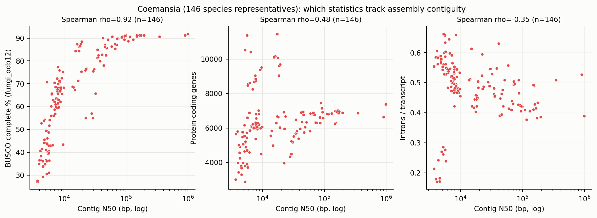
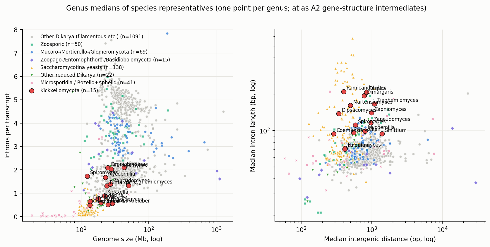
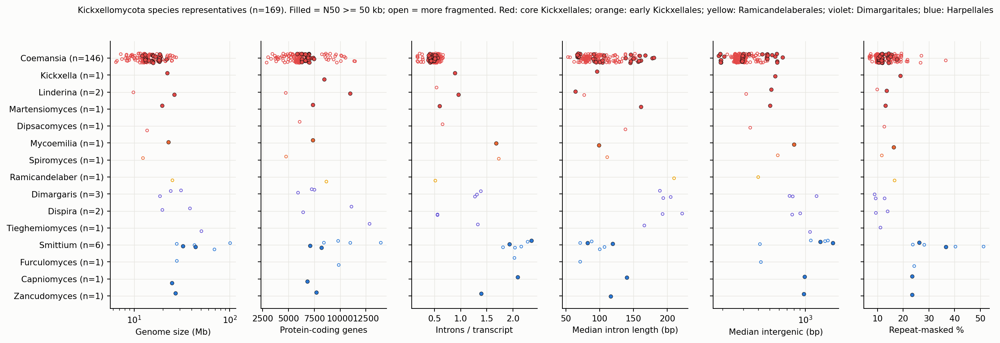
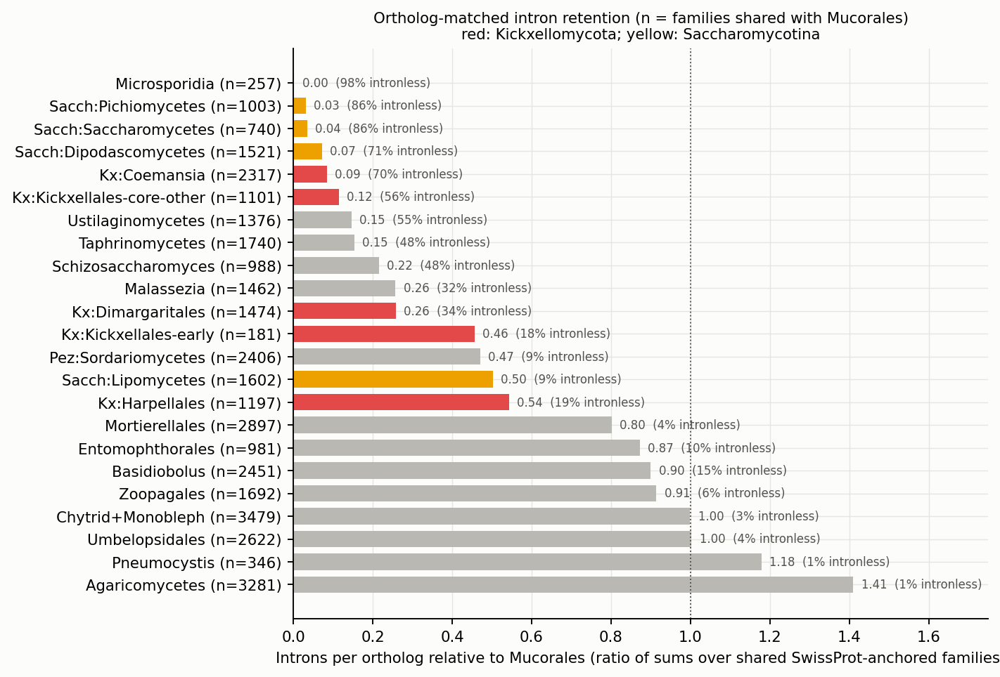
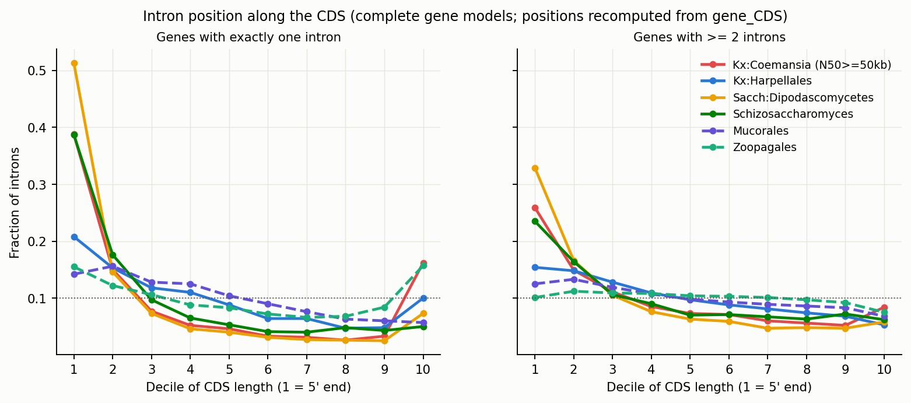
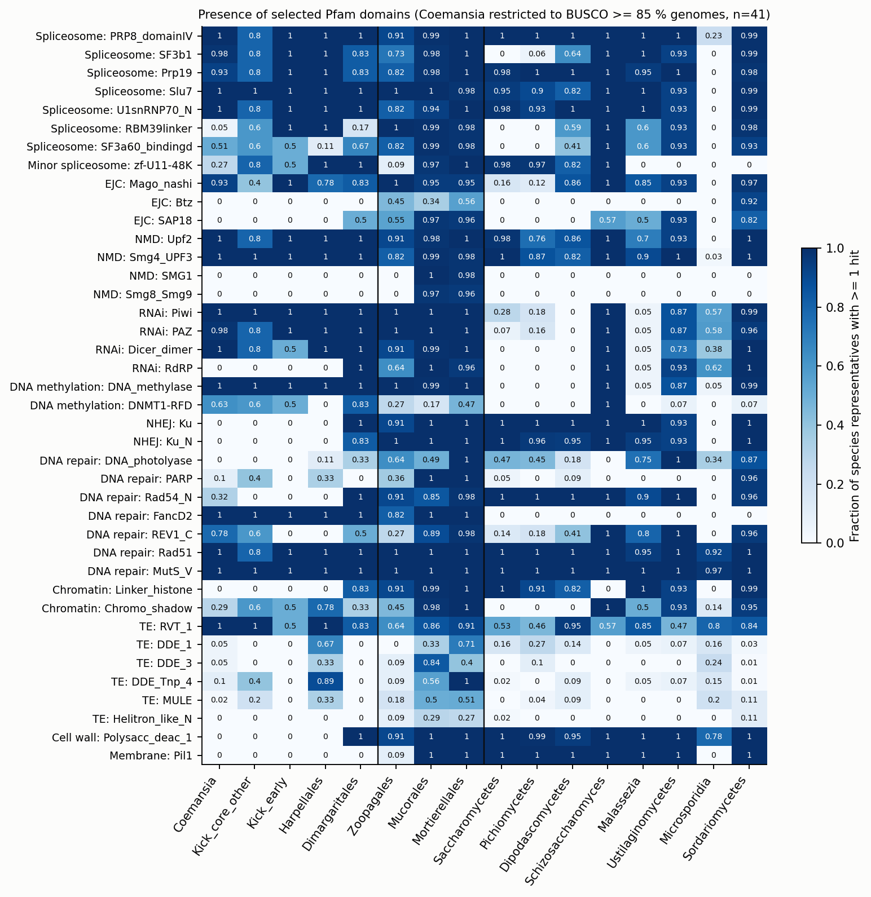
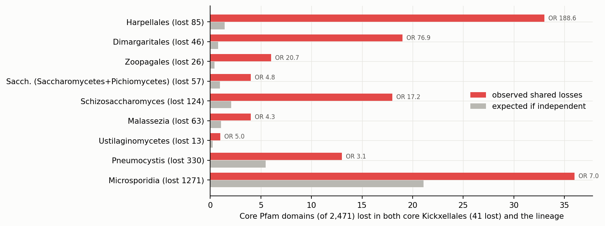

# Kickxellomycota genome and intron reduction in BFD, with a review of the atlas and a research agenda

> **Provenance.** Written by a Fable agent on 2026-11-10 (analysis A in [../../FUNCTIONAL_ANALYSES.md](../../FUNCTIONAL_ANALYSES.md)). Figures are in `figs/`, the TSVs behind every table and figure in `data/`, and the scripts in `scripts/`: `k1.py`–`k6_pf.py` build the MotherDuck `bfd_scratch.kx_*` tables, and the `make_*` scripts make the tables and figures. HPCC was down for maintenance, so the big-table work ran in MotherDuck. Some table inputs were transcribed by hand from query output; the `kx_*` scratch tables are authoritative. The `gene_introns.codon_position`/`codon_frame` off-by-one-exon bug reported here was independently confirmed on 2026-11-10. Citations marked "citation to verify" have not been checked.

Date: 2026-11-10. Data: BFD (23,680 genomes), MotherDuck database `bfd` plus atlas intermediates on HPCC (`atlas_data/`).
Nothing in the repo or in `bfd` was modified. Scratch objects are listed in section 5.

**Headline results**

- Reduction in Kickxellomycota is **not uniform**. It is concentrated in the core Kickxellales (*Coemansia*, *Kickxella*, *Linderina*, *Martensiomyces*, *Dipsacomyces*): genus-median 18.0 Mb, 7,363 genes, 0.65 introns per transcript, against 34.2 Mb, 11,460 genes and 3.83 introns per transcript in Mucorales (Cliff's delta = -1.00 for all three; 5 vs 36 genera). Harpellales (27.6 Mb, 2.06 introns) and Dimargaritales (29.1 Mb, 1.31 introns) are intermediate in introns and not small.
- Among orthologs shared with Mucorales, *Coemansia* keeps **8.5 %** of the introns (0.43 vs 5.05 per gene; 2,317 families; 95.6 % of families have fewer; 70 % are intronless). This is the same level as Dipodascomycetes yeasts (7.2 %) and close to Saccharomycetes (3.5 %). Coding length is unchanged (median CDS ratio 1.01).
- Intron loss and compaction are **separable**. Zoopagales are as small as core Kickxellales (17.2 Mb, 6,901 genes) and keep 3.3 introns per transcript with 50 bp introns. Core Kickxellales lost intron number, and the introns that remain are longer (96 bp median; 10-90 % range 34-377 bp in *Coemansia*), as in Saccharomycotina.
- The surviving introns in *Coemansia* sit at the 5' end of the CDS (39 % of sole introns in the first decile; Mucorales 14 %; Dipodascomycetes 51 %; *Schizosaccharomyces* 39 %). This is the pattern expected from reverse-transcriptase-mediated loss.
- The spliceosome, exon-junction core (Mago), NMD core (Upf1-3), Argonaute/Dicer and DNMT domains are **retained** in *Coemansia*; budding yeasts lost several of these. Losses specific to Kickxellales + Harpellales are Ku70/Ku80 (0 of 134 *Coemansia* genomes, 0 of 9 Harpellales), the canonical RdRP (PF05183), linker histone H1, photolyase, and chitin deacetylase. Secreted-enzyme repertoires are kept or expanded (AA9 in 134 of 134 *Coemansia*, tyrosinase, trypsin, laccase, GH18).
- Of 2,471 Pfam domains that are near-universal in sister lineages, core Kickxellales lack 41 and Saccharomycetes + Pichiomycetes lack 57; only 4 are shared (odds ratio 4.8, Fisher p = 0.014). The overlap with *Schizosaccharomyces* is larger (18 of 41; OR 17). So the intron phenotype converged with yeasts; the gene-content phenotype mostly did not.
- **Data bug found:** `gene_introns.codon_position` and `codon_frame` describe the *next* exon boundary, not the intron's own. Every sole intron gets the full protein length and phase 0. All phase and position results here were recomputed from `gene_CDS`.

Contents: (1) review of current ideas; (2) Kickxellomycota findings; (3) methods and justification; (4) research agenda; (5) scratch objects and scripts; (6) references.

---

## 1. Review of the current atlas and dashboard ideas

### 1.1 What is strong

- **Unit of replication is explicit.** One genome per species, then genus medians, removes the 1,309 *S. cerevisiae* / 952 *C. auris* problem. *Coemansia* shows why it is needed at genus level too: it supplies 146 of 169 Kickxellomycota species representatives.
- **H1 (quality) comes first**, and the BUSCO filter is class-relative. This is correct. A fixed 95 % cutoff would remove all yeasts and, as shown below, all Harpellales (BUSCO 71-81 % even at N50 of 0.6-2.5 Mb).
- **Effect sizes before p-values**, and several hypotheses are written as falsification tests (G3, S1) with stated polarity and outgroups.
- **Reference-bias controls in H2** (compare `q_len` within the same `sp_id`; model-organism anchors) are careful and reusable. I reused the same idea for intron counts.
- **Coverage honesty.** Table comments and the chat prompt now warn about targetP, Rfam and tmhmm.

### 1.2 What is missing

1. **No phylogeny, so no independent-contrast test.** Genus medians treat 279 Sordariomycetes genera as 279 independent points. Every cross-clade p-value in the atlas is anticonservative for this reason (Felsenstein 1985). The pending genus tree should feed PGLS for continuous traits and phylogenetic logistic regression for presence/absence.
2. **No orthogroups.** SwissProt anchoring works for conserved genes but covers early-diverging fungi poorly: with the strict gate *Coemansia* has 5,348 anchored families and Sordariomycetes 18,112. Gain/loss, HGT and orphan questions cannot be asked with the anchor proxy.
3. **Pooled groups hide the main signal.** "Zoopagomycota s.l." appears in G3 as one row with 1.90 introns per transcript (28 genera). It contains core Kickxellales at 0.5-0.9 and Zoopagales at 3.3. Early-diverging lineages need order-level rows.
4. **Q-n50 removes most of some clades.** With the full Q filter only 36 of 169 Kickxellomycota species representatives survive, and none of the Dimargaritales. The filter is right for statistics that depend on contiguity, but section 2.1 shows that intron density in *Coemansia* is only weakly tied to N50. A per-statistic sensitivity rule would keep more taxa.
5. **Presence/absence calls have no annotation-gap control.** H5 and HS_C1/C3 report "fraction of genera with domain X". A missing domain can be a missing gene model, a diverged sequence or a fragmented assembly. See agenda item A2 for a design.
6. **Intron phase and position columns are wrong in the source table** (section 2.4). Any future view using `codon_frame` would be affected. A2 `genome_gene_stats` does not use them, so the built H3 and G3 pages are not affected.
7. **Lifestyle is a genus label.** FungalTraits calls all Harpellales "animal_endosymbiont" and all Kickxellales "soil_saprotroph" (one "dung_saprotroph"). With one label per order, lifestyle and phylogeny are fully confounded inside Kickxellomycota.
8. **TE content is only `masked_pct`.** There is no repeat-class table (LTR, DNA, LINE), so "reduced TE load" can only be approximated from Pfam TE domains in gene models, which masking removes on purpose.

### 1.3 What is statistically weak

- **Multiple testing.** V30 and V55/V56 screen thousands of families. Report q-values (Benjamini and Hochberg 1995) and, better, a permutation null that shuffles group labels at genus level.
- **Small sister sets in G1/G3 pairs.** *Pneumocystis* vs *Schizosaccharomyces* + *Taphrina* is one genus against two. These are case descriptions, not tests; label them so.
- **Kruskal-Wallis across classes** mostly detects that classes differ, which is known. A variance partition (class, order within class, genus within order) is more informative. The mixed models in V51 already go this way.
- **Proteome-size scaling slopes (H5, S1)** are fitted on log-log genus medians. OLS slopes are biased toward zero when the x variable has error (gene count depends on annotation). Fit a major-axis or phylogenetic regression as well and report both.
- **BUSCO as a covariate** is ambiguous for reduced lineages: low BUSCO is both a quality signal and a biological outcome. In *Coemansia* BUSCO tracks N50 (rho = 0.92) and so is quality; in Harpellales it does not (77 % at Mb-scale N50) and so is biology or marker divergence. One covariate cannot serve both.

### 1.4 Dashboard and LLM-chat review (docs/WASM_PLAN.md, web/chat.html)

The plan's own problem list is accurate (model does not see results; chart spec too small; stale coverage now fixed). Additional gaps that this analysis ran into:

- **No label table in the queryable database.** Representatives, quality flags, growth form and lifestyle live only in `atlas_data/labels/genome_labels.parquet`. In MotherDuck I had to rebuild representatives in SQL. A chat user will not; they will count strains. Publish `genome_labels` (and the ext table) in the release and state the rule in the prompt.
- **No genome x Pfam matrix in the release.** Any presence/absence question scans 368 M rows. The atlas already has A7 (105 M rows, 355 MB). Publish it, plus a genus-level and an order-level presence table.
- **`SUBPHYLUM` is empty** and the phylum names are the split ones (Kickxellomycota, Zoopagomycota, Entomophthoromycota, Basidiobolomycota). A user asking for "Kickxellomycotina" or "Zoopagomycota" in the older broad sense gets nothing or the wrong set. Add a synonym table.
- **Key-form traps** (`protein_id` vs `gene_id` forms, `idp_summary` keys, strings 'TRUE'/'FALSE') should be normalized in the release, not explained in the prompt.
- **The prompt has no statistical guidance.** Add three rules: dedupe to representatives; report n genera and n species; never infer absence from tables that list only positives (tmhmm, signalp, targetP).

---

## 2. Kickxellomycota deep dive

### 2.1 Taxon sampling and assembly quality (observed)

Kickxellomycota in BFD: 190 genomes, 169 species representatives, 15 genera, 4 orders. Asellariales, Barbatosporales and Orphellales are **not sampled**. *Ramicandelaber* has one genome and CLASS is NULL.

| order | genus | species reps | N50>=50kb | FungalTraits lifestyle | Mb | genes | BUSCO med | BUSCO max | N50 med | introns/tx | intron bp | intergenic bp | masked % | GC % |
|---|---|---|---|---|---|---|---|---|---|---|---|---|---|---|
| Dimargaritales | Dimargaris | 3 | 0 | mycoparasite | 24.19 | 7249 | 78.9 | 87.2 | 24093 | 1.31 | 194 | 783 | 9.29 | 52.74 |
| Dimargaritales | Dispira | 2 | 0 | mycoparasite | 29.09 | 8760 | 78.3 | 88.3 | 14694.5 | 0.56 | 207.5 | 840.5 | 11.65 | 45.26 |
| Dimargaritales | Tieghemiomyces | 1 | 0 | mycoparasite | 50.6 | 12858 | 87.3 | 87.3 | 39667 | 1.33 | 166 | 1097 | 11.15 | 55.27 |
| Harpellales | Capniomyces | 1 | 1 | animal_endosymbiont | 24.84 | 6822 | 80.0 | 80.0 | 595855 | 2.09 | 140 | 989 | 23.43 | 37.35 |
| Harpellales | Furculomyces | 1 | 0 | animal_endosymbiont | 28.01 | 9866 | 80.9 | 80.9 | 45117 | 2.03 | 71.0 | 421 | 24.29 | 31.75 |
| Harpellales | Smittium | 6 | 2 | animal_endosymbiont | 43.31 | 9120 | 75.55 | 81.4 | 34920 | 2.1 | 94.0 | 1403.75 | 32.42 | 29.29 |
| Harpellales | Zancudomyces | 1 | 1 | animal_endosymbiont | 27.09 | 7684 | 75.0 | 75.0 | 2524970 | 1.39 | 116 | 974.5 | 23.43 | 35.61 |
| Kickxellales | Coemansia | 146 | 30 | soil_saprotroph | 13.55 | 6168.5 | 68.45 | 91.8 | 8674.5 | 0.49 | 94.0 | 289 | 11.35 | 49.84 |
| Kickxellales | Dipsacomyces | 1 | 0 | soil_saprotroph | 13.69 | 6078 | 74.3 | 74.3 | 15058 | 0.65 | 138 | 342 | 12.65 | 51.33 |
| Kickxellales | Kickxella | 1 | 1 | soil_saprotroph | 22.25 | 8462 | 89.6 | 89.6 | 607295 | 0.89 | 96.0 | 556.5 | 18.93 | 48.85 |
| Kickxellales | Linderina | 2 | 1 | soil_saprotroph | 18.02 | 7845 | 62.9 | 91.1 | 456162 | 0.75 | 70.5 | 416 | 11.72 | 53.33 |
| Kickxellales | Martensiomyces | 1 | 1 | soil_saprotroph | 19.69 | 7363 | 93.7 | 93.7 | 120991 | 0.6 | 161 | 501 | 13.01 | 54.34 |
| Kickxellales | Mycoemilia | 1 | 1 | soil_saprotroph | 22.86 | 7339 | 85.6 | 85.6 | 67558 | 1.67 | 99.0 | 804 | 16.29 | 40.21 |
| Kickxellales | Spiromyces | 1 | 0 | dung_saprotroph | 12.4 | 4762 | 44.1 | 44.1 | 4204 | 1.73 | 111 | 585 | 11.67 | 53.29 |
| Ramicandelaberales | Ramicandelaber | 1 | 0 | soil_saprotroph | 25.18 | 8671 | 76.9 | 76.9 | 41475 | 0.51 | 210 | 399.5 | 16.64 | 42.09 |

Table 1. Kickxellomycota species representatives by genus (medians; atlas A1/A2). 129 of the 146 *Coemansia* species are unnamed "sp." strains, so "species" here means strain-level NCBI taxa, and the 146 are not 146 independent lineages.

Quality facts that shape everything below:

- **Most *Coemansia* assemblies are fragmented**: median N50 8.7 kb, median BUSCO 68 %. Within *Coemansia*, BUSCO is a function of contiguity (Spearman rho = 0.92 with N50; n = 146). The 30 assemblies with N50 >= 50 kb have BUSCO 87-91 %. So low BUSCO in *Coemansia* is mostly assembly, and about 9 % of fungi_odb12 markers are missing even in the best assemblies.
- **Gene count and genome size are biased down by fragmentation** (rho with BUSCO 0.62 and 0.61). The high-quality subset gives 15.8 Mb and 6,809 genes (10-90 %: 13.1-18.7 Mb; 6,285-7,020 genes) instead of 13.6 Mb and 6,169.
- **Intron density is not an artefact of fragmentation.** Introns per transcript are slightly *higher* in fragmented assemblies (rho with N50 = -0.35); the high-quality subset has 0.43 (10-90 %: 0.39-0.51).
- **Harpellales BUSCO is low for a different reason**: 71-81 % at N50 up to 2.5 Mb, with 15-24 % missing. This is real loss or marker divergence, as in budding yeasts.
- **Partial gene models are common**: partial fraction 0.18 in *Coemansia*, 0.41-0.54 in Harpellales (even in the 2.5 Mb-N50 *Zancudomyces* assembly), against 0.10-0.14 in Pezizomycotina. Gene-structure statistics below use complete models where stated.
- Duplicated BUSCO of 24-55 % in *Dispira simplex*, *Tieghemiomyces* and *Linderina pennispora* indicates dikaryotic, co-cultured or contaminated assemblies. Their genome sizes (26-51 Mb) and gene counts are inflated. Dimargaritales are obligate mycoparasites usually sequenced with a host, so treat their sizes as upper bounds.



Figure 3. *Coemansia* species representatives: BUSCO and gene count rise with contig N50; introns per transcript do not.

### 2.2 How small, relative to sisters and to independently reduced lineages (observed)

| group | genera | species | Mb | genes | genes/Mb | BUSCO % | N50 bp | partial frac | introns/tx | intronless frac | intron bp | intergenic bp | protein aa | masked % | GC % |
|---|---|---|---|---|---|---|---|---|---|---|---|---|---|---|---|
| Kx:Coemansia | 1 | 146 | 13.6 | 6168 | 443 | 68.4 | 8674 | 0.18 | 0.49 | 0.66 | 94 | 289 | 348 | 11.4 | 49.8 |
| Kx:Kickxellales-core-other | 4 | 5 | 18.9 | 7604 | 412 | 81.9 | 288576 | 0.15 | 0.7 | 0.61 | 117 | 458 | 358 | 12.8 | 52.3 |
| Kx:Kickxellales-early | 2 | 2 | 17.6 | 6050 | 353 | 64.8 | 35881 | 0.2 | 1.7 | 0.4 | 105 | 694 | 352 | 14.0 | 46.8 |
| Kx:Ramicandelaber | 1 | 1 | 25.2 | 8671 | 344 | 76.9 | 41475 | 0.26 | 0.51 | 0.71 | 210 | 400 | 419 | 16.6 | 42.1 |
| Kx:Dimargaritales | 3 | 6 | 29.1 | 8760 | 307 | 78.9 | 24093 | 0.13 | 1.31 | 0.46 | 194 | 840 | 376 | 11.2 | 52.7 |
| Kx:Harpellales | 4 | 9 | 27.6 | 8402 | 279 | 77.8 | 320486 | 0.45 | 2.06 | 0.35 | 105 | 982 | 376 | 23.9 | 33.7 |
| Zoopagales | 8 | 11 | 17.2 | 6901 | 404 | 72.4 | 25152 | 0.24 | 3.29 | 0.3 | 50 | 272 | 369 | 14.2 | 47.9 |
| Entomophthorales | 6 | 9 | 60.9 | 18241 | 268 | 78.0 | 523022 | 0.55 | 2.35 | 0.37 | 52 | 1479 | 306 | 45.3 | 27.7 |
| Basidiobolus | 1 | 17 | 85.8 | 20372 | 232 | 94.9 | 18500 | 0.18 | 2.4 | 0.4 | 64 | 842 | 283 | 30.8 | 38.6 |
| Mortierellales | 14 | 55 | 38.1 | 12343 | 315 | 93.9 | 37852 | 0.24 | 2.81 | 0.2 | 105 | 625 | 427 | 16.1 | 48.2 |
| Mucorales | 36 | 106 | 34.2 | 11460 | 345 | 97.6 | 416376 | 0.36 | 3.83 | 0.15 | 64 | 619 | 360 | 20.0 | 37.5 |
| Umbelopsidales | 1 | 8 | 23.8 | 9284 | 392 | 99.0 | 1069908 | 0.14 | 4.06 | 0.15 | 70 | 459 | 388 | 9.0 | 42.5 |
| Glomeromycota | 15 | 31 | 130.5 | 27234 | 191 | 89.8 | 13758 | 0.57 | 3.14 | 0.19 | 82 | 1064 | 237 | 47.5 | 26.3 |
| Chytrid+Monobleph | 39 | 63 | 29.9 | 10257 | 363 | 83.8 | 93184 | 0.23 | 3.53 | 0.18 | 66 | 438 | 390 | 14.2 | 48.5 |
| Blastocladiomycota | 6 | 9 | 26.7 | 9687 | 355 | 78.8 | 285294 | 0.23 | 2.56 | 0.17 | 74 | 515 | 429 | 19.2 | 56.8 |
| Rozello+Aphelid | 4 | 5 | 14.8 | 5722 | 440 | 56.4 | 163245 | 0.17 | 1.09 | 0.5 | 50 | 252 | 352 | 11.1 | 43.8 |
| Microsporidia | 37 | 102 | 5.3 | 2539 | 546 | 8.9 | 77015 | 0.64 | 0.08 | 0.96 | 63 | 418 | 248 | 27.0 | 29.8 |
| Sacch:Saccharomycetes | 43 | 368 | 12.0 | 5191 | 455 | 76.2 | 282134 | 0.26 | 0.15 | 0.9 | 110 | 370 | 412 | 16.9 | 36.8 |
| Sacch:Pichiomycetes | 67 | 667 | 12.3 | 5429 | 440 | 81.4 | 464581 | 0.19 | 0.15 | 0.87 | 102 | 399 | 413 | 14.0 | 40.8 |
| Sacch:Dipodascomycetes | 22 | 211 | 12.4 | 5824 | 460 | 89.6 | 362967 | 0.18 | 0.38 | 0.73 | 66 | 428 | 396 | 11.6 | 45.1 |
| Sacch:Lipomycetes | 7 | 35 | 15.0 | 6040 | 381 | 92.2 | 336286 | 0.16 | 1.77 | 0.28 | 56 | 470 | 415 | 10.1 | 45.6 |
| Schizosaccharomyces | 1 | 7 | 11.6 | 4903 | 414 | 84.0 | 3863862 | 0.29 | 0.99 | 0.55 | 54 | 571 | 380 | 14.8 | 37.6 |
| Taphrinomycetes | 3 | 17 | 12.7 | 6115 | 472 | 91.1 | 321398 | 0.11 | 0.64 | 0.6 | 49 | 362 | 380 | 8.0 | 51.2 |
| Pneumocystis | 1 | 7 | 7.5 | 3340 | 431 | 86.5 | 480681 | 0.66 | 5.33 | 0.05 | 45 | 326 | 388 | 34.9 | 27.9 |
| Malassezia | 1 | 24 | 8.0 | 3964 | 490 | 90.6 | 1323904 | 0.16 | 1.27 | 0.39 | 26 | 123 | 426 | 15.2 | 59.0 |
| Ustilaginomycetes | 15 | 54 | 19.1 | 6507 | 345 | 97.0 | 791607 | 0.12 | 0.47 | 0.7 | 96 | 625 | 490 | 12.0 | 56.1 |
| Wallemia | 1 | 4 | 9.7 | 5058 | 524 | 86.9 | 145842 | 0.24 | 2.73 | 0.1 | 47 | 145 | 369 | 8.3 | 42.7 |
| Pez:Sordariomycetes | 279 | 1614 | 37.9 | 10756 | 290 | 99.3 | 691216 | 0.14 | 1.75 | 0.25 | 66 | 984 | 409 | 12.7 | 51.7 |
| Agaricomycetes | 323 | 1175 | 42.1 | 12324 | 296 | 98.4 | 308198 | 0.11 | 4.84 | 0.1 | 55 | 672 | 376 | 11.0 | 49.0 |

Table 2. Genus medians of species-representative values (all annotated representatives, no N50 filter; atlas A2). The Q-filtered version is in `data/grp_genus_medians_q.tsv`; for *Coemansia* it gives 15.8 Mb, 6,809 genes, 0.43 introns per transcript.



Figure 1. Left: genome size against introns per transcript, one point per genus. Right: intergenic distance against intron length.



Figure 2. Species representatives within Kickxellomycota.

Effect sizes for core Kickxellales (5 genera) against reference groups:

| reference | metric | n_focal_genera | n_ref_genera | median_focal | median_ref | median_diff | 95% CI | log2_ratio | cliffs_delta | mannwhitney_p |
|---|---|---|---|---|---|---|---|---|---|---|
| Mucorales | mb | 5 | 36 | 18.02 | 34.21 | -16.19 | -21.2 to -11.96 | -0.92 | -1.0 | 2.7e-06 |
| Mucorales | n_protein_coding | 5 | 36 | 7363 | 11459.5 | -4096.5 | -5828.5 to -2929.5 | -0.64 | -1.0 | 2.7e-06 |
| Mucorales | introns_per_transcript | 5 | 36 | 0.65 | 3.83 | -3.18 | -3.38 to -2.72 | -2.55 | -1.0 | 2.7e-06 |
| Mucorales | median_intron_len | 5 | 36 | 96.0 | 64.25 | 31.75 | 6.25 to 97.0 | 0.58 | 0.82 | 0.0036 |
| Mucorales | median_intergenic | 5 | 36 | 416 | 619.25 | -203.25 | -371.26 to -50.06 | -0.57 | -0.88 | 0.0018 |
| Mucorales | median_protein_len | 5 | 36 | 348.5 | 359.5 | -11.0 | -48.0 to 40.0 | -0.04 | -0.22 | 0.44 |
| Mucorales | masked_pct | 5 | 36 | 12.65 | 20.05 | -7.4 | -13.4 to -0.65 | -0.66 | -0.6 | 0.03 |
| Mortierellales | mb | 5 | 14 | 18.02 | 38.07 | -20.05 | -28.19 to -15.82 | -1.08 | -1.0 | 0.00017 |
| Mortierellales | n_protein_coding | 5 | 14 | 7363 | 12343.25 | -4980.25 | -6500.5 to -3874.5 | -0.75 | -1.0 | 0.00017 |
| Mortierellales | introns_per_transcript | 5 | 14 | 0.65 | 2.81 | -2.15 | -2.32 to -1.91 | -2.1 | -1.0 | 0.00017 |
| Mortierellales | median_intron_len | 5 | 14 | 96.0 | 105 | -9.0 | -34.5 to 56.0 | -0.13 | -0.2 | 0.55 |
| Mortierellales | median_intergenic | 5 | 14 | 416 | 625.25 | -209.25 | -357.0 to -48.0 | -0.59 | -0.89 | 0.0021 |
| Mortierellales | median_protein_len | 5 | 14 | 348.5 | 426.75 | -78.25 | -115.5 to -27.75 | -0.29 | -0.91 | 0.0012 |
| Mortierellales | masked_pct | 5 | 14 | 12.65 | 16.07 | -3.42 | -5.52 to 2.91 | -0.35 | -0.66 | 0.034 |
| Zoopagales | mb | 5 | 8 | 18.02 | 17.16 | 0.86 | -10.22 to 6.13 | 0.07 | 0.0 | 1 |
| Zoopagales | n_protein_coding | 5 | 8 | 7363 | 6901 | 462 | -3128.0 to 1775.0 | 0.09 | -0.05 | 0.94 |
| Zoopagales | introns_per_transcript | 5 | 8 | 0.65 | 3.29 | -2.64 | -3.45 to -1.43 | -2.33 | -1.0 | 0.0016 |
| Zoopagales | median_intron_len | 5 | 8 | 96.0 | 49.5 | 46.5 | 16.75 to 113.5 | 0.96 | 0.95 | 0.0031 |
| Zoopagales | median_intergenic | 5 | 8 | 416 | 272.25 | 143.75 | -156.0 to 362.0 | 0.61 | 0.3 | 0.44 |
| Zoopagales | median_protein_len | 5 | 8 | 348.5 | 369.25 | -20.75 | -58.25 to 36.5 | -0.08 | -0.2 | 0.61 |
| Zoopagales | masked_pct | 5 | 8 | 12.65 | 14.22 | -1.57 | -11.8 to 4.7 | -0.17 | -0.35 | 0.35 |
| Sacch:Saccharomycetes | mb | 5 | 43 | 18.02 | 11.98 | 6.04 | 1.44 to 10.44 | 0.59 | 0.86 | 0.00048 |
| Sacch:Saccharomycetes | n_protein_coding | 5 | 43 | 7363 | 5191 | 2172 | 796.5 to 3271.0 | 0.5 | 0.93 | 7e-05 |
| Sacch:Saccharomycetes | introns_per_transcript | 5 | 43 | 0.65 | 0.15 | 0.5 | 0.34 to 0.74 | 2.12 | 1.0 | 1.2e-06 |
| Sacch:Saccharomycetes | median_intron_len | 5 | 43 | 96.0 | 109.5 | -13.5 | -139.0 to 60.0 | -0.19 | -0.06 | 0.84 |
| Sacch:Saccharomycetes | median_intergenic | 5 | 43 | 416 | 369.5 | 46.5 | -86.0 to 189.5 | 0.17 | 0.13 | 0.64 |
| Sacch:Saccharomycetes | median_protein_len | 5 | 43 | 348.5 | 412 | -63.5 | -105.5 to -13.0 | -0.24 | -0.98 | 0.00039 |
| Sacch:Saccharomycetes | masked_pct | 5 | 43 | 12.65 | 16.9 | -4.24 | -7.9 to 2.95 | -0.42 | -0.31 | 0.27 |
| Sacch:Dipodascomycetes | mb | 5 | 22 | 18.02 | 12.4 | 5.62 | -0.3 to 9.85 | 0.54 | 0.56 | 0.055 |
| Sacch:Dipodascomycetes | n_protein_coding | 5 | 22 | 7363 | 5823.5 | 1539.5 | 96.0 to 2690.95 | 0.34 | 0.71 | 0.013 |
| Sacch:Dipodascomycetes | introns_per_transcript | 5 | 22 | 0.65 | 0.38 | 0.28 | 0.11 to 0.54 | 0.79 | 0.76 | 0.0063 |
| Sacch:Dipodascomycetes | median_intron_len | 5 | 22 | 96.0 | 66.0 | 30.0 | 4.5 to 95.0 | 0.54 | 0.56 | 0.057 |
| Sacch:Dipodascomycetes | median_intergenic | 5 | 22 | 416 | 428.25 | -12.25 | -155.0 to 130.38 | -0.04 | 0.0 | 1 |
| Sacch:Dipodascomycetes | median_protein_len | 5 | 22 | 348.5 | 396.5 | -48.0 | -85.5 to 3.0 | -0.19 | -0.73 | 0.01 |
| Sacch:Dipodascomycetes | masked_pct | 5 | 22 | 12.65 | 11.58 | 1.07 | -0.8 to 7.35 | 0.13 | 0.35 | 0.26 |

Table 3. Genus-level contrasts. Median difference with 95 % bootstrap interval (5,000 resamples of genera), log2 ratio of medians, Cliff's delta, Mann-Whitney p. Full table with Harpellales and Dimargaritales: `data/stats_genus_effect_sizes.tsv`.

Observed:

- **Core Kickxellales are half the size of Mucorales** (-16.2 Mb, CI -21.2 to -12.0) with 4,100 fewer genes and 3.2 fewer introns per transcript. Every core Kickxellales genus is below every Mucorales genus on all three (delta = -1.00).
- **They are the same size as Zoopagales** (delta 0.00 for Mb, -0.05 for genes) but have 2.6 fewer introns per transcript (delta -1.00).
- **Against Dipodascomycetes yeasts** they are slightly larger (18.0 vs 12.4 Mb; 7,363 vs 5,824 genes) with a little more intron (0.65 vs 0.38) and shorter median protein length (349 vs 397 aa; partly an effect of fragmented models).
- **Harpellales**: 27.6 Mb, 8,400 genes, 2.06 introns per transcript. Genome size is not reduced relative to Mucorales (delta -0.49, CI spans zero), gene count is (delta -0.96). They are AT-rich (GC 26-37 %) and repeat-rich (23-51 % masked; *Smittium mucronatum* 101 Mb).
- **Dimargaritales**: 19-31 Mb for the assemblies without heavy duplication, 6,000-7,500 genes, 1.3 introns per transcript, and the longest introns in the phylum (median 194 bp).
- **Early-branching Kickxellales** (*Mycoemilia*, *Spiromyces*) keep 1.7 introns per transcript. *Ramicandelaber* (0.51) and *Dispira* (0.56) are as intron-poor as *Coemansia*.
- Gene density in *Coemansia* (443 genes per Mb) matches Dipodascomycetes (460) and Saccharomycetes (455); Mucorales have 345.

Interpretation: there are at least two different states inside the phylum. Core Kickxellales are compact and intron-poor. Harpellales and Dimargaritales have fewer genes than Mucorales but ordinary or large genomes. Intron poverty appears in three places (core Kickxellales, *Ramicandelaber*, *Dispira*) that are not each other's closest relatives in the published phylogeny (Reynolds et al. 2023), so either the ancestor was intron-poor with later regain in Harpellales, *Mycoemilia* and *Spiromyces*, or loss happened several times. Regain on that scale is unusual in fungi (Stajich et al. 2007), so parallel loss is the simpler reading, but this needs the tree (agenda B1).

### 2.3 Is the intron deficit real? Ortholog-matched test (observed)

Raw introns per transcript depend on which genes a genome has and on fragmented models. I therefore compared intron counts inside the same SwissProt-anchored family (best hit with query and subject coverage >= 80 %, identity >= 30 %, complete gene model), with Mucorales as the common reference.

| grp | n_fam | mean_int | mean_int_mucor | ratio_sum | f_fewer | f_more | f_zero | f_zero_mucor | int_per_kb | int_per_kb_mucor | mean_ilen | mean_ilen_mucor | med_cds_ratio |
|---|---|---|---|---|---|---|---|---|---|---|---|---|---|
| Microsporidia | 257 | 0.01 | 5.06 | 0.002 | 0.977 | 0.0 | 0.984 | 0.023 | 0.01 | 4.09 | 577 | 68 | 0.952 |
| Sacch:Pichiomycetes | 1003 | 0.14 | 4.36 | 0.031 | 0.945 | 0.003 | 0.863 | 0.046 | 0.11 | 3.66 | 110 | 67 | 1.009 |
| Sacch:Saccharomycetes | 740 | 0.15 | 4.26 | 0.035 | 0.951 | 0.005 | 0.861 | 0.036 | 0.12 | 3.55 | 146 | 68 | 1.008 |
| Sacch:Dipodascomycetes | 1521 | 0.34 | 4.76 | 0.072 | 0.934 | 0.015 | 0.709 | 0.04 | 0.26 | 3.67 | 93 | 67 | 1.002 |
| Kx:Coemansia | 2317 | 0.43 | 5.05 | 0.085 | 0.956 | 0.007 | 0.699 | 0.025 | 0.3 | 3.62 | 172 | 67 | 1.01 |
| Kx:Kickxellales-core-other | 1101 | 0.58 | 5.07 | 0.115 | 0.955 | 0.01 | 0.561 | 0.022 | 0.4 | 3.55 | 185 | 67 | 1.007 |
| Ustilaginomycetes | 1376 | 0.74 | 5.09 | 0.146 | 0.895 | 0.038 | 0.546 | 0.029 | 0.48 | 3.52 | 149 | 67 | 1.058 |
| Taphrinomycetes | 1740 | 0.78 | 5.11 | 0.153 | 0.906 | 0.033 | 0.482 | 0.03 | 0.55 | 3.59 | 53 | 67 | 1.004 |
| Schizosaccharomyces | 988 | 1.08 | 4.99 | 0.216 | 0.868 | 0.044 | 0.478 | 0.037 | 0.75 | 3.43 | 80 | 67 | 0.997 |
| Malassezia | 1462 | 1.28 | 4.97 | 0.257 | 0.85 | 0.071 | 0.325 | 0.028 | 0.88 | 3.52 | 37 | 67 | 1.021 |
| Kx:Dimargaritales | 1474 | 1.33 | 5.17 | 0.258 | 0.883 | 0.051 | 0.341 | 0.022 | 0.89 | 3.59 | 213 | 67 | 1.013 |
| Kx:Kickxellales-early | 181 | 2.35 | 5.15 | 0.456 | 0.796 | 0.122 | 0.177 | 0.028 | 1.55 | 3.5 | 124 | 66 | 1.018 |
| Pez:Sordariomycetes | 2406 | 2.3 | 4.89 | 0.47 | 0.722 | 0.161 | 0.091 | 0.045 | 1.63 | 3.63 | 78 | 67 | 1.031 |
| Sacch:Lipomycetes | 1602 | 2.44 | 4.86 | 0.503 | 0.719 | 0.163 | 0.089 | 0.039 | 1.74 | 3.53 | 69 | 67 | 1.016 |
| Kx:Harpellales | 1197 | 2.68 | 4.94 | 0.543 | 0.758 | 0.119 | 0.188 | 0.026 | 1.89 | 3.58 | 116 | 67 | 1.008 |
| Mortierellales | 2897 | 4.19 | 5.23 | 0.802 | 0.548 | 0.217 | 0.038 | 0.026 | 2.85 | 3.67 | 138 | 67 | 1.015 |
| Entomophthorales | 981 | 4.54 | 5.21 | 0.872 | 0.496 | 0.34 | 0.098 | 0.024 | 3.0 | 3.39 | 55 | 68 | 0.995 |
| Basidiobolus | 2451 | 4.58 | 5.09 | 0.9 | 0.469 | 0.327 | 0.154 | 0.038 | 3.2 | 3.52 | 67 | 67 | 0.997 |
| Zoopagales | 1692 | 4.82 | 5.27 | 0.914 | 0.529 | 0.319 | 0.063 | 0.024 | 3.37 | 3.66 | 63 | 67 | 1.0 |
| Chytrid+Monobleph | 3479 | 5.07 | 5.07 | 0.999 | 0.403 | 0.435 | 0.027 | 0.035 | 3.57 | 3.61 | 78 | 67 | 1.008 |
| Umbelopsidales | 2622 | 5.07 | 5.05 | 1.003 | 0.312 | 0.33 | 0.039 | 0.035 | 3.49 | 3.5 | 76 | 67 | 1.002 |
| Pneumocystis | 346 | 6.25 | 5.3 | 1.179 | 0.301 | 0.549 | 0.009 | 0.014 | 4.06 | 3.4 | 49 | 67 | 0.998 |
| Agaricomycetes | 3281 | 6.94 | 4.92 | 1.41 | 0.216 | 0.639 | 0.009 | 0.039 | 5.0 | 3.67 | 58 | 67 | 1.025 |

Table 4. Families shared with Mucorales (reference families need >= 5 Mucorales species; focal group >= 2 species). `ratio_sum` = total introns in the focal group / total introns in Mucorales over the shared families. `f_fewer` = fraction of families with fewer introns than in Mucorales. `mean_ilen` = mean intron length (bp) in those genes. `med_cds_ratio` = median CDS length ratio.



Figure 5. Intron retention relative to Mucorales in shared families.

- *Coemansia*: 0.43 introns per ortholog against 5.05 (ratio 0.085); 95.6 % of 2,317 families have fewer introns and 0.7 % have more; 69.9 % are intronless (Mucorales 2.5 %).
- Other core Kickxellales 0.115; Dimargaritales 0.26; early Kickxellales 0.46; Harpellales 0.54; Mortierellales 0.80; Zoopagales 0.91; chytrids 1.00.
- CDS length is conserved (ratio 1.007-1.018 in all Kickxellomycota groups). The proteins did not shrink; the genes lost introns.
- Remaining introns are **longer**: mean 172 bp in *Coemansia* and 185 bp in other core Kickxellales against 67 bp in Mucorales. Saccharomycetes show the same (146 bp).

Interpretation: the deficit is in conserved, well-modelled genes and is as deep as in non-*Saccharomyces* budding yeasts. It cannot be explained by gene-content differences or by truncated models, because the comparison is within families and on complete models.

### 2.4 Fewer introns or shorter introns? Splice sites, phase, position (observed)

| group | introns/tx (complete) | introns/kb CDS | intronless frac | intron bp median (q10-q90) | GC-AG % | phase 0/1/2 | sole intron in first 10 % of CDS | sole intron in last 20 % | intron share of genome | CDS share of genome |
|---|---|---|---|---|---|---|---|---|---|---|
| Kx: *Coemansia* | 0.50 | 0.36 | 0.66 | 94 (34-377) | 3.67 | .37/.33/.30 | 0.29 | 0.38 | 3.7 % | 59.7 % |
| Kx: core Kickxellales, other | 0.71 | 0.54 | 0.60 | 117 (35-441) | 3.14 | .44/.30/.27 | 0.29 | 0.22 | 6.3 % | 55.6 % |
| Kx: early Kickxellales | 1.77 | 1.31 | 0.39 | 105 (80-181) | 3.53 | .43/.33/.24 | 0.23 | 0.26 | 8.2 % | 47.6 % |
| Kx: *Ramicandelaber* (1 genome) | 0.47 | 0.28 | 0.72 | 210 (29-1006) | 2.71 | .34/.27/.39 | 0.18 | 0.38 | 7.6 % | 57.0 % |
| Kx: Dimargaritales | 1.32 | 0.88 | 0.44 | 194 (126-291) | 0.99 | .45/.34/.21 | 0.25 | 0.26 | 7.2 % | 45.4 % |
| Kx: Harpellales | 2.14 | 1.39 | 0.33 | 105 (68-194) | 1.76 | .41/.36/.23 | 0.22 | 0.14 | 7.3 % | 44.2 % |
| Zoopagales | 3.27 | 2.46 | 0.28 | 50 (41-96) | 2.08 | .45/.32/.22 | 0.13 | 0.24 | 8.5 % | 55.4 % |
| Mortierellales | 2.86 | 1.85 | 0.19 | 105 (86-223) | 1.42 | .42/.34/.24 | 0.16 | 0.12 | 13.5 % | 49.6 % |
| Mucorales | 3.79 | 2.90 | 0.14 | 64 (54-90) | 1.22 | .42/.34/.24 | 0.15 | 0.11 | 9.8 % | 46.3 % |
| Chytrids + Monoblepharids | 3.72 | 2.42 | 0.17 | 66 (51-111) | 0.56 | .45/.33/.23 | 0.10 | 0.14 | 12.1 % | 57.2 % |
| Saccharomycetes | 0.13 | 0.08 | 0.89 | 123 (44-583) | 0.57 | .40/.34/.26 | 0.30 | 0.18 | 1.5 % | 69.1 % |
| Pichiomycetes | 0.15 | 0.09 | 0.88 | 96 (44-547) | 0.57 | .38/.35/.27 | 0.33 | 0.19 | 1.6 % | 67.8 % |
| Dipodascomycetes | 0.36 | 0.25 | 0.74 | 77 (45-279) | 0.47 | .41/.34/.26 | 0.52 | 0.10 | 1.8 % | 66.8 % |
| *Schizosaccharomyces* | 1.03 | 0.73 | 0.53 | 54 (42-147) | 0.26 | .43/.32/.25 | 0.39 | 0.09 | 3.6 % | 58.0 % |
| *Malassezia* | 1.29 | 0.78 | 0.38 | 26 (23-82) | 1.80 | .38/.32/.29 | 0.21 | 0.30 | 4.1 % | 77.5 % |
| Ustilaginomycetes | 0.48 | 0.26 | 0.71 | 95 (78-305) | 0.45 | .40/.34/.27 | 0.24 | 0.20 | 2.7 % | 60.4 % |
| Microsporidia | 0.18 | 0.21 | 0.94 | 63 (26-468) | 0.99 | .40/.30/.27 | 0.07 | 0.61 | 0.8 % | 49.9 % |
| Sordariomycetes | 1.79 | 1.22 | 0.24 | 65 (52-136) | 1.03 | .39/.34/.27 | 0.20 | 0.12 | 5.0 % | 42.5 % |
| Agaricomycetes | 5.14 | 3.61 | 0.08 | 55 (49-71) | 1.17 | .43/.31/.26 | 0.12 | 0.12 | 11.0 % | 41.5 % |

Table 5. Intron statistics, genus medians of per-genome values (MotherDuck scan of `gene_introns`, `gene_transcripts`, `gene_CDS` for 1,904 genomes; all species representatives of a genus, so the *Coemansia* row includes fragmented assemblies). Phase and position are recomputed from `gene_CDS`; see the bug note below. AT-AC introns have a genus-median frequency of 0 in every group.



Figure 4. Position of introns along the CDS in complete gene models, pooled over genomes of each group. *Coemansia* is restricted to the 30 assemblies with N50 >= 50 kb.

Observed:

- **The reduction is in intron number.** Introns per kb of CDS fall 8-fold from Mucorales to *Coemansia* (2.90 to 0.36). Median intron length is not shorter (94 vs 64 bp); the length distribution is wider (q90 377 vs 90 bp).
- **Two routes to a small genome.** Zoopagales and *Malassezia* shorten introns (50 and 26 bp) and intergenic spacers (272 and 123 bp) and keep intron number. Core Kickxellales and Saccharomycotina remove introns and keep the survivors long.
- **Intergenic distance does shrink** in core Kickxellales (416 bp vs 619 bp in Mucorales; delta -0.88). In *Coemansia* introns occupy 3.7 % of the genome (Mucorales 9.8 %) and CDS 59.7 % (Mucorales 46.3 %).
- **Co-variation inside *Coemansia*** (30 high-quality assemblies, Spearman): genome size with intergenic distance 0.92, with intron length 0.84, with gene count 0.76, with masked fraction 0.47; intron length with intergenic distance 0.89; introns per transcript with genome size -0.58. Across the 15 genera: genome size with intergenic 0.67, with introns per transcript 0.33; introns per transcript with intron length -0.34. So spacer length and intron length move together with genome size, and intron number is a separate axis that does not follow it.
- **5' bias.** In single-intron genes of the high-quality assemblies, 38.8 % of *Coemansia* introns are in the first tenth of the CDS, against 14.2 % in Mucorales, 16.4 % in Mortierellales and 15.5 % in Zoopagales. Dipodascomycetes have 51.3 %, Saccharomycetes 43.2 %, *Schizosaccharomyces* 38.7 %. Harpellales are intermediate (20.8 %).
- **A 3' excess also exists** in *Coemansia* (16 % of sole introns in the last decile), other core Kickxellales (20 %), Saccharomycetes (12 %) and most strongly Microsporidia (32 %). It is absent from Mucorales (6 %) and *Schizosaccharomyces* (5 %).
- **GC-AG introns are 3 times more frequent** in Kickxellales (3.1-3.7 % of introns; early Kickxellales 3.5 %) than in Mucorales (1.2 %); Harpellales 1.8 %, Dimargaritales 1.0 %.
- **Phase**: *Coemansia* has less phase 0 and more phase 2 (0.37/0.33/0.30) than Mucorales (0.42/0.34/0.24).

Interpretation:

- The 5' concentration of survivors matches the reverse-transcriptase model: recombination of the gene with a cDNA copy primed from the 3' end removes 3' introns first (Fink 1987; Mourier and Jeffares 2003; Roy and Gilbert 2006). The same signature in three independent intron-poor lineages (Saccharomycotina, *Schizosaccharomyces*, core Kickxellales) and its absence from the compact-but-intron-rich Zoopagales argue that the mechanism, not small size, is shared.
- The 3' excess, the excess of very short (< 50 bp, 16 %) and very long (> 500 bp, 6 %) introns, the high GC-AG share and the flattened phase distribution are all what spurious introns in evidence-poor gene models would produce. I cannot separate real from spurious without RNA-seq support. The true intron count in *Coemansia* is therefore probably **lower** than reported, which strengthens the main result but weakens anything said about splice-site composition.

**Bug in `gene_introns`.** For intron k of a transcript, `codon_position` and `codon_frame` hold the cumulative codon count and remainder at the end of exon k+1, not exon k. Check: `F0000039_000001-T1` has CDS segments of 91, 391, 1011 and 487 nt; intron 0 follows nt 91 (codon 30, phase 1) but the table gives codon 160, frame 2, which is the boundary after nt 482. For the last intron the table gives the full protein length (660) and frame 0. Consequence in the raw table: phase 0 is 58 % overall and rises as intron number falls (0.80 in *Coemansia*, 0.90 in Pichiomycetes), and `codon_position * 3 / CDS_length` is exactly 1 for every sole intron. The fix is to shift the values by one exon in the writer, or to recompute from `gene_CDS` as done here.

### 2.5 Gene families and Pfam domains (observed)

Presence is the fraction of species representatives with at least one hit of any reported strength. *Coemansia* is restricted to the 41 genomes with BUSCO >= 85 % for group comparisons; key absences were then checked in all 134 *Coemansia* genomes that have Pfam rows.



Figure 6. Presence of selected domains. The first five columns are Kickxellomycota; the next three are sister lineages.

**Intron and RNA-processing machinery**

- Core spliceosome domains are present in essentially all high-quality Kickxellomycota genomes: Prp8, SF3a/SF3b, Prp19, Slu7, U1-70K, Bud13, Cwc/Cwf, LSM. No Kickxellomycota-specific spliceosome loss was found. Budding yeasts lack hits to the SF3b1 domain model (0.00-0.06), `SF3a60_bindingd` and `RBM39linker`; *Coemansia* keeps SF3b1 (0.98) and has reduced `RBM39linker` (0.05; other core Kickxellales 0.6, Harpellales 1.0).
- Exon-junction complex: Mago nashi is present in *Coemansia* (0.93; 115 of 134 genomes) and nearly lost in Saccharomycetes and Pichiomycetes (0.16, 0.12). Btz is absent from all Kickxellomycota and all yeasts (Mucorales 0.34, Sordariomycetes 0.92). SAP18 is absent from Kickxellales and Harpellales (0 of 134 *Coemansia*), present in Mucorales (0.97).
- NMD: Upf1, Upf2, Upf3 retained. SMG1 and Smg8/9 are absent from all Kickxellomycota and Zoopagales and from every Dikarya group examined, but present in Mucorales and Mortierellales (0.96-1.00). This is not a Kickxellomycota-specific loss.
- Minor spliceosome: the U11-48K zinc finger is present in Harpellales and Dimargaritales (1.0), in 0.27 of *Coemansia* and 0.09 of Zoopagales. AT-AC introns are at zero frequency everywhere, so U12-type introns cannot be assessed from dinucleotides alone.

**RNAi and DNA methylation**

- Piwi, PAZ, ArgoN and Dicer domains are present throughout Kickxellomycota (Piwi 132 of 134 *Coemansia*; median 2 copies, 5 in *Kickxella*, *Linderina*, *Dispira*). The single *Ramicandelaber* genome has none of them.
- The canonical eukaryotic RdRP (PF05183) is **absent from all Kickxellales and Harpellales** (0 of 134 *Coemansia*, 0 of 9 Harpellales, 0 in *Mycoemilia*, *Spiromyces*) and present in all Dimargaritales (6 of 6). Mucorales 1.00, Mortierellales 0.96.
- DNA methyltransferase (PF00145) is present in every Kickxellomycota genus (133 of 134 *Coemansia*, 2-3 copies) and absent from Saccharomycotina.

**DNA repair and chromatin**

- **Ku70/Ku80 (PF02735, PF03731) are absent from all Kickxellales and Harpellales** (0 of 134 *Coemansia*; 0 of 9 Harpellales) and present in Dimargaritales (6 of 6) and *Ramicandelaber*, in all yeasts and in Mucorales/Mortierellales (1.00). The independent kingdom-wide survey run in parallel reports the same thing from the other direction: Ku in 4 % of 169 Kickxellomycota species against 85-100 % almost everywhere else; the 4 % are the Dimargaritales and *Ramicandelaber*. DNA ligase catalytic domains are present.
- Photolyase (PF00875, PF03441): 0 of 134 *Coemansia*, 1 of 9 Harpellales. PARP: 5 of 134 *Coemansia* (Mucorales 1.00; lost in yeasts as well). `Rad54_N` 0.32 in *Coemansia*, 0 in Harpellales.
- Fanconi-pathway domains (FancD2, FANCI) are retained in Kickxellomycota and get no hits in the Dikarya groups examined. Mismatch repair, Rad51, Rad52, XPA/XPG are retained.
- Linker histone H1 (PF00538): 0 of 134 *Coemansia*, 0 of 9 Harpellales; present in Dimargaritales, sisters and budding yeasts.

**Transposable-element domains in gene models**

- Median TE-domain proteins per genome: *Coemansia* 2, other core Kickxellales 4, Dimargaritales 2, Harpellales 16, Mucorales 34.5, Mortierellales 19, Glomeromycota 214. DNA-transposase domains (DDE_1, DDE_3, DDE_Tnp_4, MULE, Helitron) are in 0-10 % of *Coemansia* genomes and 30-100 % of Mucorales/Mortierellales genomes. Harpellales keep several (DDE_Tnp_4 0.89, DDE_1 0.67).
- Masked fraction: *Coemansia* 11.4 %, Mucorales 20.1 %, Harpellales 23.9 % (up to 51 %).

**Losses against a sister-defined core.** 2,471 Pfam domains are present in >= 90 % of Mucorales, Mortierellales, Sordariomycetes and Agaricomycetes representatives and >= 80 % of chytrids. Core Kickxellales lack 41 of them (<= 10 % of *Coemansia* and <= 20 % of other core genera); 15 are absent from the whole phylum. Besides those named above the list includes chitin deacetylase (`Polysacc_deac_1`, 0 against a median 23-27 copies in Mucorales and Mortierellales), Pil1 (eisosome), ATG11, `Sec15_C`, `MOR2-PAG1_C`, `Swi3`, `TRAP_alpha`, DENN, GMC oxidoreductase, UDP-glycosyltransferases (`UDPGT`, `Glyco_transf_28`), `Flavin_Reduct` and ELMO. Harpellales lack 85 (33 shared with core Kickxellales), Dimargaritales 46 (19 shared). The kingdom-wide survey, with a different core definition and the phylum taken as one group, counts 164 core domains absent in Kickxellomycota and finds the loss set most similar to Zoopagomycetes and Entomophthoromycetes; my order-level split shows the Zoopagales overlap is 6 of 41 (OR 21) and that the phylum-level number mixes three different order-level loss sets. Pfam richness: *Coemansia* 3,973 families, Harpellales 3,687, Mucorales 4,685, Saccharomycetes 4,135, Zoopagales 3,829.

**Depleted by copy number** (median copies *Coemansia* vs Mucorales / Mortierellales): F-box-like 13 vs 71 / 96; Kelch 7 vs 38 / 58; BTB 1 vs 12 / 13; HisKA 1 vs 9 / 13 and Response_reg 3 vs 18 / 19; G-alpha 2 vs 13 / 8; arrestin 1 vs 22 / 11; bZIP 8 vs 32 / 18; homeodomain 7 vs 26 / 11; aspartic peptidase 6 vs 24 / 29; PH 13 vs 48 / 30.

**Retained or expanded** (median copies *Coemansia* / other core Kickxellales / Harpellales vs Mucorales / Mortierellales): tyrosinase 9 / 9.5 / 12 vs 0 / 0; AA9 lytic polysaccharide monooxygenase 8 / 4 / 0 vs 0 / 0 (134 of 134 *Coemansia*; absent from Harpellales, Dimargaritales, *Ramicandelaber*, *Spiromyces*); trypsin 18 / 24 / 73 vs 2 / 2; fungal-specific kinase (`Pkinase_fungal`) 41 / 33 / 7 vs 15 / 5; type I fatty-acid-synthase domains 7-8 / 6-12 / 2.5 vs 1 / 1; multicopper oxidase 12 / 12 / 2 vs 7 / 5; GH18 chitinase 18 / 22 / 5 vs 12 / 10; GH46 chitosanase 5 / 9 / 0 vs 2 / 0; MatE 15 / 10 / 1.5 vs 5 / 2; `Transferase` (PF02458) 20 / 29 / 0 vs 2 / 2.

**Secretome, CAZymes, peptidases, TFs**

| group | genera | genes | secreted | secreted/1000 | CAZymes | CAZy/1000 | MEROPS | MEROPS/1000 | TFs | TF/1000 | TM>=2/1000 | median IDP frac |
|---|---|---|---|---|---|---|---|---|---|---|---|---|
| Kx:Coemansia | 1 | 6168 | 270 | 43.8 | 164 | 26.0 | 212 | 33.2 | 127 | 20.3 | 112.5 | 0.41 |
| Kx:Kickxellales-core-other | 4 | 7604 | 380 | 51.2 | 208 | 25.6 | 274 | 36.3 | 138 | 18.2 | 119.7 | 0.41 |
| Kx:Kickxellales-early | 2 | 6050 | 262 | 39.6 | 106 | 16.8 | 172 | 28.3 | 106 | 17.3 | 103.8 | 0.44 |
| Kx:Ramicandelaber | 1 | 8671 | 652 | 75.2 | 113 | 13.0 | 383 | 44.2 | 130 | 15.0 | 122.9 | 0.44 |
| Kx:Dimargaritales | 3 | 8760 | 479 | 63.0 | 138 | 16.5 | 282 | 33.2 | 158 | 19.4 | 104.6 | 0.41 |
| Kx:Harpellales | 4 | 8402 | 562 | 66.3 | 152 | 20.7 | 298 | 37.1 | 123 | 16.9 | 111.4 | 0.36 |
| Zoopagales | 8 | 6901 | 620 | 82.9 | 96.0 | 14.9 | 246 | 32.0 | 90.0 | 12.3 | 119.9 | 0.4 |
| Entomophthorales | 6 | 18241 | 1710 | 106.9 | 364 | 24.8 | 644 | 37.9 | 400 | 26.1 | 127.1 | 0.32 |
| Basidiobolus | 1 | 20372 | 1912 | 93.9 | 576 | 29.5 | 556 | 27.9 | 463 | 23.9 | 113 | 0.41 |
| Mortierellales | 14 | 12343 | 529 | 44.4 | 220 | 18.2 | 357 | 29.1 | 208 | 16.1 | 114.6 | 0.45 |
| Mucorales | 36 | 11460 | 425 | 34.2 | 272 | 23.7 | 318 | 27.1 | 324 | 28.3 | 112.2 | 0.37 |
| Umbelopsidales | 1 | 9284 | 420 | 45.2 | 360 | 39.0 | 296 | 32.7 | 250 | 27.1 | 127.6 | 0.36 |
| Glomeromycota | 15 | 27234 | 428 | 15.6 | 157 | 6.5 | 240 | 9.2 | 276 | 11.0 | 52.1 | 0.38 |
| Chytrid+Monobleph | 39 | 10257 | 422 | 43.1 | 202 | 20.5 | 298 | 28.0 | 139 | 13.1 | 121.9 | 0.38 |
| Blastocladiomycota | 6 | 9687 | 422 | 39.4 | 159 | 13.2 | 298 | 30.4 | 132 | 12.2 | 141.7 | 0.39 |
| Rozello+Aphelid | 4 | 5722 | 499 | 105.4 | 131 | 16.2 | 217 | 29.7 | 69.0 | 11.6 | 117.9 | 0.3 |
| Microsporidia | 37 | 2539 | 67.0 | 25.6 | 10.0 | 3.3 | 36.0 | 13.6 | 28.0 | 9.5 | 83.5 | 0.32 |
| Sacch:Saccharomycetes | 43 | 5191 | 118 | 22.5 | 127 | 24.2 | 162 | 32.1 | 124 | 23.7 | 120 | 0.32 |
| Sacch:Pichiomycetes | 67 | 5429 | 141 | 25.7 | 136 | 25.2 | 182 | 33.5 | 134 | 24.7 | 130.2 | 0.32 |
| Sacch:Dipodascomycetes | 22 | 5824 | 150 | 26.1 | 142 | 23.2 | 202 | 35.6 | 138 | 24.5 | 126.2 | 0.35 |
| Sacch:Lipomycetes | 7 | 6040 | 124 | 21.1 | 155 | 25.1 | 183 | 30.6 | 164 | 27.2 | 135.2 | 0.36 |
| Schizosaccharomyces | 1 | 4903 | 98.0 | 19.7 | 105 | 21.1 | 150 | 30.7 | 78.0 | 16.2 | 115.2 | 0.34 |
| Taphrinomycetes | 3 | 6115 | 254 | 43.2 | 168 | 27.2 | 204 | 32.7 | 121 | 19.1 | 116.3 | 0.37 |
| Pneumocystis | 1 | 3340 | 34.0 | 10.5 | 44.0 | 13.7 | 99.0 | 29.4 | 48.0 | 14.7 | 86.9 | 0.25 |
| Malassezia | 1 | 3964 | 112 | 28.7 | 75.0 | 19.1 | 148 | 36.6 | 58.0 | 14.0 | 111.6 | 0.38 |
| Ustilaginomycetes | 15 | 6507 | 332 | 51.5 | 194 | 29.6 | 191 | 30.1 | 138 | 21.4 | 121.8 | 0.46 |
| Wallemia | 1 | 5058 | 198 | 37.9 | 118 | 23.5 | 148 | 29.4 | 107 | 20.9 | 108.1 | 0.39 |
| Pez:Sordariomycetes | 279 | 10756 | 761 | 69.2 | 460 | 41.4 | 320 | 29.4 | 263 | 25.0 | 129 | 0.4 |
| Agaricomycetes | 323 | 12324 | 541 | 46.2 | 360 | 29.9 | 315 | 25.4 | 148 | 12.0 | 106.5 | 0.42 |

Table 6. Functional class counts, genus medians (atlas A5). "secreted" is the atlas `n_secreted_strict` count.

- Per 1,000 genes *Coemansia* has as many or more secreted proteins (43.8), CAZymes (26.0) and peptidases (33.2) as Mucorales (34.2, 23.7, 27.1) and about twice the secreted fraction of Saccharomycetes (22.5). TF density is lower than in Mucorales (20.3 vs 28.3 per 1,000) and similar to yeasts (23.7).
- Harpellales and Dimargaritales have higher secreted density (66 and 63 per 1,000), Zoopagales 83, with fewer CAZymes per 1,000 (20.7, 16.6, 14.9).

### 2.6 Convergence test against other reduced lineages (observed, then interpretation)

| lineage | n_lost_in_lineage | n_shared_with_core_Kickxellales | expected_if_independent | odds_ratio | fisher_p | jaccard |
|---|---|---|---|---|---|---|
| Harpellales | 85 | 33 | 1.41 | 188.6 | 3.8e-44 | 0.355 |
| Dimargaritales | 46 | 19 | 0.76 | 76.9 | 3.6e-24 | 0.279 |
| Zoopagales | 26 | 6 | 0.43 | 20.7 | 2.6e-06 | 0.098 |
| Sacch. (Saccharomycetes+Pichiomycetes) | 57 | 4 | 0.95 | 4.8 | 0.014 | 0.043 |
| Schizosaccharomyces | 124 | 18 | 2.06 | 17.2 | 9.1e-14 | 0.122 |
| Malassezia | 63 | 4 | 1.05 | 4.3 | 0.019 | 0.04 |
| Ustilaginomycetes | 13 | 1 | 0.22 | 5.0 | 0.2 | 0.019 |
| Pneumocystis | 330 | 13 | 5.48 | 3.1 | 0.0018 | 0.036 |
| Microsporidia | 1271 | 36 | 21.09 | 7.0 | 9.2e-07 | 0.028 |
| Sacch vs Schizosaccharomyces (reference pair) | 124 | 23 | 2.86 | 15.5 | 2.2e-16 | 0.146 |
| Sacch vs Malassezia (reference pair) | 63 | 10 | 1.45 | 9.5 | 9.4e-07 | 0.091 |
| Sacch vs Harpellales (reference pair) | 85 | 16 | 1.96 | 13.3 | 1.7e-11 | 0.127 |
| Sacch vs Zoopagales (reference pair) | 26 | 1 | 0.6 | 1.7 | 0.46 | 0.012 |

Table 7. Overlap of losses among the 2,471 core domains. First nine rows: core Kickxellales (41 lost) against each lineage. Last four rows: Saccharomycetes + Pichiomycetes (57 lost) against others, for scale. Two-sided Fisher exact test; no phylogenetic correction.



Figure 7. Observed and expected shared losses.

- Within the phylum, losses are strongly shared (Harpellales OR 189, Dimargaritales OR 77). That is common ancestry, not convergence.
- With budding yeasts the overlap is 4 domains (`PI31_Prot_N`, `ELMO_CED12`, `HEAT_SCC3-SA`, `MMtag`), OR 4.8. With *Schizosaccharomyces* it is 18 (OR 17), about the same strength as budding yeast against *Schizosaccharomyces* (OR 15.5).
- 36 of the 41 are also absent from Microsporidia (expected 21).

Interpretation (none of this is tested with a tree):

1. **Intron loss converged; gene content did not.** Core Kickxellales reached budding-yeast intron densities with the 5'-biased survivor pattern, while keeping machinery that budding yeasts lost (RNAi effectors, DNMT, Mago, SF3b1-type spliceosome, Fanconi pathway) and a filamentous saprotroph's secreted enzymes. A hypothesis that intron loss follows from loss of splicing or surveillance factors is not supported here.
2. **A candidate mechanism link: loss of NHEJ.** Kickxellales and Harpellales lack Ku. One model of intron dynamics ties intron gain to NHEJ repair of double-strand breaks and intron loss to homologous recombination (Farlow et al. 2011). A lineage without Ku repairs breaks by homologous recombination, which would favor cDNA-mediated loss and block NHEJ-dependent gain. Against a simple version: Harpellales also lack Ku and keep 2 introns per transcript, and budding yeasts lost introns with Ku present. Ku loss may be permissive rather than sufficient. This is testable (agenda B2).
3. **RdRP loss with Argonaute and Dicer retained** suggests RNAi in Kickxellales and Harpellales works without canonical amplification, or uses a diverged polymerase the Pfam model misses. With low TE-domain counts and 11 % masked sequence in *Coemansia* this fits a genome with little TE activity. Harpellales break the pattern (no RdRP, yet repeat-rich), so RdRP loss does not by itself predict TE load.
4. **Lifestyle.** The compact, intron-poor state belongs to free-living saprotrophs (core Kickxellales). The host-associated orders (Harpellales gut commensals, Dimargaritales mycoparasites) are not the reduced ones in genome size. This is the reverse of the "symbiont reduces" expectation, and unlike Microsporidia or *Pneumocystis*. AA9, laccases, tyrosinases and chitinases in *Coemansia* fit soil and dung saprotrophy; the trypsin expansion in Harpellales (median 73) fits a protein-rich insect-gut habitat. Because lifestyle is one label per order, this is a three-point observation, not a test.
5. **Chitin deacetylase absence** (and GH46 chitosanase presence in core Kickxellales) suggests a cell wall without the chitosan typical of Mucoromycota; Dimargaritales, which parasitize Mucorales, keep the deacetylase. Host contamination in Dimargaritales assemblies is an alternative explanation for that presence and for their Ku, RdRP and H1 hits; it must be excluded by checking the contigs.
6. **What compaction correlates with**: shorter intergenic spacers, fewer paralogs in signaling and regulation families (F-box, Kelch, BTB, two-component, G-alpha, bZIP), fewer TE-derived genes and less masked sequence. Mucorales paralog counts are raised by ancient whole-genome duplication, so part of the "depletion" is the reference group's expansion.

### 2.7 Caveats

- **Sample size.** 15 genera; core Kickxellales n = 5, Harpellales 4, Dimargaritales 3, *Ramicandelaber* 1 genome. *Coemansia* dominates and its 146 "species" are mostly unnamed strains. Asellariales are absent.
- **No tree.** Genus contrasts and Fisher tests treat genera and domains as independent. Shared ancestry inside the phylum is not removed. Polarity statements rely on published topologies.
- **Assembly quality.** 116 of 146 *Coemansia* assemblies have N50 < 50 kb. Counts and sizes are biased low; I report high-quality subsets alongside. Dimargaritales have no assembly with N50 >= 50 kb and two have 53-55 % BUSCO duplication.
- **Annotation.** Gene models appear to be evidence-poor for these taxa (partial fraction 0.18-0.54). Spurious or missed introns are likely; splice-site and phase results are the least reliable part. Intron counts are per annotated transcript.
- **Absence calls** are absences from the annotated proteome at Pfam sensitivity. A domain can be present in the genome but unannotated, or too diverged for the HMM (likely for Pil1, `Sec15_C`, ATG11, which are also "absent" from Entomophthorales and *Basidiobolus*). The Ku, RdRP, H1, photolyase and chitin-deacetylase absences hold in 134 of 134 *Coemansia* genomes and across 9 Harpellales, which rules out assembly gaps but not model failure or systematic annotation misses. Confirm with tblastn on assemblies and with profile searches seeded from Dimargaritales sequences.
- **TE domains** are counted in gene models after repeat masking, so they undercount TEs in every group; only the between-group ratio is informative, and only weakly.
- **SwissProt anchoring** favors conserved genes; the ortholog-matched intron result is about those genes.
- **Representatives in MotherDuck** were re-derived (best BUSCO, then N50, then LOCUSTAG) and may differ from atlas representatives in ties: 1,919 genomes against 1,944 from the atlas list, the difference being mostly Microsporidia.
- **Transcription.** Table 5, Figure 4, Figure 6 inputs and Table 4 were copied by hand from query output into TSV files; the scratch tables are the authority.

---

## 3. Methods and the reasons for each choice

**Representatives.** One genome per species: highest BUSCO complete, then highest N50 (atlas rule). Reason: strains of a species are pseudo-replicates. For large Dikarya classes one genome per genus (same ordering) was used in the MotherDuck scans to bound cost; early-diverging phyla and small reduced lineages kept all species representatives. Genus medians of species values were then taken, and group statistics are medians over genera. Reason: species within a genus share most of their history; the genus median is the atlas convention and a crude substitute for phylogenetic correction (Felsenstein 1985).

**Groups.** Kickxellomycota was split by order and, inside Kickxellales, into *Coemansia*, other core genera and the two early-branching genera (*Mycoemilia*, *Spiromyces*), following Reynolds et al. (2023). This split was made after seeing that the two genera differ in intron density, so it is descriptive and not a pre-specified contrast. Sister groups follow Spatafora et al. (2016).

**Quality filters.** Group tables are shown without Q-n50, because the filter removes 79 % of Kickxellomycota; Q-filtered values (Q-busco-rel, Q-dup <= 10 %, Q-n50 >= 50 kb) are given alongside. For *Coemansia* a "high-quality" subset was defined as N50 >= 50 kb (n = 30) for structure statistics and BUSCO >= 85 % (n = 41) for Pfam presence. 85 % was chosen because BUSCO plateaus at 87-91 % in contiguous *Coemansia* assemblies. Complete gene models (not partial, start and stop present; atlas Q-model) were required for intron position, phase and ortholog-matched counts.

**Normalization.** Functional classes are given as counts and per 1,000 proteins. Introns are given per transcript (comparable with the atlas) and per kb of CDS (removes gene-length effects). Pfam copy number is the number of proteins with a domain instance at i-Evalue <= 1e-5 (the atlas P-C threshold); presence uses any hit in the table, which is deliberately lenient so that absence is conservative. Density ratios use log2 with a pseudocount of 0.05 per 1,000.

**Effect sizes.** Median difference with a percentile bootstrap interval from 5,000 resamples of genera within each group (Efron 1979); log2 ratio of medians; Cliff's delta, the probability that a focal genus exceeds a reference genus minus the reverse (Cliff 1993). Cliff's delta was chosen because the distributions are skewed, n is 3-5 on one side, and it has a direct reading (delta = -1 means complete separation). Mann-Whitney p-values are given for screening only; with 5 vs 36 genera the smallest possible two-sided p is about 3e-6 and with 3 vs 8 about 0.012, so they mostly restate n.

**Correlations.** Spearman rank correlation, because relations are monotone but not linear and outliers (a 101 Mb *Smittium*) are present. No p-values are attached to the within-*Coemansia* matrix because the strains are not independent.

**Ortholog-matched introns.** Family = SwissProt best hit (`swissprot_best.sp_id`) with query coverage >= 80 %, subject coverage >= 80 %, identity >= 30 %. The atlas P-A proxy uses identity >= 40 %; I lowered it to 30 % because early-diverging fungi are far from SwissProt references, and kept both coverage gates so that truncated models cannot enter. Where a genome has several proteins for one `sp_id` the highest-bitscore one is used. Family values are medians over species within genus, then over genera within group. Mucorales is the reference because it is the best-sampled early-diverging order. The summary is a ratio of sums plus the fraction of families with fewer introns (a sign-test style statistic that needs no distributional assumption).

**Intron position and phase.** From `gene_CDS`: cumulative CDS length to each exon end, divided by total CDS length; phase = cumulative length mod 3. Decile histograms pool introns over the genomes of a group. Sole-intron genes are shown separately because they are the clearest test of 5' bias (Mourier and Jeffares 2003).

**Core-domain losses.** Core = present in >= 90 % of species representatives in each of Mucorales, Mortierellales, Sordariomycetes, Agaricomycetes and >= 80 % in chytrids. Requiring two early-diverging orders, two Dikarya classes and a zoosporic outgroup makes the core ancestral to Kickxellomycota under any published topology. Loss = present in <= 10 % of a group's representatives (<= 1 of 9 for Harpellales, <= 1 of 6 for Dimargaritales, <= 1 of 7 for *Schizosaccharomyces*, <= 20 % for the 5 other core Kickxellales). Overlap between two lineages' loss sets is tested with Fisher's exact test on the 2x2 table over the 2,471 core domains, and the Jaccard index is given as a similarity. Limits: domains are not independent (multi-domain proteins lose several at once: Ku and Ku_N; GMC_oxred_N and _C), which inflates significance; and shared ancestry is not modelled (Maddison and FitzJohn 2015). The odds ratios are for ranking lineages, not for inference.

**Why not PGLS, Dollo or Count here.** These need a tree. The atlas genus tree is not finished. They are specified in the agenda instead.

**Figures.** Colors are the categorical slots of the house reference palette in fixed order; the palette validator could not be run on this machine (broken Node install), so the reference values were used unchanged.

**SQL summary (MotherDuck, database `bfd`, results in `bfd_scratch`).**

```sql
-- representatives and groups (kx_genomes): species JOIN asm_stats JOIN busco_genome,
--   row_number() OVER (PARTITION BY SPECIES ORDER BY complete_pct DESC, N50_bp DESC, LOCUSTAG) = 1, CASE on PHYLUM/CLASS/ORDER for grp
-- one scan of each big table, restricted by left(id,8) IN (SELECT LOCUSTAG FROM kx_genomes):
CREATE TABLE kx_it  AS SELECT left(transcript_id,8) genome, transcript_id, "end"-"start"+1 ilen, upper(splice_5) s5, upper(splice_3) s3, ... FROM bfd.gene_introns WHERE ...;
CREATE TABLE kx_tx  AS SELECT ..., (NOT is_partial AND has_start_codon='TRUE' AND has_stop_codon='TRUE') q_model FROM bfd.gene_transcripts WHERE ...;
CREATE TABLE kx_junc AS  -- corrected intron positions
  SELECT transcript_id, ord, sum(len) OVER (PARTITION BY transcript_id ORDER BY ord) cum, sum(len) OVER (PARTITION BY transcript_id) tot, count(*) OVER (...) ncds
  FROM (SELECT transcript_id, "order" ord, "end"-"start"+1 len FROM bfd.gene_CDS WHERE ...) WHERE ord < ncds-1;
CREATE TABLE kx_pf  AS SELECT left(protein_id,8) genome, pfam_acc, count(DISTINCT protein_id) n_prot_any,
  count(DISTINCT protein_id) FILTER (WHERE domain_i_evalue<=1e-5) n_prot FROM bfd.pfam WHERE ... GROUP BY 1,2;
CREATE TABLE kx_sp_genome AS SELECT b.species_prefix genome, b.sp_id, arg_max(t.n_int,b.bitscore) n_int, arg_max(t.CDS_length,b.bitscore) cds_len, ...
  FROM bfd.swissprot_best b JOIN kx_txi t ON t.transcript_id=b.protein_id
  WHERE qcov_x10>=800 AND scov_x10>=800 AND pident_x10>=300 GROUP BY 1,2;
-- group level: zero-filled genome x pfam (CROSS JOIN), genus fraction/median, then group (kx_pf_grp); PIVOT to kx_pf_wide with core/lost flags
```

HPCC was in a maintenance reservation from 08:00 on 2026-11-10, so no `srun` job could start. Only small atlas intermediates (labels, A2, A5; a few MB) were read on the login node; all large-table work was moved to MotherDuck.

---

## 4. Research agenda

Priority order. Each item: question; tables and joins; design; pitfalls.

### Tier A: foundations that most other studies need

**A1. Orthogroups and a species tree for representatives.**
- Question: which gene families were gained, lost, expanded or contracted on which branches?
- Data: proteomes of the 1,669 genus representatives (already staged for PHYling in `atlas_data/phylo/`), plus all species representatives for focal clades. OrthoFinder (Emms and Kelly 2019), or profile-based assignment to a fixed orthogroup set so new genomes can be added without rerunning. Load `orthogroup(protein_id, og_id)` and `og_genome_counts(genome, og_id, n)` into the release.
- Design: species tree from the BUSCO-marker PHYling run. Gene-family birth-death with CAFE 5 (Mendes et al. 2020); Dollo parsimony (Farris 1977) and the phylogenetic birth-death model in Count (Csűrös 2010) for presence/absence. Dollo is the right first pass for complex domains that are unlikely to be regained; the likelihood model is needed where HGT is plausible. Report per-branch gain and loss with an error model for incomplete genomes.
- Pitfalls: fragmented assemblies create false losses and split genes create false gains; run with and without low-quality genomes. Dollo overestimates ancestral content when HGT or model failure exists. Deep fungal branching (order of the zygomycete phyla) changes loss counts; run on two alternative backbones.

**A2. A robust definition of "lineage-restricted" Pfam domains.**
- Question: which domains are confined to one clade, and is the restriction real?
- Data: `pfam` (or A7 `pfam_genome_matrix`; the kingdom-wide scratch tables `kw_pfam_matrix` and `kw_genus_pfam` already hold a representative-level matrix), `genome_labels`, `gene_proteins`, assemblies for tblastn.
- Design: for each domain and clade C compute sensitivity (fraction of genera in C with the domain) and specificity (fraction of all genera with the domain that are in C), at genus level. Call "restricted" if specificity >= 0.95 and the domain is in >= 3 genera and >= 50 % of genera of C. Guard against annotation gaps with three checks: (i) logistic model presence ~ clade + BUSCO + log N50 + partial fraction with a genus random effect; keep domains whose clade effect survives; (ii) re-examine outside-clade hits by score, HMM coverage and contig context, to separate contamination or HGT from true presence; (iii) for a sample of "absent" calls run the HMM against six-frame translations of the assembly. Estimate a false-absence rate per clade from domains carried by BUSCO genes, which should be present.
- Pitfalls: Pfam families are built from model organisms, so "restricted to Saccharomycetes" is partly ascertainment (seen above: `PRP9_N`, `Rtt106_N`, `SLX5_C`). Restriction at domain level can be fast divergence rather than gain (Weisman et al. 2020); phylostratigraphy errors are systematic (Moyers and Zhang 2015). Report restriction together with a divergence-rate proxy for the carrier proteins.

**A3. Fix and publish the shared tables.** `gene_introns` phase/position bug; `genome_labels` and `pfam_genome_matrix` in the release; order-level groups for early-diverging fungi; synonym table for higher taxa.

### Tier B: Kickxellomycota follow-ups

**B1. Ancestral-state reconstruction of intron density and of Ku/RdRP presence in the zygomycete grade.**
- Question: one intron-loss event with regain, or parallel losses in core Kickxellales, *Ramicandelaber* and *Dispira*?
- Data: tree from A1 with all 169 Kickxellomycota representatives plus Zoopagales, Entomophthorales, *Basidiobolus*; `kx_sp_genome` (ortholog-matched intron counts); intron positions from `gene_CDS`.
- Design: map intron presence/absence at homologous positions in aligned orthologs (needs protein alignments, not in the database) and reconstruct by Dollo and by likelihood. Shared intron positions between *Coemansia* and Harpellales answer the regain question directly. Continuous version: PGLS of introns per kb on Ku presence, genome size and lifestyle (Grafen 1989).
- Pitfalls: single genomes for *Ramicandelaber*, *Mycoemilia*, *Spiromyces*; spurious introns in models; the number of independent events is 2-4 whatever the method.

**B2. NHEJ loss and intron dynamics across fungi (convergence test with a tree).**
- Question: do lineages without Ku lose introns faster, or gain fewer?
- Data: genome x Pfam presence of PF02735, PF03731; A2 intron densities; tree.
- Design: find all independent Ku-loss events across the 1,669 genera (verify each by tblastn); test with phylogenetic logistic regression (Ives and Garland 2010) or Pagel's correlated-evolution test (Pagel 1994), and report the number of independent origins as the effective n (Maddison and FitzJohn 2015).
- Pitfalls: few events; Harpellales are a known counterexample; Ku is diverged in some fungi.

**B3. RNA-supported check of intron models in a panel.**
- Question: how many *Coemansia*, Harpellales and Dimargaritales introns are real, and are GC-AG and 3'-terminal introns artefacts?
- Data: public RNA-seq where it exists; splice-junction counts against annotated introns.
- Design: per genome, fraction of annotated introns with junction support by position decile, length class and splice dinucleotide; recompute Table 5 on supported introns only.
- Pitfalls: RNA-seq exists for few of these taxa; lowly expressed genes are unsupported whatever their truth.

**B4. RNAi without RdRP, and TE load with real repeat annotation.**
- Question: is TE content low in core Kickxellales, and what replaced RdRP?
- Data: assemblies; a repeat-class table per genome added to BFD as `repeats(genome, class, bp)`.
- Design: TE bp by class as a fraction of the assembly, with N50 as covariate (short-read assemblies collapse repeats, which biases *Coemansia* low). Compare contiguous assemblies only where possible. Search for diverged RdRP with profile-profile and structure search.
- Pitfalls: repeat collapse is the dominant artefact for exactly the fragmented genomes.

**B5. Cell-wall and secreted-enzyme evolution with lifestyle.**
- Question: are AA9, GH46, laccase, tyrosinase and trypsin expansions gains (HGT or duplication) on the Kickxellales and Harpellales branches?
- Data: `cazy_overview`, `merops`, `signalp_signal_peptide`, orthogroups, gene trees.
- Design: gene-tree/species-tree reconciliation for each family; HGT screen by alien index against a non-fungal database (Gladyshev et al. 2008) followed by phylogenetic confirmation; secretion status of each copy.
- Pitfalls: contamination in co-cultured mycoparasite assemblies and gut-fungus assemblies looks like HGT; require the candidate to sit on a contig with fungal neighbors.

### Tier C: database-wide studies

**C1. Function of lineage-restricted domains.**
- Question: what do clade-restricted domains do?
- Data: A3 `protein_pfam_arch` (ordered architectures), `signalp_signal_peptide`, `tmhmm`, `predgpi`, `wolfpsort`, `idp_summary`, `gene_info` coordinates for neighbors, `swissprot_best`.
- Design: for each restricted domain: (i) co-occurring domains and architecture diversity; (ii) secretion, TM and GPI fractions against the genome background (odds ratio per genome, then combined across genera); (iii) disorder fraction and length; (iv) genomic clustering with CAZymes or other restricted domains (permutation of gene order within contigs); (v) copy-number association with lifestyle by phylogenetic regression; (vi) structure-based annotation of a representative with Foldseek (van Kempen et al. 2024).
- Pitfalls: restricted domains are short, repetitive or disordered more often than average; lifestyle labels are genus-level.

**C2. Orphan and de novo gene candidates.**
- Question: how many proteins per genome have no Pfam, no SwissProt hit and no orthogroup outside the genus, and do they look like genes?
- Data: `gene_proteins` anti-joined to `pfam` and `swissprot_best`; orthogroups; `gene_transcripts` completeness; `idp_summary`; `codon_freq`.
- Design: per genome, count and classify no-hit proteins by length, completeness, disorder and codon usage relative to the genome's own. Model the count on assembly and annotation covariates first, so that the residual is biology. De novo candidates need a syntenic non-genic region in a sister species.
- Pitfalls: homology-detection failure explains most "orphans" (Weisman et al. 2020); annotation pipelines differ in how many short ORFs they keep.

**C3. HGT candidates at scale.**
- Data: needs hits against a non-fungal database (not in BFD). `swissprot_best.org_code` gives a first pass: proteins whose best hit is bacterial with high coverage.
- Design: alien index per protein, cluster candidates by orthogroup, require presence in >= 2 genomes of a clade and fungal flanking genes; confirm by phylogeny for the top families.
- Pitfalls: contamination; SwissProt is too small for a final call.

**C4. Convergent loss sets across all independent reductions.**
- Question: is there a common "reduction module"?
- Data: genus-level presence matrix; tree.
- Design: reconstruct losses per branch (A1), then test whether the same orthogroups are lost on independent reduction branches more often than expected from each orthogroup's own overall loss rate (a per-family rate null, not a uniform null). The Fisher tests in section 2.6 are the tree-free version.
- Pitfalls: dispensable families are lost everywhere; without the per-family null any two reduced lineages look convergent.

### Dashboard and chat additions that support these

1. **Release tables**: `genome_labels` (+ext), `pfam_genome_matrix`, `pfam_genus_presence`, orthogroup tables, `repeats`, corrected `gene_introns`, a `taxon_synonyms` table. The per-genome gene-structure summary (A2) should be queryable as is.
2. **Clade-contrast view**: pick a focal and a reference clade; get genus-level presence fractions, copy-number log2 ratios and Cliff's delta, with representative and quality filters as toggles and n shown. This is section 2.5 as a tool.
3. **Lineage-restriction browser**: sensitivity and specificity per domain per clade, with the annotation-gap flags from A2 and links to architectures and secretion fractions.
4. **Intron view**: position-decile and length histograms per clade, computed from `gene_CDS`.
5. **Chat/MCP path**: let the model see the result and revise; give it the label table and the representative rule; add stored macros (`rep_genomes()`, `genus_median(metric)`, `pfam_presence(clade)`) so that the right design is the easy query; warn on absence inference from positive-only tables; return n genera and n species with every aggregate; a cost guard that rejects unfiltered scans of the 250 M+ row tables and points to the summary table.

---

## 5. Scratch objects and scripts

MotherDuck database `bfd_scratch` (`bfd` untouched). Tables created by this work:

| table | content |
|---|---|
| `kx_genomes` | 1,919 genomes: group label, taxonomy, assembly and BUSCO statistics, representative flags |
| `kx_it`, `kx_tx`, `kx_txi` | introns (56.2 M rows) and transcripts (21.0 M) for those genomes; transcripts with intron counts |
| `kx_junc` | corrected intron positions from `gene_CDS` (cumulative nt, total, exon count) |
| `kx_scan_tx`, `kx_scan_intron`, `kx_scan_junc` | per-genome intron and gene-structure aggregates |
| `kx_pf`, `kx_nprot`, `kx_pfset` | genome x Pfam counts (8.1 M rows), proteome sizes, genome set used for Pfam contrasts |
| `kx_pf_grp`, `kx_pf_wide` | group x Pfam presence and copy statistics; wide table with core and loss flags |
| `kx_sp_genome`, `kx_sp_grp` | SwissProt-anchored family x genome intron counts; group medians |

Note: in `kx_scan_intron` the columns `ph0`, `ph1`, `ph2`, `relpos_*`, `f_first20*`, `f_last20`, `f_cpos_le60*` use the faulty source columns and should not be used; `kx_scan_junc` has the corrected values. The `kw_*` tables in the same database belong to the kingdom-wide survey and were not used or changed.

HPCC: `~/bigdata/tmp_kx_scratch/` (`g.parquet`, `scanset.parquet`, TSV summaries, two job scripts that never ran). `/tmp/kx_g_all.parquet` and `/tmp/kx_*.py` on the login node. One queued `srun` job was cancelled; nothing ran on compute nodes.

Files (relative to this report):

- `scripts/`: `k1.py`, `k2.py`, `k3_groups.py`, `k5.py` (atlas-intermediate summaries, run on HPCC); `k4_scan.py`, `k6_pf.py` (not run; replaced by the MotherDuck queries); `make_figures_and_stats.py` (figures 1-7, effect sizes, Fisher tests); `make_report_tables.py`; `report_part1.txt`, `report_part2.txt`, `assemble_report.py`.
- `data/`: `genus_medians_all.tsv`, `grp_genus_medians_all.tsv`, `grp_genus_medians_q.tsv`, `kx_species_reps.tsv`, `md_intron_position_deciles.tsv`, `md_ortholog_matched_introns.tsv`, `md_pfam_presence_curated.tsv`, `stats_genus_effect_sizes.tsv`, `stats_loss_overlap_fisher.tsv`, `stats_coemansia_hq_spearman.tsv`.
- `kx_figs/`: figures 1-7.

## 6. References

- Benjamini Y, Hochberg Y (1995) Controlling the false discovery rate: a practical and powerful approach to multiple testing. J R Stat Soc B 57:289-300.
- Cliff N (1993) Dominance statistics: ordinal analyses to answer ordinal questions. Psychol Bull 114:494-509. doi:10.1037/0033-2909.114.3.494
- Csűrös M (2010) Count: evolutionary analysis of phylogenetic profiles with parsimony and likelihood. Bioinformatics 26:1910-1912. doi:10.1093/bioinformatics/btq315
- Efron B (1979) Bootstrap methods: another look at the jackknife. Ann Stat 7:1-26. doi:10.1214/aos/1176344552
- Emms DM, Kelly S (2019) OrthoFinder: phylogenetic orthology inference for comparative genomics. Genome Biol 20:238. doi:10.1186/s13059-019-1832-y
- Farlow A, Meduri E, Schlötterer C (2011) DNA double-strand break repair and the evolution of intron density. Trends Genet 27:1-6. (citation to verify)
- Farris JS (1977) Phylogenetic analysis under Dollo's law. Syst Zool 26:77-88.
- Felsenstein J (1985) Phylogenies and the comparative method. Am Nat 125:1-15. doi:10.1086/284325
- Fink GR (1987) Pseudogenes in yeast? Cell 49:5-6. doi:10.1016/0092-8674(87)90746-X
- Gladyshev EA, Meselson M, Arkhipova IR (2008) Massive horizontal gene transfer in bdelloid rotifers. Science 320:1210-1213.
- Grafen A (1989) The phylogenetic regression. Phil Trans R Soc Lond B 326:119-157.
- Ives AR, Garland T (2010) Phylogenetic logistic regression for binary dependent variables. Syst Biol 59:9-26.
- Maddison WP, FitzJohn RG (2015) The unsolved challenge to phylogenetic correlation tests for categorical characters. Syst Biol 64:127-136.
- Mendes FK, Vanderpool D, Fulton B, Hahn MW (2020) CAFE 5 models variation in evolutionary rates among gene families. Bioinformatics 36:5516-5518.
- Mourier T, Jeffares DC (2003) Eukaryotic intron loss. Science 300:1393. doi:10.1126/science.1080559
- Moyers BA, Zhang J (2015) Phylostratigraphic bias creates spurious patterns of genome evolution. Mol Biol Evol 32:258-267.
- Pagel M (1994) Detecting correlated evolution on phylogenies: a general method for the comparative analysis of discrete characters. Proc R Soc Lond B 255:37-45.
- Põlme S et al. (2020) FungalTraits: a user-friendly traits database of fungi and fungus-like stramenopiles. Fungal Divers 105:1-16.
- Reynolds NK et al. (2023) Mycoparasites, gut dwellers, and saprotrophs: phylogenomic reconstructions and comparative analyses of Kickxellomycotina fungi. Genome Biol Evol 15:evac185. (citation to verify: volume and article number)
- Roy SW, Gilbert W (2006) The evolution of spliceosomal introns: patterns, puzzles and progress. Nat Rev Genet 7:211-221.
- Spatafora JW et al. (2016) A phylum-level phylogenetic classification of zygomycete fungi based on genome-scale data. Mycologia 108:1028-1046.
- Stajich JE, Dietrich FS, Roy SW (2007) Comparative genomic analysis of fungal genomes reveals intron-rich ancestors. Genome Biol 8:R223.
- van Kempen M et al. (2024) Fast and accurate protein structure search with Foldseek. Nat Biotechnol 42:243-246.
- Weisman CM, Murray AW, Eddy SR (2020) Many, but not all, lineage-specific genes can be explained by homology detection failure. PLoS Biol 18:e3000862.
