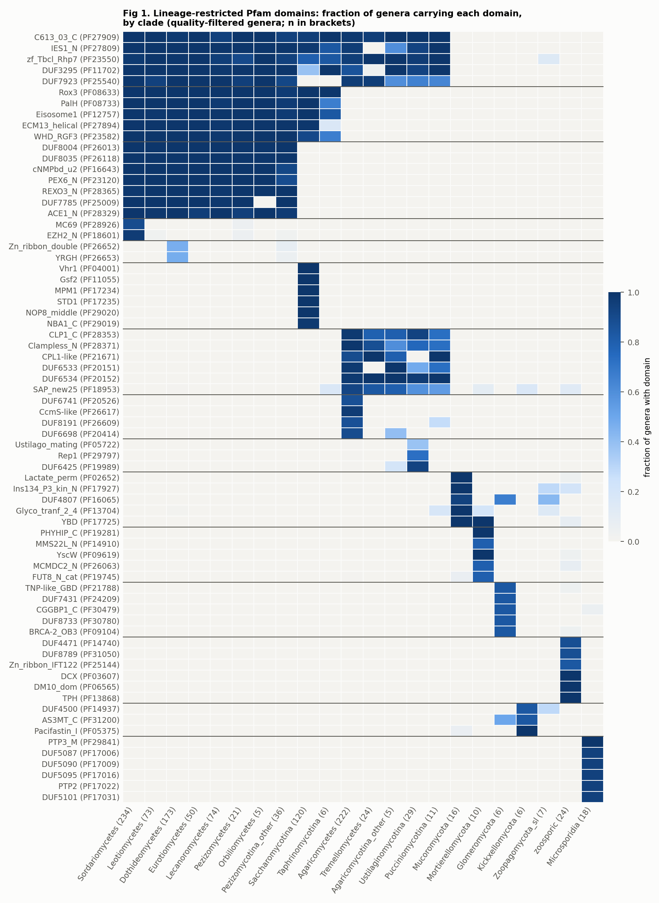
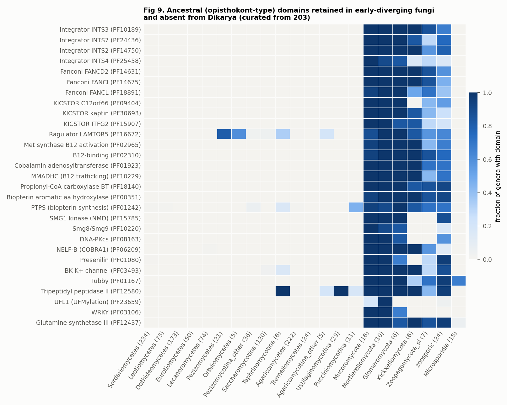
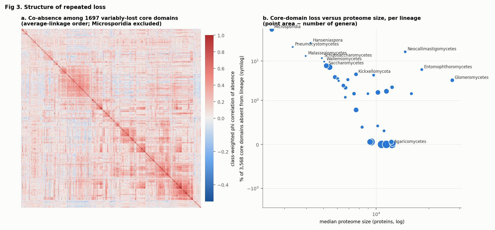
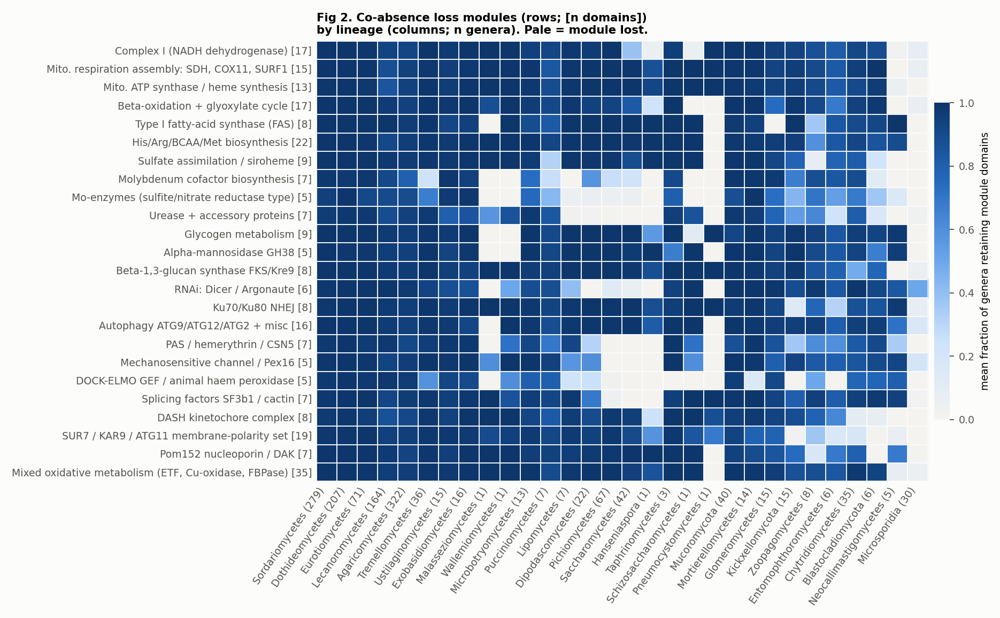
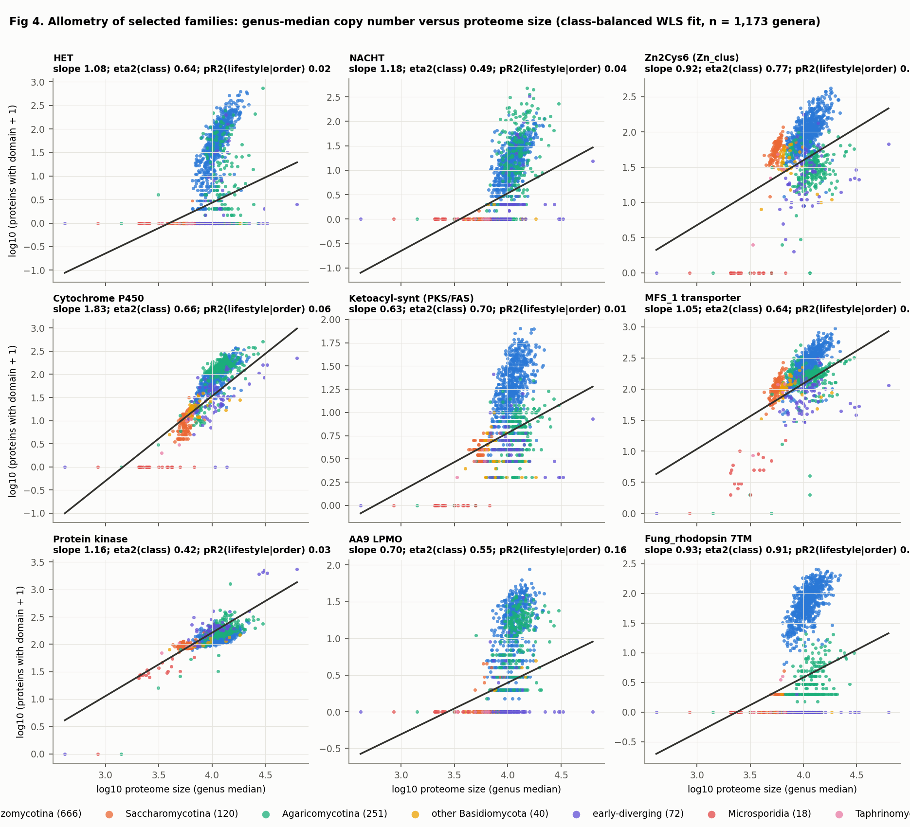
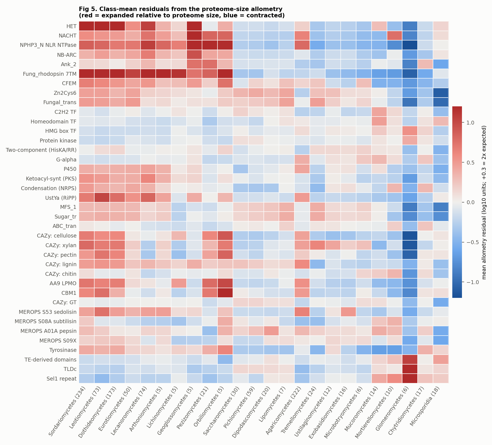
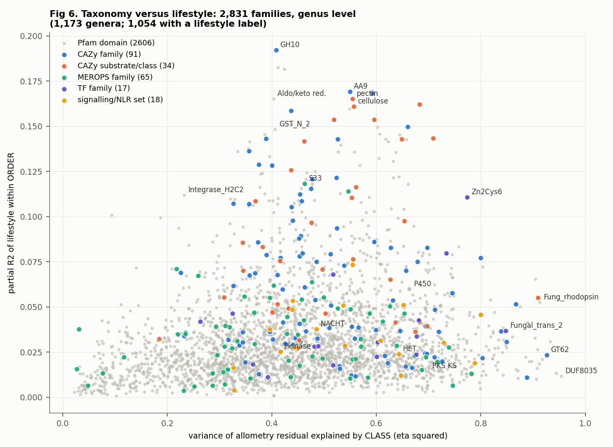
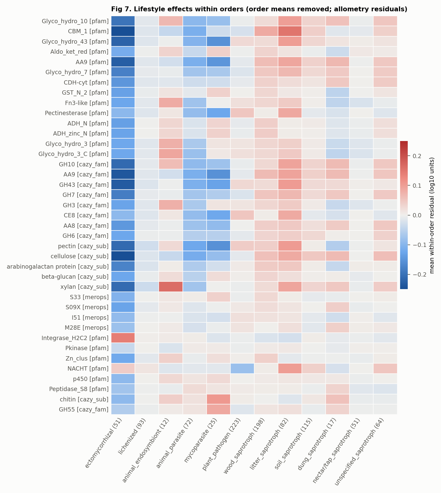
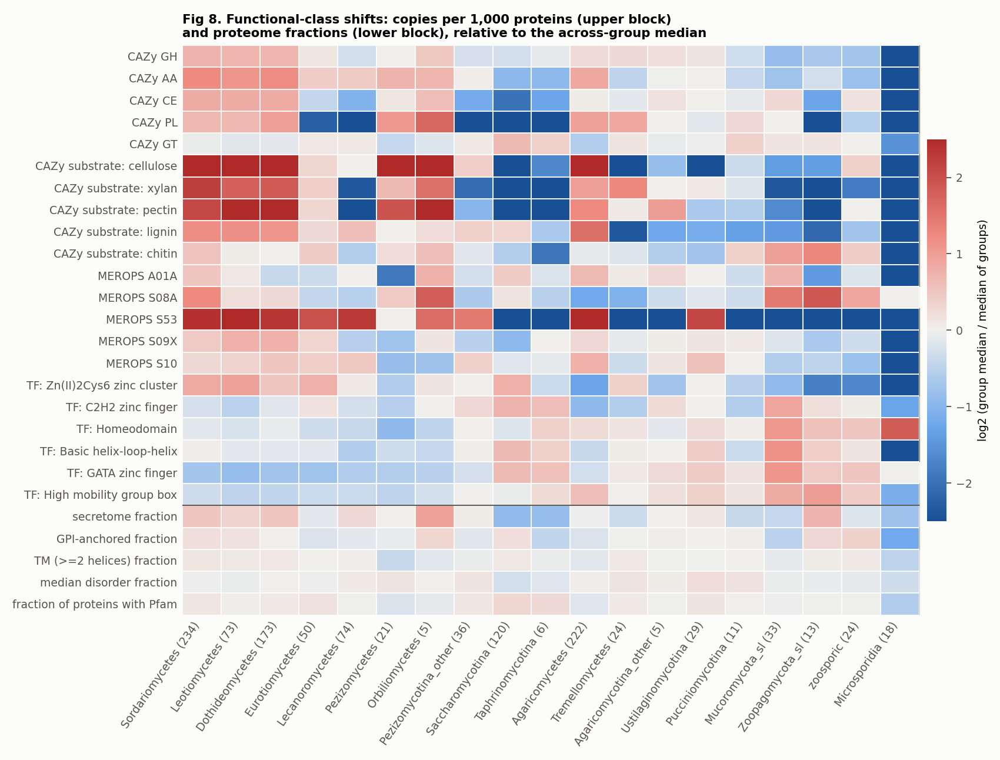

# Kingdom-wide survey of functional-domain gain, loss, expansion and contraction in BFD

> **Provenance.** Written by a Fable agent on 2026-11-10 (analysis B in [../../FUNCTIONAL_ANALYSES.md](../../FUNCTIONAL_ANALYSES.md)). Figures are in `figs/`, small result tables in `results/`, and the scripts in `scripts/` (run in order `step1_local.py` through `step6_checks.py`, then `make_tables.py` and `make_figures.py`). Set `KW_BASE` to a directory containing `kw/data` (the atlas parquet inputs, including `A7/pfam_genome_matrix.parquet`), `kw/work` and `fable_B_figs`. HPCC was down for maintenance, so this ran locally. Porting it to a SLURM job is still to do. Citations marked "citation to verify" have not been checked.

Agent B report, 2026-11-10. Exploratory and data-driven; it builds on the summary atlas (`docs/summary_atlas`) and does not repeat its hypothesis tests. Kickxellomycota is only noted in passing (another agent covers it).

## 1. Main findings

1. **Taxonomy dominates, lifestyle is a second-order signal.** After normalising copy number to proteome size, class membership explains a median 44 % of the between-genus variance of a domain family (2,606 Pfam families); lifestyle within order explains a median 2.4 %. CAZy families are the exception (median 5.4 %, up to 19 % for GH10).
2. **The Dikarya ancestor lost a block of ancestral, animal-like machinery.** 203 Pfam domains are present in at least half the genera of two or more early-diverging groups and in 5 % or fewer of 1,083 Dikarya genera; 191 of them are still in Mucoromycota s.l. They include cobalamin-dependent enzymes, Integrator, the Fanconi anaemia core, KICSTOR and biopterin metabolism (Fig 9).
3. **Reduced lineages lose the same genes.** Of 3,568 "core" domains, Microsporidia lack 62 %, *Hanseniaspora* 28 %, *Pneumocystis* 23 %, Neocallimastigomycetes 17 %, *Malassezia* 13 %, *Schizosaccharomyces* 12 %, *Wallemia* 10 %. Loss sets of independent lineages overlap about 3 to 11 times more than chance (log2 1.4 to 3.5), and co-absence clustering recovers pathway-level modules: complex I, beta-oxidation plus glyoxylate cycle, molybdenum cofactor, urease, glycogen metabolism, RNAi, type I fatty-acid synthase, sulfate assimilation (Fig 2).
4. **Fatty-acid synthase is absent from four independent host-dependent lineages**: 0 of 21 *Malassezia* species, 0 of 7 *Pneumocystis*, 0 of 31 Glomeromycota, 0 of 93 Microsporidia (and 27 % of 11 Zoopagomycota), against 93 to 100 % elsewhere.
5. **Pezizomycotina are defined by a non-self-recognition and surface-sensing expansion**: HET, NACHT, NPHP3-type NTPase, ankyrin, the "Fung_rhodopsin" 7TM family and CFEM. These are zero or near zero in every yeast lineage and in most Basidiomycota. Their copy number tracks class (eta squared 0.49 to 0.91), not lifestyle (partial R2 0.02 to 0.05).
6. **Ectomycorrhizal genera contract far more than plant-cell-wall enzymes.** Within orders they also carry fewer short-chain dehydrogenases, GSTs, aldo-keto reductases and methyltransferases and a smaller secretome, while kinases are unchanged and a transposon integrase domain is higher.
7. **Glomeromycota combine extreme expansions with metabolic loss**: median 2,020 protein-kinase proteins per genome (125 elsewhere), 734 Sel1, 622 TLDc; FAS and catalase absent.
8. **Many "lineage-restricted" domains are annotation history, not biology.** Saccharomycetales has 210 restricted domains from 13 genera because Pfam families were built on *S. cerevisiae* proteins. Restricted domains in zoosporic fungi are retained flagellar genes, not gains.

Caveat that applies to everything below: no test here is phylogenetically corrected (the genus tree is not finished). Clade-balanced weights, class and order fixed effects, and counts of independent lineages are used as stand-ins, and every pattern in section 8 names the tree-based test that should replace them.

## 2. Data and compute

- **Source.** Pfam hits (`bfd.pfam`, 368 M rows), CAZy (`cazy_overview`), MEROPS, `tf_inventory`, SignalP/TMHMM/PredGPI secretome counts, `idp_summary`. I reused the atlas intermediates that already aggregate these per genome (`atlas_data/A7/pfam_genome_matrix.parquet`, `A5/*`, `A4/genome_protein_summary.parquet`, `A11/pfam_trait_counts.parquet`, `labels/genome_labels*.parquet`), as instructed.
- **Compute.** The HPCC was in a full maintenance reservation (`20261110-Shutdown`) during this session, so no SLURM job could start. I copied the small atlas parquet files (about 370 MB) to the local scratchpad and ran everything there with DuckDB, numpy and scipy in a scratch virtualenv. Nothing heavy ran on the login node; my one pending job was cancelled.
- **MotherDuck scratch tables** (database `bfd_scratch`, all prefixed `kw_`; `bfd` was not modified):

| table | rows | content |
|---|---|---|
| `kw_rep_genomes` | 7,435 | one representative genome per species (annotated; best BUSCO complete, then N50, then ASMID); 1,669 genera. Same count as the atlas `is_representative` set |
| `kw_pfam_matrix` | 32,265,977 | genome x Pfam: distinct proteins and domain count, gate `domain_i_evalue <= 1e-5`, version suffix stripped; 7,392 genomes x 15,052 Pfams |
| `kw_genus_pfam` | 7,479,899 | genus x Pfam: share of representative genomes with the domain, mean copies (no quality filter); 1,654 genera |

These mirror the local matrices so the analyses can be rerun in SQL. The quality flags and FungalTraits labels exist only in the atlas parquet, so the statistics below were computed locally, not in MotherDuck.

SQL used for the matrix (one scan of `pfam`):

```sql
CREATE TABLE bfd_scratch.kw_rep_genomes AS
WITH g AS (SELECT s.*, b.complete_pct, a.N50_bp,
   row_number() OVER (PARTITION BY s.SPECIES ORDER BY b.complete_pct DESC NULLS LAST, a.N50_bp DESC NULLS LAST, s.ASMID) rk
  FROM bfd.species s LEFT JOIN bfd.busco_genome b USING (ASMID) LEFT JOIN bfd.asm_stats a USING (ASMID)
  WHERE a.annotation_status = 'annotated')
SELECT * FROM g WHERE rk = 1;

CREATE TABLE bfd_scratch.kw_pfam_matrix AS
SELECT split_part(protein_id,'_',1) AS genome, split_part(pfam_acc,'.',1) AS pfam_acc, any_value(pfam_id) AS pfam_id,
       count(DISTINCT protein_id) AS n_proteins, count(*) AS n_domains
FROM bfd.pfam
WHERE domain_i_evalue <= 1e-5 AND split_part(protein_id,'_',1) IN (SELECT LOCUSTAG FROM bfd_scratch.kw_rep_genomes)
GROUP BY 1, 2;
```

- **Scripts** (kept in `kw/` next to this report): `step1_local.py` (matrices), `lib.py` (loaders, clade groups), `step2_restricted.py`, `step3_loss.py`, `step4_expand.py`, `step5_classes.py`, `step6_checks.py`, `make_tables.py`, `make_figures.py`. Intermediate tables are in `kw/work/` (TSV and parquet). Figures are in `fable_B_figs/`.

## 3. Analytical choices and why

**Unit of replication: the genus.** Strains of a species and species of a genus are not independent, and BFD sampling is very uneven (1,614 Sordariomycetes species against 7 *Pneumocystis*). Following the atlas, one genome represents each species (best BUSCO, then N50), and species are collapsed to genus: a domain is *present in a genus* when at least 50 % of its representative genomes carry it, and the genus copy number is the median across those genomes (zeros included). The 50 % rule tolerates single missed gene models and single contaminated assemblies. Genera are still not independent (Felsenstein 1985, Am Nat 125:1), so I add clade weights or fixed effects everywhere and treat p-values as screening statistics only.

**Quality sets.** "q genera" (n = 1,173, from 4,743 genomes) pass the atlas filters: BUSCO complete at or above the 25th percentile of the genome's class, BUSCO duplication at most 10 %, N50 at least 50 kb. BUSCO is judged relative to class because low BUSCO is real biology in Microsporidia and budding yeasts (Simão et al. 2015, Bioinformatics 31:3210; Manni et al. 2021, Mol Biol Evol 38:4647). "All genera" (n = 1,654, 7,411 genomes) drops the three filters. Presence inside a clade is measured on q genera; absence outside a clade is checked on all genera, so a domain is not called restricted merely because low-quality genomes were removed. Loss analyses of single-genus lineages (*Malassezia*, *Pneumocystis*, *Schizosaccharomyces*, *Wallemia*, *Hanseniaspora*) use all genera and are confirmed at species level (Table 5).

**Domain gate.** Pfam hits with domain i-Evalue at most 1e-5, counting distinct proteins per family per genome (the atlas A7 rule). This is stricter than Pfam gathering thresholds for some families and looser for others; it was kept for consistency with the atlas (Pfam: Mistry et al. 2021, Nucleic Acids Res 49:D412).

**Clade groups.** PHYLUM, CLASS, ORDER as in `species`. SUBPHYLUM is empty, so I assigned subphylum-level groups from class names (Saccharomycotina = the seven budding-yeast classes in the current taxonomy; Taphrinomycotina; Pezizomycotina; Agaricomycotina; Ustilaginomycotina; Pucciniomycotina) and three pooled early-diverging groups (Mucoromycota s.l. = Mucoromycota, Mortierellomycota, Glomeromycota, Calcarisporiellomycota; Zoopagomycota s.l. = Zoopagomycota, Kickxellomycota, Entomophthoromycota, Basidiobolomycota; zoosporic = Chytridiomycota, Blastocladiomycota, Neocallimastigomycota, Monoblepharomycota, Olpidiomycota, Sanchytriomycota). The pooled groups are convenience groups, not clades.

**Lineage restriction (section 4).** For every clade with at least 5 q genera I computed the fraction of clade genera with the domain (`in`) and the number and fraction of genera outside with it (`out`, on all genera). A domain is *restricted* when in >= 0.8 and out <= 0.02; *strictly novel* when out = 0. Each domain is assigned to the clade maximising Youden's J = in - out (Youden 1950, Cancer 3:32), ties to the larger clade, so a domain is not reported at several nested ranks. This is a phylogenetic-profile screen (Pellegrini et al. 1999, PNAS 96:4285). It cannot tell gain from retention; that needs an outgroup or a gain/loss reconstruction.

**Ancestral and core sets (section 5).** Without a tree or non-fungal outgroups, ancestry is approximated by breadth: a domain is *ancestral* if present in at least 50 % of q genera in two or more of the three early-diverging groups, or in one of them plus both Ascomycota and Basidiomycota (4,475 domains). It is *core* if it is also in at least 70 % of Pezizomycotina and 70 % of Agaricomycetes genera (3,568 domains). Core domains are present on both sides of every deep split, so their absence from a nested lineage is a derived loss under Dollo-type reasoning (a complex character is unlikely to be regained; Farris 1977, Syst Zool 26:77). A lineage has *lost* a domain when at most 10 % of its genera carry it.

**Co-loss overlap.** For two lineages, observed shared losses are compared with the expectation under independence, n_A x n_B / 3,568, reported as log2(observed/expected). This is the hypergeometric mean; with these counts every reported enrichment has p far below 1e-10, so I report effect sizes only.

**Co-absence modules.** Among core domains absent from 3 to 70 % of genera (class-weighted), I computed the phi coefficient (Pearson correlation of binary absence vectors) across q genera, with each genus weighted by 1/(number of genera in its class) so that every class contributes equally. Microsporidia were excluded because they lack 62 % of all core domains and would create one giant module. Domains were clustered by average linkage (UPGMA; Sokal and Michener 1958, Univ Kansas Sci Bull 38:1409) on 1 - phi and cut at 0.35 (within-module phi about 0.65 or higher). Correlated presence/absence predicts functional linkage (Pellegrini et al. 1999), but raw correlation across species overstates the evidence because one ancient loss is inherited by many descendants (Barker and Pagel 2005, PLoS Comput Biol 1:e3; Maddison and FitzJohn 2015, Syst Biol 64:127). Class weighting reduces but does not remove this. For each module I therefore list the number of separate lineages in which it is absent; that count, not the correlation, is the evidence for convergence.

**Copy-number normalisation (section 6).** Functional categories scale with genome size as power laws with category-specific exponents (van Nimwegen 2003, Trends Genet 19:479; Molina and van Nimwegen 2009, Trends Genet 25:243), so "copies per 1,000 proteins" is biased whenever the exponent is not 1. For each family present in at least 25 % of genera with mean genus count of at least 1 (2,831 families of all types) I fitted log10(count + 1) = a + b log10(proteome size) across q genera by weighted least squares with class-balanced weights (as above), and used the residual. A residual of +0.3 means twice the copy number expected for that proteome size. The +1 pseudocount keeps zeros; it compresses families with low counts, which is why the ranking requires a median of at least 2 copies. Per-1,000 medians are also given (Table 9) because they are easier to read.

**Taxonomy versus lifestyle.** eta squared (between-group over total sum of squares) of residuals on CLASS (classes with fewer than 5 genera pooled). Lifestyle is the FungalTraits primary lifestyle of the genus (Põlme et al. 2020, Fungal Diversity 105:1); lifestyles with fewer than 10 q genera are pooled as "other"; 1,054 of 1,173 genera have a label. Its effect is the partial R2 after removing class or order fixed effects, obtained by residualising both the response and the lifestyle dummies on the taxon dummies (Frisch-Waugh-Lovell; Frisch and Waugh 1933, Econometrica 1:387; Lovell 1963, J Am Stat Assoc 58:993). Order fixed effects (orders with fewer than 3 genera pooled within class) are the conservative version: only genera that differ in lifestyle within the same order contribute. F-test p-values are corrected by Benjamini-Hochberg (Benjamini and Hochberg 1995, J R Stat Soc B 57:289). Fixed effects for taxonomic rank are a crude substitute for a phylogenetic covariance; they assume independence within orders.

**Functional classes.** CAZy family and substrate from dbCAN (Zhang et al. 2018, Nucleic Acids Res 46:W95; CAZy: Drula et al. 2022, Nucleic Acids Res 50:D571), MEROPS family of the best hit (Rawlings et al. 2018, Nucleic Acids Res 46:D624), TF family from `tf_inventory`, strict secretome (SignalP >= 0.9, at most one TM helix, no GPI anchor), GPI, TM and disorder from the atlas A5 tables. They pass through the same allometry and variance partition as Pfam families.

## 4. Lineage-restricted domains

1,838 clade-domain pairs meet in >= 0.8 and out <= 0.02; after assigning each domain to its best clade, 1,041 distinct domains are restricted to some clade (6.9 % of 15,052).



**Table 1. Restricted domains per clade** (best-clade assignment; `n_zero_outside` = present in >= 80 % of clade genera and in no genus outside, counted per clade without the best-clade rule).

| rank | clade | n_genera_q | n_genera_all | n_restricted | DUF_share | n_zero_outside |
|---|---|---|---|---|---|---|
| order | Saccharomycetales | 13 | 24 | 210 | 0.02 | 44 |
| subphylum-level group | Pezizomycotina | 666 | 888 | 108 | 0.34 | 47 |
| phylum | Chytridiomycota | 17 | 36 | 89 | 0.03 | 1 |
| order | Spizellomycetales | 5 | 6 | 85 | 0.07 | 0 |
| phylum | Ascomycota | 792 | 1041 | 71 | 0.18 | 69 |
| class | Chytridiomycetes | 17 | 35 | 61 | 0.02 | 0 |
| phylum | Glomeromycota | 6 | 15 | 58 | 0.10 | 4 |
| subphylum-level group | Saccharomycotina | 120 | 145 | 55 | 0.04 | 31 |
| phylum | Mortierellomycota | 10 | 14 | 46 | 0.09 | 2 |
| subphylum-level group | zoosporic | 24 | 50 | 38 | 0.13 | 28 |
| order | Rhizophydiales | 6 | 7 | 33 | 0.12 | 0 |
| subphylum-level group | Mucoromycota_sl | 33 | 70 | 26 | 0.08 | 0 |
| phylum | Microsporidia | 18 | 30 | 24 | 0.38 | 14 |
| phylum | Mucoromycota | 16 | 40 | 21 | 0.05 | 0 |
| subkingdom | Dikarya | 1083 | 1471 | 17 | 0.18 | 6 |
| class | Saccharomycetes | 30 | 43 | 14 | 0.00 | 10 |
| class | Mucoromycetes | 14 | 36 | 14 | 0.21 | 0 |
| order | Serinales | 46 | 51 | 12 | 0.17 | 4 |
| class | Pichiomycetes | 59 | 67 | 8 | 0.12 | 1 |
| class | Orbiliomycetes | 5 | 6 | 6 | 0.00 | 0 |
| phylum | Basidiomycota | 291 | 430 | 6 | 0.33 | 3 |
| order | Phaffomycetales | 15 | 15 | 5 | 0.00 | 0 |
| phylum | Kickxellomycota | 6 | 15 | 5 | 0.40 | 0 |
| class | Agaricomycetes | 222 | 322 | 4 | 0.75 | 1 |
| class | Ustilaginomycetes | 12 | 15 | 4 | 0.25 | 0 |
| class | Geoglossomycetes | 5 | 6 | 3 | 0.00 | 0 |

**Table 2. Top restricted domains per clade** (lowest outside count first).

| clade | genera (q) | Pfam | name | description | frac genera in clade (q) | frac in clade (all) | genera outside with domain (of all) | median copies |
|---|---|---|---|---|---|---|---|---|
| Dikarya | 1083 | PF27909 | C613_03_C | C613.03 C-terminal domain | 0.98 | 0.96 | 0 | 1.00 |
| Dikarya | 1083 | PF27809 | IES1_N | Ino eighty subunit 1 N-terminal domain | 0.96 | 0.95 | 0 | 1.00 |
| Dikarya | 1083 | PF23550 | zf_Tbcl_Rhp7 | DNA repair protein rhp7 treble clef domain | 0.95 | 0.94 | 0 | 1.00 |
| Dikarya | 1083 | PF11702 | DUF3295 | Protein of unknown function (DUF3295) | 0.88 | 0.87 | 0 | 1.00 |
| Dikarya | 1083 | PF25540 | DUF7923 | Domain of unknown function (DUF7923) | 0.85 | 0.85 | 0 | 2.00 |
| Ascomycota | 792 | PF08633 | Rox3 | Rox3 mediator complex subunit | 1.00 | 0.98 | 0 | 1.00 |
| Ascomycota | 792 | PF08733 | PalH | PalH/RIM21 | 0.99 | 0.99 | 0 | 1.00 |
| Ascomycota | 792 | PF12757 | Eisosome1 | Eisosome protein 1  | 0.99 | 0.97 | 0 | 1.00 |
| Ascomycota | 792 | PF27894 | ECM13_helical | ECM13-like, helical domain | 0.99 | 0.98 | 0 | 1.00 |
| Ascomycota | 792 | PF23582 | WHD_RGF3 | RGF3 winged helix domain | 0.98 | 0.97 | 0 | 1.00 |
| Pezizomycotina | 666 | PF26013 | DUF8004 | Domain of unknown function (DUF8004) | 1.00 | 1.00 | 0 | 3.00 |
| Pezizomycotina | 666 | PF26118 | DUF8035 | Family of unknown function (DUF8035) | 1.00 | 1.00 | 0 | 4.00 |
| Pezizomycotina | 666 | PF16643 | cNMPbd_u2 | Unstructured region on cNMP-binding protein | 0.99 | 0.98 | 0 | 1.00 |
| Pezizomycotina | 666 | PF23120 | PEX6_N | Peroxisomal ATPase 6 N-terminal | 0.99 | 0.98 | 0 | 1.00 |
| Pezizomycotina | 666 | PF28365 | REXO3_N | RNA exonuclease 3 N-terminal domain | 0.99 | 0.98 | 0 | 1.00 |
| Pezizomycotina | 666 | PF25009 | DUF7785 | Domain of unknown function (DUF7785) | 0.99 | 0.99 | 0 | 1.00 |
| Pezizomycotina | 666 | PF28329 | ACE1_N | Zinc finger transcription factor ace1 N-terminal domain | 0.99 | 0.97 | 0 | 1.00 |
| Sordariomycetes | 234 | PF28926 | MC69 | Secreted virulence factor MC69 | 0.89 | 0.87 | 2 | 1.00 |
| Sordariomycetes | 234 | PF18601 | EZH2_N | EZH2 N-terminal domain | 0.97 | 0.95 | 5 | 1.00 |
| Pleosporales | 82 | PF26652 | Zn_ribbon_double | Probable double zinc ribbon domain | 0.90 | 0.91 | 12 | 2.00 |
| Pleosporales | 82 | PF26653 | YRGH | YRGH domain | 0.89 | 0.88 | 13 | 1.00 |
| Hypocreales | 77 | PF28990 | MAD2_N | MAD2 adhesin N-terminal domain | 0.86 | 0.85 | 23 | 1.00 |
| Saccharomycotina | 120 | PF04001 | Vhr1 | Transcription factor Vhr1 | 1.00 | 1.00 | 0 | 1.00 |
| Saccharomycotina | 120 | PF11055 | Gsf2 | Glucose signalling factor 2 | 1.00 | 0.99 | 0 | 1.00 |
| Saccharomycotina | 120 | PF17234 | MPM1 | Mitochondrial peculiar membrane protein 1 | 1.00 | 1.00 | 0 | 1.00 |
| Saccharomycotina | 120 | PF17235 | STD1 | STD1/MTH1 | 1.00 | 1.00 | 0 | 2.00 |
| Saccharomycotina | 120 | PF29020 | NOP8_middle | NOP8 middle domain | 1.00 | 1.00 | 0 | 1.00 |
| Saccharomycotina | 120 | PF29019 | NBA1_C | NBA1 C-terminal domain | 0.98 | 0.99 | 0 | 1.00 |
| Basidiomycota | 291 | PF28353 | CLP1_C | Clampless protein 1 C-terminal domain | 0.95 | 0.92 | 0 | 2.50 |
| Basidiomycota | 291 | PF28371 | Clampless_N | Clampless protein 1 N-terminal domain | 0.94 | 0.91 | 0 | 2.00 |
| Basidiomycota | 291 | PF21671 | CPL1-like | Protein CPL1-like | 0.81 | 0.80 | 0 | 3.00 |
| Basidiomycota | 291 | PF20151 | DUF6533 | Family of unknown function (DUF6533) | 0.84 | 0.84 | 1 | 24.00 |
| Basidiomycota | 291 | PF20152 | DUF6534 | Family of unknown function (DUF6534) | 0.98 | 0.97 | 2 | 37.00 |
| Basidiomycota | 291 | PF18953 | SAP_new25 | SAP domain-containing new25, SAP domain | 0.87 | 0.81 | 18 | 1.00 |
| Agaricomycetes | 222 | PF20526 | DUF6741 | Domain of unknown function (DUF6741) | 0.87 | 0.86 | 0 | 1.00 |
| Agaricomycetes | 222 | PF26617 | CcmS-like | CcmS related | 0.97 | 0.96 | 1 | 1.00 |
| Agaricomycetes | 222 | PF26609 | DUF8191 | Domain of unknown function (DUF8191) | 0.87 | 0.85 | 5 | 1.00 |
| Agaricomycetes | 222 | PF20414 | DUF6698 | Family of unknown function (DUF6698) | 0.89 | 0.90 | 7 | 11.00 |
| Ustilaginomycetes | 12 | PF05722 | Ustilago_mating | Ustilago B locus mating-type protein | 0.92 | 0.93 | 1 | 1.00 |
| Ustilaginomycetes | 12 | PF29797 | Rep1 | Repellent protein 1 | 1.00 | 0.93 | 11 | 1.00 |
| Ustilaginomycetes | 12 | PF19989 | DUF6425 | Family of unknown function (DUF6425) | 1.00 | 0.93 | 18 | 1.00 |
| Ustilaginomycetes | 12 | PF04940 | BLUF | Sensors of blue-light using FAD | 1.00 | 0.93 | 22 | 1.00 |
| Ustilaginales | 11 | PF30297 | UMAG_00792 | Secreted cysteine-rich protein UMAG_00792 | 0.82 | 0.75 | 0 | 1.00 |
| Ustilaginales | 11 | PF03283 | PAE | Pectinacetylesterase | 0.91 | 0.83 | 4 | 2.00 |
| Mucoromycota | 16 | PF02652 | Lactate_perm | L-lactate permease | 1.00 | 1.00 | 3 | 1.00 |
| Mucoromycota | 16 | PF17927 | Ins134_P3_kin_N | Inositol 1,3,4-trisphosphate 5/6-kinase pre-ATP-grasp domain | 1.00 | 0.95 | 13 | 1.00 |
| Mucoromycota | 16 | PF16065 | DUF4807 | Domain of unknown function (DUF4807) | 0.94 | 0.90 | 16 | 1.00 |
| Mucoromycota | 16 | PF13704 | Glyco_tranf_2_4 | Glycosyltransferase family 25, N-terminal domain | 1.00 | 0.93 | 17 | 2.00 |
| Mucoromycota | 16 | PF17725 | YBD | YAP binding domain | 1.00 | 1.00 | 18 | 1.00 |
| Mucoromycota | 16 | PF05770 | Ins134_P3_kin | Inositol 1,3,4-trisphosphate 5/6-kinase ATP-grasp domain | 1.00 | 0.97 | 19 | 1.00 |
| Mortierellomycota | 10 | PF19281 | PHYHIP_C | Phytanoyl-CoA hydroxylase-interacting protein C-terminus | 1.00 | 0.86 | 0 | 1.00 |
| Mortierellomycota | 10 | PF14910 | MMS22L_N | S-phase genomic integrity recombination mediator, N-terminal | 0.80 | 0.64 | 0 | 1.00 |
| Mortierellomycota | 10 | PF09619 | YscW | Type III secretion system lipoprotein chaperone (YscW) | 1.00 | 0.93 | 2 | 1.75 |
| Mortierellomycota | 10 | PF26063 | MCMDC2_N | MCMDC2, N-terminal domain | 0.80 | 0.86 | 2 | 1.00 |
| Mortierellomycota | 10 | PF19745 | FUT8_N_cat | Alpha-(1,6)-fucosyltransferase N- and catalytic domains | 0.80 | 0.64 | 3 | 1.50 |
| Glomeromycota | 6 | PF21788 | TNP-like_GBD | TNP-like, GTP-binding insertion domain | 0.83 | 0.40 | 0 | 2.50 |
| Glomeromycota | 6 | PF24209 | DUF7431 | Domain of unknown function (DUF7431) | 0.83 | 0.87 | 0 | 31.75 |
| Glomeromycota | 6 | PF30479 | CGGBP1_C | CGGBP1 helical domain | 0.83 | 0.87 | 0 | 2.50 |
| Glomeromycota | 6 | PF30780 | DUF8733 | Domain of unknown function (DUF8733) | 0.83 | 0.80 | 0 | 6.00 |
| Glomeromycota | 6 | PF09104 | BRCA-2_OB3 | BRCA2, oligonucleotide/oligosaccharide-binding, domain 3 | 0.83 | 0.67 | 1 | 1.00 |
| Glomeromycota | 6 | PF21358 | Ezh2_MCSS | Ezh2, MCSS domain | 0.83 | 0.80 | 1 | 1.00 |
| zoosporic | 24 | PF14740 | DUF4471 | Domain of unknown function (DUF4471) | 0.88 | 0.92 | 0 | 1.00 |
| zoosporic | 24 | PF31050 | DUF8789 | Domain of unknown function (DUF8789) | 0.88 | 0.92 | 0 | 1.00 |
| zoosporic | 24 | PF25144 | Zn_ribbon_IFT122 | IFT122, zinc ribbon domain | 0.83 | 0.78 | 0 | 1.00 |
| zoosporic | 24 | PF03607 | DCX | Doublecortin | 1.00 | 0.98 | 1 | 1.00 |
| zoosporic | 24 | PF06565 | DM10_dom | DM10 domain | 1.00 | 0.98 | 1 | 2.00 |
| zoosporic | 24 | PF13868 | TPH | Trichohyalin-plectin-homology domain | 1.00 | 1.00 | 1 | 4.00 |
| Kickxellomycota | 6 | PF14937 | DUF4500 | Domain of unknown function (DUF4500) | 0.83 | 0.87 | 6 | 1.00 |
| Kickxellomycota | 6 | PF31200 | AS3MT_C | Arsenite methyltransferase C-terminal domain | 0.83 | 0.67 | 6 | 1.00 |
| Kickxellomycota | 6 | PF05375 | Pacifastin_I | Pacifastin inhibitor (LCMII) | 1.00 | 0.67 | 8 | 1.50 |
| Microsporidia | 18 | PF29841 | PTP3_M | Polar tube protein 3 middle domain | 1.00 | 0.97 | 0 | 1.00 |
| Microsporidia | 18 | PF17006 | DUF5087 | Domain of unknown function (DUF5087) | 0.94 | 0.93 | 0 | 1.00 |
| Microsporidia | 18 | PF17009 | DUF5090 | Domain of unknown function (DUF5090) | 0.94 | 0.97 | 0 | 1.00 |
| Microsporidia | 18 | PF17016 | DUF5095 | Domain of unknown function (DUF5095) | 0.94 | 0.97 | 0 | 1.00 |
| Microsporidia | 18 | PF17022 | PTP2 | Polar tube protein 2 from Microsporidia | 0.94 | 0.97 | 0 | 1.00 |
| Microsporidia | 18 | PF17031 | DUF5101 | Domain of unknown function (DUF5101) | 0.94 | 0.97 | 0 | 1.00 |
| Microsporidia | 18 | PF29631 | EnP1_N | Microsporidian spore wall protein EnP1 N-terminal domain | 0.94 | 0.90 | 0 | 1.00 |

Observations.

- **Dikarya (17), Ascomycota (71), Pezizomycotina (108), Saccharomycotina (55), Basidiomycota (6), Agaricomycetes (4).** The Ascomycota set is mostly named regulators and complex subunits known from yeast and *Aspergillus* (Rox3/Med19, PalH/Rim21, eisosome, DASH Spc34, Fig1). The Pezizomycotina set is 47 strictly novel domains, many still DUFs (DUF8004 and DUF8035 are in 100 % of 666 genera and in none of 766 other genera), plus KpeA, AcrB and Ace1 regulators. Basidiomycota have few restricted domains but two are large families: DUF6534 (97.9 % of 291 genera; median 50.5 proteins per genome in Agaricomycetes, up to 211 in *Gerronema*) and its partner DUF6533, and the Clampless-1 domains (94 %).
- **Microsporidia (24; 14 strictly novel)**: polar-tube proteins PTP2 and PTP3, spore-wall proteins EnP1, SWP7, MICSWaP. These are the infection apparatus; a clean positive control for the method.
- **Zoosporic fungi (38 pooled, 89 Chytridiomycota)**: intraflagellar transport, axonemal dynein, centriole and cilium proteins. This is retention of the ancestral flagellum, lost in the non-flagellated fungi, not a gain.
- **Mucoromycota (21), Mortierellomycota (46), Glomeromycota (58)**: a mix of retained ancestral genes (UFL1 UFMylation ligase, Castor1 arginine sensor, PEPCK-GTP) and real lineage expansions: WRKY DNA-binding domain in 100 % of Mucoromycota genera with a median of 5 copies in Mucoromycetes, RNF213-type AAA domains at 15 to 19 copies and GVIN/URGCP GTPases in all 6 Glomeromycota genera.
- **Small yeast clades dominate the count**: Saccharomycetales 210 from 13 genera, Saccharomycetes 14, Serinales 12. Saccharomycotina-wide strictly novel domains include glucose-signalling regulators (STD1/MTH1, Gsf2), Vhr1 and POC1.

Interpretation and caveats.

- Pfam is built from characterised proteins, so clades containing *S. cerevisiae*, *S. pombe*, *Aspergillus*, *Neurospora* and *Ustilago* have many narrow families and under-studied clades have few. The Saccharomycetales count is this bias. Counts in Table 1 are not comparable between clades as a measure of innovation.
- Fast-evolving proteins fall below the HMM threshold in distant relatives, which looks like restriction (homology-detection failure; Weisman, Murray and Eddy 2020, PLoS Biol 18:e3000862). The Saccharomycotina "restricted" regulators may be of this kind.
- Clades with 5 or 6 q genera (Spizellomycetales, Glomeromycota, Kickxellomycota, Orbiliomycetes, Geoglossomycetes) meet in >= 0.8 by chance more easily; their lists have 6 to 30 outside genera and should be read as enrichment, not restriction.
- Bacterial-type domains restricted to one small clade (YscW in Mortierellomycota, HSDR_N_2 in Orbiliomycetes) may be endosymbiont or contaminant sequence; Mortierellomycota are known to carry *Burkholderia*-related endobacteria. Check scaffold-level taxonomy before interpreting.

## 5. Repeated loss and loss modules

### 5.1 Ancestral domains missing from Dikarya

203 ancestral domains are present in 5 % or fewer of 1,083 Dikarya q genera; 191 of these are in at least half of the 33 Mucoromycota s.l. genera. Only one is confined to zoosporic fungi, because flagellar domains fail the "two early-diverging groups" rule; this set is therefore not the flagellum.



Recognisable sets (Fig 9): cobalamin-dependent metabolism (methionine synthase B12 domains, B12-binding, cobalamin adenosyltransferase, MMADHC, propionyl-CoA carboxylase BT domain: 67 to 100 % of early-diverging genera, 0 to 0.1 % of Dikarya); Integrator subunits INTS2/3/4/7; Fanconi anaemia core FANCD2/FANCI/FANCL; KICSTOR (kaptin, ITFG2, C12orf66) and LAMTOR5; SMG1 and Smg8/9; DNA-PKcs; biopterin-dependent aromatic amino-acid hydroxylase and PTPS; presenilin; BK potassium channel; Tubby; tripeptidyl peptidase II; type III glutamine synthetase.

Interpretation: one or a few losses on the Dikarya stem removed several animal-type regulatory and repair complexes. B12 loss in Dikarya is published (Orłowska et al. 2021, Genome Biol Evol; citation to verify). I did not find a published kingdom-wide statement for Integrator, Fanconi and KICSTOR as a group; I have not searched the literature systematically. Alternative: these domains are in Dikarya but diverged below threshold. This is testable with profile-profile or structure searches on a few Dikarya proteomes.

### 5.2 Core-domain loss per lineage

**Table 3. Core domains (of 3,568) absent from each lineage** (present in <= 10 % of its genera; all-genera set).

| lineage | n_genera | median BUSCO % | median proteins | core domains absent | % of 3,568 | absent only here |
|---|---|---|---|---|---|---|
| Microsporidia | 30 | 9.3 | 2539.2 | 2228 | 62.4 | 669 |
| genus Hanseniaspora | 1 | 49.4 | 4226.5 | 1016 | 28.5 | 86 |
| Pneumocystomycetes | 1 | 86.5 | 3340.0 | 806 | 22.6 | 43 |
| Neocallimastigomycetes | 5 | 63.6 | 14667.0 | 608 | 17.0 | 22 |
| Malasseziomycetes | 1 | 90.6 | 3964.0 | 477 | 13.4 | 12 |
| Schizosaccharomycetes | 1 | 84.0 | 4903.0 | 420 | 11.8 | 4 |
| Wallemiomycetes | 1 | 86.9 | 5057.5 | 343 | 9.6 | 7 |
| Saccharomycetes | 42 | 76.2 | 5198.5 | 270 | 7.6 | 0 |
| Pichiomycetes | 67 | 81.4 | 5429.0 | 249 | 7.0 | 0 |
| Entomophthoromycetes | 6 | 78.0 | 18241.2 | 216 | 6.1 | 2 |
| Kickxellomycota | 15 | 78.3 | 7684.0 | 164 | 4.6 | 0 |
| Blastocladiomycota | 6 | 78.8 | 9687.0 | 156 | 4.4 | 1 |
| Dipodascomycetes | 22 | 89.6 | 5823.5 | 139 | 3.9 | 0 |
| Lipomycetes | 7 | 92.2 | 6040.0 | 127 | 3.6 | 1 |
| Zoopagomycetes | 8 | 72.4 | 6901.0 | 120 | 3.4 | 0 |
| Glomeromycetes | 15 | 89.8 | 27234.0 | 116 | 3.3 | 0 |
| Taphrinomycetes | 3 | 91.1 | 6115.0 | 112 | 3.1 | 0 |
| Ustilaginomycetes | 15 | 97.0 | 6507.0 | 85 | 2.4 | 0 |
| Mortierellomycetes | 14 | 93.9 | 12343.2 | 77 | 2.2 | 1 |
| Exobasidiomycetes | 16 | 95.2 | 6695.8 | 75 | 2.1 | 0 |
| Mucoromycota | 40 | 97.5 | 11459.5 | 61 | 1.7 | 0 |
| Chytridiomycetes | 35 | 84.1 | 10246.5 | 57 | 1.6 | 0 |
| Microbotryomycetes | 13 | 95.0 | 7484.0 | 53 | 1.5 | 1 |
| Cystobasidiomycetes | 5 | 92.2 | 8983.0 | 53 | 1.5 | 1 |



- Loss scales with proteome reduction but not only with it (Fig 3b). Neocallimastigomycetes have a large proteome (median 14,667) and lack 17 % of core domains (BUSCO 64 %, so part of this is incompleteness; the mitochondrial losses are expected for anaerobes with hydrogenosomes). Glomeromycetes (27,234 proteins) lack 3.3 %; Entomophthoromycetes (18,241) lack 6.1 %.
- *Hanseniaspora* lacks 1,016 core domains, four times the Saccharomycetes median (270), consistent with the published loss of cell-cycle and DNA-repair genes in this genus (Steenwyk et al. 2019, PLoS Biol 17:e3000255). Its median BUSCO is 49 %, which is itself a consequence of the losses; I cannot separate real loss from annotation gaps with this table alone.
- The large filamentous classes lack 0 to 2 core domains each, by construction of the core set.

**Overlap between independent lineages** (log2 observed/expected shared losses; full matrices in `kw/work/step3.out`): Saccharomycetes vs *Schizosaccharomyces* 2.2 (147 shared; 32 expected); *Malassezia* vs *Wallemia* 2.0 (185 shared; 46 expected); *Malassezia* vs Saccharomycetes 2.2; *Pneumocystis* vs *Malassezia* 1.4 (291 shared; 108 expected); Pucciniomycetes vs Ustilaginomycetes 4.0; Kickxellomycota vs Zoopagomycetes 3.4 and vs Entomophthoromycetes 3.3. Lecanoromycetes, a control with 2 losses, shows none. Every pair of reduced lineages overlaps more than expected, so there is a common pool of dispensable domains. 1,072 core domains are never lost in any of the 37 lineages; 850 are lost in exactly one; 114 are lost in 10 or more. The most often lost: MIF (23 lineages), Thaumatin, alkaline ceramidase, MIOX, cyanate lyase, NACHT, tyrosinase, PARP, animal haem peroxidase (12 to 18 lineages each).

### 5.3 Loss modules

1,697 core domains are variably absent; average-linkage clustering of class-weighted co-absence gives 58 modules of 4 or more domains. Modules were named by me from their Pfam content.



**Table 4. Selected co-absence modules.**

| module (my label) | n domains | example Pfam domains | n lineages lost | lineages with mean presence <= 0.2 (n genera) |
|---|---|---|---|---|
| Complex I (NADH dehydrogenase) | 17 | Complex1_30kDa, Complex1_49kDa, Molybdopterin, Oxidored_q6, Methyltransf_28, ETC_C1_NDUFA5, NDUS4 | 4 | Microsporidia (30), Neocallimastigomycetes (5), Schizosaccharomycetes (1), Hanseniaspora (1) |
| Mito. respiration assembly: SDH, COX11, SURF1 | 15 | DNA_pol_A, Sdh_cyt, GCV_T, SURF1, Ubiq_cyt_C_chap, CtaG_Cox11, L51_S25_CI-B8 | 2 | Microsporidia (30), Neocallimastigomycetes (5) |
| Mito. ATP synthase / heme synthesis | 13 | OSCP, ALAD, Ribosomal_L19, PTS_2-RNA, Porphobil_deamC, HIG_1_N, Mt_ATP-synt_B | 2 | Microsporidia (30), Neocallimastigomycetes (5) |
| Beta-oxidation + glyoxylate cycle | 17 | Acyl-CoA_dh_1, ICL, Carn_acyltransf, MS_TIM-barrel, Acyl_CoA_thio, Acyl-CoA_dh_M, Acyl-CoA_dh_N | 4 | Microsporidia (30), Neocallimastigomycetes (5), Pneumocystomycetes (1), Schizosaccharomycetes (1) |
| Type I fatty-acid synthase (FAS) | 8 | Fas1-AflB-like_hel, FAS1_DH_region, SAT, FAS_N, FAS_meander, FAS_I_H, Fas_alpha_ACP | 4 | Microsporidia (30), Glomeromycetes (15), Pneumocystomycetes (1), Malasseziomycetes (1) |
| His/Arg/BCAA/Met biosynthesis | 22 | IGPD, Arginosuc_synth, Histidinol_dh, ILVD_EDD_N, KARI_C, PRA-CH, PRA-PH | 2 | Microsporidia (30), Pneumocystomycetes (1) |
| Sulfate assimilation / siroheme | 9 | NIR_SIR, APS_kinase, ATP-sulfurylase, NIR_SIR_ferr, NAD_binding_7, Lys_Orn_oxgnase, PUA_2 | 4 | Microsporidia (30), Zoopagomycetes (8), Neocallimastigomycetes (5), Pneumocystomycetes (1) |
| Molybdenum cofactor biosynthesis | 7 | MoaC, MoaE, MoeA_N, MoeA_C, MOSC, MOSC_N, Mob_synth_C | 9 | Microsporidia (30), Lipomycetes (7), Blastocladiomycota (6), Neocallimastigomycetes (5), Pneumocystomycetes (1), Schizosaccharomycetes (1), Wallemiomycetes (1), Malasseziomycetes (1), Hanseniaspora (1) |
| Mo-enzymes (sulfite/nitrate reductase type) | 5 | Oxidored_molyb, GILT, Mo-co_dimer, EHN, CSN7_HB_subdom | 11 | Pichiomycetes (67), Saccharomycetes (42), Microsporidia (30), Dipodascomycetes (22), Lipomycetes (7), Neocallimastigomycetes (5), Pneumocystomycetes (1), Schizosaccharomycetes (1), Wallemiomycetes (1), Malasseziomycetes (1), Hanseniaspora (1) |
| Urease + accessory proteins | 7 | Urease_alpha, Urease_gamma, Urease_beta, UreF, UreD, Peptidase_C78, MBOAT_2 | 9 | Pichiomycetes (67), Saccharomycetes (42), Microsporidia (30), Dipodascomycetes (22), Lipomycetes (7), Blastocladiomycota (6), Neocallimastigomycetes (5), Pneumocystomycetes (1), Hanseniaspora (1) |
| Glycogen metabolism | 9 | Alpha-amylase, Alpha-amylase_C, CBM_48, CBM_21, Glycogen_syn, GDE_C, hGDE_N | 4 | Microsporidia (30), Schizosaccharomycetes (1), Wallemiomycetes (1), Malasseziomycetes (1) |
| Alpha-mannosidase GH38 | 5 | Glyco_hydro_38N, Glyco_hydro_38C, Alpha-mann_mid, Glyco_hydro38C2, Ams1-like_1st | 4 | Microsporidia (30), Pneumocystomycetes (1), Wallemiomycetes (1), Malasseziomycetes (1) |
| Beta-1,3-glucan synthase FKS/Kre9 | 8 | PLDc, GIDA, Glucan_synthase, YccF, Kre9_KNH, ATP_sub_h, FKS1_dom1 | 2 | Microsporidia (30), Neocallimastigomycetes (5) |
| RNAi: Dicer / Argonaute | 6 | PAZ, Piwi, Dicer_dimer, ArgoL1, ArgoN, ArgoL2 | 6 | Pichiomycetes (67), Saccharomycetes (42), Dipodascomycetes (22), Pneumocystomycetes (1), Malasseziomycetes (1), Hanseniaspora (1) |
| Ku70/Ku80 NHEJ | 8 | Ku, PRA1, Ku_N, Sec15_C, Gly_transf_sug, Rad54_N, DUF6581 | 2 | Microsporidia (30), Kickxellomycota (15) |
| Autophagy ATG9/ATG12/ATG2 + misc | 16 | Aldolase_II, BTB, Glyco_hydro_15, PDT, DPPIV_N, FMN_red, ATG9 | 3 | Microsporidia (30), Pneumocystomycetes (1), Malasseziomycetes (1) |
| PAS / hemerythrin / CSN5 | 7 | Hemerythrin, Cytochrom_B561, PAS_3, PAS_9, HAM1_C, CSN5_C, HAM1_N | 6 | Pichiomycetes (67), Saccharomycetes (42), Microsporidia (30), Pneumocystomycetes (1), Malasseziomycetes (1), Hanseniaspora (1) |
| Mechanosensitive channel / Pex16 | 5 | MS_channel_2nd, MAPEG, Pex16, RAI16-like, Msy1 | 5 | Pichiomycetes (67), Saccharomycetes (42), Microsporidia (30), Pneumocystomycetes (1), Hanseniaspora (1) |
| DOCK-ELMO GEF / animal haem peroxidase | 5 | Methyltransf_2, An_peroxidase, ELMO_ARM, DOCK-C2, TPR_DOCK | 11 | Pichiomycetes (67), Saccharomycetes (42), Microsporidia (30), Kickxellomycota (15), Mortierellomycetes (14), Entomophthoromycetes (6), Taphrinomycetes (3), Pneumocystomycetes (1), Schizosaccharomycetes (1), Malasseziomycetes (1), Hanseniaspora (1) |
| Splicing factors SF3b1 / cactin | 7 | SF3b1, CactinC_cactus, MMtag, Cactin_mid, DUF4078, RBM39linker, IQGAP_C | 4 | Pichiomycetes (67), Saccharomycetes (42), Microsporidia (30), Hanseniaspora (1) |
| DASH kinetochore complex | 8 | PYC_OADA, TOM13, DASH_Spc19, DASH_Duo1, DASH_Dam1, DASH_Dad2, DASH_Ask1 | 4 | Chytridiomycetes (35), Microsporidia (30), Blastocladiomycota (6), Neocallimastigomycetes (5) |
| SUR7 / KAR9 / ATG11 membrane-polarity set | 19 | Cu_amine_oxid, Gln-synt_N, SUR7, SHR3_chaperone, Kei1, KAR9, DUF5427 | 6 | Chytridiomycetes (35), Microsporidia (30), Kickxellomycota (15), Entomophthoromycetes (6), Blastocladiomycota (6), Neocallimastigomycetes (5) |
| Pom152 nucleoporin / DAK | 7 | Dak1, Dak2, Ig_Pom152, TMD_POM152, Ig-like_POM152, Ig-like_Pom152_1, Ig-like_Pom152_9 | 4 | Microsporidia (30), Zoopagomycetes (8), Blastocladiomycota (6), Pneumocystomycetes (1) |
| Mixed oxidative metabolism (ETF, Cu-oxidase, FBPase) | 35 | FBPase, Cu-oxidase, ETF_alpha, ETF, GTP1_OBG, G_glu_transpept, CNNM | 3 | Microsporidia (30), Neocallimastigomycetes (5), Pneumocystomycetes (1) |

**Table 5. Species-level check of marker domains** (fraction of representative species with the domain; all species representatives, no quality filter). FAS = Fas_alpha_ACP PF18325; Piwi PF02171; complex I 49 kDa PF00346; MoaC PF01967; urease alpha PF00449; glycogen synthase PF05693; glucan synthase PF02364; isocitrate lyase PF00463; Ku PF02735; catalase PF00199; ATP-sulfurylase PF01747.

| lineage | n_species | busco | FAS | Piwi | Complex1_49kDa | MoaC | Urease_alpha | Glycogen_syn | Glucan_synthase | ICL | Ku | Catalase | ATP-sulfurylase |
|---|---|---|---|---|---|---|---|---|---|---|---|---|---|
| Microsporidia | 93 | 10.20 | 0.00 | 0.62 | 0.00 | 0.00 | 0.00 | 0.00 | 0.00 | 0.00 | 0.00 | 0.01 | 0.00 |
| g:Pneumocystis | 7 | 86.50 | 0.00 | 0.00 | 0.86 | 0.00 | 0.00 | 0.71 | 1.00 | 0.00 | 1.00 | 0.00 | 0.00 |
| g:Malassezia | 21 | 90.60 | 0.00 | 0.05 | 0.95 | 0.05 | 0.91 | 0.05 | 0.95 | 0.95 | 0.95 | 0.76 | 0.95 |
| g:Wallemia | 4 | 86.95 | 1.00 | 0.50 | 1.00 | 0.00 | 1.00 | 0.00 | 1.00 | 1.00 | 1.00 | 1.00 | 1.00 |
| g:Schizosaccharomyces | 7 | 84.00 | 1.00 | 1.00 | 0.00 | 0.00 | 1.00 | 0.00 | 1.00 | 0.14 | 1.00 | 1.00 | 1.00 |
| g:Hanseniaspora | 22 | 49.35 | 0.95 | 0.00 | 0.00 | 0.00 | 0.00 | 0.95 | 0.95 | 0.00 | 0.82 | 0.91 | 0.95 |
| f:Saccharomycetaceae | 158 | 75.05 | 0.99 | 0.54 | 0.00 | 0.00 | 0.02 | 1.00 | 0.99 | 0.99 | 0.99 | 1.00 | 0.97 |
| Saccharomycetes | 163 | 84.30 | 0.99 | 0.00 | 0.85 | 0.64 | 0.00 | 0.99 | 1.00 | 0.99 | 0.99 | 0.98 | 0.77 |
| Pichiomycetes | 639 | 80.70 | 0.99 | 0.20 | 0.99 | 0.19 | 0.01 | 0.99 | 1.00 | 1.00 | 1.00 | 1.00 | 0.99 |
| Dipodascomycetes | 210 | 89.70 | 1.00 | 0.07 | 0.96 | 0.66 | 0.01 | 0.98 | 1.00 | 0.98 | 0.99 | 0.99 | 1.00 |
| Lipomycetes | 35 | 92.60 | 0.97 | 0.71 | 1.00 | 0.00 | 0.00 | 1.00 | 1.00 | 1.00 | 1.00 | 1.00 | 1.00 |
| Tremellomycetes | 192 | 96.10 | 0.97 | 0.98 | 0.98 | 0.25 | 0.98 | 0.99 | 0.98 | 1.00 | 0.99 | 0.99 | 0.99 |
| g:Puccinia | 11 | 93.00 | 0.91 | 1.00 | 1.00 | 0.00 | 1.00 | 1.00 | 1.00 | 1.00 | 1.00 | 1.00 | 0.00 |
| f:Erysiphaceae | 17 | 98.50 | 0.82 | 1.00 | 1.00 | 0.35 | 0.06 | 0.88 | 0.88 | 1.00 | 1.00 | 0.94 | 0.00 |
| Glomeromycota | 31 | 90.10 | 0.00 | 1.00 | 0.94 | 1.00 | 0.84 | 0.97 | 0.84 | 0.94 | 1.00 | 0.00 | 0.90 |
| Zoopagomycota | 11 | 73.20 | 0.27 | 1.00 | 0.91 | 0.91 | 0.64 | 1.00 | 0.64 | 0.82 | 0.91 | 0.91 | 0.00 |
| Kickxellomycota | 169 | 70.70 | 0.92 | 0.91 | 0.85 | 0.66 | 0.73 | 0.83 | 0.85 | 0.85 | 0.04 | 0.92 | 0.76 |
| Neocallimastigomycota | 9 | 72.90 | 1.00 | 1.00 | 0.00 | 0.00 | 0.00 | 1.00 | 0.00 | 0.00 | 1.00 | 0.00 | 0.00 |
| Blastocladiomycota | 9 | 79.70 | 1.00 | 1.00 | 0.89 | 0.11 | 0.11 | 1.00 | 0.78 | 1.00 | 0.89 | 0.11 | 0.11 |
| Chytridiomycota | 57 | 83.20 | 0.86 | 0.96 | 0.93 | 0.86 | 0.88 | 0.90 | 0.33 | 0.95 | 1.00 | 0.35 | 0.72 |
| Mucoromycota | 118 | 97.60 | 0.97 | 0.99 | 0.98 | 0.99 | 0.97 | 0.91 | 0.99 | 0.99 | 0.99 | 0.99 | 0.97 |
| Sordariomycetes | 1614 | 99.40 | 0.99 | 1.00 | 0.99 | 0.98 | 0.98 | 1.00 | 0.99 | 1.00 | 1.00 | 0.99 | 0.99 |
| Agaricomycetes | 1173 | 98.00 | 0.93 | 0.96 | 0.91 | 0.75 | 0.90 | 0.92 | 0.97 | 0.97 | 0.94 | 0.96 | 0.93 |

Observations.

- **Respiratory complex I** (17 co-absent domains): absent from Microsporidia, Neocallimastigomycota, *Schizosaccharomyces* (0 of 7), Saccharomycetaceae (0 of 158) and *Hanseniaspora* (0 of 22), present in 96 to 99 % of Dipodascomycetes and Pichiomycetes. At least four independent losses.
- **Beta-oxidation plus glyoxylate cycle** (17 domains): absent from Microsporidia, Neocallimastigomycota, *Pneumocystis*, *Schizosaccharomyces* (isocitrate lyase 14 %) and *Hanseniaspora* (0 %).
- **Type I FAS** (8 domains): see finding 4. Lipid dependence is documented for *Malassezia* (Xu et al. 2007, PNAS 104:18730), arbuscular mycorrhizal fungi (Wewer et al. 2014, Plant J 79:398; Jiang et al. 2017, Science 356:1172) and *Pneumocystis* (Ma et al. 2016, Nat Commun 7:10740). The BFD matrix recovers all of them in one screen and adds a partial signal in Zoopagomycota (3 of 11 species retain FAS).
- **Molybdenum cofactor** (7 domains) is the most often lost pathway: absent or rare in 9 lineages at module level, and at species level in Lipomycetes (0 %), Pichiomycetes (19 %), Saccharomycetaceae (0 %), Tremellomycetes (25 %; *Cryptococcus* 7 %), *Puccinia* (0 of 11), *Malassezia*, *Wallemia*, *Schizosaccharomyces*, *Pneumocystis*, Neocallimastigomycota. Mo-dependent enzymes (nitrate reductase, sulfite oxidase type) form the adjacent module.
- **Urease** is absent from all Saccharomycotina classes (0 to 1 %), consistent with replacement by urea amidolyase, and also from Erysiphaceae (6 %), *Pneumocystis*, *Batrachochytrium*, Blastocladiomycota and Neocallimastigomycota.
- **Sulfate assimilation** (ATP-sulfurylase): absent from Erysiphaceae (0 of 17), *Puccinia* (0 of 11), Zoopagomycota (0 of 11), *Pneumocystis*, *Batrachochytrium*, Blastocladiomycota (11 %), Neocallimastigomycota and Microsporidia. The powdery-mildew and rust losses are published (Spanu et al. 2010, Science 330:1543; Duplessis et al. 2011, PNAS 108:9166); the zoosporic and Zoopagomycota cases extend the pattern.
- **RNAi** (Dicer plus Argonaute domains): Dicer dimerisation domain is absent from Saccharomycetes, Pichiomycetes and Dipodascomycetes (0 %), *Pneumocystis*, *Malassezia* (5 %), *Wallemia* and *Hanseniaspora*; Piwi is retained in 54 % of Saccharomycetaceae and 63 % of *Candida*, matching the non-canonical Dicer of budding yeasts (Drinnenberg et al. 2009, Science 326:544).
- **Glycogen metabolism** (9 domains): absent from Microsporidia, *Malassezia* (5 %), *Wallemia* and *Schizosaccharomyces* (0 %).
- **Catalase** is absent from Glomeromycota (0 of 31), *Pneumocystis*, Neocallimastigomycota, and rare in Chytridiomycota (35 %) and Blastocladiomycota (11 %).
- **Ku70/Ku80** is in 4 % of 169 Kickxellomycota species and in 85 to 100 % of almost every other group (noted for the Kickxellomycota agent; BUSCO there is 71 %, so confirm with a tblastn search).
- Two modules are not losses in reduced lineages but late gains: the DASH kinetochore complex and the SUR7/KAR9/ATG11 set are absent from Chytridiomycetes, Blastocladiomycota and Neocallimastigomycota and present in Mucoromycota and Dikarya. They passed the ancestral filter through Mucoromycota s.l. and Zoopagomycota s.l. They date innovations to after the zoosporic grade.

Caveats. Absence in lineages with BUSCO below about 80 % (Neocallimastigomycota 73 %, Zoopagomycota 73 %, Kickxellomycota 71 %, Blastocladiomycota 80 %) can be missing assembly or gene models. A whole pathway of 7 to 17 domains missing together while housekeeping modules are present is hard to explain by random incompleteness, but single-domain calls in these groups are not reliable. Mitochondrial-genome-encoded subunits are not in the protein sets and do not affect the nuclear complex I domains used here.

## 6. Expansions and contractions relative to proteome size



**Table 6. Variance partition by feature type** (medians over families).

| ftype | n | median_slope | eta2_class | eta2_life_raw | pR2_life_class | pR2_life_order |
|---|---|---|---|---|---|---|
| cazy_class | 6 | 1.233 | 0.604 | 0.274 | 0.136 | 0.097 |
| cazy_fam | 91 | 0.356 | 0.486 | 0.202 | 0.067 | 0.054 |
| cazy_sub | 28 | 0.598 | 0.479 | 0.215 | 0.080 | 0.071 |
| merops | 65 | 0.262 | 0.430 | 0.127 | 0.034 | 0.028 |
| pfam | 2606 | 0.240 | 0.439 | 0.134 | 0.034 | 0.024 |
| tf | 17 | 0.558 | 0.540 | 0.162 | 0.031 | 0.031 |
| trait | 18 | 0.722 | 0.538 | 0.138 | 0.045 | 0.031 |

Slopes are mostly well below 1 (median 0.24 for Pfam families): most families do not grow with the proteome. Families with slopes above 1 are the ones that make large proteomes large: ankyrin (1.3 to 1.4), F-box-like (1.41), GDSL lipase (1.33), carboxylesterase (1.24), GMC oxidoreductase (1.23), NACHT (1.18), protein kinase (1.16), CAZy AA (1.46) and CE (1.60). These slopes come from a class-balanced fit and differ from the genome-weighted slopes in atlas view V27 and page S1; the two answer different questions (the kingdom-wide trend across classes here, the trend among sampled genomes there).



**Table 7. Families whose residual copy number differs most between classes** (Pfam, median >= 2 copies; SD of class-mean residuals over the 24 classes with >= 5 q genera; residuals in log10 units).

| id | name | desc | median copies | slope | eta2 class | SD of class means | highest class | resid | lowest class | resid  | pR2 lifestyle/order |
|---|---|---|---|---|---|---|---|---|---|---|---|
| PF20684 | Fung_rhodopsin | Fungal rhodopsin domain | 27.50 | 0.93 | 0.91 | 0.80 | Lecanoromycetes | 1.46 | Glomeromycetes | -1.06 | 0.05 |
| PF24883 | NPHP3_N | Nephrocystin 3, N-terminal | 26.00 | 1.21 | 0.66 | 0.73 | Geoglossomycetes | 1.46 | Glomeromycetes | -1.23 | 0.04 |
| PF06985 | HET | Heterokaryon incompatibility protein ( | 16.00 | 1.08 | 0.64 | 0.61 | Leotiomycetes | 1.39 | Glomeromycetes | -0.87 | 0.02 |
| PF22939 | WHD_GPIID | GPI inositol-deacylase, winged helix d | 4.00 | 0.77 | 0.60 | 0.60 | Geoglossomycetes | 1.53 | Glomeromycetes | -0.79 | 0.07 |
| PF11951 | Fungal_trans_2 | Fungal specific transcription factor d | 19.00 | 0.16 | 0.85 | 0.57 | Leotiomycetes | 1.11 | Glomeromycetes | -0.80 | 0.04 |
| PF05729 | NACHT | NACHT domain | 9.00 | 1.18 | 0.49 | 0.52 | Geoglossomycetes | 1.24 | Glomeromycetes | -0.83 | 0.04 |
| PF13374 | TPR_10 | Tetratricopeptide repeat | 4.00 | 0.69 | 0.49 | 0.52 | Geoglossomycetes | 1.32 | Glomeromycetes | -0.83 | 0.05 |
| PF00734 | CBM_1 | Fungal cellulose binding domain | 3.00 | 0.84 | 0.42 | 0.45 | Orbiliomycetes | 1.51 | Glomeromycetes | -0.80 | 0.18 |
| PF03443 | AA9 | Auxiliary Activity family 9 (formerly  | 5.00 | 0.70 | 0.55 | 0.44 | Orbiliomycetes | 0.99 | Glomeromycetes | -0.76 | 0.16 |
| PF11807 | UstYa | Mycotoxin biosynthesis protein UstYa | 6.00 | 0.61 | 0.63 | 0.43 | Leotiomycetes | 1.02 | Glomeromycetes | -0.61 | 0.05 |
| PF14420 | Clr5 | Clr5 domain | 2.00 | 0.52 | 0.79 | 0.42 | Orbiliomycetes | 0.95 | Glomeromycetes | -0.54 | 0.04 |
| PF24864 | DUF7730 | Domain of unknown function (DUF7730) | 2.00 | 0.43 | 0.84 | 0.42 | Lecanoromycetes | 1.03 | Glomeromycetes | -0.48 | 0.03 |
| PF14765 | PS-DH | Polyketide synthase dehydratase N-term | 4.50 | 0.51 | 0.75 | 0.42 | Lecanoromycetes | 0.91 | Glomeromycetes | -0.60 | 0.02 |
| PF05730 | CFEM | CFEM domain | 7.00 | 0.38 | 0.75 | 0.39 | Orbiliomycetes | 0.75 | Glomeromycetes | -0.69 | 0.08 |
| PF21089 | PKS_DH_N | Polyketide synthase dehydratase domain | 3.00 | 0.46 | 0.73 | 0.39 | Lecanoromycetes | 0.86 | Glomeromycetes | -0.52 | 0.02 |
| PF00931 | NB-ARC | NB-ARC domain | 2.00 | 0.71 | 0.44 | 0.38 | Geoglossomycetes | 0.95 | Glomeromycetes | -0.68 | 0.03 |
| PF16197 | KAsynt_C_assoc | Ketoacyl-synthetase C-terminal extensi | 3.50 | 0.56 | 0.70 | 0.38 | Lecanoromycetes | 0.79 | Glomeromycetes | -0.49 | 0.02 |
| PF04082 | Fungal_trans | Fungal specific transcription factor d | 60.00 | 1.01 | 0.73 | 0.38 | Eurotiomycetes | 0.51 | Microsporidia_incertae | -1.01 | 0.08 |
| PF00891 | Methyltransf_2 | O-methyltransferase domain | 7.50 | 0.91 | 0.63 | 0.37 | Lecanoromycetes | 0.71 | Glomeromycetes | -0.76 | 0.05 |
| PF00172 | Zn_clus | Fungal Zn(2)-Cys(6) binuclear cluster  | 64.50 | 0.92 | 0.77 | 0.37 | Leotiomycetes | 0.47 | Microsporidia_incertae | -1.09 | 0.11 |
| PF00264 | Tyrosinase | Common central domain of tyrosinase | 5.00 | 1.06 | 0.60 | 0.37 | Orbiliomycetes | 0.62 | Mortierellomycetes | -0.64 | 0.02 |
| PF22621 | CurL-like_PKS_C | CurL-like, PKS C-terminal | 3.00 | 0.55 | 0.75 | 0.36 | Lecanoromycetes | 0.78 | Glomeromycetes | -0.48 | 0.02 |
| PF07534 | TLD | TLDc domain | 2.00 | 1.06 | 0.76 | 0.36 | Glomeromycetes | 1.55 | Agaricomycetes | -0.41 | 0.03 |
| PF02133 | Transp_cyt_pur | Permease for cytosine/purines, uracil, | 7.00 | 0.04 | 0.56 | 0.36 | Leotiomycetes | 0.53 | Glomeromycetes | -0.61 | 0.05 |
| PF13637 | Ank_4 | Ankyrin repeats (many copies) | 29.50 | 1.32 | 0.62 | 0.35 | Geoglossomycetes | 0.81 | Glomeromycetes | -0.82 | 0.05 |
| PF11915 | DUF3433 | Protein of unknown function (DUF3433) | 2.00 | 0.45 | 0.68 | 0.35 | Geoglossomycetes | 0.69 | Glomeromycetes | -0.48 | 0.05 |
| PF08238 | Sel1 | Sel1 repeat | 5.00 | 1.26 | 0.68 | 0.35 | Glomeromycetes | 1.23 | Leotiomycetes | -0.42 | 0.02 |
| PF26113 | GH16_XgeA | XgeA-like, catalytic GH16 domain | 6.00 | 0.46 | 0.83 | 0.35 | Agaricomycetes | 0.58 | Glomeromycetes | -0.73 | 0.05 |
| PF04828 | GFA | Glutathione-dependent formaldehyde-act | 7.00 | 0.72 | 0.70 | 0.35 | Dothideomycetes | 0.53 | Glomeromycetes | -0.85 | 0.07 |
| PF03663 | Glyco_hydro_76 | Glycosyl hydrolase family 76  | 5.00 | 0.13 | 0.75 | 0.35 | Leotiomycetes | 0.69 | Glomeromycetes | -0.46 | 0.07 |

Observations.

- **NLR and allorecognition parts** (HET, NACHT, NPHP3_N, NB-ARC, TPR_10, Ank) lead the list. Per 1,000 proteins: HET 6.0 to 7.3 in Sordariomycetes, Leotiomycetes and Dothideomycetes, 0.55 in Eurotiomycetes, 0.10 in Agaricomycetes and Pezizomycetes, 0 in all yeasts. Pezizomycetes carry the largest ankyrin load of any class: median 352 Ank_2 proteins (42 elsewhere), *Choiromyces* 1,236 and *Tuber* 1,036. This agrees with atlas page C1 and adds the Pezizomycetes ankyrin outlier. Fungal NLR diversity is reviewed in Dyrka et al. 2014 (Genome Biol Evol 6:3137).
- **"Fung_rhodopsin" (PF20684)**: eta squared 0.91, the most class-structured large family. 4.6 to 11.5 per 1,000 proteins in Pezizomycotina (Lecanoromycetes median 118 proteins, *Parmelia* 257), 0 to 0.13 in every other group. With CFEM this is the PTH11-type receptor repertoire (name-to-family mapping: citation to verify against the Pfam entry).
- **Secondary metabolism**: PKS domains (ketoacyl-synt, PS-DH, acyl transferase) are highest in Lecanoromycetes (median 26 ketoacyl-synt proteins against 7 elsewhere; *Parmelia* 79), then Sordariomycetes, Leotiomycetes and Eurotiomycetes. UstYa (RiPP-associated) is highest in Leotiomycetes. P450 is 7.8 to 11.7 per 1,000 in Pezizomycotina classes and Agaricomycetes and 1.3 to 1.6 in yeasts and Tremellomycetes.
- **Zn2Cys6 and Fungal_trans**: high in Sordariomycetes, Leotiomycetes, Eurotiomycetes and Saccharomycotina (10 per 1,000) and in Tremellomycetes for Fungal_trans (10.2), low in Agaricomycetes (2.2). So the "Pezizomycotina-specific" expansion of atlas H5 is shared with budding yeasts and with Tremellomycetes when normalised.
- **Glomeromycetes are the lowest class for most metabolic families and the highest for a few**: TLDc (+1.55), Sel1 (+1.23), TE-derived domains (+1.05), protein kinase (+0.41). Raw medians: 2,020 Pkinase proteins, 734 Sel1, 622 TLDc. Kinase and Sel1 expansion in *Rhizophagus* is published (Tisserant et al. 2013, PNAS 110:20117); here it holds for all 6 q genera.

**Table 8. Families with the largest lifestyle effect within orders** (partial R2 after order fixed effects; effects are mean within-order residuals in log10 units).

| ftype | feat | name | median copies | eta2 class | pR2 life/class | pR2 life/order | BH q | highest lifestyle | eff | lowest lifestyle | eff  |
|---|---|---|---|---|---|---|---|---|---|---|---|
| pfam | PF00331 | Glyco_hydro_10 | 2.000 | 0.411 | 0.250 | 0.183 | 1.3e-30 | litter_saprotroph | 0.098 | ectomycorrhizal | -0.196 |
| pfam | PF00734 | CBM_1 | 3.000 | 0.424 | 0.235 | 0.182 | 1.5e-30 | litter_saprotroph | 0.151 | ectomycorrhizal | -0.353 |
| pfam | PF04616 | Glyco_hydro_43 | 4.000 | 0.591 | 0.236 | 0.169 | 7.2e-28 | litter_saprotroph | 0.100 | ectomycorrhizal | -0.221 |
| pfam | PF00248 | Aldo_ket_red | 27.000 | 0.403 | 0.154 | 0.165 | 3.5e-27 | mycoparasite | 0.038 | ectomycorrhizal | -0.114 |
| pfam | PF03443 | AA9 | 5.000 | 0.549 | 0.166 | 0.160 | 4.7e-26 | litter_saprotroph | 0.089 | ectomycorrhizal | -0.227 |
| pfam | PF00840 | Glyco_hydro_7 | 1.000 | 0.439 | 0.220 | 0.151 | 3.3e-24 | litter_saprotroph | 0.067 | ectomycorrhizal | -0.180 |
| pfam | PF16010 | CDH-cyt | 3.000 | 0.602 | 0.195 | 0.149 | 5.9e-24 | dung_saprotroph | 0.048 | ectomycorrhizal | -0.147 |
| pfam | PF13409 | GST_N_2 | 16.000 | 0.406 | 0.115 | 0.148 | 1.0e-23 | mycoparasite | 0.035 | ectomycorrhizal | -0.132 |
| pfam | PF14310 | Fn3-like | 7.000 | 0.607 | 0.161 | 0.146 | 3.5e-23 | animal_endosymbiont | 0.082 | ectomycorrhizal | -0.124 |
| pfam | PF01095 | Pectinesterase | 1.000 | 0.387 | 0.170 | 0.145 | 3.9e-23 | litter_saprotroph | 0.087 | mycoparasite | -0.124 |
| pfam | PF08240 | ADH_N | 39.000 | 0.645 | 0.154 | 0.145 | 4.0e-23 | wood_saprotroph | 0.041 | ectomycorrhizal | -0.134 |
| pfam | PF00107 | ADH_zinc_N | 40.000 | 0.618 | 0.158 | 0.143 | 1.1e-22 | wood_saprotroph | 0.042 | ectomycorrhizal | -0.129 |
| pfam | PF00933 | Glyco_hydro_3 | 9.000 | 0.658 | 0.140 | 0.143 | 1.1e-22 | animal_endosymbiont | 0.076 | ectomycorrhizal | -0.123 |
| pfam | PF01915 | Glyco_hydro_3_C | 8.000 | 0.622 | 0.153 | 0.142 | 1.9e-22 | animal_endosymbiont | 0.089 | ectomycorrhizal | -0.123 |
| pfam | PF00657 | Lipase_GDSL | 9.000 | 0.357 | 0.141 | 0.141 | 1.9e-22 | dung_saprotroph | 0.034 | ectomycorrhizal | -0.169 |
| pfam | PF13649 | Methyltransf_25 | 44.000 | 0.532 | 0.089 | 0.140 | 4.6e-22 | mycoparasite | 0.031 | ectomycorrhizal | -0.110 |
| cazy_fam | GH10 | GH10 | 2.000 | 0.408 | 0.252 | 0.192 | 1.4e-32 | litter_saprotroph | 0.094 | ectomycorrhizal | -0.210 |
| cazy_fam | AA9 | AA9 | 5.000 | 0.549 | 0.171 | 0.169 | 7.2e-28 | litter_saprotroph | 0.092 | ectomycorrhizal | -0.238 |
| cazy_fam | GH43 | GH43 | 5.000 | 0.593 | 0.234 | 0.168 | 8.9e-28 | litter_saprotroph | 0.103 | ectomycorrhizal | -0.231 |
| cazy_fam | GH7 | GH7 | 1.000 | 0.437 | 0.223 | 0.159 | 7.0e-26 | litter_saprotroph | 0.067 | ectomycorrhizal | -0.184 |
| cazy_fam | GH3 | GH3 | 9.000 | 0.660 | 0.146 | 0.150 | 5.4e-24 | animal_endosymbiont | 0.076 | ectomycorrhizal | -0.127 |
| cazy_fam | CE8 | CE8 | 1.000 | 0.389 | 0.172 | 0.143 | 1.1e-22 | litter_saprotroph | 0.085 | mycoparasite | -0.123 |
| cazy_sub | pectin | pectin | 6.000 | 0.554 | 0.204 | 0.165 | 3.5e-27 | litter_saprotroph | 0.103 | ectomycorrhizal | -0.210 |
| cazy_sub | cellulose | cellulose | 10.000 | 0.557 | 0.181 | 0.161 | 2.6e-26 | litter_saprotroph | 0.085 | ectomycorrhizal | -0.253 |
| cazy_sub | arabinogalactan protein | arabinogalactan protein | 3.000 | 0.596 | 0.210 | 0.154 | 8.2e-25 | litter_saprotroph | 0.048 | ectomycorrhizal | -0.175 |
| cazy_sub | beta-glucan | beta-glucan | 32.000 | 0.709 | 0.148 | 0.143 | 9.7e-23 | wood_saprotroph | 0.032 | ectomycorrhizal | -0.125 |
| merops | S33 | S33 | 24.500 | 0.463 | 0.153 | 0.118 | 1.0e-17 | mycoparasite | 0.036 | ectomycorrhizal | -0.104 |
| merops | S09X | S09X | 26.000 | 0.547 | 0.132 | 0.114 | 7.4e-17 | dung_saprotroph | 0.041 | ectomycorrhizal | -0.127 |
| merops | I51 | I51 | 1.000 | 0.218 | 0.054 | 0.071 | 6.4e-09 | plant_pathogen | 0.019 | ectomycorrhizal | -0.089 |





- 1,163 of 2,831 families have a lifestyle effect at BH q < 0.01 within orders; 496 with partial R2 >= 0.05. The largest are plant-cell-wall enzymes: GH10 (0.19), CBM1 (0.18), GH43, AA9 (0.17), GH7, pectinesterase, cellobiose dehydrogenase.
- **In nearly every top family the lowest lifestyle is ectomycorrhizal** and the highest is litter saprotroph. The ECM deficit is not confined to CAZymes: aldo-keto reductase, GST, alcohol dehydrogenase, SDR, methyltransferase and MFS-type efflux families are 0.10 to 0.15 log10 units lower (20 to 30 % fewer copies than order-mates). In Agaricomycetes absolute medians, ECM (44 genera) versus wood saprotroph (100 genera): cellulose-active CAZymes 5 vs 25, AA9 3 vs 15, GH7 0 vs 3.5, SDR (PF00106) 56.5 vs 98.5, GST_N_2 15 vs 28, P450 112.5 vs 149, strict secretome 2.8 % vs 5.1 % of proteins; protein kinases 161 vs 177 (no change); proteome 10,838 vs 12,227; fraction of proteins with any Pfam domain 0.595 vs 0.630. Integrase_H2C2 is the one family that is higher in ECM. The PCWDE loss and transposon gain are established (Kohler et al. 2015, Nat Genet 47:410; Miyauchi et al. 2020, Nat Commun 11:5125); the breadth of the oxidoreductase and detoxification contraction is the part worth testing.
- **Mycoparasites** are higher for chitin-active CAZymes and GH55 and lower for pectin enzymes (Fig 7). **Animal parasites** are lower for plant-cell-wall families.
- **Lichenised** genera show almost no within-order effect. Lichenisation is fixed at order or class level (Lecanoromycetes), so the model has no contrast. The Lecanoromycetes PKS and 7TM expansions (Table 7) may be lichen biology or Lecanoromycetes history; this design cannot say which.
- NLR families have small lifestyle effects (HET 0.02, NACHT 0.04).

## 7. Functional-class shifts



**Table 9. Copies per 1,000 proteins, median of genus medians (q genera), selected families and classes.** Group sizes are in Table 10.

| family | Sordario. | Eurotio. | Lecanoro. | Pezizo. | Saccharo. | Agarico. | Tremello. | Ustilagino. | Puccinio. | Mucoro s.l. | Zoopago s.l. | zoosporic | Microsporidia |
|---|---|---|---|---|---|---|---|---|---|---|---|---|---|
| PF05729 NACHT | 1.40 | 0.85 | 1.74 | 2.60 | 0.00 | 1.63 | 0.00 | 0.00 | 0.00 | 0.08 | 0.00 | 0.06 | 0.00 |
| PF00931 NB-ARC | 0.47 | 0.54 | 0.96 | 0.58 | 0.00 | 0.02 | 0.00 | 0.00 | 0.00 | 0.00 | 0.00 | 0.00 | 0.00 |
| PF06985 HET | 6.03 | 0.55 | 3.75 | 0.10 | 0.00 | 0.10 | 0.00 | 0.00 | 0.00 | 0.00 | 0.00 | 0.00 | 0.00 |
| PF24883 NPHP3_N (NLR NTPase) | 4.02 | 2.66 | 5.95 | 6.28 | 0.00 | 3.45 | 0.00 | 0.00 | 0.00 | 0.00 | 0.00 | 0.10 | 0.00 |
| PF00069 Pkinase | 11.04 | 13.42 | 12.48 | 13.45 | 17.28 | 14.49 | 12.44 | 14.27 | 12.97 | 18.74 | 14.10 | 17.45 | 11.25 |
| PF00172 Zn_clus | 10.64 | 10.05 | 6.09 | 3.76 | 10.08 | 2.24 | 7.55 | 5.80 | 3.95 | 3.01 | 1.47 | 1.63 | 0.00 |
| PF04082 Fungal_trans | 10.02 | 10.54 | 4.61 | 4.47 | 6.05 | 3.52 | 10.21 | 4.82 | 4.25 | 2.44 | 2.18 | 1.54 | 0.00 |
| PF00067 p450 | 8.82 | 7.79 | 9.80 | 3.36 | 1.25 | 11.71 | 1.34 | 2.59 | 1.86 | 3.69 | 4.66 | 2.03 | 0.00 |
| PF00109 ketoacyl-synt (PKS/FAS) | 1.90 | 1.58 | 2.40 | 0.36 | 0.48 | 0.36 | 0.14 | 0.54 | 0.14 | 0.25 | 0.39 | 0.35 | 0.00 |
| PF00668 Condensation (NRPS) | 0.92 | 0.89 | 0.73 | 0.19 | 0.00 | 0.15 | 0.00 | 0.31 | 0.13 | 0.14 | 0.10 | 0.46 | 0.00 |
| PF00501 AMP-binding | 4.11 | 5.09 | 3.91 | 2.07 | 1.80 | 2.80 | 1.54 | 3.72 | 1.97 | 2.61 | 3.00 | 2.70 | 0.90 |
| PF03936 Terpene_synth_C | 0.00 | 0.00 | 0.00 | 0.00 | 0.00 | 0.23 | 0.00 | 0.00 | 0.00 | 0.00 | 0.00 | 0.00 | 0.00 |
| PF07690 MFS_1 | 26.06 | 24.67 | 16.98 | 9.33 | 19.17 | 13.47 | 27.75 | 15.73 | 15.95 | 9.40 | 9.64 | 5.25 | 1.10 |
| PF00083 Sugar_tr | 12.79 | 12.90 | 8.41 | 5.31 | 9.79 | 5.68 | 14.01 | 8.36 | 7.37 | 3.34 | 3.75 | 2.22 | 0.55 |
| PF00005 ABC_tran | 4.48 | 4.43 | 3.30 | 2.59 | 4.96 | 3.65 | 5.01 | 4.84 | 4.00 | 3.92 | 5.17 | 7.54 | 4.67 |
| PF01185 Hydrophobin | 0.00 | 0.13 | 0.00 | 0.78 | 0.00 | 1.47 | 0.00 | 0.31 | 0.00 | 0.00 | 0.00 | 0.00 | 0.00 |
| PF06766 Hydrophobin_2 | 0.18 | 0.00 | 0.00 | 0.00 | 0.00 | 0.00 | 0.00 | 0.00 | 0.00 | 0.00 | 0.00 | 0.00 | 0.00 |
| PF01476 LysM | 0.39 | 0.33 | 0.22 | 0.00 | 0.00 | 0.36 | 0.14 | 0.16 | 0.10 | 0.08 | 0.00 | 0.24 | 0.00 |
| PF05730 CFEM | 1.27 | 0.78 | 0.94 | 0.37 | 0.34 | 0.32 | 0.44 | 0.15 | 0.54 | 0.00 | 0.00 | 0.00 | 0.00 |
| PF07249 Cerato-platanin | 0.12 | 0.11 | 0.00 | 0.17 | 0.00 | 0.33 | 0.00 | 0.00 | 0.00 | 0.00 | 0.00 | 0.00 | 0.00 |
| PF20684 Fung_rhodopsin (PTH11-like 7TM) | 6.58 | 4.55 | 11.51 | 2.89 | 0.00 | 0.11 | 0.13 | 0.00 | 0.00 | 0.00 | 0.00 | 0.00 | 0.00 |
| PF00082 Peptidase_S8 | 1.96 | 0.78 | 0.84 | 0.90 | 0.80 | 0.69 | 0.38 | 1.00 | 0.62 | 1.85 | 2.81 | 1.31 | 0.70 |
| PF00026 Asp protease | 1.81 | 1.04 | 1.84 | 0.39 | 1.77 | 2.67 | 1.38 | 1.53 | 1.58 | 2.07 | 0.39 | 1.06 | 0.00 |
| PF03443 AA9 LPMO | 1.81 | 0.20 | 0.20 | 1.81 | 0.00 | 1.01 | 0.00 | 0.00 | 0.13 | 0.00 | 0.00 | 0.00 | 0.00 |
| PF00734 CBM_1 | 0.94 | 0.04 | 0.00 | 1.75 | 0.00 | 1.17 | 0.00 | 0.00 | 0.00 | 0.00 | 0.00 | 0.00 | 0.00 |
| PF00704 Glyco_hydro_18 chitinase | 1.53 | 1.17 | 0.77 | 0.36 | 0.51 | 0.98 | 0.52 | 0.47 | 0.72 | 0.85 | 1.04 | 0.67 | 0.00 |
| PF03106 WRKY | 0.00 | 0.00 | 0.00 | 0.00 | 0.00 | 0.00 | 0.00 | 0.00 | 0.00 | 0.23 | 0.00 | 0.00 | 0.00 |
| PF20152 DUF6534 | 0.00 | 0.00 | 0.00 | 0.00 | 0.00 | 4.10 | 1.30 | 0.17 | 1.32 | 0.00 | 0.00 | 0.00 | 0.00 |
| PF00078 RVT_1 | 0.09 | 0.09 | 0.10 | 0.06 | 0.09 | 0.00 | 0.13 | 0.08 | 0.11 | 0.16 | 0.13 | 0.14 | 0.46 |
| PF12796 Ank_2 | 6.30 | 5.81 | 9.36 | 31.48 | 2.43 | 2.14 | 1.71 | 2.43 | 1.96 | 4.17 | 2.98 | 7.86 | 0.39 |
| cazy_class/GH | 21.07 | 13.55 | 10.09 | 12.49 | 10.14 | 14.98 | 15.11 | 13.92 | 9.97 | 6.70 | 7.55 | 7.37 | 0.95 |
| cazy_class/AA | 9.44 | 5.24 | 5.35 | 6.46 | 1.92 | 7.31 | 2.79 | 3.89 | 2.89 | 2.21 | 3.14 | 2.13 | 0.00 |
| cazy_class/CE | 3.04 | 1.23 | 0.77 | 1.81 | 0.36 | 1.74 | 1.54 | 1.68 | 1.58 | 2.05 | 0.65 | 1.90 | 0.00 |
| cazy_class/PL | 0.82 | 0.09 | 0.00 | 1.08 | 0.00 | 0.99 | 0.94 | 0.46 | 0.62 | 0.50 | 0.00 | 0.33 | 0.00 |
| cazy_class/GT | 7.40 | 8.23 | 8.06 | 5.69 | 12.27 | 5.03 | 8.42 | 7.56 | 10.14 | 8.47 | 8.46 | 7.68 | 2.37 |
| cazy_class/CBM | 1.17 | 0.68 | 0.29 | 0.38 | 0.73 | 0.55 | 1.07 | 0.16 | 0.22 | 0.27 | 0.20 | 0.35 | 0.00 |
| cazy_sub/cellulose | 2.96 | 0.35 | 0.28 | 2.59 | 0.00 | 1.76 | 0.00 | 0.00 | 0.22 | 0.10 | 0.10 | 0.37 | 0.00 |
| cazy_sub/xylan | 2.97 | 0.82 | 0.10 | 0.99 | 0.00 | 1.23 | 1.51 | 0.64 | 0.54 | 0.09 | 0.00 | 0.15 | 0.00 |
| cazy_sub/pectin | 1.10 | 0.31 | 0.00 | 1.00 | 0.00 | 0.61 | 0.26 | 0.15 | 0.16 | 0.07 | 0.00 | 0.25 | 0.00 |
| cazy_sub/lignin | 1.70 | 0.87 | 1.09 | 0.72 | 0.90 | 2.24 | 0.11 | 0.31 | 0.26 | 0.25 | 0.14 | 0.42 | 0.00 |
| cazy_sub/chitin | 1.61 | 1.49 | 0.71 | 1.28 | 0.71 | 1.03 | 0.95 | 0.64 | 1.41 | 2.19 | 2.73 | 1.47 | 0.00 |
| merops/A01A | 1.63 | 0.88 | 1.13 | 0.26 | 1.55 | 1.78 | 1.18 | 1.14 | 0.89 | 1.88 | 0.39 | 0.99 | 0.00 |
| merops/S08A | 1.34 | 0.40 | 0.38 | 0.78 | 0.61 | 0.23 | 0.26 | 0.50 | 0.44 | 1.55 | 2.17 | 1.04 | 0.55 |
| merops/S53 | 0.47 | 0.36 | 0.44 | 0.09 | 0.00 | 0.74 | 0.00 | 0.39 | 0.00 | 0.00 | 0.00 | 0.00 | 0.00 |
| merops/M36 | 0.00 | 0.00 | 0.00 | 0.00 | 0.00 | 0.07 | 0.00 | 0.00 | 0.00 | 0.00 | 0.00 | 0.26 | 0.00 |
| merops/S09X | 2.86 | 2.58 | 1.38 | 1.18 | 1.03 | 2.49 | 1.93 | 2.25 | 2.14 | 1.77 | 1.26 | 1.60 | 0.00 |
| merops/S10 | 0.79 | 0.88 | 0.93 | 0.35 | 0.58 | 1.12 | 0.51 | 0.98 | 0.65 | 0.43 | 0.46 | 0.36 | 0.00 |
| tf/Zn(II)2Cys6 zinc cluster | 10.64 | 10.05 | 6.09 | 3.76 | 10.08 | 2.24 | 7.55 | 5.80 | 3.95 | 3.01 | 1.47 | 1.63 | 0.00 |
| tf/C2H2 zinc finger | 0.67 | 0.90 | 0.66 | 0.54 | 1.35 | 0.40 | 0.52 | 0.80 | 0.52 | 1.54 | 0.91 | 0.82 | 0.30 |
| tf/Homeodomain | 0.59 | 0.51 | 0.48 | 0.33 | 0.56 | 0.77 | 0.70 | 0.77 | 0.66 | 1.39 | 0.95 | 0.93 | 2.35 |
| tf/Basic helix-loop-helix | 1.01 | 0.91 | 0.64 | 0.78 | 1.59 | 0.75 | 1.02 | 1.35 | 0.76 | 2.23 | 1.32 | 1.11 | 0.00 |
| tf/GATA zinc finger | 0.55 | 0.53 | 0.60 | 0.61 | 1.47 | 0.76 | 0.97 | 1.29 | 1.05 | 2.06 | 1.30 | 1.36 | 0.93 |
| tf/High mobility group box | 0.71 | 0.68 | 0.68 | 0.63 | 0.85 | 1.34 | 0.89 | 1.16 | 0.98 | 1.61 | 1.82 | 1.20 | 0.39 |

**Table 10. Proteome-level traits by group** (median of genus medians; fractions of the proteome).

| group | n_genera | proteins | genome Mb | secretome | GPI | TM>=2 | median disorder | with Pfam | median aa |
|---|---|---|---|---|---|---|---|---|---|
| Sordariomycetes | 234 | 10982 | 39.0 | 0.071 | 0.016 | 0.130 | 0.395 | 0.745 | 409 |
| Leotiomycetes | 73 | 12280 | 44.3 | 0.062 | 0.016 | 0.126 | 0.387 | 0.697 | 398 |
| Dothideomycetes | 173 | 11460 | 34.3 | 0.070 | 0.014 | 0.128 | 0.402 | 0.718 | 402 |
| Eurotiomycetes | 50 | 9368 | 30.1 | 0.045 | 0.012 | 0.121 | 0.396 | 0.774 | 416 |
| Lecanoromycetes | 74 | 10227 | 34.1 | 0.060 | 0.013 | 0.123 | 0.422 | 0.677 | 398 |
| Pezizomycetes | 21 | 11868 | 49.1 | 0.049 | 0.013 | 0.091 | 0.447 | 0.594 | 358 |
| Orbiliomycetes | 5 | 10928 | 38.3 | 0.096 | 0.017 | 0.110 | 0.407 | 0.642 | 414 |
| Pezizomycotina_other | 36 | 8044 | 25.8 | 0.050 | 0.013 | 0.116 | 0.442 | 0.743 | 416 |
| Saccharomycotina | 120 | 5526 | 12.3 | 0.025 | 0.016 | 0.129 | 0.327 | 0.857 | 413 |
| Taphrinomycotina | 6 | 5926 | 12.9 | 0.026 | 0.010 | 0.117 | 0.359 | 0.825 | 383 |
| Agaricomycetes | 222 | 12028 | 42.0 | 0.047 | 0.012 | 0.110 | 0.413 | 0.609 | 392 |
| Tremellomycetes | 24 | 7820 | 20.8 | 0.038 | 0.014 | 0.129 | 0.445 | 0.717 | 420 |
| Agaricomycotina_other | 5 | 9761 | 29.4 | 0.049 | 0.014 | 0.121 | 0.417 | 0.676 | 378 |
| Ustilaginomycotina | 29 | 6494 | 18.7 | 0.053 | 0.014 | 0.120 | 0.476 | 0.756 | 486 |
| Pucciniomycotina | 11 | 7646 | 24.7 | 0.037 | 0.014 | 0.122 | 0.456 | 0.685 | 425 |
| Mucoromycota_sl | 33 | 11942 | 38.9 | 0.036 | 0.010 | 0.114 | 0.390 | 0.668 | 376 |
| Zoopagomycota_sl | 13 | 7363 | 24.8 | 0.081 | 0.017 | 0.125 | 0.385 | 0.681 | 368 |
| zoosporic | 24 | 9672 | 29.2 | 0.043 | 0.018 | 0.128 | 0.376 | 0.682 | 403 |
| Microsporidia | 18 | 2558 | 6.8 | 0.028 | 0.006 | 0.085 | 0.316 | 0.444 | 246 |

Which classes shift most (eta squared by class; partial R2 of lifestyle within order):

| trait | eta2 class | pR2 lifestyle within order | lowest lifestyle (within-order effect) |
|---|---|---|---|
| fraction of proteins with Pfam | 0.66 | 0.108 | ectomycorrhizal (-0.047) |
| log proteome size | 0.59 | 0.018 | dung saprotroph |
| median protein length | 0.54 | 0.060 | ectomycorrhizal (-17 aa) |
| strict secretome fraction | 0.47 | 0.087 | ectomycorrhizal (-0.0096) |
| median disorder fraction | 0.45 | 0.033 | wood saprotroph (ECM highest, +0.012) |
| TM (>= 2 helices) fraction | 0.40 | 0.096 | ectomycorrhizal (-0.011) |
| GPI-anchored fraction | 0.39 | 0.072 | ectomycorrhizal (-0.0017) |

- **CAZy.** Substrate classes for cellulose, xylan and pectin vary most between classes (SD of class means 0.39 to 0.45 log10) and have the largest lifestyle effects (0.14 to 0.17). Per 1,000 proteins, cellulose-active enzymes are 1.8 to 3.7 in Sordariomycetes, Dothideomycetes, Leotiomycetes, Pezizomycetes, Orbiliomycetes and Agaricomycetes, 0.3 in Eurotiomycetes and Lecanoromycetes, and 0 in Saccharomycotina, Tremellomycetes and Ustilaginomycotina. Lignin-active (AA) enzymes peak in Agaricomycetes (2.2). GT is the only class enriched in yeasts (12.3 per 1,000 in Saccharomycotina against 5.0 in Agaricomycetes), because the cell-wall and glycosylation GT set is fixed while the proteome shrinks. PL is absent (median 0) from Lecanoromycetes, Saccharomycotina and Taphrinomycotina.
- **Peptidases.** Sedolisin S53 varies most (Leotiomycetes +0.74; 0 in Saccharomycotina, Tremellomycetes, Pucciniomycotina and early-diverging groups). Subtilisin S08A is highest in Orbiliomycetes (2.0 per 1,000; nematode-trapping fungi), Zoopagomycota s.l. and Sordariomycetes. Lifestyle effects on peptidase families are small (median partial R2 0.028; largest S33 0.12 and S09X 0.11, both lower in ECM).
- **Transcription factors.** Zn2Cys6 and its partner domain separate Dikarya classes; the generic families (C2H2, bHLH, GATA, homeodomain, HMG, bZIP, HSF) are all highest in Mucoromycetes after normalisation (+0.4 to +0.5 log10) and per 1,000 proteins in Mucoromycota s.l. (for example GATA 2.1 against 0.5 in Sordariomycetes). Mucoromycetes have a known whole-genome-duplication history, which may explain retained TF paralogs (the atlas `wgd_ks_summary` could test this).
- **Secretome.** Highest in Orbiliomycetes (9.6 %), Zoopagomycota s.l. (8.1 %), Sordariomycetes and Dothideomycetes (7.0 %); lowest in Saccharomycotina (2.5 %), Taphrinomycotina (2.6 %) and Microsporidia (2.8 %). This agrees with atlas H4.
- **Disorder.** Highest in Ustilaginomycotina (0.48), Pucciniomycotina (0.46), Pezizomycetes (0.45) and Tremellomycetes (0.44); lowest in Microsporidia (0.32) and Saccharomycotina (0.33). The basidiomycete yeasts are therefore not low-disorder, consistent with atlas P2.
- **Fraction of proteins with any Pfam domain** runs from 0.86 (Saccharomycotina) to 0.59 to 0.61 (Pezizomycetes, Agaricomycetes) and 0.44 (Microsporidia). Every per-proteome normalisation in this report inherits this: large proteomes contain more domain-less models, real or spurious.

## 8. Patterns worth deeper investigation

Ranked by my judgment of novelty times tractability. Each lists the observation, alternative explanations, and a concrete design. The genus tree (`atlas_data/phylo`, FastTree on fungi_odb10 markers) is required for most designs. R packages already on the system: `phylolm`, `ape`, `phytools`, `corHMM`.

**P1. A Dikarya-stem loss of animal-type regulatory and repair complexes.**
- Observation: 203 ancestral domains in <= 5 % of 1,083 Dikarya genera; 191 retained in >= 50 % of 33 Mucoromycota s.l. genera. Includes Integrator, Fanconi core, KICSTOR, B12 metabolism, SMG1, DNA-PKcs (Fig 9).
- Alternatives: (a) divergence below HMM threshold in Dikarya; (b) the losses are spread over several nodes (Zoopagomycota s.l. already lack some, for example SMG1 and LETM1_C at 0 %); (c) the "ancestral" call is wrong and these were acquired in Mucoromycota; unlikely for domains shared with animals.
- Design: add non-fungal opisthokont outgroups (animal, choanoflagellate, nucleariid proteomes) to the matrix. Reconstruct gains and losses on the genus tree with Dollo parsimony and with the phylogenetic birth-death model in Count (Csűrös 2010, Bioinformatics 26:1910) and report the number of losses per branch. Test whether the Dikarya stem carries more losses than expected from its length. For 20 focal complexes run HHsearch or Foldseek on three Dikarya proteomes to rule out (a). Tables: `pfam`, `swissprot_best` for ortholog confirmation.

**P2. A common pool of dispensable genes: convergent loss in every reduced lineage.**
- Observation: loss sets of independent reduced lineages overlap at log2 1.4 to 3.5 over expectation; 114 core domains lost in >= 10 of 37 lineages, 1,072 never lost.
- Alternatives: (a) shared annotation failure for short or fast-evolving proteins; (b) low-BUSCO lineages inflate overlap; (c) nested lineages counted as independent (the four Saccharomycotina classes share ancestry).
- Design: on the genus tree, map each core domain's losses by Dollo parsimony and count independent loss events per domain. Model loss count per domain with a negative-binomial regression on protein properties (length, disorder, copy number, essentiality of the *S. cerevisiae* or *S. pombe* ortholog from `swissprot_best`, pathway membership). Validate absences with tblastn against assemblies for a sample of 200 domain-lineage pairs. Gene loss as an adaptive or neutral force is reviewed in Albalat and Cañestro 2016 (Nat Rev Genet 17:379).

**P3. Lipid auxotrophy by FAS loss in at least four host-dependent lineages.**
- Observation: Table 5. 0 of 21, 7, 31 and 93 species in *Malassezia*, *Pneumocystis*, Glomeromycota, Microsporidia; 3 of 11 in Zoopagomycota.
- Alternatives: the 8-domain FAS module is two giant genes, so one unassembled locus removes all domains at once (relevant for Zoopagomycota, BUSCO 73 %). Not an issue for the four main lineages, where every species agrees.
- Design: phylogenetic logistic regression of FAS presence on obligate host association (Ives and Garland 2010, Syst Biol 59:9; `phylolm::phyloglm`), with the caveat that four origins give little power (Maddison and FitzJohn 2015). More informative: ask what is gained or retained alongside the loss (lipases, fatty-acid transporters, CD36-like or FAT domains) by comparing each lineage with its sister. Tables: `pfam`, `merops` (lipase S09/S33), `cazy_overview`.

**P4. Loss of inorganic sulfur and nitrogen assimilation and of the molybdenum cofactor.**
- Observation: MoCo biosynthesis absent in 9 or more lineages; ATP-sulfurylase absent in Erysiphaceae, *Puccinia*, Zoopagomycota, *Pneumocystis*, *Batrachochytrium*, Neocallimastigomycota, Microsporidia; urease absent in Saccharomycotina and several parasites.
- Alternatives: MoCo loss follows loss of its client enzymes (nitrate reductase) in any lineage with reduced nitrogen sources, not parasitism as such (it is also lost in free-living Lipomycetes, Saccharomycetaceae and Tremellomycetes). The order of loss cannot be read from presence/absence.
- Design: test correlated evolution of MoCo synthesis and each Mo-enzyme with Pagel's discrete model (Pagel 1994, Proc R Soc B 255:37; `phytools::fitPagel` or `corHMM`), including the dependent-order models (does enzyme loss precede cofactor loss?). Cross with atlas hypothesis T2 (inorganic-nutrient transporters in obligate biotrophs).

**P5. Ectomycorrhizal contraction extends to oxidoreductase and detoxification families.**
- Observation: within orders, ECM genera have 20 to 30 % fewer SDR, GST, aldo-keto reductase, ADH and methyltransferase proteins, on top of the known PCWDE loss; kinases unchanged; 51 ECM q genera.
- Alternatives: (a) ECM genomes are transposon-rich and harder to annotate, lowering the Pfam-annotated fraction (0.595 vs 0.630) and biasing every family; kinases being unchanged argues against a uniform bias; (b) few independent ECM origins within orders (Agaricales, Boletales, Russulales, Pezizales dominate); (c) FungalTraits labels are genus-level and some genera are mixed.
- Design: PGLS of log copy number on ECM status with log proteome size as covariate (Grafen 1989, Phil Trans R Soc B 326:119; Freckleton, Harvey and Pagel 2002, Am Nat 160:712; `phylolm`, Ho and Ané 2014, Syst Biol 63:397), per family, BH-corrected. Then sister-pair contrasts for each independent ECM origin using `ecm_lineage` in `genome_labels_ext`, with a sign test across origins (as atlas V14 did for yeasts). Check whether the contracted oxidoreductases are secreted or cytosolic (`signalp_signal_peptide`).

**P6. The Pezizomycotina recognition and sensing complex: NLR, HET, ankyrin, PTH11-type 7TM, CFEM.**
- Observation: eta squared by class 0.49 to 0.91; lifestyle partial R2 <= 0.08; Pezizomycetes ankyrin median 352 (elsewhere 42); Lecanoromycetes 7TM median 118.
- Alternatives: (a) repeat domains inflate protein counts through fragmented models in repeat-rich genomes (*Tuber* is 58 % repeats; Martin et al. 2010, Nature 464:1033); (b) TE-associated ankyrin proteins; (c) the families expand together only because all scale steeply with proteome size (slopes 1.1 to 1.4).
- Design: count domain architectures instead of domains using `A3/protein_pfam_arch.parquet` (NACHT-Ank, HET-NACHT-WD40, 7TM-CFEM) and exclude proteins co-occurring with TE domains. Model family size with a birth-death process along the tree (CAFE 5; Mendes et al. 2020, Bioinformatics 36:5516) to locate the branches with rate shifts. Test co-expansion of 7TM and NLR families by PGLS on residuals.

**P7. Glomeromycota: signalling expansion with metabolic loss.**
- Observation: 2,020 Pkinase, 734 Sel1, 622 TLDc proteins (genus medians, 6 q genera); RNF213-type AAA 15 to 19 copies and GVIN/URGCP GTPases in all genera and almost nowhere else; FAS and catalase absent.
- Alternatives: transposon-linked gene duplication and allelic copies in dikaryotic or heterokaryotic assemblies inflate counts (BUSCO duplication should be checked per genome; `wgd_ks_summary` identical-copy statistics); only 6 q genera.
- Design: use `wgd_ks_nodes` to date the kinase and Sel1 paralogs (dS distribution) and compare with TE-domain load. Architecture analysis of the kinases (TKL with or without receptor domains). Compare with the other obligate plant biotrophs (Pucciniomycetes, Erysiphaceae) to separate "obligate biotroph" from "Glomeromycota".

**P8. Large Basidiomycota-specific families of unknown function.**
- Observation: DUF6534 in 97.9 % of 291 Basidiomycota genera, median 50.5 copies in Agaricomycetes (IQR 30 to 74; *Gerronema* 211, *Mycena* 199, *Armillaria* 183), 2 genera outside; DUF6533 similar; Clampless-1 domains in 94 %.
- Alternatives: a fast-evolving family whose Ascomycota homologs fall below threshold; counts inflated by fragmented models.
- Design: architecture, TM and signal-peptide profile of DUF6533/6534 proteins (`tmhmm`, `signalp_signal_peptide`), genomic clustering (`gene_info` coordinates), copy number against fruit-body and lifestyle traits by PGLS within Agaricomycetes (222 q genera gives real power). Structure-based homology search for remote relatives.

**P9. Timing of fungal cell-biology innovations after the zoosporic grade.**
- Observation: modules such as the DASH kinetochore complex (8 domains) and the SUR7/KAR9/ATG11 set (19 domains) are absent from Chytridiomycetes (35 genera), Blastocladiomycota and Neocallimastigomycota but present in Mucoromycota and Dikarya; the Ascomycota and Dikarya restricted sets (71 and 17 domains) add later layers.
- Alternatives: homology-detection failure with distance from *S. cerevisiae*, the species these families were defined in (Weisman et al. 2020). This is the main risk for every "innovation" call here.
- Design: stratigraphic assignment of each domain to its earliest node by Dollo parsimony on the tree, with a per-family detection-failure simulation (absence expected from evolutionary rate and protein length, as in Weisman et al. 2020) to flag families whose apparent origin is explained by divergence alone.

**P10. Lichen secondary metabolism versus Lecanoromycetes history.**
- Observation: Lecanoromycetes carry the most PKS domains per proteome (median 26 ketoacyl-synt proteins, 74 q genera) and the most PTH11-type 7TM proteins; within-order lifestyle contrast is nil because lichenisation is fixed at high rank.
- Alternatives: phylogenetic inertia; metagenome-derived lichen assemblies (BUSCO median 89.7 %, only 74 of 164 genera pass the quality filters) can include photobiont or other fungal contigs.
- Design: use the independent lichenised lineages outside Lecanoromycetes (Arthoniomycetes, Lichinomycetes, Candelariomycetes, Coniocybomycetes, lichenised Eurotiomycetes and Dothideomycetes; `primary_photobiont` in `genome_labels_ext`) and the secondarily non-lichenised Lecanoromycetes as natural contrasts in a phylogenetic logistic regression or PGLS. Screen contigs for taxonomic consistency first.

## 9. Limits of this survey

- No phylogenetic correction; class weights and rank fixed effects are stand-ins (Felsenstein 1985; Uyeda, Zenil-Ferguson and Pennell 2018, Syst Biol 67:1091).
- Presence/absence comes from predicted proteins. Unannotated genes, fragmented models and contamination all enter. Loss calls in lineages with BUSCO below 80 % are provisional.
- Pfam coverage is biased toward model organisms; counts of restricted domains measure curation as much as innovation.
- Ancestral and core sets are defined by breadth, without outgroups.
- FungalTraits lifestyle is one label per genus, and 119 of 1,173 q genera have none.
- Thresholds (50 % for genus presence, 0.8/0.02 for restriction, 10 % for loss, 0.35 linkage cut) were set once and not tuned; I did not run a sensitivity grid. The specific counts would move with them; the named modules and the top-ranked families are well separated from the thresholds (for example FAS at 0 % against 93 to 100 %).
- Literature statements marked "citation to verify" were written from memory and not checked online. Other citations are ones I am confident of in author, year and journal; volume and page numbers should still be checked before publication.
