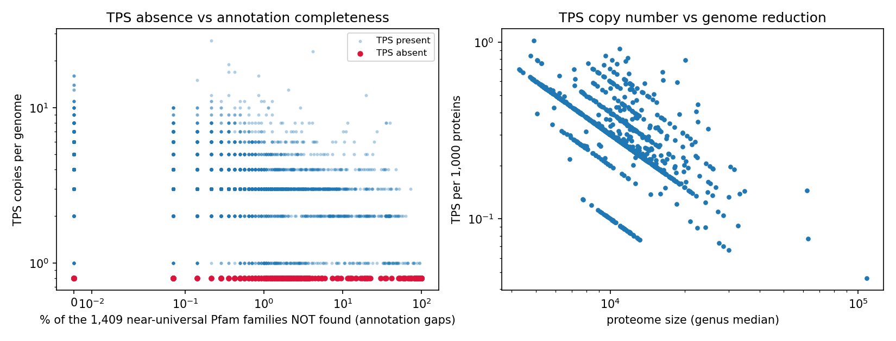
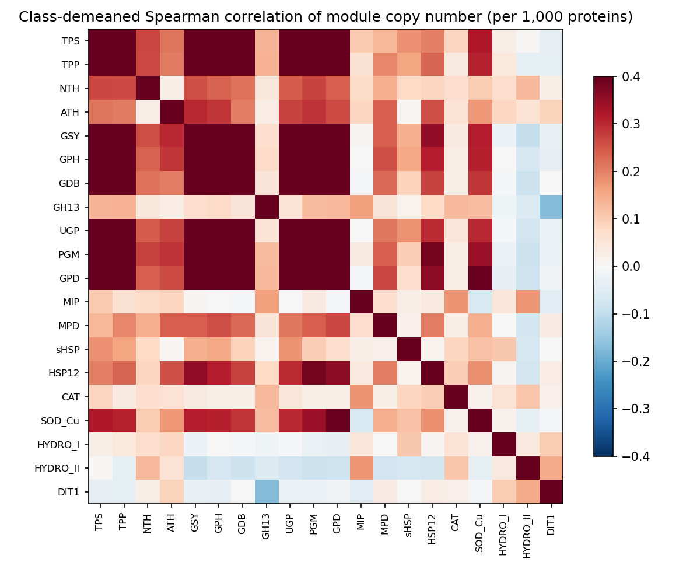
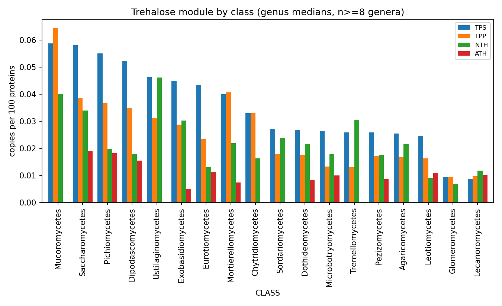
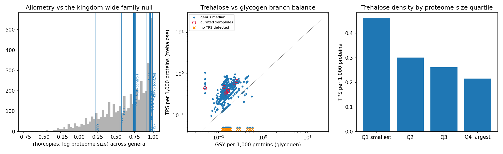

# Trehalose synthesis across the fungal kingdom: first pass

Started 2026-11-10 in the `j11-intron-position` worktree. Summary entry:
[FUNCTIONAL_ANALYSES.md §G](../../FUNCTIONAL_ANALYSES.md).

**Question.** How is the trehalose pathway distributed across BFD, does its
evolution track other pathways, and does it predict desiccation-associated
lifestyles? Along the way it doubles as a test of the "false absence" problem
flagged in [FUNCTIONAL_ANALYSES.md](../../FUNCTIONAL_ANALYSES.md) (agenda A2/C4),
because the trehalose genes are near-universal and their absences are clustered.

**Status.** Observational first pass, one afternoon, MotherDuck only. No tree, no
tblastn, no wet-lab validation. Nothing here should be quoted as a loss call yet.

## 0. Review corrections and the HPCC rebuild (2026-11-13)

The first pass (sections 1-8 below, tables in `data/`, figures in `figs/`) was computed on a laptop from MotherDuck and was reviewed before merging.
Three kinds of change were made on the branch `trehalose-integration`; the rebuild is `workflows/atlas/J13_trehalose.sh` (HPCC job 32074641, 8.5 minutes,
inputs `scripts/th0_inputs.sql`, outputs in `data_j13/` and `figs_j13/`, slurm log `data_j13/slurm_J13.log`). **Where a number below differs from `data_j13/`, `data_j13/` is the current one; the text of sections 1-8 was not rewritten and still quotes the first run.**

**Code fixes (with fixture tests, `scripts/test_stats_util.py`, run as step 0 of J13):**
1. *Benjamini-Hochberg q-values were wrong in two scripts.* `th4_predict.py` computed q on sorted p and assigned them to unsorted rows (for example neutral trehalase in xerophiles, AUC 0.46, p 0.68, was reported with q = 0.017, which belongs to another row); `th3_coloss.py` applied the step-up to rows ordered by effect size (388 of 907 co-absence q-values were exactly 0, including rows with p = 0.95). Both now use `stats_util.bh_qvalues` (verified against `scipy.stats.false_discovery_control`, and a test shows the old formula differs). `th2_stats.py` now also reports q for the trait contrasts.
2. *A class-stratified co-absence null was added.* The first null stratified only by how many universal families a genome misses, so a trait shared within a clade looks like co-absence (69 of 75 TPS-absent genomes are Lecanoromycetes). `stats_util.expected_coabsence` now also stratifies by class; a fixture test shows a clade-wide trait that the first null calls a signal (p < 1e-6) and the class-stratified null does not (p > 0.5).
3. *Hygiene:* hard-coded `/Users/...` paths removed (repo-relative, `TH_DATA`/`TH_FIGS` override); the `.cache.pkl` that could serve stale results was removed; the "credible loss" set now uses class-relative BUSCO (Q-busco-rel) like `keep`, not absolute BUSCO >= 85; the missing input producers (`th_pfprot`, the allometry table, `genus_prot`) are now in `th0_inputs.sql`; `qcov` is gated at 1e-5 everywhere (the first version counted ungated hits in one table and gated hits in another). Literature statements are marked "citation to verify" and method references are listed in [H9](../../summary_atlas/H9_trehalose_carbon_block.md) (details from memory, to verify).

**What the rebuild changes (old = first run, new = J13; `scripts/compare_runs.py` prints these):**

| Item | Old | New |
|---|---|---|
| Species representatives / genera | 7,186 / 1,669 | 7,186 / 1,669 (identical) |
| Quality-kept genomes / genera | 5,107 / 1,290 | 5,088 / 1,280 |
| Near-universal families | 1,409 | 1,458 (see caveat) |
| TPS, TPP, NTH, GH65 presence among kept genomes | 98.2, 98.7, 99.6, 57.3 % | 98.3, 98.8, 99.6, 57.3 % |
| Class-demeaned rho TPS-TPP, GPH-GSY, GSY-UGP | 0.86, 0.74, 0.74 | 0.86, 0.75, 0.74 |
| Allometry percentile: TPS, NTH, glycerol (GPD), PGI control, HSP70 control | 53, 91, 13, 53, 91 | 77, 85, 6, 43, 89 |
| TPS-absent kept genomes (Lecanoromycetes) | 78 (72) | 75 (69) |
| Credible TPS-loss genomes / genera | 88 / 51 | 74 / 42 (class-relative BUSCO) |
| TPS-absent genomes missing >= 5 universal families | 58 of 78 | 55 of 75 |
| Reps with < 30 % of proteins Pfam-annotated (of those at BUSCO >= 90) | 80 (21) | 67 (23) |
| TPS-TPP co-absence: observed / expected, obs/exp | 54 / 0.54, 100 | 50 / 0.46, 109 (class-stratified: expected 1.55, obs/exp 32; q ~ 0) |
| Other pathway genes co-absent with TPS | NTH, GSY, GH65 had q = 0.0 (bug) | NTH q = 0.39, GSY q = 1.0 (class null 0.46), GH65 depleted (obs/exp 0.1; class null 0.8, q = 1.0) |
| Co-absence rows with q < 0.1 (all 907 or 949 families) | 889 (bug) | 21 (class null: 19 of 492 testable families) |
| AUC table rows with q < 0.1 (of 87) | 4 (wrong rows) | 4 (right rows; for example entomopathogen TPS/GSY AUC 0.91, q = 0.017; xerophile NTH AUC 0.46, q = 0.75) |

**What stays and what does not (observed):**
- *Stays:* the pathway is near-universal and the module correlations, the GH65 patchiness, the TPS-TPP co-absence in Lecanoromycetes (it survives the class-stratified null, obs/exp 32 with 50 observed against 1.55 expected) and the weak desiccation prediction.
- *Does not stand as written:* "neutral trehalase is dropped" rested on its percentile in the allometry null (91 first, 85 now) and on a q-value that belonged to another row; the xerophile NTH result is not significant (q = 0.75). Of the other trehalose and glycogen genes none is co-absent with TPS beyond expectation once the q-values are correct.
- *Unresolved:* the TPS-absent genomes are gap-prone (55 of 75 miss >= 5 universal families, against a median of 4), so even the surviving TPS-TPP co-absence in Lecanoromycetes is consistent with a lineage-wide annotation gap (metagenome-derived, fragmented assemblies, N50 about 38 kb) and remains a **candidate**; the tblastn check (T1, queue in `TODO.md`) has not been run.

**Caveats of the rebuild.** (i) The allometry null and the near-universal set depend on analysis B's `kw_genus_pfam`, which has no saved SQL; it was rebuilt from the atlas A7 Pfam matrix and differs from the MotherDuck copy (Coemansia: 161 genomes and 145 with PF00982 now against 146 and 131 in the MotherDuck table, probably the newer snapshot; 1,458 universal families against 1,409; `data_j13/th_check_kw.csv`), so shifts in the allometry percentiles (TPS 53 to 77, glycerol 13 to 6) mix the effect of the rebuilt table with the effect of the code fixes and are not separated. (ii) p-values are rounded to six decimals in `th3`, so five q-values are exactly 0. (iii) The `mumm` word in the dry-habitat epithet list of `th1` is absent from `th2`/`th4` (not reconciled). (iv) The rebuild used the current BFD parquet snapshot on the HPCC; the first run used a 2026-11-06 MotherDuck copy. (v) Two log labels were not regenerated: `data_j13/run_log_th1_survey.txt` still says "BUSCO>=85" for the credible set (the values use class-relative BUSCO; the label is fixed in the script) and `run_log_th5_qc.txt` says "1,409 near-universal families" (the set is now 1,458). (vi) Everything else in the Limitations section (no tree, no tblastn, genus medians treated as independent) still applies.

## 1. Data and reproducibility

| Item | Value |
|---|---|
| Source | MotherDuck `bfd` (36 tables), read-only. `bfd` untouched. |
| Scratch | `bfd_scratch.th_*` (new prefix `th_` = this trehalose survey) |
| Client | duckdb CLI v1.5.6 + `motherduck` extension. The brew duckdb v2.0.0 is **not** supported by MotherDuck yet. |
| Queries | [scripts/export_queries.sql](scripts/export_queries.sql) |
| Analysis | [scripts/th1_survey.py](scripts/th1_survey.py) → [th2_stats.py](scripts/th2_stats.py) → [th3_coloss.py](scripts/th3_coloss.py) → [th4_predict.py](scripts/th4_predict.py) |
| Tables | `data/th_*.tsv`, run logs `data/run_log*.txt` |
| Figures | `figs/f1`–`f4` |

Genomes: species representatives rebuilt from `bfd` on the atlas rule (highest
`busco_genome.complete_pct`, tie `asm_stats.N50_bp`, tie `LOCUSTAG`; annotated;
genus and species known) → 7,186 genomes, 1,669 genera. Quality-kept set:
annotation-complete **and** class-relative BUSCO (see §2) → 5,107 genomes, 1,290 genera.

## 2. Two controls that were not in the earlier analyses

**Annotation completeness, family based (`qcov`).** For each genome, the share of
1,409 Pfam families present in ≥95 % of genera (`scr.th_univ`, built from analysis B's
`kw_genus_pfam`). Median 1,407/1,409; 5th percentile 1,275. Unlike BUSCO this is
measured on the same HMM pipeline that produced every presence/absence call in this
repo, so it tracks exactly the failure mode that matters for absence calls.

**Class-relative BUSCO.** The first version of this survey used BUSCO ≥ 90, which silently
deleted every budding yeast from the analysis (Saccharomycetes median complete is 75 %).
All numbers here use complete_pct ≥ the 25th percentile of its own class, per Q-busco-rel.

`keep` = `qcov ≥ 0.98` and class-relative BUSCO. A stricter flag `keep_strict`
(also BUSCO ≥ 90) is retained in `data/th_genome_matrix.tsv`.

## 3. Which Pfam family stands for which activity

Chosen by looking up characterised fungal enzymes in `bfd.swissprot_subject.pfam`
(SwissProt release carried in BFD), not by guessing:

| Activity | Pfam | Evidence (SwissProt entry / gene) |
|---|---|---|
| trehalose-6-P synthase (TPS) | [PF00982](https://www.ebi.ac.uk/interpro/entry/pfam/PF00982/) Glyco_transf_20 | TPS1_SCHPO, TPS1_YEAST, TPS1A/1B_ASPFU, TPS1_CANAL, TPS1_BOTFB, TPS1_ENCCU |
| trehalose-6-P phosphatase (TPP) | [PF02358](https://www.ebi.ac.uk/interpro/entry/pfam/PF02358/) Trehalose_PPase | TPS2_YEAST (trehalose-phosphatase), TSL1, tpp1, plant/nematode bifunctional TPS |
| neutral trehalase (NTH) | [PF01204](https://www.ebi.ac.uk/interpro/entry/pfam/PF01204/) Trehalase (+ [PF07492](https://www.ebi.ac.uk/interpro/entry/pfam/PF07492/) Ca-binding) | NTH1 (4 fungi), NTC1_CANAL, ntp1_SCHPO, TRE1_BOTFB |
| acid trehalase (ATH, GH65) | [PF03632](https://www.ebi.ac.uk/interpro/entry/pfam/PF03632/) Glyco_hydro_65m (+ [PF03636](https://www.ebi.ac.uk/interpro/entry/pfam/PF03636/) N, [PF03633](https://www.ebi.ac.uk/interpro/entry/pfam/PF03633/) C) | ATC1_CANAL, ATH1_EMENI, atc1_ARTBC |
| glycogen synthase | [PF05693](https://www.ebi.ac.uk/interpro/entry/pfam/PF05693/) Glycogen_syn | GSY1/GSY2 |
| glycogen phosphorylase | [PF00343](https://www.ebi.ac.uk/interpro/entry/pfam/PF00343/) Phosphorylase | GPH1 |
| glycogen debranching | [PF06202](https://www.ebi.ac.uk/interpro/entry/pfam/PF06202/) GDE_C | GDB1 |
| UDP-glucose supply | [PF01704](https://www.ebi.ac.uk/interpro/entry/pfam/PF01704/) UDPGP | UGP1 |
| phosphoglucomutase | PF02878/79/80 PGM_PMM_I/II/III | PGM1/PGM2 |
| glycerol branch | [PF07479](https://www.ebi.ac.uk/interpro/entry/pfam/PF07479/) + [PF01210](https://www.ebi.ac.uk/interpro/entry/pfam/PF01210/) NAD_Gly3P_dh_C/N | GPD1/GPD2 |
| glycerol efflux | [PF00230](https://www.ebi.ac.uk/interpro/entry/pfam/PF00230/) MIP | FPS1 |
| mannitol branch | [PF01232](https://www.ebi.ac.uk/interpro/entry/pfam/PF01232/) + [PF08125](https://www.ebi.ac.uk/interpro/entry/pfam/PF08125/) Mannitol_dh | MAN2, mpdA |
| hydrophilins | [PF04119](https://www.ebi.ac.uk/interpro/entry/pfam/PF04119/) HSP9_HSP12 | HSP12 |
| small HSPs | [PF00011](https://www.ebi.ac.uk/interpro/entry/pfam/PF00011/) HSP20 | HSP26 |
| class I / II hydrophobin | [PF01185](https://www.ebi.ac.uk/interpro/entry/pfam/PF01185/) / [PF06766](https://www.ebi.ac.uk/interpro/entry/pfam/PF06766/) | ROD1-3, NC2 |
| ascospore wall | [PF05141](https://www.ebi.ac.uk/interpro/entry/pfam/PF05141/) DIT1_PvcA | DIT1 |

One diagnostic domain per activity (not the sum of a protein's sub-domains), so
copy number = number of proteins carrying it. Gate `domain_i_evalue <= 1e-5`,
accession version stripped, genome key `split_part(protein_id,'_',1)`.

## 4. Findings

### 4.1 The pathway is near-universal; the catabolic and GH65 branches are the variable ones

Among 5,107 quality-kept species representatives (median copies per genome, per 1,000 proteins):

| Module | % genomes present | median copies | per 1,000 proteins |
|---|---|---|---|
| TPS | 98.2 | 3 | 0.282 |
| TPP | 98.7 | 2 | 0.178 |
| NTH | 99.6 | 2 | 0.211 |
| ATH (GH65) | 57.3 | 1 | 0.062 |
| GSY | 98.8 | 1 | 0.089 |
| GPH | 96.1 | 1 | 0.088 |
| sHSP | 88.8 | 3 | 0.262 |
| HSP12 | 62.9 | 1 | 0.074 |
| DIT1 | 54.9 | 1 | 0.077 |

So "does a fungus make trehalose" is not a useful question — almost all do. The
useful questions are how many copies, whether the biosynthetic and hydrolytic arms
stay in balance, and why GH65 is present in only ~57 % of genera.

### 4.2 GH65 acid trehalase is a patchy, taxonomically structured family

Share of quality genera with ≥1 GH65 ([PF03632](https://www.ebi.ac.uk/interpro/entry/pfam/PF03632/)) protein: Leotiomycetes 1.00,
Eurotiomycetes 1.00, Saccharomycetes 0.97, Lecanoromycetes 0.96, Pezizomycetes 0.95,
Pichiomycetes 0.95, Dothideomycetes 0.88, Mortierellomycetes 0.75,
Dipodascomycetes 0.55, Exobasidiomycetes 0.50, Sordariomycetes 0.33,
Agaricomycetes 0.03; **absent from all** Mucoromycetes, Tremellomycetes,
Ustilaginomycetes, Chytridiomycetes and Glomeromycetes genera.

A Dikarya-stem gain followed by many losses (or an earlier origin, given
Mortierellomycetes, with losses in Mucorales and Tremellomycetes) both fit. This
matters for the trehalose story but not only: PF03632/GH65 also contains
arbutinases, α-xylosidases and 6-phospho-β-galactosidases (family membership from general knowledge of GH65, citation to verify), so some of these
proteins are not acid trehalases at all. Treat the GH65 column as "GH65 family",
not "ATH1 orthologue", until a curated seed alignment is used.

### 4.3 The trehalose module does not vary on its own: it is part of a carbon-partitioning block

Class-demeaned Spearman correlation between per-1,000-protein densities across 1,290
genera ([`data/th_module_pairs.tsv`](data/th_module_pairs.tsv), fig f2):

TPS–TPP 0.86; GPD–GSY 0.75; GPH–GSY 0.74; GSY–UGP 0.74; GPD–PGM 0.71; GSY–TPP 0.69;
GPD–UGP 0.69. By contrast TPS–hydrophobin, TPS–DIT1, TPS–HSP12 and
TPS–sHSP are all within ±0.1 of zero.

So trehalose, glycogen, UDP-glucose and glycerol supply move together within a class,
while the desiccation-protectant and spore modules do not. Any test of "trehalose and
desiccation" that does not condition on the glycogen/glycerol block is testing the
block, not trehalose.

### 4.4 Against a kingdom-wide allometry null, trehalose synthase is ordinary

Copies per genus vs log proteome size, for 4,954 Pfam families with ≥300 genera
(median rho **+0.72**, IQR +0.42 to +0.90; [`data/th_allometry_modules.tsv`](data/th_allometry_modules.tsv)):

| Module | rho | percentile in null |
|---|---|---|
| GPD (glycerol) | +0.22 | **13** |
| GSY (glycogen synthase) | +0.55 | 35 |
| HSP12 | +0.58 | 36 |
| ATH | +0.73 | 51 |
| TPS | +0.75 | 53 |
| PGI (control) | +0.76 | 53 |
| GPH | +0.92 | 75 |
| TPP, UGP, DIT1 | +0.95 | 82 |
| HYDRO_I, MPD | +0.96 | 86 |
| NTH, sHSP, HSP70 (control) | +0.99 | 91 |

Read the extremes, not the signs. Glycerol synthesis is disproportionately
**retained** as genomes shrink (bottom 13 % of families), while neutral trehalase
is disproportionately **dropped** (top 9 %). TPS is indistinguishable from a
housekeeping control (PGI). The often-repeated line "compact genomes concentrate on
trehalose" is, in these data, a statement about density, and density rises for
essentially every low-copy gene.

Within-clade this differs by lineage direction: inside Saccharomycotina (118 genera)
TPS and TPP density rise steeply as proteomes shrink (rho −0.82 and −0.84), while in
Mucoromycota (50 genera) the sign flips (TPS +0.32). Growth-form medians go the same
way: yeast 0.53, dimorphic 0.38, filamentous 0.27 TPS per 1,000 proteins.

### 4.5 The one genuinely surprising result: clustered TPS/TPP absence

89 of 7,186 representatives have no [PF00982](https://www.ebi.ac.uk/interpro/entry/pfam/PF00982/) record at all (not at any e-value,
including the weak ones: `bfd.pfam` does keep sub-1e-5 hits — 8.4 % of its 368 M
rows, up to E = 1.8, though `full_seq_e_value` never exceeds 0.026, i.e. the
upstream hmmsearch ran near Pfam's report threshold).

Where the absences sit (quality genera, all representatives negative):

| Group | TPS-negative genera / total |
|---|---|
| Lecanoromycetes | **46 / 122 (38 %)** |
| Sordariomycetes | 6 / 221: *Scedosporium*, *Parascedosporium*, *Lomentospora*, *Cephalotrichum*, *Scopulariopsis*, *Basipetospora* |
| all other classes | 8 / 1,168 (0.7 %) |

Controls that argue this is not generic gap-driven absence:

1. **The partner enzyme goes too.** Of 78 quality genomes with no TPS, 54 also have
   no TPP ([PF02358](https://www.ebi.ac.uk/interpro/entry/pfam/PF02358/)). Expected 0.54 under a null stratified by each genome's total
   number of missing near-universal families: **obs/exp 100, q = 0**, and TPP ranks
   2nd of 970 families tested ([`data/th_coloss_vs_TPS.tsv`](data/th_coloss_vs_TPS.tsv)).
   The other top co-absent families are PEX11, ACBP, Ribosomal_S4, V-ATPase_H_N —
   each with 2–5 co-absences, i.e. ordinary residual gaps, not a module.
2. **Neighbours are retained.** In TPS-negative genomes, NTH is still present in
   96 %, GSY in 97 %, PGM in 100 %. These genomes still catabolise trehalose and
   still make glycogen.
3. **A Pfam-independent method agrees for TPS and disagrees for GSY.** Of 73
   quality genomes with no Pfam GSY hit, 60 (82 %) do contain a protein whose best
   SwissProt hit is named glycogen synthase → [PF05693](https://www.ebi.ac.uk/interpro/entry/pfam/PF05693/) false absence. Of 89 genomes
   with no Pfam TPS hit, **0** have a best hit named "trehalose-phosphate synthase".
   The same two-method comparison rescues nothing for TPS/TPP.
4. BUSCO is high where the absences are (Lecanoromycetes representatives at 88–99 %),
   and `qcov ≥ 0.985` was required for the "credible" set (88 genomes, 51 genera).
5. **The domain scan in those genomes is working normally.** Median share of their own
   proteins carrying ≥1 Pfam hit: 0.702 in the 89 credible TPS-loss genomes, against
   0.741 kingdom-wide (minimum 0.477). Only 7 of 91 quality TPS-absent genomes fall
   below 0.6.
6. **The contrast with comparable classes is absolute.** Among quality representatives,
   TPS-negative: Lecanoromycetes 32.1 % (79 of 246 genomes) versus **0.0 %** (0 of 1,252)
   in Dothideomycetes + Eurotiomycetes + Leotiomycetes + Pezizomycetes. Lecanoromycete
   assemblies are the weaker ones in the comparison (median N50 44 kb against 1.17 Mb) and
   their domain coverage is slightly lower — so if this is an artefact it is an artefact of
   fragmented-assembly gene prediction, which is a testable and different claim from "the
   Pfam scan failed".

Interpretation: this is a *specific, clade-clustered, module-level* absence of the
trehalose biosynthetic step. Three explanations survive, in decreasing order of what
I would bet on:

- **(a) missing gene models.** The gene is in the assembly but was never predicted.
  This repo already has a documented precedent: in analysis C, blastx found 33 of 44
  "absent" near-universal families in the assemblies. Homology searches cannot
  distinguish this from (b).
- **(b) undetected diverged TPS.** Both methods are homology-based. A bifunctional
  plant/nematode-type TPS (Glyco_transf_20 + T6PP_N/T6PP_C, PF18572/PF21141) would be
  missed by a Pfam-only scan; here the SwissProt-name check also fails, so this needs
  a profile built from the lichen themselves.
- **(c) real loss of de novo trehalose synthesis**, with trehalose obtained from the
  environment or the photobiont, and retained trehalase used to catabolise it.
  For lichen-forming fungi this is at least coherent with the symbiosis (the
  mycobiont imports ribitol/glucose from the photobiont); for *Scedosporium* it is
  harder to rationalise, which is itself evidence against (c).

**This is the decisive experiment, and it is cheap:** tblastn the TPS and TPP
proteins of the nearest non-lichen relative against ~10 Lecanoromycetes and ~5
Scedosporium assemblies, plus a six-frame blastx of the same queries against the
contigs. Full-length hits with introns = detection failure; no hits anywhere = a
candidate pathway loss worth a paper. Until then every mention of these absences
carries the "absences need tblastn" caveat.

### 4.6 Desiccation: suggestive, not predictive

Focal sets are necessarily hand-curated (see §6): 11 quality genera from a
xerophile/rock-inhabiting/osmotolerant list, 25 with dry-habitat species epithets,
6 entomopathogen genera. Markers were converted to **within-class percentiles**
before comparison, so this is not the class effect in disguise
([`data/th_predictive_auc.tsv`](data/th_predictive_auc.tsv)):

| Focal set | marker | AUC | q |
|---|---|---|---|
| xerophile genera | TPS per 1,000 | 0.69 | 0.000 |
| xerophile genera | TPP per 1,000 | 0.68 | 0.008 |
| xerophile genera | GH65 ATH per 1,000 | 0.66 | 0.028 |
| xerophile genera | GPH / GSY per 1,000 | 0.70 / 0.68 | 0.14 / 0.10 |
| xerophile genera | NTH per 1,000 | 0.46 | 0.017 |
| xerophile genera | GC % | 0.74 | — |

Class-matched sister contrasts on genus medians (Cliff's δ, bootstrap CI) point the
same way: curated xerophiles in Dothideomycetes TPS +0.052 [0.034, 0.076] δ 0.66,
TPP +0.038 δ 0.69, GSY +0.020 δ 0.71, GPH +0.019 δ 0.70, TPS/GSY +0.077 δ 0.55,
sHSP +0.090 δ 0.53; and they are **lower** in the ascospore-wall marker DIT1 (δ −0.54).

Individual genera make the case better than the aggregate:

- *Xeromyces* (the extremely xerophilic gut fungus): 7 TPS copies in a 7,521-protein
  genome, 0.93 per 1,000 = 99.9th percentile of the kingdom; 9 sHSP.
- *Wallemia* (4 genomes, 4.9–5.5 Mb): TPS and TPP retained, GPH and GSY not detected
  by Pfam (GSY is rescued by SwissProt in 3 of 4 → Pfam artefact; GPH is not rescued in
  any → candidate real loss), sHSP 1.28 per 1,000 ≈ 5× the kingdom median, TPS/GSY ratio
  8.9, the highest in the dataset.
- *Zygosaccharomyces* / *Debaryomyces* (osmo-halotolerant): TPS, TPP, GSY, GPH, sHSP all
  above their class median (n=3 genera, weak).
- Entomopathogens (*Beauveria*, *Metarhizium*, *Cordyceps*, *Ophiocordyceps*,
  *Lecanicillium*, *Purpureocillium*) vs other Sordariomycetes: TPS +0.150 [0.105, 0.215]
  δ 0.85; TPS/GSY +0.81 [0.66, 1.20] δ 0.91 (largest effect of any set here);
  class I hydrophobin +0.176 δ 0.66 (p = 0.002); TPP +0.046 δ 0.56.

Verdict: **trehalose-synthesis density is a weak-to-moderate marker of a dry or
variable-water-potential lifestyle (AUC ≈ 0.68, n = 11–25 genera), and the
trehalose-vs-glycogen *balance* is better than either arm alone.** It is not a
diagnostic, and with FungalTraits carrying no xerophily trait (the closest labels
are `dung_saprotroph` 17 genera, `sooty_mold` 4, `epiphyte` 9) the trait definition,
not the genomics, is the binding constraint.

Lichen-forming classes are the counter-example: within-class percentiles are flat
(TPS AUC 0.50, table in §4.5 explains why: they are where the absences are), and
they are the single largest source of candidate pathway loss in the kingdom.

### 4.7 Kickxellomycota: the trehalose module is not what they lost

| Genus | class | n_sp | proteins | TPS | TPP | NTH | ATH | GSY | TPS/1,000 |
|---|---|---|---|---|---|---|---|---|---|
| *Coemansia* | Kickxellomycetes | 42 | 6,851 | 3 | 2 | 3 | 0 | 1 | 0.439 |
| *Linderina* | Kickxellomycetes | 1 | 10,959 | 6 | 3 | 5 | 0 | 2 | 0.547 |
| *Martensiomyces* | Kickxellomycetes | 1 | 7,363 | 3 | 4 | 3 | 0 | 1 | 0.407 |
| *Mucor* | Mucoromycetes | 18 | 11,884 | 8 | 9 | 5 | 0 | 2 | 0.665 |
| *Rhizopus* | Mucoromycetes | 7 | 16,184 | 10 | 10 | 5 | 0 | 3 | 0.659 |
| *Backusella* | Mucoromycetes | 13 | 16,518 | — | — | — | 0 | — | 0.614 |

Kickxellomycetes keep TPS, TPP and neutral trehalase, and in *Coemansia* the
density is only ~34 % below Mucorales despite a proteome half the size — i.e. the
module is relatively retained. They have the same GH65 absence as all other
Mucoromycotina/Zoopagomycota (except *Umbelopsis* and *Bifiguratus*), so that
absence is a phylum-level character, not part of the Kickxellales reduction.
For the reduction narrative in analysis A, the trehalose pathway is a **control
region**: a core carbon module that stayed while 4,100 genes and 3.2 introns per
transcript went.

### 4.8 Side finding: 21 genomes look complete to BUSCO but were barely domain-scanned

While building the `qcov` control I found a defect class that is not in the caveat table
([`data/th_qc_suspect_genomes.tsv`](data/th_qc_suspect_genomes.tsv)):

| Symptom | n species reps |
|---|---|
| no `gene_proteins` rows although `annotation_status = 'annotated'` | 22 |
| 0 of the 1,409 near-universal families found | 40 |
| <30 % of their own proteins carry a Pfam hit (kingdom median 74 %) | 80, of which **21 at BUSCO ≥ 90** |

Two distinct failure modes hide in that set:

**(i) Partly scanned genomes** — low `n_univ_found` with an ordinary proteome size, i.e. the
domain scan covers only a fraction of the proteins: *Tricholoma* FD6195C5 (BUSCO 99.8 %,
3,744 proteins, 265 with any Pfam hit, **29 of 1,409** universal families), *Tuber* ×3
(186–587), *Amanita* ×6 (82–260), *Pulveroboletus* (194), *Lactarius* (267), *Russula* (123),
*Austroboletus* (364), *Lactifluus* (670), *Gautieria* (712), plus *Hanseniaspora* FCC4DCF0
and *Malassezia* F8A09998 with no Pfam rows at all.

**(ii) Inflated proteomes** — 20 k–108 k protein models (*Phakopsora* 108,051;
*Gigaspora* 95,809; *Massospora* 89,323; *Puccinia* 34,622; *Polystigma* 31,825), where a low
domain fraction means many spurious models rather than a missing scan. Their near-universal
coverage is fine (1,375–1,401 of 1,409), so they fail a different QC check and need a
different fix.

Proteins per Mb is **not** a usable defect marker on its own: 297 reps sit below 200/Mb and
most of those are real biology (rusts, Agaricales, Glomeromycota). The domain-annotation
fraction, measured against each genome's own proteins, is the signal that works.

## 5. Figures

## 6. The trait sets, and why they are weak

`XERO_GENERA` = Wallemia, Xeromyces, Baudoinia, Knufia, Cryomyces, Antarctomyces,
Cryoendolithus, Friedmanniomyces, Hortaea, Exophiala, Aureobasidium,
Zygosaccharomyces, Debaryomyces, Coniochaeta, Gymnoascus — chosen because these are
genera whose ecology is not in doubt (Antarctic rock endoliths, wall-blackening and
rock-inhabiting "black yeasts", high-sugar spoilage yeasts, the xerophilic gut
fungus). `dry_epithet` = species names matching
`antarct|arctic|desert|endolith|xero|halophil|salin|cavernicol|arid`, which is how
*Friedmanniomyces endolithicus* (25 genomes), *Cryomyces antarcticus*,
*Aspergillus desertorum* and *Penicillium desertorum* were found.

Problems, in order of severity: (i) genus-level labels lump xerophilic species with
non-xerophilic congenerics (*Aspergillus* is 234 genomes here, most not xerophilic);
(ii) no water-activity, substrate or habitat field exists in BFD to do better;
(iii) the sets are small, so most q-values above 0.1; (iv) ecology is confounded with
phylogeny exactly as analysis A found for Harpellales. A real version of this test
needs a curated per-species water-activity/xerophily table — that is a data
curation task, not a query.

## 7. Hypotheses to test next

| # | Hypothesis | Test | What would kill it |
|---|---|---|---|
| T1 | TPS+TPP are genuinely absent in Lecanoromycetes and the Microascales clade, i.e. de novo trehalose synthesis lost ≥2× | tblastn/blastx as §4.5; then profile HMM built from lichen six-frame translations | any full-length model in the assemblies |
| T2 | Loss of trehalose synthesis is tolerated only in symbioses where the partner supplies carbon, so it should also occur in *Biatoridiaceae*/lichenicolous and in some mycoparasites | presence/absence of TPS vs lichenicolous + mycoparasitic genera, with T1 validation | losses in free-living saprotrophs with no sugar-rich niche |
| T3 | The xerophile signal is in the balance, not the dose: TPS/(GSY+GPH) rises with desiccation tolerance | curated water-activity table; within-genus (species-level) contrasts in *Aspergillus*, *Saccharomyces*, *Penicillium* where xerophily varies within genus | no within-genus shift between xerophilic and non-xerophilic congeners |
| T4 | Entomopathogen trehalose expansion reflects harvesting **host** trehalose (insect haemolymph is trehalose-rich, citation to verify), so TPS, GH65/ATH and trehalose transport should co-expand and correlate with the animal-parasite label | co-expansion test with the class-demeaned block from §4.3 as the null; MEROPS/chitinase co-variation as a positive control | ATH absent in the same genomes (it is, in *Beauveria*: 0 copies) |
| T5 | GH65 acid trehalase is a Dikarya-stem innovation with repeated losses (0 % in Mucoromycetes, 3 % in Agaricomycetes), not a single gain | gene tree from a curated seed alignment over all genera + a genus tree; also test the HGT alternative (bacterial GH65 sisters, near-identical GC to host) | GH65 proteins that are arbutinases/α-xylosidases rather than trehalases → family is mis-assigned |
| T6 | Neutral trehalase is preferentially dropped from reduced genomes (91st percentile of the allometry null, and 0.46 AUC in xerophiles) because storage rather than scavenging matters in a stable niche | ortholog-matched retention rate as in analysis A table 4 for NTH vs TPS vs a housekeeping control | the same pattern in a lineage without genome reduction |

## 8. Limitations

- No phylogeny: every cross-clade p-value here is anticonservative; genus medians are
  treated as independent, which they are not (analysis A's caveat, unchanged).
- `bfd.pfam` appears to be a near-report-threshold hmmsearch output, so "absent from
  the table" ≠ "absent from the proteome" for diverged proteins; §4.5 quantifies how
  far the two-method check can and cannot go.
- The co-absence matrix (`th_uvmiss`) only contains genomes with ≥1 missing family, so
  ~1,970 perfectly complete genomes are absent from that specific test.
- PF03632/GH65 is functionally heterogeneous (§4.2).
- [PF00083](https://www.ebi.ac.uk/interpro/entry/pfam/PF00083/) (Sugar_tr) was inspected and rejected as a trehalose-transport proxy: it is
  the GLUT/HXT/STL1 hexose-transport family, not specific to trehalose; the fungal
  trehalose transporter VHT1 is an ordinary MFS_1 ([PF07690](https://www.ebi.ac.uk/interpro/entry/pfam/PF07690/)) protein and is not separable
  by domain. Trehalose uptake is therefore unmeasured here.
- Correlations are at genus medians with class demeaning; no PGLS, no direction of
  causation, no expression or metabolite data. Trehalose **content** ≠ trehalose **gene
  copy number**, and the assay data that would settle most of §4.6 lives in the
  physiological literature, not in BFD.
- Two citations in the pathway table are from SwissProt annotation carried in BFD and
  have not been checked against the primary literature ("citation to verify" applies to
  any external reference added later).
