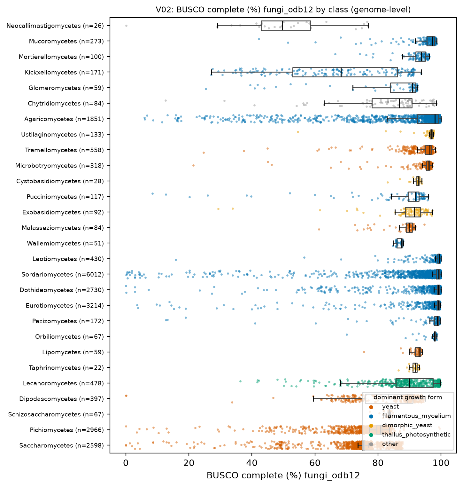
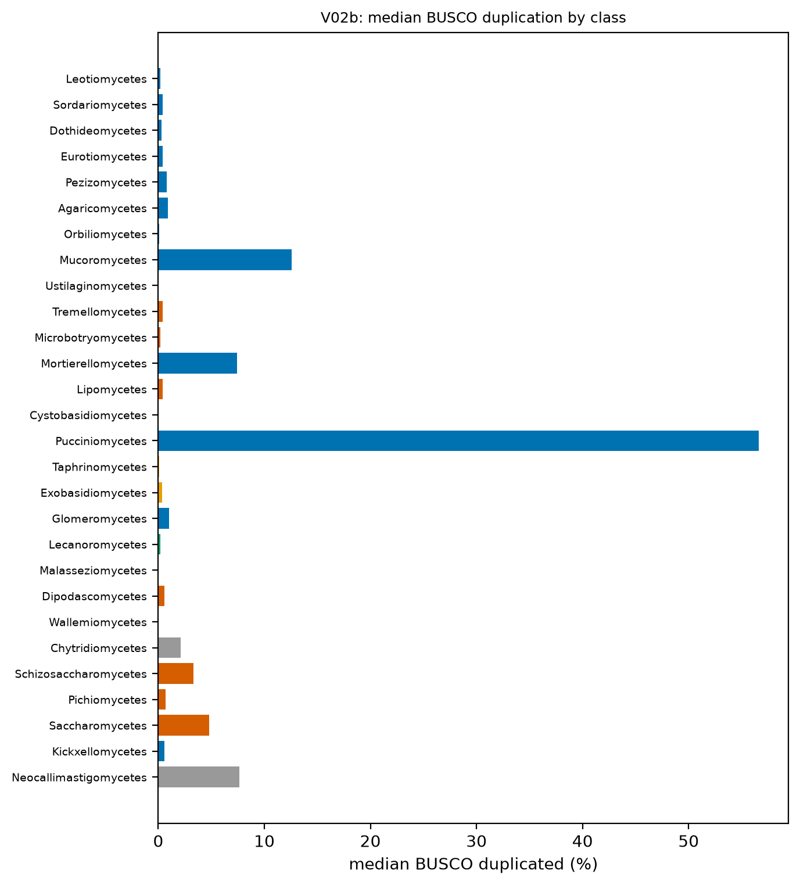
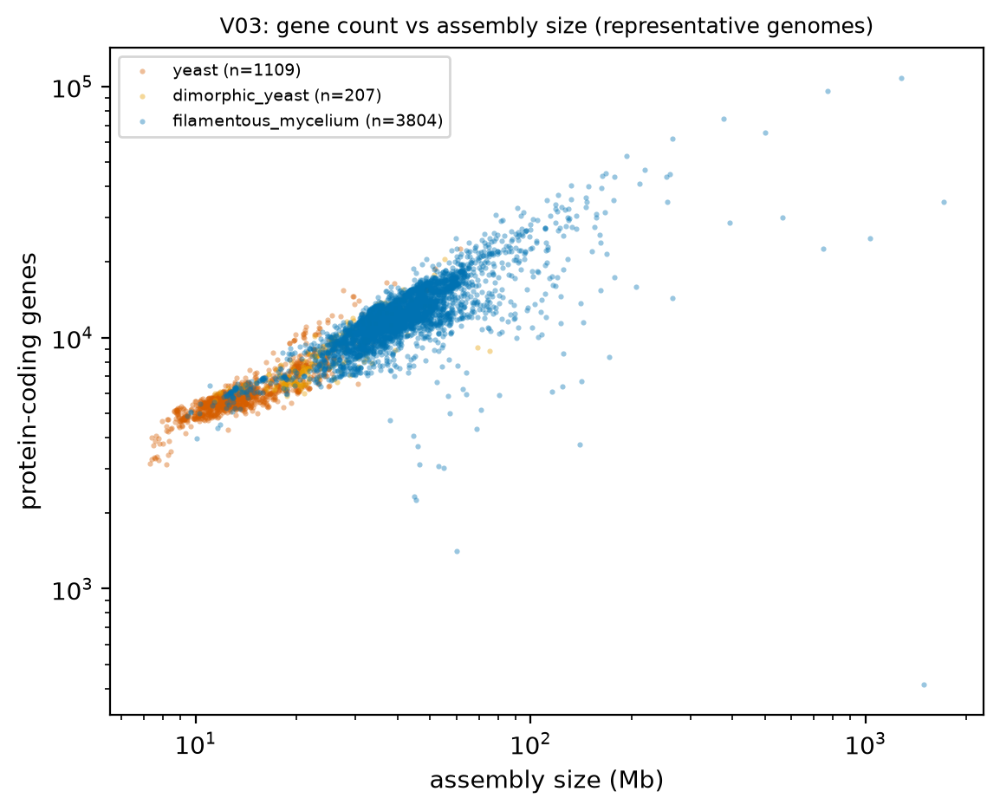
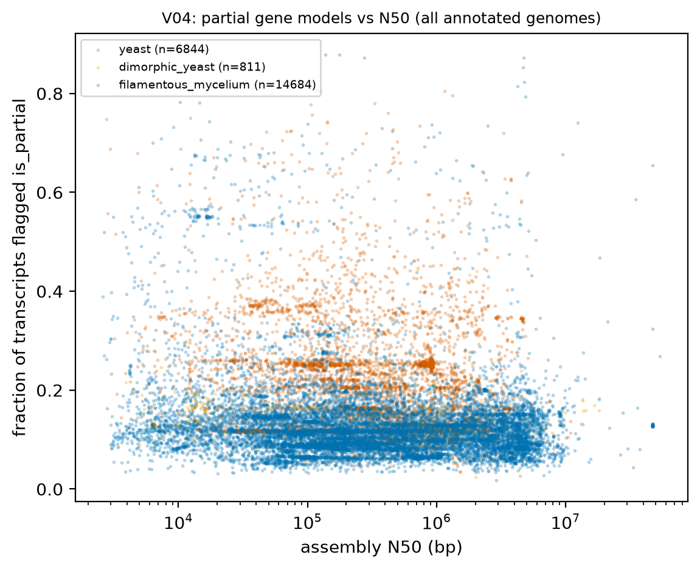
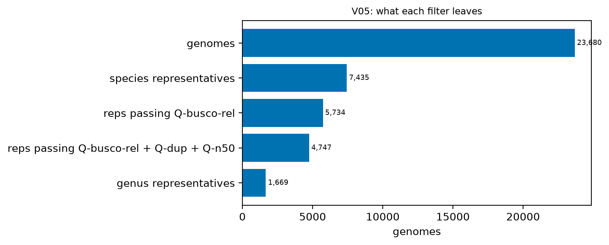
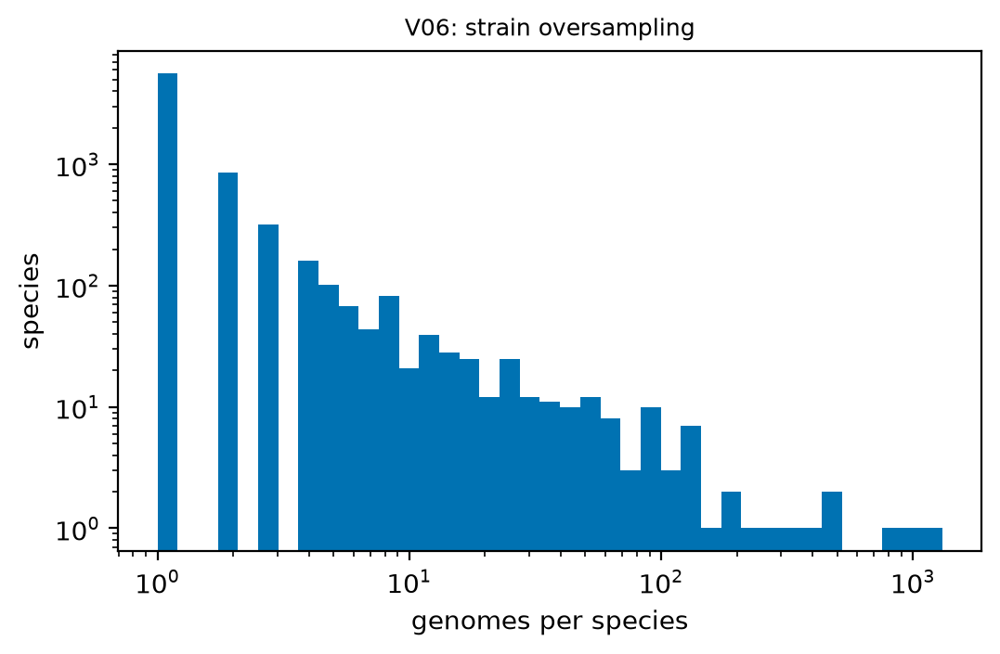

# H1. Annotation and assembly quality differ by clade

Expected: yeast classes have lower fungi_odb12 BUSCO; fragmented assemblies have more partial models.

[Back to index](index.md)

### V01 Data coverage

Genomes covered per table (distinct genome key) and rows. Full table: `tables/V01_coverage.tsv`.

| table | key | n_genomes | n_rows | source |
|---|---|---|---|---|
| species | LOCUSTAG | 23,680 | 23,680 | measured at render |
| samples | LOCUSTAG | 23,680 | 23,680 | measured at render |
| asm_stats | ASMID | 23,584 | 23,584 | measured at render |
| busco_genome | ASMID | 23,582 | 23,582 | measured at render |
| telomere_summary | ASMID | 23,582 | 23,582 | measured at render |
| telomere_tracts | ASMID | 8,369 | 73,242 | measured at render |
| aa_freq | species_prefix | 23,452 | 477,535 | measured at render |
| codon_freq | species_prefix | 23,452 | 1,500,925 | measured at render |
| tf_inventory | species_prefix | 23,394 | 10,946,927 | measured at render |
| cazy.overview | species_prefix | 23,401 | 9,310,657 | measured at render |
| cazy.cazymes_hmm | species_prefix | 23,394 | 9,164,068 | measured at render |
| signalp.signal_peptide | species_prefix | 23,410 | 18,767,284 | measured at render |
| targetP | species_prefix | 125 | 178,535 | measured at render |
| infernal_rfam | species_prefix | 14 | 3,925 | measured at render |
| wgd.ks.summary | species_prefix | 7,384 | 7,384 | measured at render |
| gene_trnas | split_part(gene_id) | 23,446 | 4,558,316 | measured at render |
| wgd.ks | species_prefix | 7,384 | 25,831,001 | tables/_manifest/wgd.ks.json |
| wgd.ks.nodes | species_prefix | 7,384 | 28,982,469 | tables/_manifest/wgd.ks.nodes.json |
| gene_CDS | split_part(transcript_id) | 23,452 | 753,622,745 | job J0 |
| gene_exons | split_part(transcript_id) | 23,452 | 758,181,061 | job J0 |
| gene_info | LOCUSTAG | 23,452 | 249,546,610 | job J0 |
| gene_intergenic_distances | species_prefix | 23,452 | 233,406,624 | job J0 |
| gene_introns | split_part(transcript_id) | 23,452 | 508,634,451 | job J0 |
| gene_proteins | split_part(gene_id) | 23,452 | 244,988,294 | job J0 |
| gene_transcripts | split_part(gene_id) | 23,452 | 249,546,610 | job J0 |
| idp | species_prefix | 23,412 | 233,329,228 | job J0 |
| idp_summary | species_prefix | 23,412 | 144,924,594 | job J0 |
| merops | species_prefix | 23,404 | 43,462,876 | job J0 |
| pfam | split_part(protein_id) | 23,410 | 368,209,721 | job J0 |
| predgpi | species_prefix | 23,410 | 227,238,177 | job J0 |
| swissprot_best | species_prefix | 23,409 | 157,614,964 | job J0 |
| swissprot_hits | species_prefix | 23,409 | 2,192,440,076 | job J0 |
| tmhmm | species_prefix | 23,409 | 45,707,260 | job J0 |
| wolfpsort | species_prefix | 23,410 | 244,790,951 | job J0 |

### V02 BUSCO completeness and duplication by class

- All annotated genomes (n = 23,580); no representative filter (this view describes the raw set).
- Median BUSCO complete in yeast classes: Saccharomycetes 75.4 %; Pichiomycetes 80.8 %; Schizosaccharomycetes 83.6 %; Dipodascomycetes 89.4 %; Lipomycetes 93.0 %. Filamentous classes with >= 1,000 genomes: Agaricomycetes 98.1 %; Eurotiomycetes 99.1 %; Dothideomycetes 99.2 %; Sordariomycetes 99.3 %.
- Consequence: a fixed cutoff removes yeasts. All later views use the class-relative threshold (Q-busco-rel, 25th percentile of the class).
- Caveat: fungi_odb12 is one marker set for all fungi; low yeast values are partly marker-set bias, not annotation quality. Pucciniomycetes duplication reflects dikaryotic assemblies.
- Table: `tables/V02_busco_by_class.tsv`.

### V03 Gene count versus assembly size

- n = 5,120 genomes / 5,120 species / 1,164 genera. Filters: Q-ann, Q-rep (one genome per species), Q-busco-rel (BUSCO complete >= class 25th percentile).
- log-log slope (genes on size), yeast: 0.622 (95 % CI 0.603 to 0.640), r^2 = 0.796, n = 1,109 genomes.
- log-log slope (genes on size), dimorphic_yeast: 0.664 (95 % CI 0.603 to 0.726), r^2 = 0.689, n = 207 genomes.
- log-log slope (genes on size), filamentous_mycelium: 0.556 (95 % CI 0.540 to 0.573), r^2 = 0.545, n = 3,804 genomes.
**Genes per Mb, yeast vs filamentous:**
- Unit = genus (median of representative genomes). Yeast genera n = 153, filamentous genera n = 960.
- Median genes per Mb: yeast 427.135, filamentous 301.425; difference 125.710 (bootstrap 95 % CI 113.509 to 140.833); Cliff's delta 0.911; Mann-Whitney p = 2.37e-73.
- Dimorphic yeast genera n = 51, median 353.923 (shown, not pooled).
- Mixed model `genes_per_mb ~ gf_yeast + log_genome + busco_complete + (1|CLASS/ORDER_)` (n = 1,091 genera, 49 classes, converged = True): yeast effect 24.860 (95 % CI 7.489 to 42.232), p = 0.005. PGLS pending tree.
- Caveat: gene count depends on the per-genome funannotate model set and repeat masking (`masked_pct` available). Genus-median table: `tables/V03_genus_medians.tsv`.

### V04 Partial gene models versus assembly contiguity

- n = 23,451 annotated genomes (no representative filter). Overall median partial fraction 0.123; Spearman rho(log N50, partial fraction) = -0.074 (n = 23,451).
- `has_start_codon` is the string 'NULL' for a median 0.017 of transcripts; these are excluded from Q-model.
- Per-class table (classes with >= 50 genomes): `tables/V04_partial_by_class.tsv`.

| CLASS | n | median_partial_fraction | median_frac_start_null | spearman_rho_logN50 | p |
|---|---|---|---|---|---|
| Glomeromycetes | 59 | 0.645 | 0.003 | 0.287 | 0.028 |
| Mucoromycetes | 273 | 0.530 | 0.010 | -0.254 | 2.10e-05 |
| Schizosaccharomycetes | 67 | 0.345 | 0.035 | -0.339 | 0.005 |
| Wallemiomycetes | 51 | 0.273 | 0.022 | -0.404 | 0.003 |
| Saccharomycetes | 2,576 | 0.251 | 0.048 | -0.106 | 7.21e-08 |
| Mortierellomycetes | 100 | 0.238 | 0.009 | -0.200 | 0.046 |
| Chytridiomycetes | 82 | 0.217 | 0.014 | -0.445 | 2.85e-05 |
| Orbiliomycetes | 67 | 0.192 | 0.010 | -0.356 | 0.003 |
| Pezizomycetes | 172 | 0.180 | 0.021 | 0.132 | 0.085 |
| Dipodascomycetes | 393 | 0.180 | 0.029 | -0.324 | 4.87e-11 |
| Kickxellomycetes | 171 | 0.180 | 0.011 | -0.093 | 0.226 |
| Exobasidiomycetes | 92 | 0.171 | 0.009 | -0.066 | 0.530 |
| Microbotryomycetes | 318 | 0.165 | 0.017 | -0.278 | 4.73e-07 |
| Pucciniomycetes | 117 | 0.158 | 0.018 | -0.633 | 1.79e-14 |
| Leotiomycetes | 429 | 0.146 | 0.013 | -0.068 | 0.158 |

### V05 Representative set and quality tiers

- genomes: 23,680
- species representatives: 7,435
- reps passing Q-busco-rel: 5,734
- reps passing Q-busco-rel + Q-dup + Q-n50: 4,747
- genus representatives: 1,669
- Growth form of species representatives (FungalTraits 1.2 + overrides): filamentous_mycelium 4,741; yeast 1,543; thallus_photosynthetic 441; dimorphic_yeast 286; NULL 259; unicellular-aflagellate_(non-yeast) 81; zoosporic-rhizomycelial_(chytrid-like) 74; zoosporic-plasmodium_(aphelid) 5; zoosporic_only 4; other 1.
- Rule D6: representative = highest BUSCO complete within species, tie N50. Per-class table: `tables/V05_representatives_by_class.tsv`.

### V06 Strain oversampling

- 23,680 genomes in 7,450 named species; top 20 species hold 6,806 genomes (28.7 %).

| genomes_per_species | n_species |
|---|---|
| 1 | 5,575 |
| 2 | 859 |
| 3-5 | 584 |
| 6-10 | 215 |
| 11-50 | 166 |
| 51-200 | 42 |
| >200 | 9 |

| SPECIES | n_genomes |
|---|---|
| Saccharomyces cerevisiae | 1,309 |
| Candidozyma auris | 952 |
| Fusarium oxysporum | 814 |
| Pyricularia oryzae | 495 |
| Macrophomina phaseolina | 466 |
| Aspergillus fumigatus | 416 |
| Aspergillus flavus | 328 |
| Fusarium asiaticum | 257 |
| Beauveria bassiana | 224 |
| Cryptococcus neoformans | 187 |
| Parastagonospora nodorum | 175 |
| Alternaria alternata | 148 |
| Botryosphaeria dothidea | 141 |
| Komagataella phaffii | 135 |
| Fusarium graminearum | 134 |
| Candida albicans | 134 |
| Aspergillus oryzae | 128 |
| Rhodotorula mucilaginosa | 125 |
| Aspergillus niger | 123 |
| Candida tropicalis | 115 |

- This is why every cross-clade view uses one representative per species. Table: `tables/V06_top_species.tsv`.

## Verdict

**Verdict: supported.** BUSCO (fungi_odb12) completeness depends on class: median 75-84 % in Saccharomycetes, Pichiomycetes and Schizosaccharomycetes against 98-99 % in the large filamentous classes (V02). The partial-model fraction also differs by class (median 0.25 in Saccharomycetes, 0.65 in Glomeromycetes) and is only weakly related to N50 across all genomes (Spearman rho = -0.07, V04). The top 20 species hold 28.7 % of all genomes (V06). Every later view therefore uses one genome per species, class-relative BUSCO thresholds and the complete-model filter. Next data needed: an RNA-seq-in-training flag per genome (D8).
