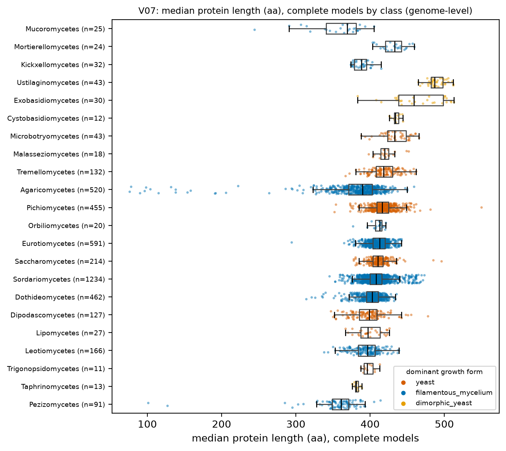
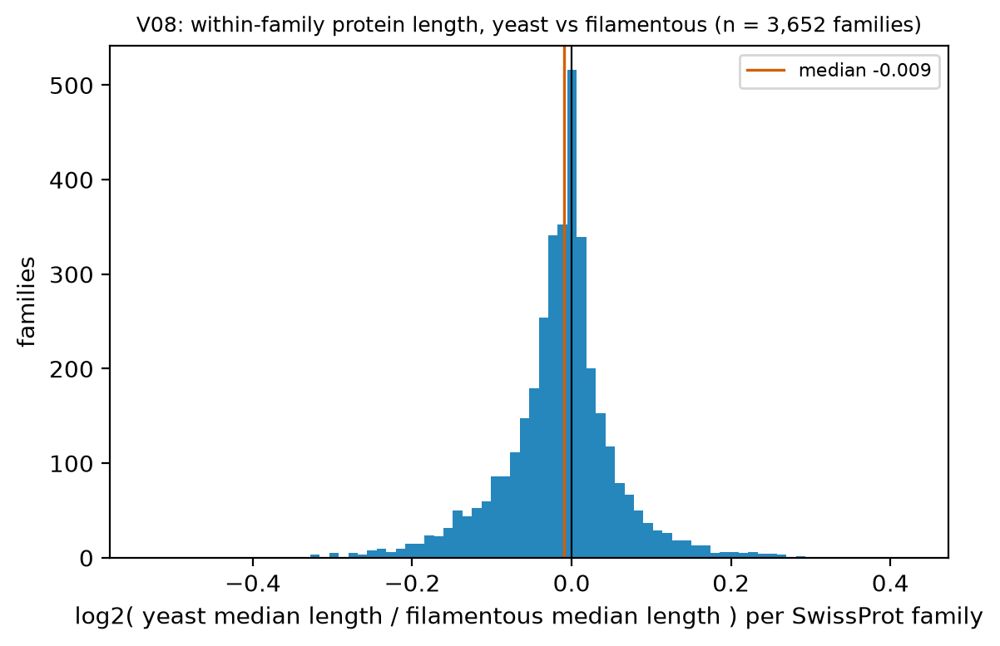
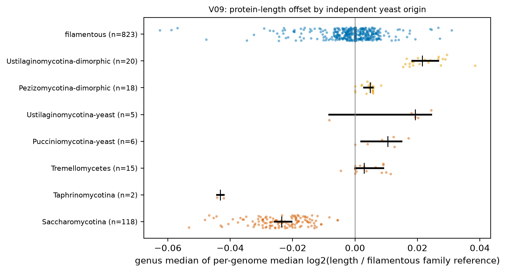
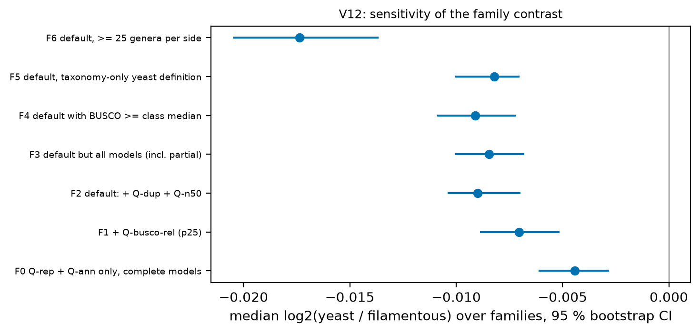
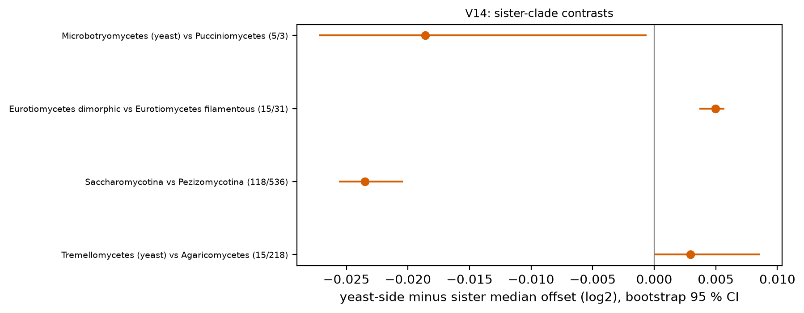

# H2. Among orthologous proteins, yeast proteins are shorter

PI hypothesis: yeast shorter. Proxies for orthology: SwissProt best-hit families (P-A); model-anchor (P-B) and Pfam architecture (P-C) are P2.

[Back to index](index.md)

### V07 Raw protein length by growth form and class

- n = 4,377 genomes / 4,377 species / 1,030 genera. Filters: Q-ann, Q-rep (one genome per species), Q-busco-rel (BUSCO complete >= class 25th percentile), Q-dup (BUSCO duplicated <= 10 %), Q-n50 (N50 >= 50 kb), Q-model (complete gene models only).
- Unit = genus (median of representative genomes). Yeast genera n = 150, filamentous genera n = 829.
- Median median protein length (aa): yeast 414.500, filamentous 401.000; difference 13.500 (bootstrap 95 % CI 9.500 to 16.250); Cliff's delta 0.435; Mann-Whitney p = 2.27e-17.
- Dimorphic yeast genera n = 51, median 435.000 (shown, not pooled).
- Mixed model `median_len_model ~ gf_yeast + log_n50 + busco_complete + (1|CLASS/ORDER_)` (n = 959 genera, 45 classes, converged = True): yeast effect 18.356 (95 % CI -3.651 to 40.364), p = 0.102. PGLS pending tree.
- Caveat: raw lengths mix gene content with length within families. This view sets the baseline only; V08 controls for family. Table: `tables/V07_genus_medians.tsv`.

### V08 Within-family length contrast, SwissProt proxy (P-A)

- Unit = family (SwissProt best-hit subject `sp_id`). Families kept: 3,652 with >= 10 yeast genera and >= 10 filamentous genera. Genomes: representative set with Q-ann, Q-rep (one genome per species), Q-busco-rel (BUSCO complete >= class 25th percentile), Q-dup (BUSCO duplicated <= 10 %), Q-n50 (N50 >= 50 kb), Q-model (complete gene models only); proteins: qcov >= 80 %, scov >= 80 %, pident >= 40 %, complete models. Family value = median over genera of the per-genome median length.
- Median log2 ratio = -0.0090 (bootstrap 95 % CI -0.0104 to -0.0074); as a length ratio yeast/filamentous = 0.9938.
- Sign test: 2,063 of 3,446 families have yeast shorter (59.9 %), binomial p = 3.91e-31.
- Mean absolute log2 ratio = 0.051; 10th/90th percentiles -0.102 / +0.058.
- By reference-length decile (filamentous median length), median log2 ratio:

| ref_len_bin | median | size |
|---|---|---|
| (50.999, 139.0] | 0.000 | 369 |
| (139.0, 201.0] | -0.007 | 370 |
| (201.0, 262.0] | -0.012 | 363 |
| (262.0, 326.0] | -0.011 | 360 |
| (326.0, 375.125] | -0.012 | 364 |
| (375.125, 449.0] | -0.015 | 367 |
| (449.0, 513.7] | -0.009 | 363 |
| (513.7, 584.85] | -0.005 | 365 |
| (584.85, 795.9] | -0.009 | 365 |
| (795.9, 4696.0] | -0.004 | 366 |

- Caveats: reference-dominance bias (Saccharomycotina best hits go mostly to *S. cerevisiae* references; see V07 table column `frac_best_hit_yeast`); coverage gates remove truncated and fused variants (conservative); paralogs collapse to the per-genome median. Family table: `tables/V08_family_ratios.tsv`; decile table: `tables/V08_ratio_by_reference_length_decile.tsv`.

### V09 Per-genome length offset by yeast origin

- Unit = genus (median of genome offsets). Genome offset = median over families (>= 200 families per genome) of log2(length / family reference), reference = median over filamentous genera. Filters: Q-ann, Q-rep (one genome per species), Q-busco-rel (BUSCO complete >= class 25th percentile), Q-dup (BUSCO duplicated <= 10 %), Q-n50 (N50 >= 50 kb), Q-model (complete gene models only).
| yeast_origin | n_genera | median_offset_log2 | ci_lo | ci_hi | ratio |
|---|---|---|---|---|---|
| Saccharomycotina | 118 | -0.024 | -0.026 | -0.020 | 0.984 |
| Taphrinomycotina | 2 | -0.043 | -0.044 | -0.042 | 0.971 |
| Tremellomycetes | 15 | 0.003 | 0.000 | 0.009 | 1.002 |
| Pucciniomycotina-yeast | 6 | 0.010 | 0.002 | 0.015 | 1.007 |
| Ustilaginomycotina-yeast | 5 | 0.019 | -0.008 | 0.024 | 1.013 |
| Pezizomycotina-dimorphic | 18 | 0.005 | 0.003 | 0.006 | 1.003 |
| Ustilaginomycotina-dimorphic | 20 | 0.022 | 0.018 | 0.027 | 1.015 |
| filamentous | 823 | 0.000 | 0.000 | 0.000 | 1.000 |

- Origins with median offset < 0: 2 of 7 non-filamentous groups (Saccharomycotina, Taphrinomycotina). The filamentous row is the reference distribution (expected near 0 by construction).
- Caveat: the filamentous reference itself is a mixture of classes; Pezizomycotina dominate it. Table: `tables/V09_offset_by_origin.tsv`. PGLS pending tree.

### V12 Sensitivity of the length contrast to quality filters

| filter_set | n_families | median_log2_ratio | ci_lo | ci_hi | frac_yeast_shorter | binom_p |
|---|---|---|---|---|---|---|
| F0 Q-rep + Q-ann only, complete models | 4,574 | -0.004 | -0.006 | -0.003 | 0.562 | 5.62e-16 |
| F1 + Q-busco-rel (p25) | 3,896 | -0.007 | -0.009 | -0.005 | 0.585 | 5.13e-25 |
| F2 default: + Q-dup + Q-n50 | 3,652 | -0.009 | -0.010 | -0.007 | 0.599 | 3.91e-31 |
| F3 default but all models (incl. partial) | 3,945 | -0.008 | -0.010 | -0.007 | 0.595 | 2.72e-31 |
| F4 default with BUSCO >= class median | 2,966 | -0.009 | -0.011 | -0.007 | 0.596 | 2.30e-24 |
| F5 default, taxonomy-only yeast definition | 3,866 | -0.008 | -0.010 | -0.007 | 0.596 | 2.45e-31 |
| F6 default, >= 25 genera per side | 1,686 | -0.017 | -0.021 | -0.014 | 0.668 | 1.22e-41 |

- Same family statistic as V08 under each filter set. Table: `tables/V12_filter_grid.tsv`.

### V14 Paired sister-clade contrasts

| pair | n_yeast_genera | n_sister_genera | median_yeast_offset | median_sister_offset | difference_log2 | ci_lo | ci_hi | mw_p |
|---|---|---|---|---|---|---|---|---|
| Schizosaccharomycetes vs Taphrinomycetes+Pneumocystomycetes | 1 | 3 | -0.044 | -0.031 | NA | NA | NA | NA |
| Tremellomycetes (yeast) vs Agaricomycetes | 15 | 218 | 0.003 | 0.000 | 0.003 | 0.000 | 0.009 | 7.10e-07 |
| Saccharomycotina vs Pezizomycotina | 118 | 536 | -0.024 | 0.000 | -0.024 | -0.026 | -0.020 | 2.75e-70 |
| Malasseziomycetes vs Ustilaginomycetes | 1 | 12 | -0.008 | 0.018 | NA | NA | NA | NA |
| Eurotiomycetes dimorphic vs Eurotiomycetes filamentous | 15 | 31 | 0.005 | 0.000 | 0.005 | 0.004 | 0.006 | 9.06e-08 |
| Microbotryomycetes (yeast) vs Pucciniomycetes | 5 | 3 | 0.009 | 0.027 | -0.019 | -0.027 | -6.29e-04 | 0.036 |

- Unit = genus median offset (as V09). Pairs are taxonomy-based (D3), not tree-based. Sign test across pairs: 2 of 4 pairs negative, binomial p = 1.000 (low power with 4 pairs). Table: `tables/V14_sister_pairs.tsv`.

## Verdict

**Verdict: not supported as a general rule; a small effect exists in Saccharomycotina only.** Within SwissProt families (V08, 3,652 families, strict gates) the median yeast/filamentous length ratio is 0.994 (log2 -0.009, 95 % CI -0.010 to -0.007); 59.9 % of families have the yeast median shorter. The effect is small against the spread between families (10th/90th percentiles -0.10/+0.06) and is stable across the quality-filter grid (V12: -0.004 to -0.017). By origin (V09) only Saccharomycotina (118 genera, 1.6 % shorter) and the two Taphrinomycotina genera are shorter; Tremellomycetes, Pucciniomycotina and Ustilaginomycotina yeasts are 0.2-1.3 % longer than the filamentous reference. Raw median protein length is slightly longer in yeast genera (414 vs 401 aa, V07). The sister-clade contrasts (V14) split 2 negative / 2 positive. The mixed model with CLASS/ORDER random intercepts gives a yeast effect of +18 aa on raw median length with a CI that spans zero (V07); growth form is nearly constant within class, so the class random effect absorbs the contrast and the model is not informative for yeast vs filamentous. The within-family, multiple-origin and sister-pair designs are the controls that carry the comparison. Caveats: SwissProt best-hit families are biased toward *S. cerevisiae* references for Saccharomycotina; the model-anchored (P-B) and Pfam-architecture (P-C) proxies are P2 and not yet run; PGLS pending tree.
