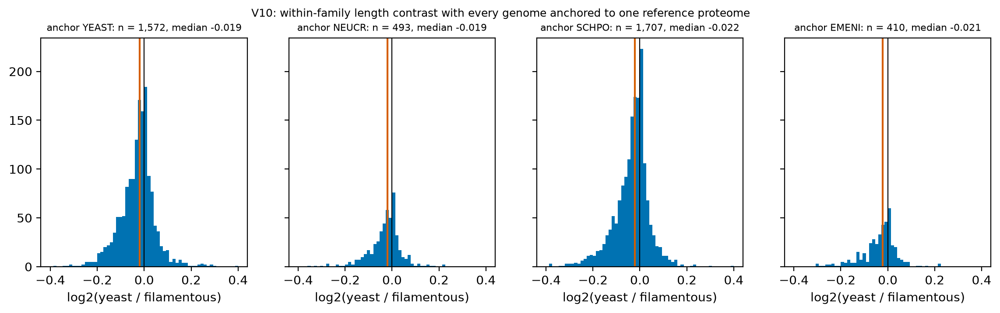
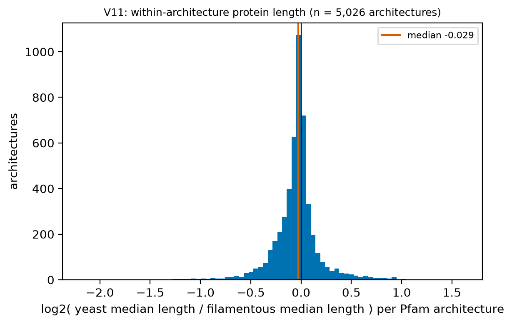
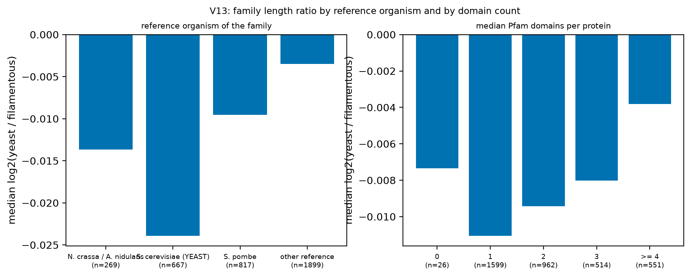
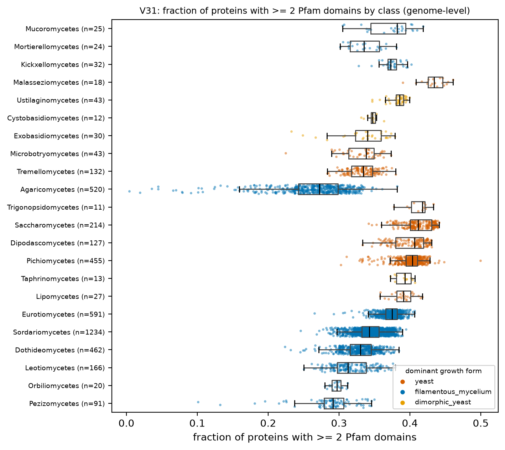

# H2. Among orthologous proteins, yeast proteins are shorter

PI hypothesis: yeast shorter. Proxies for orthology: SwissProt best-hit families (P-A); model-anchor (P-B) and Pfam architecture (P-C) are P2.

[Back to index](index.md)

### V07 Raw protein length by growth form and class

- n = 4,377 genomes / 4,377 species / 1,030 genera. Filters: Q-ann, Q-rep (one genome per species), Q-busco-rel (BUSCO complete >= class 25th percentile), Q-dup (BUSCO duplicated <= 10 %), Q-n50 (N50 >= 50 kb), Q-model (complete gene models only).
- Unit = genus (median of representative genomes). Yeast genera n = 150, filamentous genera n = 829.
- Median median protein length (aa): yeast 414.500, filamentous 401.000; difference 13.500 (bootstrap 95 % CI 9.500 to 16.250); Cliff's delta 0.435; Mann-Whitney p = 2.27e-17.
- Dimorphic yeast genera n = 51, median 435.000 (shown, not pooled).
- Mixed model `median_len_model ~ gf_yeast + log_n50 + busco_complete + (1|CLASS/ORDER_)` (n = 959 genera, 45 classes, converged = True): yeast effect 18.356 (95 % CI -3.651 to 40.364), p = 0.102. PGLS pending tree.
- Caveat: raw lengths mix gene content with length within families. This view sets the baseline only; V08 controls for family. Table: `tables/V07_genus_medians.tsv`.

### V08 Within-family length contrast, SwissProt proxy (P-A)

- Unit = family (SwissProt best-hit subject `sp_id`). Families kept: 3,652 with >= 10 yeast genera and >= 10 filamentous genera. Genomes: representative set with Q-ann, Q-rep (one genome per species), Q-busco-rel (BUSCO complete >= class 25th percentile), Q-dup (BUSCO duplicated <= 10 %), Q-n50 (N50 >= 50 kb), Q-model (complete gene models only); proteins: qcov >= 80 %, scov >= 80 %, pident >= 40 %, complete models. Family value = median over genera of the per-genome median length.
- Median log2 ratio = -0.0090 (bootstrap 95 % CI -0.0104 to -0.0074); as a length ratio yeast/filamentous = 0.9938.
- Sign test: 2,063 of 3,446 families have yeast shorter (59.9 %), binomial p = 3.91e-31.
- Mean absolute log2 ratio = 0.051; 10th/90th percentiles -0.102 / +0.058.
- By reference-length decile (filamentous median length), median log2 ratio:

| ref_len_bin | median | size |
|---|---|---|
| (50.999, 139.0] | 0.000 | 369 |
| (139.0, 201.0] | -0.007 | 370 |
| (201.0, 262.0] | -0.012 | 363 |
| (262.0, 326.0] | -0.011 | 360 |
| (326.0, 375.125] | -0.012 | 364 |
| (375.125, 449.0] | -0.015 | 367 |
| (449.0, 513.7] | -0.009 | 363 |
| (513.7, 584.85] | -0.005 | 365 |
| (584.85, 795.9] | -0.009 | 365 |
| (795.9, 4696.0] | -0.004 | 366 |

- Caveats: reference-dominance bias (Saccharomycotina best hits go mostly to *S. cerevisiae* references; see V07 table column `frac_best_hit_yeast`); coverage gates remove truncated and fused variants (conservative); paralogs collapse to the per-genome median. Family table: `tables/V08_family_ratios.tsv`; decile table: `tables/V08_ratio_by_reference_length_decile.tsv`.

### V09 Per-genome length offset by yeast origin

- Unit = genus (median of genome offsets). Genome offset = median over families (>= 200 families per genome) of log2(length / family reference), reference = median over filamentous genera. Filters: Q-ann, Q-rep (one genome per species), Q-busco-rel (BUSCO complete >= class 25th percentile), Q-dup (BUSCO duplicated <= 10 %), Q-n50 (N50 >= 50 kb), Q-model (complete gene models only).
| yeast_origin | n_genera | median_offset_log2 | ci_lo | ci_hi | ratio |
|---|---|---|---|---|---|
| Saccharomycotina | 118 | -0.024 | -0.026 | -0.020 | 0.984 |
| Taphrinomycotina | 2 | -0.043 | -0.044 | -0.042 | 0.971 |
| Tremellomycetes | 15 | 0.003 | 0.000 | 0.009 | 1.002 |
| Pucciniomycotina-yeast | 6 | 0.010 | 0.002 | 0.015 | 1.007 |
| Ustilaginomycotina-yeast | 5 | 0.019 | -0.008 | 0.024 | 1.013 |
| Pezizomycotina-dimorphic | 18 | 0.005 | 0.003 | 0.006 | 1.003 |
| Ustilaginomycotina-dimorphic | 20 | 0.022 | 0.018 | 0.027 | 1.015 |
| filamentous | 823 | 0.000 | 0.000 | 0.000 | 1.000 |

- Origins with median offset < 0: 2 of 7 non-filamentous groups (Saccharomycotina, Taphrinomycotina). The filamentous row is the reference distribution (expected near 0 by construction).
- Caveat: the filamentous reference itself is a mixture of classes; Pezizomycotina dominate it. Table: `tables/V09_offset_by_origin.tsv`. PGLS pending tree.

### V10 Model-organism-anchored contrast (P-B)

- Family = the best hit of each protein to one reference proteome (*S. cerevisiae* YEAST, *N. crassa* NEUCR, *S. pombe* SCHPO, *A. nidulans* EMENI) taken from all ranked SwissProt hits, so yeast and filamentous genomes are compared on the same reference protein. Gates on the anchor hit: qcov >= 80 %, scov >= 80 %, pident >= 40 %; complete models; representative genomes with Q-ann, Q-rep (one genome per species), Q-busco-rel (BUSCO complete >= class 25th percentile), Q-dup (BUSCO duplicated <= 10 %), Q-n50 (N50 >= 50 kb), Q-model (complete gene models only); >= 10 genera per side; unit = family.

| proxy | n_families | median_log2_ratio | ci_lo | ci_hi | ratio | frac_yeast_shorter | binom_p | p10 | p90 |
|---|---|---|---|---|---|---|---|---|---|
| P-B anchor YEAST | 1,572 | -0.019 | -0.023 | -0.017 | 0.987 | 0.693 | 1.13e-51 | -0.121 | 0.047 |
| P-B anchor NEUCR | 493 | -0.019 | -0.024 | -0.014 | 0.987 | 0.713 | 5.01e-20 | -0.114 | 0.033 |
| P-B anchor SCHPO | 1,707 | -0.022 | -0.025 | -0.018 | 0.985 | 0.704 | 2.91e-62 | -0.127 | 0.037 |
| P-B anchor EMENI | 410 | -0.021 | -0.027 | -0.015 | 0.986 | 0.710 | 7.51e-17 | -0.128 | 0.034 |
| P-A SwissProt best hit | 3,652 | -0.009 | -0.010 | -0.007 | 0.994 | 0.599 | 3.91e-31 | -0.102 | 0.058 |

- Median number of strict anchors per representative genome:

| org_code | median_strict_anchors_filamentous_mycelium | median_strict_anchors_yeast |
|---|---|---|
| EMENI | 598.500 | 207.000 |
| NEUCR | 620.000 | 282.000 |
| SCHPO | 1139.500 | 1006.000 |
| YEAST | 931.000 | 1599.000 |

- Result: the four anchors agree (median log2 ratio -0.019 to -0.022, 69-71 % of families yeast-shorter). The YEAST-anchored and NEUCR-anchored medians are the same (-0.019), so the P-A signal is not an artefact of Saccharomycotina genomes hitting *S. cerevisiae* references; P-B is the cleaner proxy because every genome is scored against one reference protein. Yeast genomes have more strict YEAST anchors (1,599 vs 931) and fewer NEUCR/EMENI anchors (282 vs 620) than filamentous genomes, which shows the reference-side bias that P-A inherits. Tables: `tables/V10_anchor_contrast.tsv`, `tables/V10_anchor_coverage.tsv`.

### V11 Within-architecture length contrast, Pfam proxy (P-C)

- Family = ordered Pfam domain string (domain_i_evalue <= 1e-5), architectures with >= 2 domains present in >= 10 yeast and >= 10 filamentous genera; complete models; representative genomes with Q-ann, Q-rep (one genome per species), Q-busco-rel (BUSCO complete >= class 25th percentile), Q-dup (BUSCO duplicated <= 10 %), Q-n50 (N50 >= 50 kb), Q-model (complete gene models only); unit = architecture.

| proxy | n_families | median_log2_ratio | ci_lo | ci_hi | ratio | frac_yeast_shorter | binom_p | p10 | p90 |
|---|---|---|---|---|---|---|---|---|---|
| P-C Pfam architecture (>= 2 domains) | 5,026 | -0.029 | -0.032 | -0.026 | 0.980 | 0.639 | 2.26e-87 | -0.280 | 0.158 |

- By number of domains in the architecture:

| n_dom | median | size |
|---|---|---|
| (1, 2] | -0.032 | 2,135 |
| (2, 3] | -0.027 | 1,253 |
| (3, 4] | -0.031 | 772 |
| (4, 6] | -0.030 | 621 |
| (6, 100] | -0.013 | 245 |

- Caveat: a truncated model loses domains and leaves its architecture class, so truncation does not make a family shorter here; what remains is linker and terminal length. Tables: `tables/V11_arch_ratios.tsv`, `tables/V11_ratio_by_domain_count.tsv`.

### V12 Sensitivity of the length contrast to quality filters

| filter_set | n_families | median_log2_ratio | ci_lo | ci_hi | frac_yeast_shorter | binom_p |
|---|---|---|---|---|---|---|
| F0 Q-rep + Q-ann only, complete models | 4,574 | -0.004 | -0.006 | -0.003 | 0.562 | 5.62e-16 |
| F1 + Q-busco-rel (p25) | 3,896 | -0.007 | -0.009 | -0.005 | 0.585 | 5.13e-25 |
| F2 default: + Q-dup + Q-n50 | 3,652 | -0.009 | -0.010 | -0.007 | 0.599 | 3.91e-31 |
| F3 default but all models (incl. partial) | 3,945 | -0.008 | -0.010 | -0.007 | 0.595 | 2.72e-31 |
| F4 default with BUSCO >= class median | 2,966 | -0.009 | -0.011 | -0.007 | 0.596 | 2.30e-24 |
| F5 default, taxonomy-only yeast definition | 3,866 | -0.008 | -0.010 | -0.007 | 0.596 | 2.45e-31 |
| F6 default, >= 25 genera per side | 1,686 | -0.017 | -0.020 | -0.014 | 0.668 | 1.22e-41 |

- Same family statistic as V08 under each filter set. Table: `tables/V12_filter_grid.tsv`.

### V13 Which families drive the difference

- Same 3,652 families as V08 (unit = family). Split by the organism of the SwissProt reference each family maps to, and by the median Pfam domain count of its members.

| ref_group | median | size | ci_lo | ci_hi | frac_yeast_shorter |
|---|---|---|---|---|---|
| N. crassa / A. nidulans | -0.014 | 269 | -0.018 | -0.008 | 0.645 |
| S. cerevisiae (YEAST) | -0.024 | 667 | -0.028 | -0.018 | 0.683 |
| S. pombe | -0.010 | 817 | -0.016 | -0.006 | 0.617 |
| other reference | -0.003 | 1,899 | -0.006 | 0.000 | 0.554 |

| dom_bin | median | size |
|---|---|---|
| 0 | -0.007 | 26 |
| 1 | -0.011 | 1,599 |
| 2 | -0.009 | 962 |
| 3 | -0.008 | 514 |
| >= 4 | -0.004 | 551 |

- Reading: a negative median in the *N. crassa / A. nidulans*-referenced families shows the yeast-shorter signal is not produced by families referenced to *S. cerevisiae*. The 25 most negative and 25 most positive families are in `tables/V13_extreme_families.tsv`. Tables: `tables/V13_by_reference.tsv`, `tables/V13_by_domain_count.tsv`.

### V14 Paired sister-clade contrasts

| pair | n_yeast_genera | n_sister_genera | median_yeast_offset | median_sister_offset | difference_log2 | ci_lo | ci_hi | mw_p |
|---|---|---|---|---|---|---|---|---|
| Schizosaccharomycetes vs Taphrinomycetes+Pneumocystomycetes | 1 | 3 | -0.044 | -0.031 | NA | NA | NA | NA |
| Tremellomycetes (yeast) vs Agaricomycetes | 15 | 218 | 0.003 | 0.000 | 0.003 | 0.000 | 0.009 | 7.10e-07 |
| Saccharomycotina vs Pezizomycotina | 118 | 536 | -0.024 | 0.000 | -0.024 | -0.026 | -0.020 | 2.75e-70 |
| Malasseziomycetes vs Ustilaginomycetes | 1 | 12 | -0.008 | 0.018 | NA | NA | NA | NA |
| Eurotiomycetes dimorphic vs Eurotiomycetes filamentous | 15 | 31 | 0.005 | 0.000 | 0.005 | 0.004 | 0.006 | 9.06e-08 |
| Microbotryomycetes (yeast) vs Pucciniomycetes | 5 | 3 | 0.009 | 0.027 | -0.019 | -0.027 | -6.29e-04 | 0.036 |

- Unit = genus median offset (as V09). Pairs are taxonomy-based (D3), not tree-based. Sign test across pairs: 2 of 4 pairs negative, binomial p = 1.000 (low power with 4 pairs). Table: `tables/V14_sister_pairs.tsv`.

### V31 Domains per protein and multi-domain fraction

- n = 4,377 genomes / 4,377 species / 1,030 genera. Filters: Q-ann, Q-rep (one genome per species), Q-busco-rel (BUSCO complete >= class 25th percentile), Q-dup (BUSCO duplicated <= 10 %), Q-n50 (N50 >= 50 kb). Domain gate domain_i_evalue <= 1e-5.
**Multi-domain fraction:**
- Unit = genus (median of representative genomes). Yeast genera n = 150, filamentous genera n = 829.
- Median fraction of proteins with >= 2 Pfam domains: yeast 0.404, filamentous 0.326; difference 0.078 (bootstrap 95 % CI 0.073 to 0.081); Cliff's delta 0.849; Mann-Whitney p = 1.39e-61.
- Dimorphic yeast genera n = 51, median 0.362 (shown, not pooled).
- Mixed model `frac_multidomain ~ gf_yeast + log_n50 + busco_complete + (1|CLASS/ORDER_)` (n = 959 genera, 45 classes, converged = True): yeast effect 0.038 (95 % CI 0.013 to 0.064), p = 0.003. PGLS pending tree.
**Fraction with any Pfam domain:**
- Unit = genus (median of representative genomes). Yeast genera n = 150, filamentous genera n = 829.
- Median fraction of proteins with >= 1 Pfam domain: yeast 0.853, filamentous 0.705; difference 0.148 (bootstrap 95 % CI 0.139 to 0.158); Cliff's delta 0.843; Mann-Whitney p = 9.91e-61.
- Dimorphic yeast genera n = 51, median 0.751 (shown, not pooled).
- Mixed model `frac_with_pfam ~ gf_yeast + log_n50 + busco_complete + (1|CLASS/ORDER_)` (n = 959 genera, 45 classes, converged = True): yeast effect 0.076 (95 % CI 0.028 to 0.124), p = 0.002. PGLS pending tree.
- Link to H2: V13 shows the family length ratio by domain count. Table: `tables/V31_genus_medians.tsv`.

## Verdict

**Verdict: a small, consistent shortening exists; it is 1-2 % and strongest in Saccharomycotina.** Three orthology proxies agree in direction. P-A (shared SwissProt best hit, V08, 3,652 families): median yeast/filamentous length ratio 0.994 (log2 -0.009, 95 % CI -0.010 to -0.007), 59.9 % of families yeast-shorter. P-B (every genome anchored to one reference proteome, V10): ratio 0.985-0.987 (log2 -0.019 to -0.022) for all four anchors (*S. cerevisiae*, *N. crassa*, *S. pombe*, *A. nidulans*), 69-71 % of families yeast-shorter; the *S. cerevisiae*- and *N. crassa*-anchored medians are identical, so the reference-dominance bias of P-A does not create the signal. P-C (Pfam domain architecture, V11, 5,026 architectures): ratio 0.980 (log2 -0.029, 95 % CI -0.032 to -0.025), 63.9 % yeast-shorter, similar at every domain count. The effect is small against the spread between families (10th/90th percentiles about -0.12/+0.04 for P-B) and is stable across the quality-filter grid (V12). By origin (V09) Saccharomycotina genera are 1.6 % shorter and the two Taphrinomycotina genera 3 % shorter; Tremellomycetes, Pucciniomycotina and Ustilaginomycotina yeasts are 0.2-1.3 % longer than the filamentous reference, so the shortening is a Saccharomycotina trait rather than a yeast trait. Raw median protein length is slightly longer in yeast genera (414 vs 401 aa, V07) because yeast proteomes have more multi-domain proteins (V31: 40 % vs 33 %) and lack many short secreted families. The mixed model with CLASS/ORDER random intercepts cannot separate growth form from class; the within-family, multiple-origin and sister-pair designs carry the comparison. PGLS pending tree.
