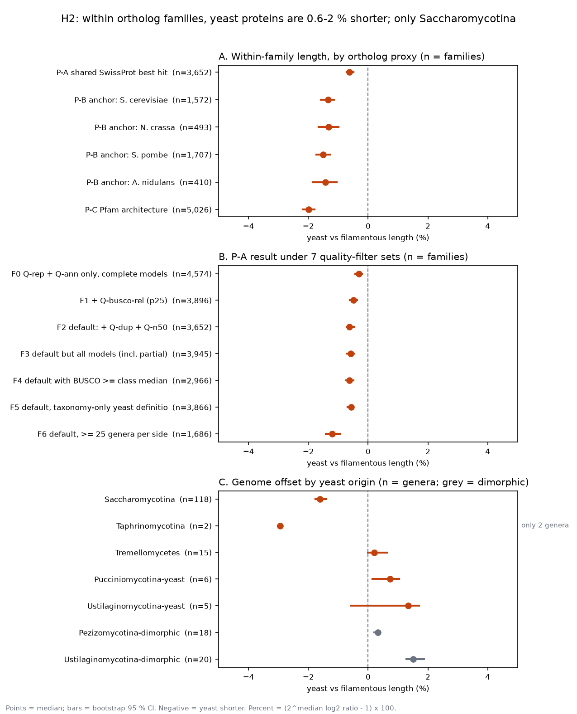
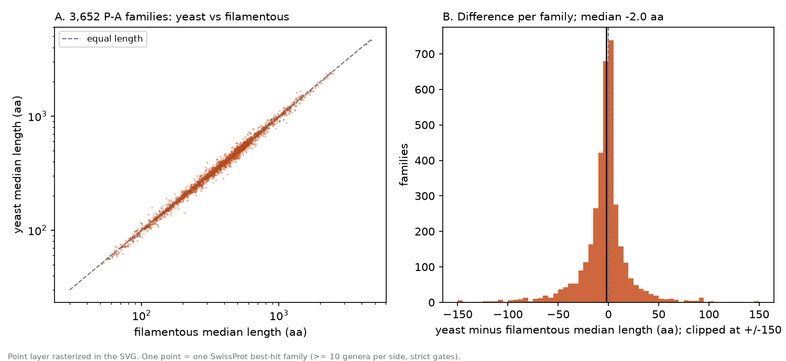

# Are yeast proteins shorter than filamentous-fungal orthologs?

Report on hypothesis H2 of the BFD summary atlas. Date: 2026-11-08.
Data: BFD snapshot tables (`Fungi_BFD_runs/tables`, 23,680 genomes). Build: atlas P1 + P2.

[Atlas index](index.md) · [Full H2 page with all views](H2_protein_length.md) · [Build plan and log](PLAN.md)

## 1. Answer

**Yes, but the difference is small, and it is a Saccharomycotina trait, not a general yeast trait.**

- Within ortholog families, yeast proteins are **0.6 % to 2.0 % shorter** than filamentous proteins.
- All three ortholog proxies give the same direction. The 95 % confidence intervals of all proxies exclude zero.
- The typical difference is **about 2 amino acids** in a protein of about 375 aa (median over 3,652 families).
- The spread between families is much larger than the shift. One family in three has the yeast protein longer.
- Only Saccharomycotina (118 genera, 1.6 % shorter) and Taphrinomycotina (2 genera) show shorter proteins. Basidiomycete yeasts show **longer** proteins (+0.2 % to +1.3 %).
- Raw median protein length, without ortholog matching, is **longer** in yeasts (414 vs 401 aa). Yeast proteomes have more multi-domain proteins.

*Figure 1. Percent length difference, yeast vs filamentous. A: three ortholog proxies. B: the P-A result under 7 quality-filter sets. C: genome offset by independent yeast origin. Points = median; bars = bootstrap 95 % CI. Negative = yeast shorter.*

## 2. How large is the difference?

*Figure 2. A: median yeast length vs median filamentous length for 3,652 P-A families (log scale). The points lie on the line of equal length. B: per-family difference in amino acids. The median is −2.0 aa.*

| Measure (P-A, 3,652 families) | Value |
|---|---|
| Median filamentous length | 375.1 aa |
| Median yeast length | 371.0 aa |
| Median per-family difference (yeast − filamentous) | −2.0 aa |
| Families with yeast shorter / longer / tied (aa) | 2,062 / 1,383 / 207 |
| Median log2 ratio (95 % CI) | −0.0090 (−0.0104 to −0.0071) |
| Length ratio yeast / filamentous | 0.994 |
| 10th / 90th percentile of log2 ratio | −0.102 / +0.058 |

Note: the sign counts above use differences in amino acids. The H2 page uses log2 ratios and reports 2,063 of 3,446 non-tied families. The 1-family difference comes from rounding of medians.

## 3. Result by ortholog proxy

No orthology table exists in BFD. We used three proxies. Each has a different bias.

| Proxy | Definition | Families | Median log2 ratio (95 % CI) | Length change | Yeast shorter | Binomial p |
|---|---|---|---|---|---|---|
| P-A | Shared SwissProt best hit (qcov, scov ≥ 80 %; pident ≥ 40 %) | 3,652 | −0.009 (−0.010 to −0.007) | −0.6 % | 59.9 % | 3.9e-31 |
| P-B | Best hit in the *S. cerevisiae* proteome | 1,572 | −0.019 (−0.023 to −0.017) | −1.3 % | 69.3 % | 1.1e-51 |
| P-B | Best hit in the *N. crassa* proteome | 493 | −0.019 (−0.024 to −0.014) | −1.3 % | 71.3 % | 5.0e-20 |
| P-B | Best hit in the *S. pombe* proteome | 1,707 | −0.022 (−0.025 to −0.018) | −1.5 % | 70.4 % | 2.9e-62 |
| P-B | Best hit in the *A. nidulans* proteome | 410 | −0.021 (−0.027 to −0.015) | −1.4 % | 71.0 % | 7.5e-17 |
| P-C | Same Pfam domain architecture (≥ 2 domains) | 5,026 | −0.029 (−0.032 to −0.026) | −2.0 % | 63.9 % | 2.3e-87 |

**Reference bias check.** Saccharomycotina proteins often hit *S. cerevisiae* entries in SwissProt. This could bias P-A. P-B removes this bias: each genome is matched to one fixed reference proteome. The *S. cerevisiae* anchor and the *N. crassa* anchor give the same median (−0.019). So the choice of reference does not create the signal. The bias itself is real: yeast genomes have a median of 1,599 strict *S. cerevisiae* anchors vs 931 in filamentous genomes.

| Reference proteome | Median strict anchors, filamentous genome | Median strict anchors, yeast genome |
|---|---|---|
| *S. cerevisiae* | 931 | 1,599 |
| *S. pombe* | 1,140 | 1,006 |
| *N. crassa* | 620 | 282 |
| *A. nidulans* | 598.5 | 207 |

## 4. Result under different quality filters

Saccharomycotina genomes have lower BUSCO completeness (median 75–84 %) than large filamentous classes (98–99 %). Truncated gene models could make proteins look shorter. We changed the filters to test this.

| Filter set | Families | Median log2 ratio (95 % CI) | Yeast shorter |
|---|---|---|---|
| F0 representative genomes, annotated, complete models | 4,574 | −0.004 (−0.006 to −0.003) | 56.2 % |
| F1 + BUSCO ≥ class 25th percentile | 3,896 | −0.007 (−0.009 to −0.005) | 58.5 % |
| **F2 default: + BUSCO duplication ≤ 10 %, N50 ≥ 50 kb** | 3,652 | −0.009 (−0.010 to −0.007) | 59.9 % |
| F3 default, partial models included | 3,945 | −0.008 (−0.010 to −0.007) | 59.5 % |
| F4 default, BUSCO ≥ class median | 2,966 | −0.009 (−0.011 to −0.007) | 59.6 % |
| F5 default, yeast defined by taxonomy only | 3,866 | −0.008 (−0.010 to −0.007) | 59.6 % |
| F6 default, ≥ 25 genera per side | 1,686 | −0.017 (−0.020 to −0.014) | 66.8 % |

The direction does not change. Stricter BUSCO filters do not remove the effect (F4 vs F2). Including partial models does not increase it (F3 vs F2). This argues against gene-model truncation as the main cause. It does not rule it out: the filters measure genome completeness, not the accuracy of each gene model.

## 5. Result by independent yeast origin

Yeast growth evolved several times. Each origin is an independent test.

| Yeast origin | Genera | Median offset log2 (95 % CI) | Length change |
|---|---|---|---|
| Saccharomycotina | 118 | −0.024 (−0.026 to −0.020) | −1.6 % |
| Taphrinomycotina | 2 | −0.043 (−0.044 to −0.042) | −2.9 % (2 genera only) |
| Tremellomycetes | 15 | +0.003 (0.000 to +0.009) | +0.2 % |
| Pucciniomycotina yeasts | 6 | +0.010 (+0.002 to +0.015) | +0.7 % |
| Ustilaginomycotina yeasts | 5 | +0.019 (−0.008 to +0.024) | +1.3 % |
| Pezizomycotina dimorphic | 18 | +0.005 (+0.003 to +0.006) | +0.3 % |
| Ustilaginomycotina dimorphic | 20 | +0.022 (+0.018 to +0.027) | +1.5 % |

Offset = median over families of log2(genome length / filamentous family median), then the median over genera.

Sister-clade pairs (V14) give the same picture: Saccharomycotina vs Pezizomycotina −0.024 (Mann-Whitney p = 2.7e-70); Tremellomycetes vs Agaricomycetes +0.003; two pairs have only one genus on one side.

**Conclusion:** the pooled yeast result comes mostly from Saccharomycotina. Saccharomycotina are 118 of about 150 yeast genera in the analysis.

## 6. Why raw protein length goes the other way

| Measure (genus medians) | Yeast | Filamentous | Difference (95 % CI) |
|---|---|---|---|
| Median protein length, all proteins (V07) | 414.5 aa | 401 aa | +13.5 aa (+9.5 to +16.3) |
| Proteins with ≥ 2 Pfam domains (V31) | 40.4 % | 32.6 % | +7.8 points (+7.3 to +8.1) |
| Proteins with any Pfam domain (V31) | 85.3 % | 70.5 % | — |

Yeast proteomes contain more long, multi-domain proteins and fewer short proteins without domains (for example small secreted proteins). This raises the raw median. Inside each family, the yeast copy is still slightly shorter. A comparison of raw medians therefore gives the wrong answer for this question.

## 7. Larger effects in single families

The table lists the 10 P-A families with the largest yeast shortening (from `tables/V13_extreme_families.tsv`). These are single families. Do not read them as a general pattern.

| SwissProt family | Reference | Yeast genera | Filamentous genera | Yeast median (aa) | Filamentous median (aa) | log2 ratio |
|---|---|---|---|---|---|---|
| Small nuclear ribonucleoprotein-associated protein B | SCHPO | 32 | 16 | 141.5 | 204.5 | −0.53 |
| tRNA (cytidine32/guanosine34-2'-O)-methyltransferase | SCHPO | 10 | 499 | 285 | 393 | −0.46 |
| Ser/Thr protein phosphatase PP-X isozyme 1 | ARATH | 36 | 364 | 308.5 | 420 | −0.45 |
| Putative GTPase-activating protein AN11010 | EMENI | 12 | 492 | 879.5 | 1131 | −0.36 |
| tRNA (carboxymethyluridine34-5-O)-methyltransferase | YEAST | 83 | 62 | 262 | 331.5 | −0.34 |
| Dehydrodolichyl diphosphate synthase subunit | SCHPO | 45 | 422 | 276 | 346 | −0.33 |
| CDP-diacylglycerol--inositol 3-phosphatidyltransferase | SCHPO | 43 | 560 | 235 | 293 | −0.32 |
| Alpha-ketoglutarate dehydrogenase subunit 4 | THET3 | 11 | 488 | 106 | 132 | −0.32 |
| UDP-galactose transporter | SCHPO | 29 | 461 | 362 | 449.5 | −0.31 |
| Molybdenum cofactor biosynthesis protein 1 | HUMAN | 22 | 154 | 543.5 | 670 | −0.30 |

## 8. Methods in short

- **Genomes.** One representative genome per species. Filters: annotated; BUSCO complete ≥ 25th percentile of its class; BUSCO duplicated ≤ 10 %; N50 ≥ 50 kb; complete gene models only (start and stop codon).
- **Yeast label.** FungalTraits 1.2 growth form, joined on genus, plus an override file for about 30 genera that FungalTraits lacks. Dimorphic genera form a separate group.
- **Unit of replication.** The family (P-A, P-B, P-C), or the genus (origins, sister pairs). Family value = median over genera of the per-genome median length. Families need ≥ 10 yeast and ≥ 10 filamentous genera.
- **Statistics.** Median log2(yeast / filamentous) with bootstrap 95 % CI; sign test (binomial) over families; Mann-Whitney for sister pairs.
- **Code.** `bin/atlas/` (SQL jobs J3, J5, render), `workflows/atlas/` (sbatch). Summary figures in this report: `bin/atlas/report_h2_summary.py`.

## 9. Limits

- **No true orthology.** All three proxies are approximations. P-A and P-B can mix paralogs. P-C groups proteins by domain order, not by descent.
- **Gene-model quality.** Filters reduce but do not remove the risk that truncated gene models make yeast proteins look shorter. A direct test needs gene-model accuracy per gene, for example RNA-seq support. That is not in the atlas.
- **No phylogenetic regression yet.** The genus tree (1,654 genera, phyling + FastTree) is still running. PGLS is pending. The independent-origin and sister-pair analyses partly replace it.
- **Uneven sampling.** Saccharomycotina dominate the yeast set (118 of about 150 genera). Basidiomycete yeast origins have 5–15 genera each. Taphrinomycotina has 2.
- **Small p-values.** The p-values are small because there are thousands of families. They do not mean the effect is large. Use the effect size: 0.6–2 %.

## 10. Next steps

1. Add PGLS on genus medians when the tree finishes.
2. Test gene-model accuracy: compare lengths only in genomes with RNA-seq-supported annotation (decision D8 in the plan).
3. Find where the shortening is located in the protein: N-terminus, C-terminus, or linkers between domains. Use the alignment coordinates in `swissprot_best` (q_start, q_end, s_start, s_end).
4. Add more basidiomycete yeast genomes to test whether those origins are really longer.

## 11. Follow-up (H2b, 2026-11-08)

The PI's follow-up questions are answered on [H2b_compaction_extremes.md](H2b_compaction_extremes.md) (views V50-V56, code `bin/atlas/h2b_build.py`, `bin/atlas/render_h2b.py`, job `workflows/atlas/J8_h2b.sh`). In short:

- Genome compaction predicts shorter orthologs inside Saccharomycotina (genus-level Spearman rho -0.43 with genes per Mb, +0.44 with genome size; mixed model +0.012 log2 per SD of log genome size), but the slope is small (about 1 % per genome doubling) and the clade mean offset of -0.024 remains at mean compaction. The relation is absent or reversed in filamentous Pezizomycotina and absent in Tremellomycetes.
- Annotation quality does not explain the offset inside Saccharomycotina (BUSCO rho -0.07, N50 +0.06; RNA-seq-trained genomes -0.020 vs -0.025).
- 301 of 2,313 P-A families shrink consistently (>= 80 % of Saccharomycotina genera below the filamentous 10th percentile, >= 20 aa or 5 %); the loss is internal or N-terminal and mostly disordered sequence (188 of 301 lose >= 10 disordered residues; 7 lose a Pfam domain).
- 54 families are consistently longer; extra Pfam domains explain few of them (8.7 % vs 3.6 % in unchanged families); most gains are N-terminal extensions.
