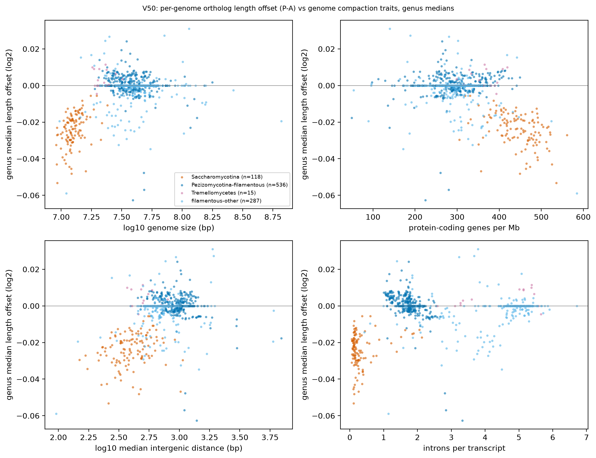
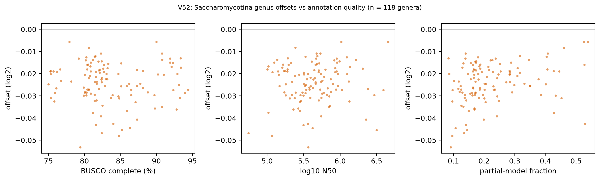
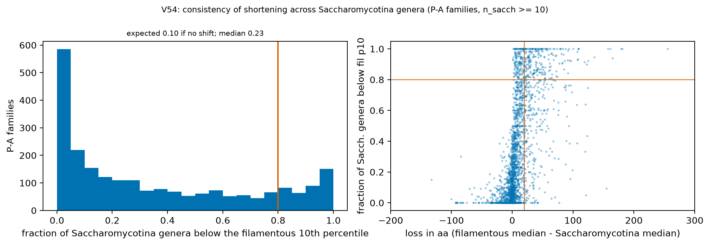
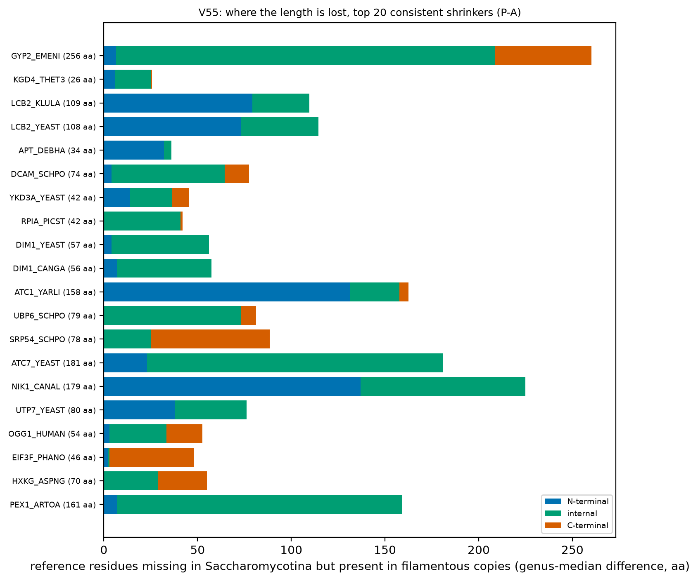
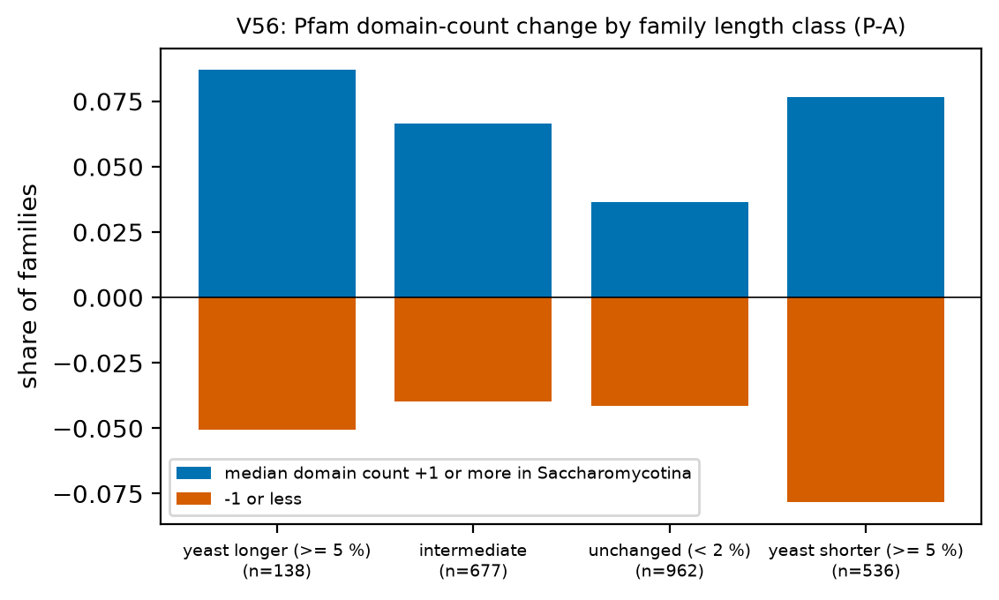

# H2b. Genome compaction, consistent shrinkers and gainers

Follow-up to [H2](H2_protein_length.md) and the [H2 report](H2_report.md). Questions: (1) is the Saccharomycotina ortholog shortening explained by genome compaction, within clades and not only between them, and does annotation quality explain it; (2) which families shrink consistently across Saccharomycotina genera, where in the protein, and what is lost; (3) which families are consistently longer, and is that extra domains.

[Back to index](index.md)

## Q1. Genome compaction

### V50 Length offset versus genome compaction, within and between clades

- Unit = genus (median over representative genomes; 1,146 genera, 4,654 genomes). Offset = median over SwissProt families (>= 200 per genome) of log2(genome length / filamentous family median), as V09. Filters: Q-ann, Q-rep (one genome per species), Q-busco-rel (BUSCO complete >= class 25th percentile), Q-dup (BUSCO duplicated <= 10 %), Q-n50 (N50 >= 50 kb), Q-model (complete gene models only). Compaction traits from A2 and asm_stats. Spearman rho with bootstrap 95 % CI; OLS slope of offset on the trait (intergenic distance on log10 scale).

| trait | clade_group | n | rho | ci_lo | ci_hi | slope | slope_lo | slope_hi |
|---|---|---|---|---|---|---|---|---|
| log_genome | Saccharomycotina | 118 | 0.440 | 0.277 | 0.592 | 0.049 | 0.030 | 0.069 |
| log_genome | Pezizomycotina-filamentous | 536 | -0.156 | -0.238 | -0.074 | -0.008 | -0.012 | -0.005 |
| log_genome | Tremellomycetes | 15 | 0.083 | -0.467 | 0.659 | 0.004 | -0.038 | 0.045 |
| log_genome | filamentous-other | 287 | 0.064 | -0.078 | 0.194 | 0.004 | -7.18e-04 | 0.010 |
| log_genome | all genera | 1,146 | 0.132 | 0.062 | 0.206 | 0.022 | 0.019 | 0.025 |
| genes_per_mb | Saccharomycotina | 118 | -0.429 | -0.575 | -0.264 | -7.29e-05 | -1.03e-04 | -4.27e-05 |
| genes_per_mb | Pezizomycotina-filamentous | 536 | 0.104 | 0.018 | 0.193 | 1.84e-05 | 9.23e-06 | 2.76e-05 |
| genes_per_mb | Tremellomycetes | 15 | 0.074 | -0.493 | 0.561 | 1.04e-05 | -7.09e-05 | 9.17e-05 |
| genes_per_mb | filamentous-other | 287 | -0.161 | -0.300 | -0.037 | -3.96e-05 | -5.66e-05 | -2.26e-05 |
| genes_per_mb | all genera | 1,146 | -0.215 | -0.279 | -0.146 | -7.62e-05 | -8.47e-05 | -6.76e-05 |
| median_intergenic | Saccharomycotina | 118 | 0.312 | 0.129 | 0.468 | 0.014 | 0.004 | 0.025 |
| median_intergenic | Pezizomycotina-filamentous | 536 | -0.158 | -0.245 | -0.065 | -0.015 | -0.019 | -0.010 |
| median_intergenic | Tremellomycetes | 15 | -0.095 | -0.586 | 0.502 | -0.006 | -0.037 | 0.024 |
| median_intergenic | filamentous-other | 287 | 0.103 | -0.031 | 0.248 | 0.008 | 0.002 | 0.014 |
| median_intergenic | all genera | 1,146 | 0.224 | 0.152 | 0.290 | 0.026 | 0.022 | 0.029 |
| introns_per_transcript | Saccharomycotina | 118 | -0.008 | -0.201 | 0.174 | 0.005 | 7.33e-04 | 0.009 |
| introns_per_transcript | Pezizomycotina-filamentous | 536 | -0.443 | -0.523 | -0.365 | -0.010 | -0.011 | -0.008 |
| introns_per_transcript | Tremellomycetes | 15 | 0.142 | -0.471 | 0.788 | 0.002 | -8.28e-04 | 0.004 |
| introns_per_transcript | filamentous-other | 287 | 0.293 | 0.170 | 0.424 | 0.002 | 0.001 | 0.003 |
| introns_per_transcript | all genera | 1,146 | 0.069 | -0.005 | 0.133 | 0.002 | 0.001 | 0.002 |

- Table: `tables/V50_spearman_by_clade.tsv`. PGLS pending tree.

### V51 Partial association of the offset with compaction after growth form and taxonomy

- Mixed models on genus medians (statsmodels MixedLM, REML). Traits standardized (effect = change in log2 offset per 1 SD of the trait). Across all genera: random intercepts CLASS and ORDER within CLASS, growth form (yeast = 1) as fixed covariate. Within a clade: random intercepts ORDER and FAMILY within ORDER.

| model | trait | n_genera | trait_effect_per_SD | ci_lo | ci_hi | p | yeast_effect | yeast_ci_lo | yeast_ci_hi | converged |
|---|---|---|---|---|---|---|---|---|---|---|
| all genera: offset ~ trait + yeast + (1|CLASS/ORDER) | log_genome | 1,117 | 7.07e-04 | -1.46e-05 | 0.001 | 0.055 | -0.003 | -0.007 | 1.02e-04 | 1 |
| Saccharomycotina: offset ~ trait + (1|ORDER/FAMILY) | log_genome | 114 | 0.012 | 0.007 | 0.016 | 2.62e-07 | NA | NA | NA | 1 |
| Pezizomycotina-filamentous: offset ~ trait + (1|ORDER/FAMILY) | log_genome | 502 | -0.001 | -0.002 | -6.37e-05 | 0.037 | NA | NA | NA | 1 |
| all genera: offset ~ trait + yeast + (1|CLASS/ORDER) | genes_per_mb | 1,117 | -0.002 | -0.002 | -0.001 | 1.27e-08 | -0.003 | -0.007 | 2.82e-04 | 1 |
| Saccharomycotina: offset ~ trait + (1|ORDER/FAMILY) | genes_per_mb | 114 | -0.004 | -0.007 | -0.002 | 1.74e-04 | NA | NA | NA | 0 |
| Pezizomycotina-filamentous: offset ~ trait + (1|ORDER/FAMILY) | genes_per_mb | 502 | 4.26e-04 | -3.53e-04 | 0.001 | 0.284 | NA | NA | NA | 1 |
| all genera: offset ~ trait + yeast + (1|CLASS/ORDER) | median_intergenic | 1,117 | 0.001 | 6.89e-04 | 0.002 | 4.66e-05 | -0.003 | -0.007 | 8.75e-05 | 1 |
| Saccharomycotina: offset ~ trait + (1|ORDER/FAMILY) | median_intergenic | 114 | 0.002 | 3.40e-04 | 0.004 | 0.021 | NA | NA | NA | 1 |
| Pezizomycotina-filamentous: offset ~ trait + (1|ORDER/FAMILY) | median_intergenic | 502 | -0.002 | -0.003 | -8.90e-04 | 3.40e-04 | NA | NA | NA | 1 |
| all genera: offset ~ trait + yeast + (1|CLASS/ORDER) | introns_per_transcript | 1,117 | 2.06e-04 | -0.001 | 0.002 | 0.801 | -0.003 | -0.007 | 2.78e-05 | 1 |
| Saccharomycotina: offset ~ trait + (1|ORDER/FAMILY) | introns_per_transcript | 114 | 0.013 | 0.002 | 0.024 | 0.026 | NA | NA | NA | 1 |
| Pezizomycotina-filamentous: offset ~ trait + (1|ORDER/FAMILY) | introns_per_transcript | 502 | -0.023 | -0.027 | -0.019 | 8.67e-30 | NA | NA | NA | 1 |

- Reading: a trait effect with a CI excluding zero inside Saccharomycotina means compaction predicts shorter orthologs within the clade; the yeast effect in the all-genera model is the growth-form difference that the trait does not absorb. Table: `tables/V51_mixed_models.tsv`. PGLS pending tree.

### V52 Does annotation quality explain the Saccharomycotina offset?

- Within Saccharomycotina: 118 genera (833 representative genomes). Spearman rho of the genus offset with each covariate:

| covariate | n | rho | ci_lo | ci_hi | p |
|---|---|---|---|---|---|
| BUSCO complete (%) | 118 | -0.070 | -0.240 | 0.119 | 0.451 |
| log10 N50 | 118 | 0.064 | -0.136 | 0.265 | 0.494 |
| partial-model fraction | 118 | 0.281 | 0.093 | 0.465 | 0.002 |
| log10 genome size | 118 | 0.440 | 0.280 | 0.598 | 6.25e-07 |
| genes per Mb | 118 | -0.429 | -0.576 | -0.242 | 1.24e-06 |

- RNA-seq-trained genomes (a `training/funannotate_train.pasa.gff3` or `kallisto.tsv` file exists): n = 53 genomes, median offset -0.020; not trained: n = 780, median -0.025; difference 0.005 (95 % CI 0.003 to 0.008), p = 9.92e-05 (genome level, not independent).
- Joint OLS on genus medians, standardized covariates (offset ~ log genome size + BUSCO + log N50 + partial fraction):

| term | coef_per_SD | ci_lo | ci_hi | p |
|---|---|---|---|---|
| intercept | -0.024 | -0.026 | -0.023 | 2.71e-60 |
| log_genome | 0.005 | 0.003 | 0.006 | 6.56e-07 |
| busco_complete | -0.002 | -0.004 | -5.86e-04 | 0.009 |
| log_n50 | 0.001 | 1.15e-05 | 0.003 | 0.048 |
| partial_fraction | 0.002 | 1.27e-05 | 0.003 | 0.048 |

- Caveat: the offset uses complete models only, so partial-model fraction acts through which genes remain, not through truncated lengths. Tables: `tables/V52_quality_rho.tsv`, `tables/V52_joint_ols.tsv`.

## Q2. Consistent extreme shrinkers

### V54 How consistent is the shortening across families?

- Per family: genus medians of the per-genome median length (complete models, strict gates, representative genomes with default filters). Filamentous percentiles are taken over filamentous genera. Shrinker rule: n_sacch >= 10, n_fil >= 10, >= 80 % of Saccharomycotina genera below the filamentous 10th percentile, loss >= 20 aa or >= 5 %. Gainer rule: n_sacch >= 10, n_fil >= 10, >= 80 % of Saccharomycotina genera above the filamentous 90th percentile, gain >= 20 aa or >= 5 %.

| proxy | families (n_sacch >= 10) | median loss aa (fil - sacch) | >= 80 % sacch below fil p10 | consistent shrinkers (rule) | shrinkers (p25 rule, >= 90 %) | >= 80 % sacch above fil p90 | consistent gainers (rule) | median sacch_frac_below_p25 |
|---|---|---|---|---|---|---|---|---|
| P-A | 2,313 | 5.000 | 388 | 301 | 354 | 73 | 54 | 0.500 |
| P-B-YEAST | 1,563 | 5.000 | 243 | 194 | 250 | 47 | 37 | 0.485 |
| P-B-NEUCR | 463 | 4.000 | 93 | 73 | 83 | 13 | 9 | 0.505 |
| P-C | 4,033 | 16.500 | 600 | 565 | 702 | 102 | 95 | 0.494 |

- Reading: with no shift, 10 % of Saccharomycotina genera would fall below the filamentous 10th percentile. Table: `tables/V54_consistency_summary.tsv`.

### V55 Consistent extreme shrinkers

- Rule: n_sacch >= 10, n_fil >= 10, >= 80 % of Saccharomycotina genera below the filamentous 10th percentile, loss >= 20 aa or >= 5 %. P-A: 301 families; P-B (S. cerevisiae anchor): 194; P-B (N. crassa anchor): 73; P-C: 565 architectures. 71 families are consistent shrinkers in both P-A and P-B (S. cerevisiae anchor).
- Location (P-A shrinkers, from alignment coordinates against the SwissProt reference): internal 111; mixed 75; N-terminal 66; C-terminal 49. 7 of 301 families lose a Pfam domain (present in >= 50 % of filamentous genera, <= 20 % of Saccharomycotina genera); 188 lose >= 10 disordered residues (idp_summary genus medians).
- Top 10 by consistency then relative loss:

| entry_name | protein_name | n_sacch | fil_median | sacch_median | loss_aa | loss_frac | sacch_frac_below_p10 | n_origins_shorter | n_origins_tested | location | d_nterm | d_cterm | d_internal | domains_lost | d_idp_res |
|---|---|---|---|---|---|---|---|---|---|---|---|---|---|---|---|
| GYP2_EMENI | Putative GTPase-activating protein AN11010 | 10 | 1131.000 | 875.500 | 255.500 | 0.226 | 1.000 | 1 | 1 | internal | 6.500 | 51.500 | 202.250 | NA | -298.000 |
| KGD4_THET3 | Alpha-ketoglutarate dehydrogenase subunit 4, mitochondr | 10 | 132.000 | 106.000 | 26.000 | 0.197 | 1.000 | 1 | 1 | internal | 6.000 | 0.750 | 19.000 | NA | -35.000 |
| LCB2_KLULA | Serine palmitoyltransferase 2 | 94 | 671.500 | 562.500 | 109.000 | 0.162 | 1.000 | 1 | 1 | N-terminal | 79.250 | -3.000 | 30.500 | NA | -70.000 |
| LCB2_YEAST | Serine palmitoyltransferase 2 | 26 | 675.000 | 566.500 | 108.500 | 0.161 | 1.000 | 1 | 2 | N-terminal | 73.000 | -2.500 | 41.500 | NA | -82.500 |
| APT_DEBHA | Adenine phosphoribosyltransferase | 19 | 218.000 | 184.000 | 34.000 | 0.156 | 1.000 | 1 | 1 | N-terminal | 32.000 | -3.000 | 4.000 | NA | NA |
| DCAM_SCHPO | S-adenosylmethionine decarboxylase proenzyme / S-adenos | 21 | 479.000 | 405.000 | 74.000 | 0.154 | 1.000 | 1 | 1 | internal | 4.000 | 13.000 | 60.500 | NA | -41.500 |
| YKD3A_YEAST | Probable pseudouridine-5'-phosphatase YKL033W-A | 104 | 276.000 | 233.500 | 42.500 | 0.154 | 1.000 | 1 | 1 | mixed | 14.000 | 9.000 | 22.500 | NA | NA |
| RPIA_PICST | Ribose-5-phosphate isomerase | 41 | 280.000 | 238.000 | 42.000 | 0.150 | 1.000 | 1 | 1 | internal | -1.000 | 1.000 | 41.000 | NA | NA |
| DIM1_YEAST | Dimethyladenosine transferase | 23 | 381.000 | 324.000 | 57.000 | 0.150 | 1.000 | 1 | 1 | internal | 4.000 | 0.000 | 52.000 | NA | -42.750 |
| DIM1_CANGA | Dimethyladenosine transferase | 32 | 380.500 | 324.000 | 56.500 | 0.148 | 1.000 | 1 | 1 | internal | 7.000 | 0.000 | 50.500 | NA | -44.000 |

- Full ranked tables: `tables/V55_consistent_shrinkers_PA.tsv`, `tables/V55_consistent_shrinkers_P-B-YEAST.tsv`, `tables/V55_consistent_shrinkers_P-B-NEUCR.tsv`, `tables/V55_consistent_shrinkers_PC.tsv`. `n_origins_shorter` counts independent yeast origins (>= 3 genera) whose median is below the filamentous median.
- Caveats: alignment coordinates come from the best SwissProt hit, so 'internal' includes alignment gaps, not only deletions; a domain counted as lost may be present below the e-value gate; paralogs can be mixed in a family; protein names and GO terms are those of the reference, not of the fungal protein.

## Q3. Consistent gainers and domain gain

### V56 Families where Saccharomycotina proteins are longer: is it extra domains?

- P-A families with n_sacch >= 10 and domain counts on both sides (2,313); class by relative length change of the Saccharomycotina median vs the filamentous median; domain change = Saccharomycotina genus-median Pfam domain count minus filamentous.

| class | n_families | share_domain_gain_ge1 | share_domain_gain_ge05 | share_domain_loss_ge1 | median_ndom_fil | median_ndom_sacch |
|---|---|---|---|---|---|---|
| yeast longer (>= 5 %) | 138 | 0.087 | 0.087 | 0.051 | 2.000 | 2.000 |
| intermediate | 677 | 0.066 | 0.087 | 0.040 | 2.000 | 2.000 |
| unchanged (< 2 %) | 962 | 0.036 | 0.054 | 0.042 | 2.000 | 2.000 |
| yeast shorter (>= 5 %) | 536 | 0.076 | 0.103 | 0.078 | 2.000 | 2.000 |

- Consistent gainers (rule: n_sacch >= 10, n_fil >= 10, >= 80 % of Saccharomycotina genera above the filamentous 90th percentile, gain >= 20 aa or >= 5 %): 54 P-A families; 37 P-B (S. cerevisiae anchor); 9 P-B (N. crassa anchor); 95 P-C architectures. Among the P-A gainers, 9 % have a median domain count higher by >= 1, and 3 carry a Pfam domain present in >= 50 % of Saccharomycotina genera but <= 20 % of filamentous genera.
- Top 10 consistent gainers:

| entry_name | protein_name | n_sacch | fil_median | sacch_median | gain_aa | gain_frac | sacch_frac_above_p90 | n_origins_longer | n_origins_tested | ndom_gain_sacch | domains_gained | location | d_idp_res |
|---|---|---|---|---|---|---|---|---|---|---|---|---|---|
| SEO1_YEAST | Probable transporter SEO1 | 90 | 485.000 | 577.625 | 92.625 | 0.191 | 1.000 | 1 | 1 | 0.000 | NA | N-terminal | 11.000 |
| CYB2_YEAST | L-lactate dehydrogenase (cytochrome) | 11 | 494.000 | 585.000 | 91.000 | 0.184 | 1.000 | 2 | 2 | 1.000 | PF01645 | N-terminal | -30.500 |
| GPA3_NEUCR | Guanine nucleotide-binding protein alpha-3 subunit | 14 | 355.000 | 419.500 | 64.500 | 0.182 | 1.000 | 1 | 1 | 0.000 | NA | N-terminal | 63.500 |
| TPO11_CANGA | Multidrug transporter TPO1_1 | 11 | 495.500 | 582.000 | 86.500 | 0.175 | 1.000 | 1 | 1 | 0.000 | NA | N-terminal | 86.500 |
| MGN_ARATH | Protein mago nashi homolog | 13 | 149.000 | 174.000 | 25.000 | 0.168 | 1.000 | 2 | 2 | 0.000 | NA | N-terminal | NA |
| CFIS2_ARATH | Pre-mRNA cleavage factor Im 25 kDa subunit 2 | 12 | 208.000 | 242.500 | 34.500 | 0.166 | 1.000 | 3 | 4 | 0.000 | NA | N-terminal | 19.000 |
| RT02_YEAST | Small ribosomal subunit protein uS14m | 16 | 101.000 | 117.000 | 16.000 | 0.158 | 1.000 | 3 | 3 | 0.000 | NA | N-terminal | NA |
| AMPP1_COLGM | Probable Xaa-Pro aminopeptidase P | 11 | 617.000 | 710.000 | 93.000 | 0.151 | 1.000 | 1 | 1 | 0.000 | NA | N-terminal | 18.500 |
| RT02_EREGS | Small ribosomal subunit protein uS14m | 104 | 100.000 | 115.000 | 15.000 | 0.150 | 1.000 | 3 | 3 | 0.000 | NA | N-terminal | NA |
| AMPP1_SORMK | Probable Xaa-Pro aminopeptidase P | 10 | 614.000 | 704.000 | 90.000 | 0.147 | 1.000 | 1 | 1 | 0.000 | NA | N-terminal | 26.000 |

- Tables: `tables/V56_domain_gain_by_class.tsv`, `tables/V56_consistent_gainers_PA.tsv`, `tables/V56_consistent_gainers_P-B-YEAST.tsv`, `tables/V56_consistent_gainers_P-B-NEUCR.tsv`. Location for gainers = where the extra residues sit relative to the reference (sign reversed). Caveats as V55.

## Verdict

**Q1, compaction: partly, and only inside Saccharomycotina.** Within Saccharomycotina (118 genera) a more compact genome predicts shorter orthologs: Spearman rho of the genus offset with genes per Mb is -0.43 (95 % CI -0.58 to -0.26), with log genome size +0.44 (0.28 to 0.59), with log intergenic distance +0.31 (0.13 to 0.47); intron density shows no association (rho -0.01). The mixed model inside the clade (random intercepts ORDER/FAMILY) keeps these effects: +0.012 log2 per SD of log genome size (CI 0.007 to 0.016), -0.004 per SD of genes per Mb (CI -0.007 to -0.002, fit not converged). The effect size is small: the slope of 0.049 log2 per log10 bp means a 2-fold larger Saccharomycotina genome has orthologs about 1 % longer, against a clade mean offset of -0.024 (1.6 % shorter). Compaction therefore explains part of the variation inside Saccharomycotina but not the clade shift itself: at the clade mean of every trait the intercept stays at -0.024 (V52 joint OLS). The relation is not general: inside filamentous Pezizomycotina (536 genera) the signs are reversed and weak (rho -0.16 for genome size, +0.10 for genes per Mb), intron density correlates negatively there (rho -0.44), and Tremellomycetes (15 genera) show nothing. In the all-genera mixed model with growth form as covariate, genes per Mb keeps a small effect (-0.002 per SD, CI -0.002 to -0.001) and the yeast coefficient is -0.003 (CI -0.007 to +0.0001); that model is confounded because growth form is nearly constant within class, so it cannot separate compaction from clade. PGLS pending tree.

**Q1, annotation quality: no.** Inside Saccharomycotina the offset is unrelated to BUSCO completeness (rho -0.07, CI -0.24 to 0.12) and N50 (rho +0.06). The partial-model fraction correlates positively (rho +0.28): genomes with more partial models have less shortening, the opposite of a truncation artefact (the offset uses complete models only). RNA-seq-trained genomes (53 of 833) have a median offset of -0.020 against -0.025 for the rest, so annotation without RNA-seq adds at most about 0.3 % to a 1.6 % effect. In the joint OLS, log genome size keeps its effect (+0.005 per SD) with BUSCO, N50 and partial fraction in the model.

**Q2, consistent shrinkers: a minority of families, and the loss is mostly disordered, internal or N-terminal sequence, not domains.** Median loss across families is only 4-5 aa (P-A, P-B) and 16.5 aa for P-C. With the rule ">= 80 % of Saccharomycotina genera below the filamentous 10th percentile and loss >= 20 aa or >= 5 %", 301 of 2,313 P-A families (13 %), 194 of 1,563 P-B (S. cerevisiae anchor), 73 of 463 P-B (N. crassa anchor) and 565 of 4,033 P-C architectures qualify; 71 families qualify under both P-A and the S. cerevisiae anchor. In the 301 P-A shrinkers the lost residues are internal in 111 families, mixed in 75, N-terminal in 66 and C-terminal in 49. Only 7 of 301 lose a Pfam domain; 188 of 301 lose >= 10 predicted disordered residues. The largest consistent losses (all Saccharomycotina genera below the filamentous 10th percentile) are GTPase-activating protein AN11010 (-256 aa, internal, -298 disordered residues), serine palmitoyltransferase LCB2 (-109 aa, N-terminal), S-adenosylmethionine decarboxylase (-74 aa, internal), dimethyladenosine transferase DIM1 (-57 aa, internal), pseudouridine-5'-phosphatase YKL033W-A (-43 aa), ribose-5-phosphate isomerase (-42 aa, internal), adenine phosphoribosyltransferase (-34 aa, N-terminal) and alpha-ketoglutarate dehydrogenase subunit 4 (-26 aa). Functions are housekeeping enzymes of metabolism and RNA processing; this list is the reference's annotation and is not a tested enrichment. Only Saccharomycotina has enough genera per family to test an origin, so "independent origins shorter" is 1 of 1 for most families.

**Q3, consistent gainers: not explained by extra domains.** 54 P-A families (37 with the S. cerevisiae anchor, 9 with the N. crassa anchor, 95 P-C architectures) are consistently longer in Saccharomycotina. Among P-A families with >= 5 % longer Saccharomycotina medians, 8.7 % show a median Pfam domain count higher by >= 1, against 3.6 % of unchanged families and 7.6 % of families that are >= 5 % shorter; 3 of the 54 consistent gainers carry a Saccharomycotina-specific Pfam domain. The top gainers are N-terminal extensions (transporter SEO1 +93 aa, L-lactate dehydrogenase CYB2 +91 aa with a gained PF01645 domain, G-protein alpha-3 +65 aa, mitochondrial ribosomal protein uS14m +15-16 aa in 3 of 3 origins, pre-mRNA cleavage factor Im 25 kDa +35 aa in 3 of 4 origins), several of them mitochondrial or membrane proteins where the extension is a targeting or disordered region (d_idp_res +11 to +87 in SEO1, GPA3, TPO1). Caveats: all families are proxies for orthology; alignment-based locations count gaps as internal loss; domain presence depends on the e-value gate; names and GO terms belong to the SwissProt reference.
