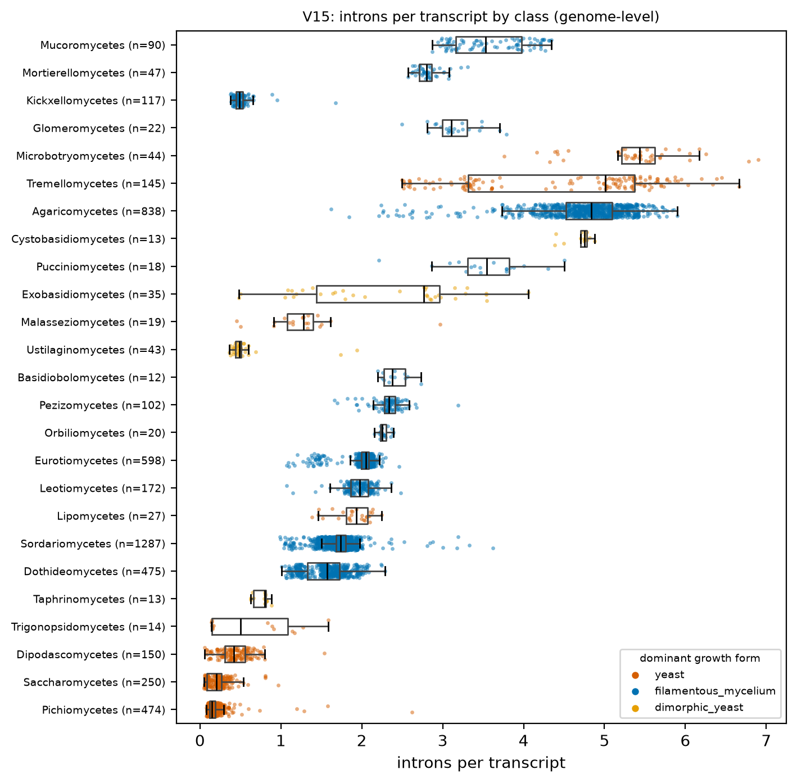
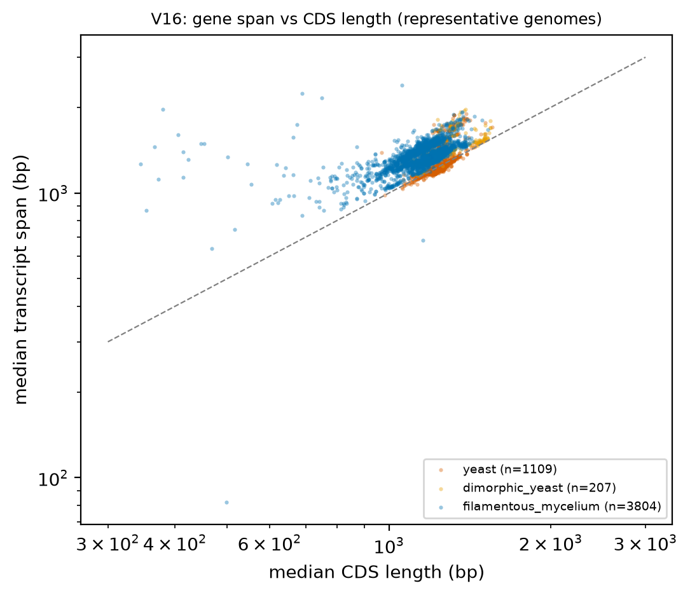
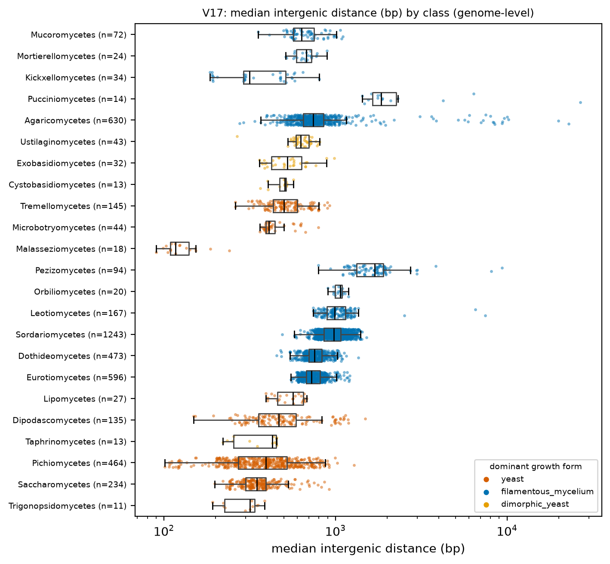
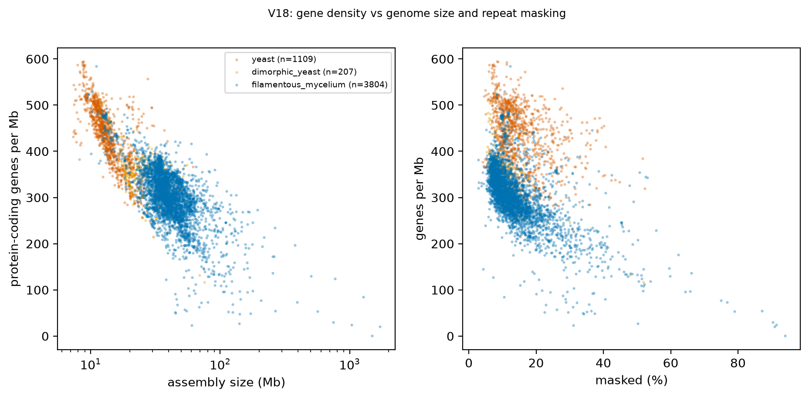

# H3. Yeast genomes have fewer introns and denser, shorter genes

Expected: yeast fewer introns per gene, shorter intergenic distances, higher gene density.

[Back to index](index.md)

### V15 Introns per gene by class and growth form

- n = 5,120 genomes / 5,120 species / 1,164 genera. Filters: Q-ann, Q-rep (one genome per species), Q-busco-rel (BUSCO complete >= class 25th percentile).
**Introns per transcript:**
- Unit = genus (median of representative genomes). Yeast genera n = 153, filamentous genera n = 960.
- Median introns per transcript: yeast 0.244, filamentous 2.034; difference -1.790 (bootstrap 95 % CI -1.882 to -1.688); Cliff's delta -0.682; Mann-Whitney p = 5.90e-42.
- Dimorphic yeast genera n = 51, median 1.562 (shown, not pooled).
- Mixed model `introns_per_transcript ~ gf_yeast + log_n50 + busco_complete + (1|CLASS/ORDER_)` (n = 1,091 genera, 49 classes, converged = True): yeast effect 0.001 (95 % CI -0.386 to 0.389), p = 0.994. PGLS pending tree.
**Intronless fraction:**
- Unit = genus (median of representative genomes). Yeast genera n = 153, filamentous genera n = 960.
- Median fraction of intronless transcripts: yeast 0.814, filamentous 0.220; difference 0.594 (bootstrap 95 % CI 0.550 to 0.626); Cliff's delta 0.658; Mann-Whitney p = 3.65e-39.
- Dimorphic yeast genera n = 51, median 0.303 (shown, not pooled).
- Mixed model `frac_intronless ~ gf_yeast + log_n50 + busco_complete + (1|CLASS/ORDER_)` (n = 1,091 genera, 49 classes, converged = True): yeast effect 0.026 (95 % CI -0.023 to 0.075), p = 0.300. PGLS pending tree.
- Caveat: ab initio predictors trained per genome; intron under-prediction in genomes without RNA-seq (training flag not in tables, D8). Table: `tables/V15_genus_medians.tsv`.

### V16 Gene span versus CDS length

- n = 5,120 genomes / 5,120 species / 1,164 genera. Filters: Q-ann, Q-rep (one genome per species), Q-busco-rel (BUSCO complete >= class 25th percentile). Span = transcript start to end (introns included; UTRs only where predicted).
**Span / CDS ratio:**
- Unit = genus (median of representative genomes). Yeast genera n = 153, filamentous genera n = 960.
- Median transcript span / CDS length: yeast 0.996, filamentous 1.137; difference -0.141 (bootstrap 95 % CI -0.148 to -0.133); Cliff's delta -0.715; Mann-Whitney p = 6.79e-46.
- Dimorphic yeast genera n = 51, median 1.084 (shown, not pooled).
- Mixed model `span_cds_ratio ~ gf_yeast + log_n50 + busco_complete + (1|CLASS/ORDER_)` (n = 1,091 genera, 49 classes, converged = True): yeast effect -0.054 (95 % CI -0.110 to 0.003), p = 0.062. PGLS pending tree.
**Median CDS length:**
- Unit = genus (median of representative genomes). Yeast genera n = 153, filamentous genera n = 960.
- Median median CDS length (bp): yeast 1242.000, filamentous 1194.000; difference 48.000 (bootstrap 95 % CI 37.500 to 61.500); Cliff's delta 0.501; Mann-Whitney p = 2.11e-23.
- Dimorphic yeast genera n = 51, median 1309.500 (shown, not pooled).
- Mixed model `median_cds_len ~ gf_yeast + log_n50 + busco_complete + (1|CLASS/ORDER_)` (n = 1,091 genera, 49 classes, converged = True): yeast effect 53.551 (95 % CI -8.925 to 116.027), p = 0.093. PGLS pending tree.
- Caveat: most ab initio models have no UTR, so span minus CDS is intron length. Table: `tables/V16_genus_medians.tsv`. Scatter points are rasterized in the SVG.

### V17 Intergenic distance by growth form

- n = 4,631 genomes / 4,631 species / 1,086 genera. Filters: Q-ann, Q-rep (one genome per species), Q-busco-rel (BUSCO complete >= class 25th percentile), Q-n50 (N50 >= 50 kb).
- Unit = genus (median of representative genomes). Yeast genera n = 151, filamentous genera n = 884.
- Median median intergenic distance (bp): yeast 406.000, filamentous 842.750; difference -436.750 (bootstrap 95 % CI -461.012 to -398.234); Cliff's delta -0.897; Mann-Whitney p = 1.40e-69.
- Dimorphic yeast genera n = 51, median 592.000 (shown, not pooled).
- Mixed model `median_intergenic ~ gf_yeast + log_genome + log_n50 + (1|CLASS/ORDER_)` (n = 1,014 genera, 47 classes, converged = True): yeast effect 533.879 (95 % CI -227.704 to 1295.462), p = 0.169. PGLS pending tree.
- Caveat: distances exist only within contigs; fragmented assemblies bias them downward (Q-n50 applied; log N50 is a covariate). Table: `tables/V17_genus_medians.tsv`.

### V18 Gene density versus genome size

- n = 5,120 genomes / 5,120 species / 1,164 genera. Filters: Q-ann, Q-rep (one genome per species), Q-busco-rel (BUSCO complete >= class 25th percentile).
- yeast: Spearman rho(size, density) = -0.812; rho(masked %, density) = -0.349 (n = 1,109 genomes).
- dimorphic_yeast: Spearman rho(size, density) = -0.355; rho(masked %, density) = -0.624 (n = 207 genomes).
- filamentous_mycelium: Spearman rho(size, density) = -0.599; rho(masked %, density) = -0.665 (n = 3,804 genomes).
- Caveat: masking method may differ between pipeline waves (not verified). Genus-level contrast of density is in V03.

## Verdict

**Verdict: supported.** Yeast genera have a median 0.24 introns per transcript against 2.03 in filamentous genera (Cliff's delta -0.68), 81 % intronless transcripts against 22 % (V15), transcript span / CDS ratio 1.00 against 1.14 (V16), median intergenic distance 406 bp against 843 bp (V17), and 427 against 301 protein-coding genes per Mb (V03). Median CDS length is not shorter in yeasts (1,242 vs 1,194 bp, V16). Dimorphic yeasts sit between the two groups on every measure. The mixed models with CLASS/ORDER random intercepts return yeast effects with CIs spanning zero: growth form is confounded with class, so those models cannot separate the two; the genus-median contrasts above are the stated result. Caveats: intron counts depend on per-genome gene prediction and RNA-seq availability; intergenic distances are truncated by contig ends (Q-n50 applied).
