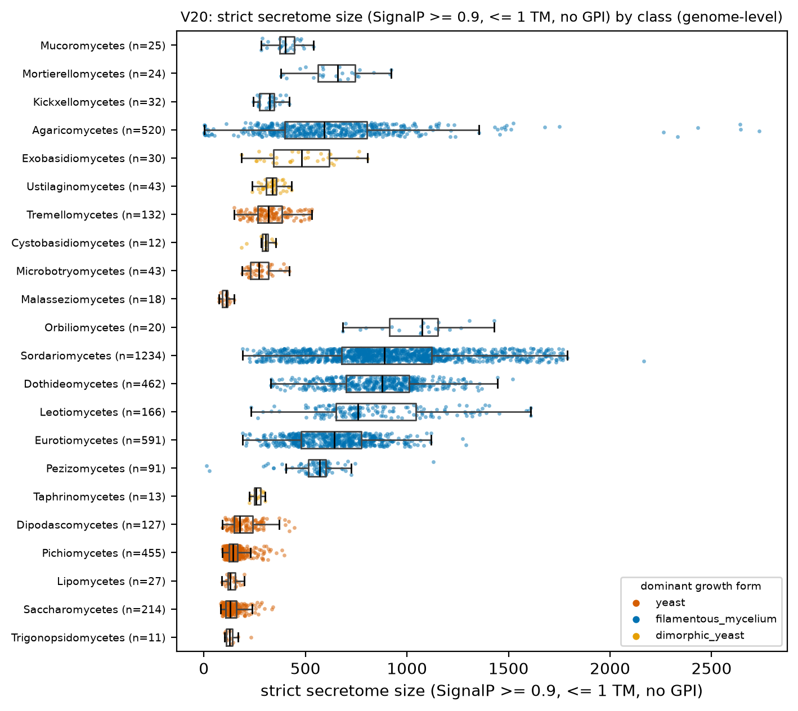
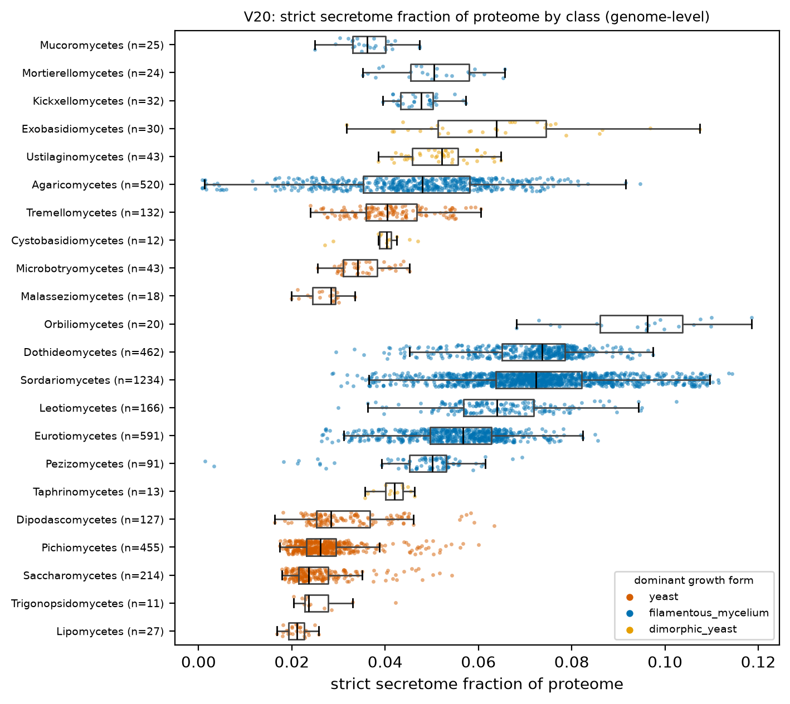
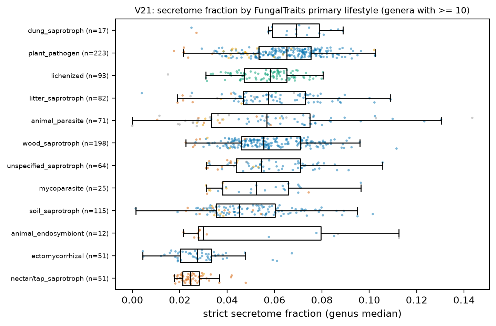
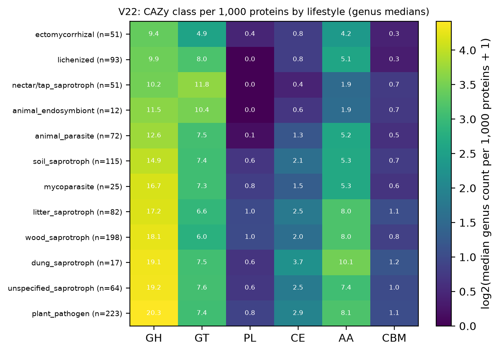
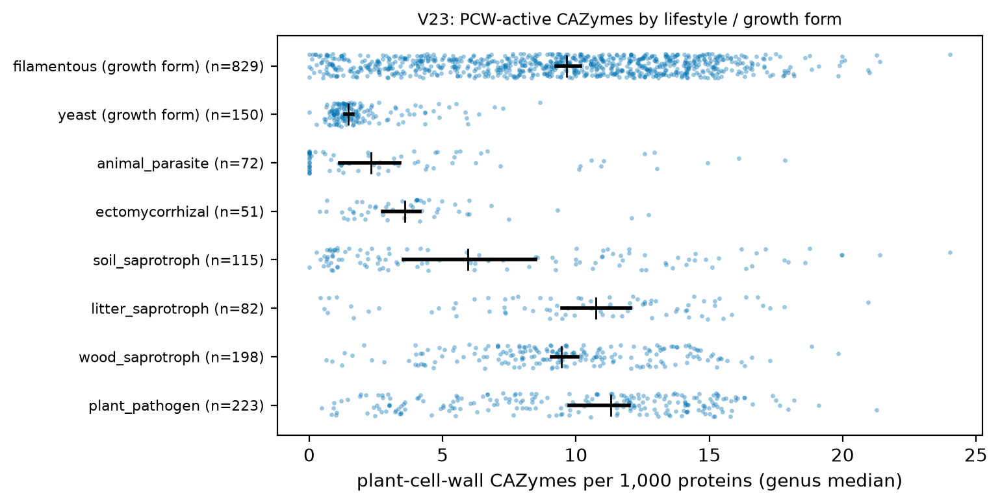

# H4. Secretome and CAZy content track lifestyle

Expected: plant-associated and wood/litter saprotrophs > yeasts and animal parasites.

[Back to index](index.md)

### V20 Secretome size per genome

- n = 4,376 genomes / 4,376 species / 1,029 genera. Filters: Q-ann, Q-rep (one genome per species), Q-busco-rel (BUSCO complete >= class 25th percentile), Q-dup (BUSCO duplicated <= 10 %), Q-n50 (N50 >= 50 kb).
**Count:**
- Unit = genus (median of representative genomes). Yeast genera n = 150, filamentous genera n = 828.
- Median strict secretome size: yeast 146.000, filamentous 672.000; difference -526.000 (bootstrap 95 % CI -556.000 to -494.500); Cliff's delta -0.944; Mann-Whitney p = 1.04e-75.
- Dimorphic yeast genera n = 51, median 333.000 (shown, not pooled).
- Mixed model `n_secreted_strict ~ gf_yeast + log_n50 + busco_complete + (1|CLASS/ORDER_)` (n = 958 genera, 45 classes, converged = True): yeast effect -270.067 (95 % CI -403.935 to -136.198), p = 7.68e-05. PGLS pending tree.
**Fraction of proteome:**
- Unit = genus (median of representative genomes). Yeast genera n = 150, filamentous genera n = 828.
- Median secretome fraction: yeast 0.026, filamentous 0.059; difference -0.033 (bootstrap 95 % CI -0.035 to -0.031); Cliff's delta -0.845; Mann-Whitney p = 4.91e-61.
- Dimorphic yeast genera n = 51, median 0.042 (shown, not pooled).
- Mixed model `secretome_frac ~ gf_yeast + log_n50 + busco_complete + (1|CLASS/ORDER_)` (n = 958 genera, 45 classes, converged = True): yeast effect -0.013 (95 % CI -0.023 to -0.004), p = 0.008. PGLS pending tree.
- SignalP proteins without a TMHMM row (the TMHMM table holds only proteins with >= 1 helix, so these have 0 helices): 2,847,524 across these genomes.
- Caveat: SignalP cannot see truncated N-termini; partial models reduce counts. Table: `tables/V20_genus_medians.tsv`.

### V21 Secretome fraction by primary lifestyle

- Unit = genus. 1,002 genera in 12 lifestyles with >= 10 genera. Filters: Q-ann, Q-rep (one genome per species), Q-busco-rel (BUSCO complete >= class 25th percentile), Q-dup (BUSCO duplicated <= 10 %), Q-n50 (N50 >= 50 kb).
- Kruskal-Wallis (screening only): H = 265.2, p = 1.81e-50.
- Mixed model secretome_frac ~ lifestyle + log N50 + BUSCO + (1|CLASS/ORDER), reference = unspecified_saprotroph, n = 964 genera: animal_endosymbiont: +0.0039 (95 % CI -0.0066 to +0.0144), p = 0.470; animal_parasite: +0.0037 (95 % CI -0.0011 to +0.0085), p = 0.130; dung_saprotroph: +0.0026 (95 % CI -0.0038 to +0.0090), p = 0.421; ectomycorrhizal: -0.0209 (95 % CI -0.0266 to -0.0153), p = 5.15e-13; lichenized: +0.0006 (95 % CI -0.0094 to +0.0107), p = 0.905; litter_saprotroph: +0.0007 (95 % CI -0.0035 to +0.0049), p = 0.748; mycoparasite: -0.0036 (95 % CI -0.0096 to +0.0025), p = 0.246; nectar_tap_saprotroph: +0.0006 (95 % CI -0.0065 to +0.0076), p = 0.875; plant_pathogen: +0.0006 (95 % CI -0.0031 to +0.0043), p = 0.738; soil_saprotroph: -0.0027 (95 % CI -0.0067 to +0.0013), p = 0.184; wood_saprotroph: +0.0011 (95 % CI -0.0027 to +0.0050), p = 0.561. PGLS pending tree.

| primary_lifestyle | n_genera | median_secretome_frac | median_n_secreted | dominant_growth_form |
|---|---|---|---|---|
| nectar/tap_saprotroph | 51 | 0.024 | 133.000 | yeast |
| ectomycorrhizal | 51 | 0.027 | 326.000 | filamentous_mycelium |
| animal_endosymbiont | 12 | 0.030 | 221.250 | yeast |
| soil_saprotroph | 115 | 0.045 | 480.000 | filamentous_mycelium |
| mycoparasite | 25 | 0.052 | 545.000 | filamentous_mycelium |
| unspecified_saprotroph | 64 | 0.054 | 610.500 | filamentous_mycelium |
| wood_saprotroph | 198 | 0.055 | 681.500 | filamentous_mycelium |
| animal_parasite | 71 | 0.057 | 474.000 | filamentous_mycelium |
| litter_saprotroph | 82 | 0.057 | 734.000 | filamentous_mycelium |
| lichenized | 93 | 0.058 | 554.000 | thallus_photosynthetic |
| plant_pathogen | 223 | 0.065 | 735.000 | filamentous_mycelium |
| dung_saprotroph | 17 | 0.069 | 727.000 | filamentous_mycelium |

- Caveats: lifestyle is a genus trait (FungalTraits 1.2, citation to verify); `nectar/tap_saprotroph` is mostly *Saccharomyces* and confounded with growth form; `plant_pathogen` mixes trophic modes. Table: `tables/V21_by_lifestyle.tsv`.

### V22 CAZy class profile by lifestyle

- Unit = genus median of per-genome counts per 1,000 proteins (dbCAN `toolcount >= 2`). 1,173 genera; lifestyles with >= 10 genera shown. Filters: Q-ann, Q-rep (one genome per species), Q-busco-rel (BUSCO complete >= class 25th percentile), Q-dup (BUSCO duplicated <= 10 %), Q-n50 (N50 >= 50 kb).
- Median per 1,000 proteins by growth form:

| growth_form | GH | GT | PL | CE | AA | CBM |
|---|---|---|---|---|---|---|
| dimorphic_yeast | 13.916 | 8.144 | 0.433 | 1.448 | 3.849 | 0.322 |
| filamentous_mycelium | 18.474 | 6.806 | 0.850 | 2.290 | 7.832 | 0.912 |
| yeast | 10.261 | 11.784 | 0.000 | 0.372 | 1.997 | 0.727 |

- Kruskal-Wallis across lifestyles (screening): GH H = 340, p = 3.73e-66; GT H = 344, p = 4.59e-67; PL H = 399, p = 8.05e-79; CE H = 394, p = 1.19e-77; AA H = 298, p = 1.93e-57; CBM H = 241, p = 1.72e-45.
- Caveat: a protein with several family tokens counts once per class; shared ancestry inflates significance. Table: `tables/V22_cazy_class_by_lifestyle.tsv`.

### V23 Plant-cell-wall-degrading CAZymes versus plant association

| group | n_genera | median_pcw_per_1000 | ci_lo | ci_hi |
|---|---|---|---|---|
| plant_pathogen | 223 | 11.319 | 9.777 | 11.994 |
| wood_saprotroph | 198 | 9.466 | 9.111 | 9.953 |
| litter_saprotroph | 82 | 10.740 | 9.445 | 12.021 |
| soil_saprotroph | 115 | 5.955 | 3.533 | 8.545 |
| ectomycorrhizal | 51 | 3.585 | 2.762 | 4.136 |
| animal_parasite | 72 | 2.313 | 1.145 | 3.384 |
| yeast (growth form) | 150 | 1.475 | 1.347 | 1.633 |
| filamentous (growth form) | 829 | 9.642 | 9.261 | 10.156 |

- Unit = genus. Substrates counted: alpha-galactan, arabinan, arabinogalactan protein, beta-galactan, beta-mannan, cellulose, cutin, hemicellulose, lignin, pectin, suberin, xylan, xyloglucan (dbCAN family-level substrate map, `toolcount >= 2`). Filters: Q-ann, Q-rep (one genome per species), Q-busco-rel (BUSCO complete >= class 25th percentile), Q-dup (BUSCO duplicated <= 10 %), Q-n50 (N50 >= 50 kb).
- plant_pathogen vs animal_parasite: median difference 9.006 per 1,000 (95 % CI 6.912 to 10.499), Cliff's delta 0.673, p = 8.90e-18.
- yeast vs filamentous: median difference -8.167 (95 % CI -8.706 to -7.725), Cliff's delta -0.814, p = 8.35e-57.
- Caveat: substrate labels come from the family, not the protein; groups overlap taxonomically (no independence). Table: `tables/V23_pcw_by_group.tsv`. PGLS pending tree.

## Verdict

**Verdict: supported in direction; lifestyle and clade are confounded.** The strict secretome is 2.6 % of the proteome in yeast genera against 5.9 % in filamentous genera (V20). Plant pathogens and dung/litter/wood saprotrophs have the largest secretome fractions (6.5-6.9 % and 5.5-5.7 %), ectomycorrhizal genera and the yeast-dominated nectar/tap saprotrophs the smallest (2.4-2.7 %) (V21). Plant-cell-wall CAZymes per 1,000 proteins: plant pathogens 11.3, wood saprotrophs 9.5, animal parasites 2.3, yeasts 1.5 (V23). PL and CE classes are near zero in yeasts (V22). Caveats: FungalTraits labels are genus traits; several lifestyles map to one clade, so the Kruskal-Wallis values overstate independence; the mixed model with CLASS/ORDER random intercepts still gives a yeast secretome effect below zero (count -270, 95 % CI -404 to -136; fraction -0.013, CI -0.023 to -0.004), so the yeast deficit is not explained by class membership alone. Across lifestyles the same model leaves only ectomycorrhizal genera different from unspecified saprotrophs (-0.021, 95 % CI -0.027 to -0.015); the other lifestyle contrasts in V21 are absorbed by class, so most of the lifestyle signal is clade signal; PGLS pending tree.
