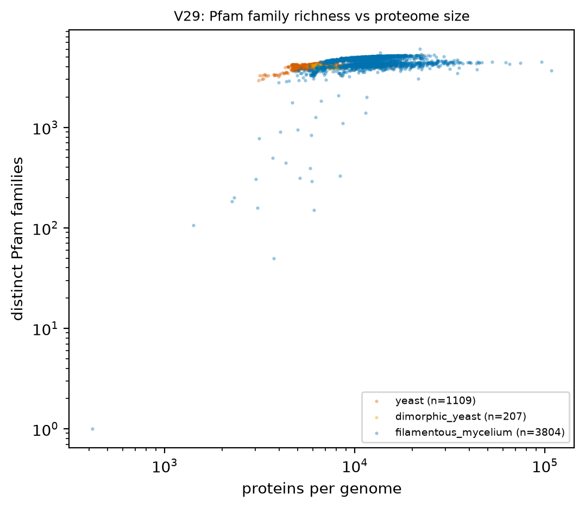
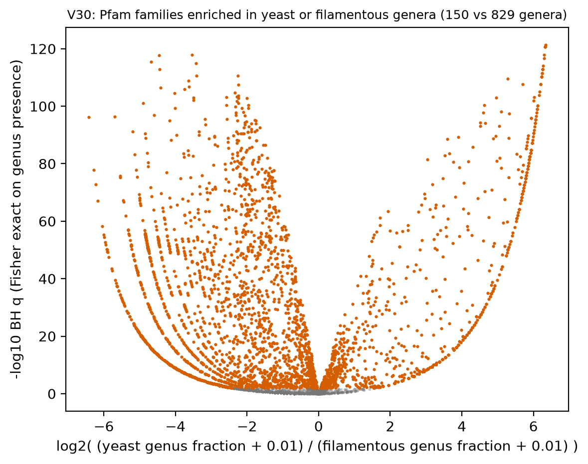

# H5. TF and domain repertoires scale sub-linearly; Zn2Cys6 expansion is Pezizomycotina-specific

Expected: slopes < 1 for most TF families; highest Zn2Cys6 share in Pezizomycotina.

[Back to index](index.md)

### V27 TF family counts versus gene count

- n = 5,120 genomes / 5,120 species / 1,164 genera. Filters: Q-ann, Q-rep (one genome per species), Q-busco-rel (BUSCO complete >= class 25th percentile). Domain gate domain_i_evalue <= 1e-5; a protein counts once per family.
- log-log OLS slope of family size on proteome size, with 95 % CI (slope < 1 = sub-linear; slope > 1 = super-linear):

| tf_family | n_genomes | slope | ci_lo | ci_hi | r2 | median_yeast | median_filamentous |
|---|---|---|---|---|---|---|---|
| Fungal-specific transcription factor domain (C-terminal to Zn_clus) | 5,097 | 1.238 | 1.186 | 1.291 | 0.295 | 36.000 | 104.000 |
| Homeodomain | 5,104 | 0.958 | 0.931 | 0.985 | 0.484 | 3.000 | 7.000 |
| Homeobox KN domain | 5,003 | 0.958 | 0.921 | 0.995 | 0.335 | 1.000 | 4.000 |
| High mobility group box | 5,111 | 0.780 | 0.749 | 0.811 | 0.323 | 5.000 | 8.000 |
| Zn(II)2Cys6 zinc cluster | 5,098 | 0.729 | 0.669 | 0.788 | 0.101 | 56.000 | 101.000 |
| C6H2-type zinc finger | 4,712 | 0.703 | 0.607 | 0.799 | 0.042 | 13.000 | 34.000 |
| Basic leucine zipper | 5,099 | 0.595 | 0.568 | 0.622 | 0.267 | 5.000 | 9.000 |
| Forkhead / winged-helix domain | 5,102 | 0.497 | 0.479 | 0.516 | 0.348 | 3.000 | 4.000 |
| Basic helix-loop-helix | 5,107 | 0.403 | 0.382 | 0.425 | 0.209 | 9.000 | 10.000 |
| GATA zinc finger | 5,102 | 0.243 | 0.215 | 0.271 | 0.054 | 8.000 | 7.000 |
| Myb-like DNA-binding domain | 5,110 | 0.232 | 0.213 | 0.252 | 0.097 | 12.000 | 12.000 |
| Myb-like DNA-binding domain variant | 5,106 | 0.220 | 0.198 | 0.241 | 0.074 | 9.000 | 9.000 |
| MADS-box (SRF-type) | 5,092 | 0.218 | 0.193 | 0.243 | 0.054 | 2.000 | 2.000 |
| Basic leucine zipper variant | 5,098 | 0.214 | 0.180 | 0.248 | 0.028 | 4.000 | 5.000 |
| CCCH zinc finger | 5,102 | 0.206 | 0.186 | 0.226 | 0.075 | 6.000 | 6.000 |
| RNA Pol I transcription factor Rrn7-type | 4,088 | 0.136 | 0.117 | 0.154 | 0.047 | 0.000 | 1.000 |
| C2H2 zinc finger variant | 301 | 0.126 | 0.058 | 0.195 | 0.042 | 0.000 | 0.000 |
| Heat shock factor DNA-binding domain | 5,101 | 0.088 | 0.058 | 0.118 | 0.007 | 4.000 | 3.000 |
| C2H2 zinc finger | 5,091 | -0.013 | -0.046 | 0.019 | 1.22e-04 | 7.000 | 8.000 |

- Caveat: genomes are not independent (no mixed model per family here; genus-level version is in V28 for Zn2Cys6). Table: `tables/V27_tf_slopes.tsv`.

### V28 Zn2Cys6 share of the TF repertoire by class

- n = 5,271 genomes / 5,271 species / 1,170 genera. Filters: Q-ann, Q-rep (one genome per species), Q-busco-rel (BUSCO complete >= class 25th percentile).

| subphylum_group | n_genera | median_zn_share | median_n_zn |
|---|---|---|---|
| Basidiomycota | 362 | 0.178 | 29.000 |
| Pezizomycotina | 579 | 0.403 | 108.000 |
| Saccharomycotina | 122 | 0.394 | 55.000 |
| other | 107 | 0.138 | 35.000 |

- Pezizomycotina vs all other genera: median share 0.403 vs 0.196, difference 0.207 (95 % CI 0.192 to 0.219), Cliff's delta 0.754.
**Yeast vs filamentous:**
- Unit = genus (median of representative genomes). Yeast genera n = 153, filamentous genera n = 959.
- Median Zn2Cys6 share: yeast 0.374, filamentous 0.341; difference 0.032 (bootstrap 95 % CI 0.010 to 0.054); Cliff's delta 0.235; Mann-Whitney p = 2.83e-06.
- Dimorphic yeast genera n = 51, median 0.335 (shown, not pooled).
- Mixed model `zn_share ~ gf_yeast + log_n50 + busco_complete + (1|CLASS/ORDER_)` (n = 1,090 genera, 49 classes, converged = True): yeast effect 0.038 (95 % CI -0.005 to 0.081), p = 0.087. PGLS pending tree.
- Caveat: Zn2Cys6 and the fungal-specific TF domain co-occur on one protein; proteins are counted once per family. Table: `tables/V28_genus_medians.tsv`.

### V29 Pfam domain richness versus gene count

- n = 5,120 genomes / 5,120 species / 1,164 genera. Filters: Q-ann, Q-rep (one genome per species), Q-busco-rel (BUSCO complete >= class 25th percentile). Domain gate domain_i_evalue <= 1e-5.

| growth_form | n | slope | slope_ci_lo | slope_ci_hi | intercept | r2 |
|---|---|---|---|---|---|---|
| yeast | 1,109 | 0.090 | 0.080 | 0.100 | 3.267 | 0.213 |
| dimorphic_yeast | 207 | 0.249 | 0.217 | 0.282 | 2.657 | 0.533 |
| filamentous_mycelium | 3,804 | 0.303 | 0.279 | 0.328 | 2.427 | 0.133 |

- Unit = genus (median of representative genomes). Yeast genera n = 153, filamentous genera n = 960.
- Median distinct Pfam families: yeast 4061.500, filamentous 4755.000; difference -693.500 (bootstrap 95 % CI -739.013 to -635.000); Cliff's delta -0.765; Mann-Whitney p = 2.57e-52.
- Dimorphic yeast genera n = 51, median 4075.000 (shown, not pooled).
- Mixed model `n_families ~ gf_yeast + log_genome + busco_complete + (1|CLASS/ORDER_)` (n = 1,091 genera, 49 classes, converged = True): yeast effect -147.920 (95 % CI -304.746 to 8.907), p = 0.065. PGLS pending tree.
- Caveat: richness saturates at the Pfam library size; slopes below 1 are expected for any finite library. Table: `tables/V29_slopes.tsv`. Scatter points are rasterized in the SVG.

### V30 Clade-enriched Pfam families, yeast versus filamentous

- Unit = genus (150 yeast, 829 filamentous genera of representative genomes with Q-ann, Q-rep (one genome per species), Q-busco-rel (BUSCO complete >= class 25th percentile), Q-dup (BUSCO duplicated <= 10 %), Q-n50 (N50 >= 50 kb)). A family is present in a genus when >= 50 % of its representative genomes carry it. 7,907 families tested (present in >= 5 genera); 3,582 with BH q < 0.01.

**Top yeast-enriched (by log2 odds, q < 0.01):**

| pfam_acc | pfam_id | yeast_present | fil_present | yeast_frac | fil_frac | log2_odds | bh_q | n_orders_present |
|---|---|---|---|---|---|---|---|---|
| PF10450 | POC1 | 120 | 0 | 0.800 | 0.000 | 6.340 | 4.39e-122 | 13 |
| PF04001 | Vhr1 | 119 | 0 | 0.793 | 0.000 | 6.328 | 2.03e-121 | 11 |
| PF11055 | Gsf2 | 119 | 0 | 0.793 | 0.000 | 6.328 | 2.03e-121 | 11 |
| PF17234 | MPM1 | 119 | 0 | 0.793 | 0.000 | 6.328 | 2.03e-121 | 12 |
| PF29020 | NOP8_middle | 119 | 0 | 0.793 | 0.000 | 6.328 | 2.03e-121 | 11 |
| PF17235 | STD1 | 119 | 0 | 0.793 | 0.000 | 6.328 | 2.03e-121 | 11 |
| PF29019 | NBA1_C | 117 | 0 | 0.780 | 0.000 | 6.304 | 1.22e-118 | 11 |
| PF18794 | HSM3_C | 116 | 0 | 0.773 | 0.000 | 6.292 | 2.17e-117 | 11 |
| PF25338 | C2_DCK_4th | 114 | 0 | 0.760 | 0.000 | 6.267 | 9.90e-115 | 10 |
| PF29059 | AIM39_C | 113 | 0 | 0.753 | 0.000 | 6.254 | 1.67e-113 | 11 |
| PF08203 | RNA_polI_A14 | 113 | 0 | 0.753 | 0.000 | 6.254 | 1.67e-113 | 12 |
| PF07954 | DUF1689 | 113 | 0 | 0.753 | 0.000 | 6.254 | 1.67e-113 | 11 |
| PF28771 | RMD9_mid | 113 | 0 | 0.753 | 0.000 | 6.254 | 1.67e-113 | 11 |
| PF18471 | Ribosomal_L27_C | 112 | 0 | 0.747 | 0.000 | 6.242 | 3.44e-112 | 10 |
| PF29080 | UPF0507_helical | 112 | 0 | 0.747 | 0.000 | 6.242 | 3.44e-112 | 10 |
| PF30502 | SSY5_N | 111 | 0 | 0.740 | 0.000 | 6.229 | 5.89e-111 | 11 |
| PF28917 | MGR3_mid | 111 | 0 | 0.740 | 0.000 | 6.229 | 5.89e-111 | 11 |
| PF29033 | YBL029W_C | 111 | 0 | 0.740 | 0.000 | 6.229 | 5.89e-111 | 11 |
| PF29054 | HMO1_N | 111 | 0 | 0.740 | 0.000 | 6.229 | 5.89e-111 | 10 |
| PF29062 | MSS2_N | 109 | 0 | 0.727 | 0.000 | 6.203 | 2.35e-108 | 10 |
| PF29037 | DSE1_N | 109 | 0 | 0.727 | 0.000 | 6.203 | 2.35e-108 | 11 |
| PF17075 | RRT14 | 107 | 0 | 0.713 | 0.000 | 6.177 | 8.24e-106 | 11 |
| PF16958 | PRP9_N | 106 | 0 | 0.707 | 0.000 | 6.163 | 1.51e-104 | 9 |
| PF29718 | JID1_C | 103 | 0 | 0.687 | 0.000 | 6.122 | 7.11e-101 | 10 |
| PF21551 | CSL4_N | 103 | 0 | 0.687 | 0.000 | 6.122 | 7.11e-101 | 8 |
| PF12827 | Peroxin-22 | 102 | 0 | 0.680 | 0.000 | 6.109 | 1.18e-99 | 9 |
| PF29316 | ECM19 | 102 | 0 | 0.680 | 0.000 | 6.109 | 1.18e-99 | 10 |
| PF12209 | SAC3 | 101 | 0 | 0.673 | 0.000 | 6.095 | 2.01e-98 | 12 |
| PF28989 | YGL138C_N | 100 | 0 | 0.667 | 0.000 | 6.080 | 3.20e-97 | 10 |
| PF29097 | MRM1_N | 99 | 0 | 0.660 | 0.000 | 6.066 | 4.91e-96 | 9 |

**Top filamentous-enriched:**

| pfam_acc | pfam_id | yeast_present | fil_present | yeast_frac | fil_frac | log2_odds | bh_q | n_orders_present |
|---|---|---|---|---|---|---|---|---|
| PF07249 | Cerato-platanin | 0 | 700 | 0.000 | 0.844 | -6.417 | 5.21e-97 | 60 |
| PF29556 | DUF8562 | 0 | 634 | 0.000 | 0.765 | -6.276 | 1.24e-78 | 69 |
| PF17866 | AAA_lid_6 | 0 | 612 | 0.000 | 0.738 | -6.225 | 1.65e-73 | 71 |
| PF01341 | Glyco_hydro_6 | 0 | 585 | 0.000 | 0.706 | -6.161 | 9.71e-68 | 67 |
| PF13598 | DUF4139 | 0 | 539 | 0.000 | 0.650 | -6.045 | 6.10e-59 | 64 |
| PF05462 | Dicty_CAR | 0 | 522 | 0.000 | 0.630 | -5.999 | 5.56e-56 | 68 |
| PF13600 | DUF4140 | 0 | 517 | 0.000 | 0.624 | -5.986 | 3.81e-55 | 64 |
| PF23076 | PH_FT_C | 0 | 506 | 0.000 | 0.610 | -5.955 | 2.46e-53 | 52 |
| PF03572 | Peptidase_S41 | 0 | 501 | 0.000 | 0.604 | -5.941 | 1.59e-52 | 69 |
| PF01828 | Peptidase_A4 | 0 | 491 | 0.000 | 0.592 | -5.912 | 6.04e-51 | 58 |
| PF23074 | PH_FT_N | 0 | 490 | 0.000 | 0.591 | -5.909 | 8.63e-51 | 50 |
| PF14388 | DUF4419 | 0 | 486 | 0.000 | 0.586 | -5.898 | 3.84e-50 | 59 |
| PF26640 | DUF8212 | 0 | 485 | 0.000 | 0.585 | -5.895 | 5.25e-50 | 48 |
| PF02102 | Peptidase_M35 | 0 | 473 | 0.000 | 0.571 | -5.859 | 3.99e-48 | 45 |
| PF17109 | Goodbye | 0 | 447 | 0.000 | 0.539 | -5.779 | 3.19e-44 | 55 |
| PF28457 | BtgE_N | 0 | 441 | 0.000 | 0.532 | -5.760 | 1.88e-43 | 44 |
| PF19086 | Terpene_syn_C_2 | 1 | 708 | 0.007 | 0.854 | -5.696 | 3.85e-97 | 82 |
| PF17100 | NACHT_N | 0 | 418 | 0.000 | 0.504 | -5.684 | 2.65e-40 | 55 |
| PF24483 | DUF7582 | 0 | 409 | 0.000 | 0.493 | -5.654 | 3.96e-39 | 50 |
| PF11017 | DUF2855 | 0 | 403 | 0.000 | 0.486 | -5.633 | 3.64e-38 | 47 |
| PF08493 | AflR | 0 | 401 | 0.000 | 0.484 | -5.626 | 4.51e-38 | 46 |
| PF28404 | ARB_05178 | 0 | 400 | 0.000 | 0.483 | -5.622 | 5.57e-38 | 43 |
| PF26616 | CorA-like | 0 | 389 | 0.000 | 0.469 | -5.583 | 1.55e-36 | 49 |
| PF28293 | BAS2 | 0 | 388 | 0.000 | 0.468 | -5.579 | 1.89e-36 | 37 |
| PF02816 | Alpha_kinase | 0 | 378 | 0.000 | 0.456 | -5.542 | 3.99e-35 | 53 |
| PF18271 | GH131_N | 1 | 635 | 0.007 | 0.766 | -5.541 | 1.81e-76 | 72 |
| PF25312 | Allergen_Asp_f_4 | 0 | 377 | 0.000 | 0.455 | -5.538 | 4.63e-35 | 43 |
| PF14441 | OTT_1508_deam | 1 | 633 | 0.007 | 0.764 | -5.536 | 5.40e-76 | 71 |
| PF27986 | TSP1 | 0 | 370 | 0.000 | 0.446 | -5.512 | 3.60e-34 | 32 |
| PF20516 | PDDEXK_12 | 0 | 368 | 0.000 | 0.444 | -5.504 | 9.19e-34 | 49 |

- Caveat: genera share ancestry, so q-values overstate independence; `n_orders_present` counts the orders in which the family occurs. Tables: `tables/V30_all_families.tsv`, `tables/V30_yeast_enriched.tsv`, `tables/V30_filamentous_enriched.tsv`. Points are rasterized in the SVG.

## Verdict

**Verdict: partly supported.** 17 of 19 TF families scale sub-linearly with proteome size (slope < 1, V27); the fungal-specific TF domain scales super-linearly (slope 1.24, 95 % CI 1.19-1.29) and Zn2Cys6 has slope 0.73. Pfam family richness scales with slope 0.09 (yeast) and 0.30 (filamentous) and yeast genera carry 4,062 against 4,755 distinct families (V29). The Zn2Cys6 share of the TF repertoire is 0.40 in Pezizomycotina against 0.18 in Basidiomycota, but Saccharomycotina reach 0.39 (V28), so the expansion is an Ascomycota feature, not a Pezizomycotina-specific one. 3,582 of 7,907 Pfam families differ in genus presence between yeasts and filamentous fungi at BH q < 0.01 (V30); the most yeast-specific are Saccharomycotina-only entries (POC1, STD1, MPM1, Gsf2), the most filamentous-specific are cerato-platanin, GH6 cellulases and AAA_lid_6. Caveat: slopes are fitted on genomes, not genera (clade non-independence not modelled in V27/V29 slopes).
