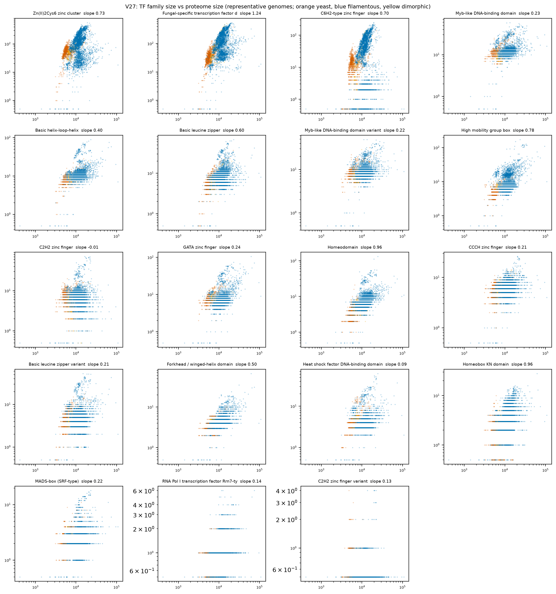
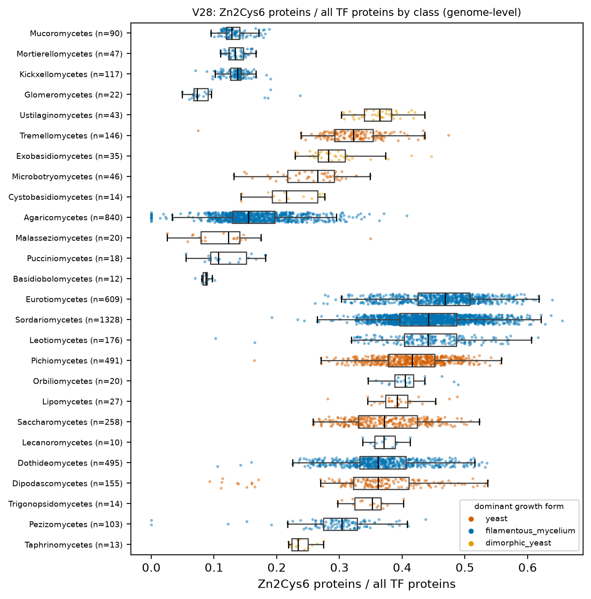

# H5. TF and domain repertoires scale sub-linearly; Zn2Cys6 expansion is Pezizomycotina-specific

Expected: slopes < 1 for most TF families; highest Zn2Cys6 share in Pezizomycotina.

[Back to index](index.md)

### V27 TF family counts versus gene count

- n = 5,120 genomes / 5,120 species / 1,164 genera. Filters: Q-ann, Q-rep (one genome per species), Q-busco-rel (BUSCO complete >= class 25th percentile). Domain gate domain_i_evalue <= 1e-5; a protein counts once per family.
- log-log OLS slope of family size on proteome size, with 95 % CI (slope < 1 = sub-linear; slope > 1 = super-linear):

| tf_family | n_genomes | slope | ci_lo | ci_hi | r2 | median_yeast | median_filamentous |
|---|---|---|---|---|---|---|---|
| Fungal-specific transcription factor domain (C-terminal to Zn_clus) | 5,097 | 1.238 | 1.186 | 1.291 | 0.295 | 36.000 | 104.000 |
| Homeodomain | 5,104 | 0.958 | 0.931 | 0.985 | 0.484 | 3.000 | 7.000 |
| Homeobox KN domain | 5,003 | 0.958 | 0.921 | 0.995 | 0.335 | 1.000 | 4.000 |
| High mobility group box | 5,111 | 0.780 | 0.749 | 0.811 | 0.323 | 5.000 | 8.000 |
| Zn(II)2Cys6 zinc cluster | 5,098 | 0.729 | 0.669 | 0.788 | 0.101 | 56.000 | 101.000 |
| C6H2-type zinc finger | 4,712 | 0.703 | 0.607 | 0.799 | 0.042 | 13.000 | 34.000 |
| Basic leucine zipper | 5,099 | 0.595 | 0.568 | 0.622 | 0.267 | 5.000 | 9.000 |
| Forkhead / winged-helix domain | 5,102 | 0.497 | 0.479 | 0.516 | 0.348 | 3.000 | 4.000 |
| Basic helix-loop-helix | 5,107 | 0.403 | 0.382 | 0.425 | 0.209 | 9.000 | 10.000 |
| GATA zinc finger | 5,102 | 0.243 | 0.215 | 0.271 | 0.054 | 8.000 | 7.000 |
| Myb-like DNA-binding domain | 5,110 | 0.232 | 0.213 | 0.252 | 0.097 | 12.000 | 12.000 |
| Myb-like DNA-binding domain variant | 5,106 | 0.220 | 0.198 | 0.241 | 0.074 | 9.000 | 9.000 |
| MADS-box (SRF-type) | 5,092 | 0.218 | 0.193 | 0.243 | 0.054 | 2.000 | 2.000 |
| Basic leucine zipper variant | 5,098 | 0.214 | 0.180 | 0.248 | 0.028 | 4.000 | 5.000 |
| CCCH zinc finger | 5,102 | 0.206 | 0.186 | 0.226 | 0.075 | 6.000 | 6.000 |
| RNA Pol I transcription factor Rrn7-type | 4,088 | 0.136 | 0.117 | 0.154 | 0.047 | 0.000 | 1.000 |
| C2H2 zinc finger variant | 301 | 0.126 | 0.058 | 0.195 | 0.042 | 0.000 | 0.000 |
| Heat shock factor DNA-binding domain | 5,101 | 0.088 | 0.058 | 0.118 | 0.007 | 4.000 | 3.000 |
| C2H2 zinc finger | 5,091 | -0.013 | -0.046 | 0.019 | 1.22e-04 | 7.000 | 8.000 |

- Caveat: genomes are not independent (no mixed model per family here; genus-level version is in V28 for Zn2Cys6). Table: `tables/V27_tf_slopes.tsv`.

### V28 Zn2Cys6 share of the TF repertoire by class

- n = 5,271 genomes / 5,271 species / 1,170 genera. Filters: Q-ann, Q-rep (one genome per species), Q-busco-rel (BUSCO complete >= class 25th percentile).

| subphylum_group | n_genera | median_zn_share | median_n_zn |
|---|---|---|---|
| Basidiomycota | 362 | 0.178 | 29.000 |
| Pezizomycotina | 579 | 0.403 | 108.000 |
| Saccharomycotina | 122 | 0.394 | 55.000 |
| other | 107 | 0.138 | 35.000 |

- Pezizomycotina vs all other genera: median share 0.403 vs 0.196, difference 0.207 (95 % CI 0.192 to 0.220), Cliff's delta 0.754.
**Yeast vs filamentous:**
- Unit = genus (median of representative genomes). Yeast genera n = 153, filamentous genera n = 959.
- Median Zn2Cys6 share: yeast 0.374, filamentous 0.341; difference 0.032 (bootstrap 95 % CI 0.011 to 0.056); Cliff's delta 0.235; Mann-Whitney p = 2.83e-06.
- Dimorphic yeast genera n = 51, median 0.335 (shown, not pooled).
- Mixed model `zn_share ~ gf_yeast + log_n50 + busco_complete + (1|CLASS/ORDER_)` (n = 1,090 genera, 49 classes, converged = True): yeast effect 0.038 (95 % CI -0.005 to 0.081), p = 0.087. PGLS pending tree.
- Caveat: Zn2Cys6 and the fungal-specific TF domain co-occur on one protein; proteins are counted once per family. Table: `tables/V28_genus_medians.tsv`.

## Verdict

**Verdict: partly supported.** 17 of 19 TF families scale sub-linearly with proteome size (slope < 1, V27); the fungal-specific TF domain scales super-linearly (slope 1.24, 95 % CI 1.19-1.29) and Zn2Cys6 has slope 0.73. The Zn2Cys6 share of the TF repertoire is 0.40 in Pezizomycotina against 0.18 in Basidiomycota, but Saccharomycotina reach 0.39 (V28), so the expansion is an Ascomycota feature, not a Pezizomycotina-specific one. Caveat: slopes are fitted on genomes, not genera (clade non-independence not modelled in V27).
