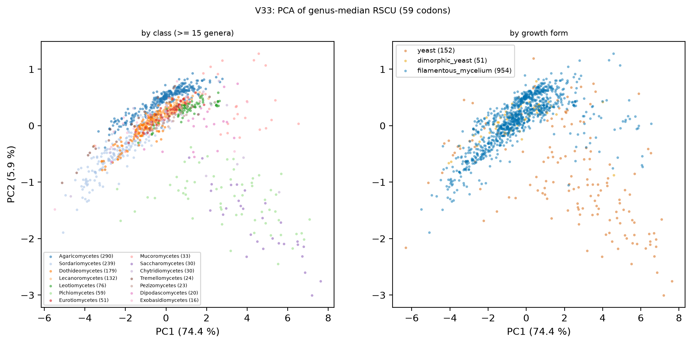
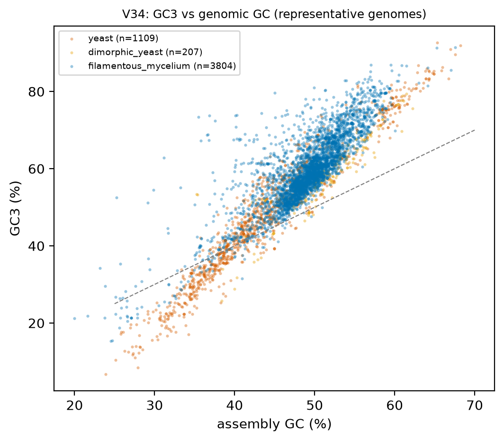
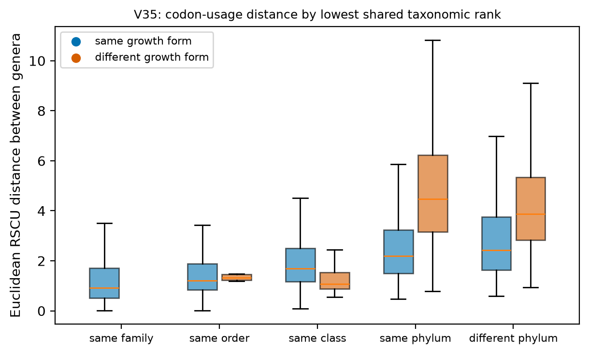

# H6. Codon usage tracks taxonomy more than growth form; GC3 follows genomic GC

Expected: CLASS explains more RSCU variance than growth form.

[Back to index](index.md)

### V33 Codon usage ordination

- Unit = genus (median RSCU over representative genomes; 1,355 genera). RSCU computed with the standard code for all genomes (CTG-clade code-12 genomes keep CTG in the Leu family; see caveat). Filters: Q-ann, Q-rep (one genome per species), Q-busco-rel (BUSCO complete >= class 25th percentile).
- PC1 explains 74.4 %, PC2 5.9 % of RSCU variance.
- PERMANOVA (Euclidean, 1,121 genera in classes with >= 5 genera, 499 permutations):

| model | pseudo_F | R2 | p | n | n_groups | n_perm |
|---|---|---|---|---|---|---|
| CLASS | 55.194 | 0.567 | 0.002 | 1,121 | 27 | 499 |
| growth_form | 91.857 | 0.141 | 0.002 | 1,121 | 3 | 499 |
| growth_form | CLASS (permutations within class) | 91.857 | 0.141 | 0.858 | 1,121 | 3 | 499 |

- Caveat: whole-proteome codon frequencies, not expression-weighted; GC content drives much of PC1 (see V34). Tables: `tables/V33_permanova.tsv`, `tables/V33_genus_pcs.tsv`.

### V34 GC3 versus genomic GC

- n = 5,120 genomes / 5,120 species / 1,164 genera. Filters: Q-ann, Q-rep (one genome per species), Q-busco-rel (BUSCO complete >= class 25th percentile).

| growth_form | n_genomes | slope_gc3_on_gc | intercept | r2 | spearman_rho |
|---|---|---|---|---|---|
| yeast | 1,109 | 1.893 | -35.100 | 0.931 | 0.961 |
| dimorphic_yeast | 207 | 1.688 | -28.564 | 0.804 | 0.944 |
| filamentous_mycelium | 3,804 | 1.616 | -19.821 | 0.688 | 0.809 |

**Residual GC3 (yeast vs filamentous):**
- Unit = genus (median of representative genomes). Yeast genera n = 153, filamentous genera n = 960.
- Median GC3 residual from the filamentous line (%): yeast -4.576, filamentous -1.374; difference -3.201 (bootstrap 95 % CI -3.945 to -2.060); Cliff's delta -0.420; Mann-Whitney p = 6.85e-17.
- Dimorphic yeast genera n = 51, median -5.124 (shown, not pooled).
- Mixed model `gc3_resid ~ gf_yeast + (1|CLASS/ORDER_)` (n = 1,091 genera, 49 classes, converged = True): yeast effect -3.067 (95 % CI -5.112 to -1.022), p = 0.003. PGLS pending tree.
- Caveat: assembly GC includes repeats and masked regions. Table: `tables/V34_gc3_slopes.tsv`.

### V35 Codon-usage distance versus taxonomic rank

- Unit = genus pair (594,595 pairs among 1,091 yeast or filamentous genera). No p-value: pairs are not independent.

| rank | same_growth_form | median | size |
|---|---|---|---|
| same family | 1 | 0.926 | 4,090 |
| same order | 0 | 1.328 | 6 |
| same order | 1 | 1.215 | 19,580 |
| same class | 0 | 1.065 | 175 |
| same class | 1 | 1.700 | 66,351 |
| same phylum | 0 | 4.479 | 76,249 |
| same phylum | 1 | 2.188 | 115,122 |
| different phylum | 0 | 3.864 | 65,510 |
| different phylum | 1 | 2.434 | 247,512 |

- Reading: if distance rises with rank at both colors, taxonomy structures codon usage; the gap between colors within a rank is the growth-form signal at that rank. Table: `tables/V35_distance_by_rank.tsv`.

## Verdict

**Verdict: supported.** CLASS explains 57 % of the variance in genus-median RSCU (PERMANOVA R2 = 0.567) against 14 % for growth form, and growth form has no effect once permutations are restricted within class (p = 0.86, V33). GC3 follows genomic GC (Spearman rho 0.81 filamentous, 0.96 yeast, V34); at equal genomic GC, yeast genera have GC3 3.2 points lower than the filamentous regression line. Codon-usage distance rises with taxonomic rank; within a phylum, pairs with different growth forms are about twice as distant as pairs with the same growth form (V35), which reflects the Saccharomycotina/Pezizomycotina split. Caveat: whole-proteome codon frequencies, not expression-weighted; code-12 CTG kept in the Leu family.
