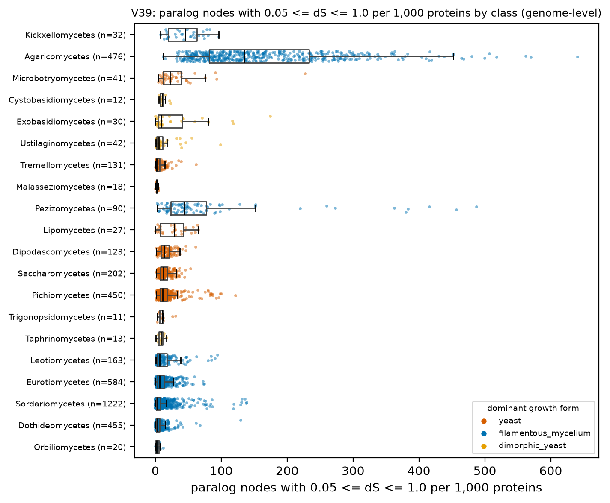
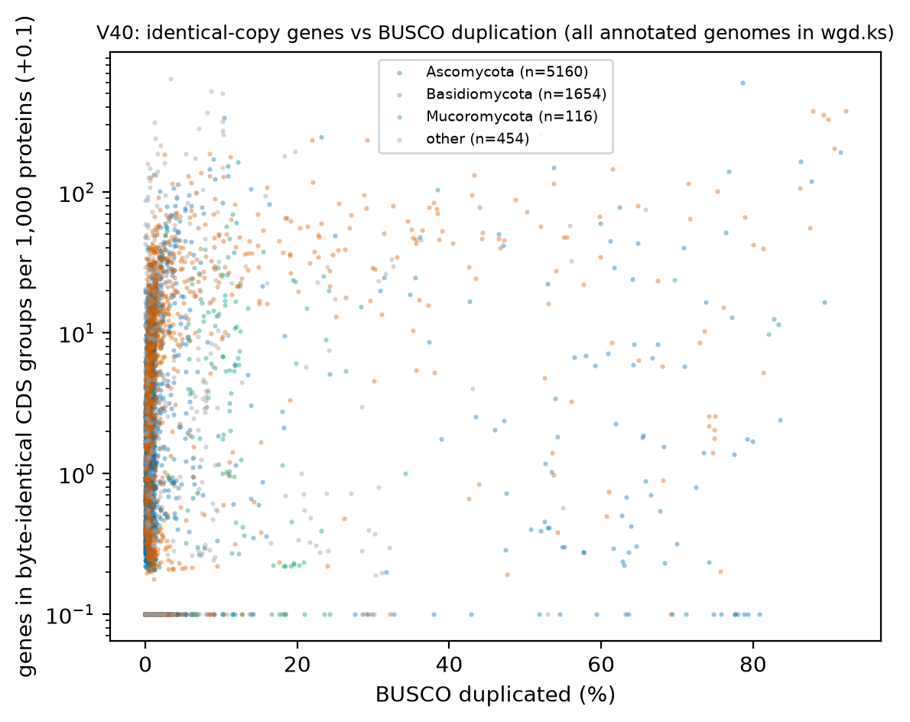

# H7. Recent paralog retention is lower in yeasts; large identical-copy groups mark assembly artefacts

Expected: fewer young paralog nodes per 1,000 genes in yeasts. 7,384 genomes only (interim wgd.ks release).

[Back to index](index.md)

### V39 Young paralog nodes per 1,000 genes by growth form

- n = 4,215 genomes / 4,215 species / 987 genera of the 7,384 genomes in the interim wgd.ks release. Filters: Q-ann, Q-rep, Q-busco-rel, BUSCO duplicated <= 5 %, Q-n50, `hybrid = 0`. Young = tree node with mean yn00 dS in 0.05-1.0 (D9).
- Unit = genus (median of representative genomes). Yeast genera n = 147, filamentous genera n = 789.
- Median young paralog nodes per 1,000 proteins: yeast 10.598, filamentous 9.201; difference 1.398 (bootstrap 95 % CI -0.751 to 3.971); Cliff's delta -0.029; Mann-Whitney p = 0.582.
- Dimorphic yeast genera n = 51, median 4.538 (shown, not pooled).
- Mixed model `young_per1000 ~ gf_yeast + log_genome + busco_complete + (1|CLASS/ORDER_)` (n = 916 genera, 41 classes, converged = True): yeast effect 19.704 (95 % CI -7.998 to 47.405), p = 0.163. PGLS pending tree.
- Caveat: per fable_context.md, dS < 0.05 is heterozygosity/haplotigs and dS > 1.5 is saturated; the wgd.ks subset selection is not documented in the manifest; TE-derived models inflate node counts in repeat-rich genomes. Table: `tables/V39_genus_medians.tsv`.

### V40 Identical-copy groups versus BUSCO duplication

- n = 7,384 annotated genomes with a wgd.ks summary (no representative filter: this is an artefact screen). Spearman rho(BUSCO duplicated, identical genes per 1,000) = 0.372.
- 239 genomes have >= 50 identical-group genes per 1,000 proteins or a largest identical group >= 20; 440 genomes have BUSCO duplication > 10 %. Outlier table: `tables/V40_outliers.tsv`.

| LOCUSTAG | SPECIES | PHYLUM | CLASS | busco_duplicated | ident_per1000 | largest_identical_group | n_identical_groups | hybrid | N50_bp |
|---|---|---|---|---|---|---|---|---|---|
| F60E8408 | Enterocytozoonidae sp. gmOTU26 Ox002348 | Microsporidia | NA | 3.300 | 638.882 | 30 | 899 | 0 | 69,153 |
| F1B2BAA8 | Ogataea polymorpha x Ogataea parapolymorpha | Ascomycota | Pichiomycetes | 78.600 | 597.114 | 3 | 4,586 | 1 | 90,445 |
| FFC6560D | Vairimorpha sp. gmOTU13 SAN23001243 | Microsporidia | NA | 8.600 | 524.273 | 10 | 1,337 | 0 | 270,178 |
| FF4B6540 | Nosema muscidifuracis | Microsporidia | NA | 10.200 | 505.926 | 12 | 1,370 | 0 | 544,348 |
| F1CF758D | Puccinia polysora | Basidiomycota | Pucciniomycetes | 87.900 | 377.188 | 10 | 6,430 | 0 | 53,962,258 |
| FEE05A87 | Lentinula aciculospora | Basidiomycota | Agaricomycetes | 92.200 | 376.114 | 15 | 4,352 | 0 | 1,192,520 |
| F1D4FA12 | Nosema sp. gmOTU22 Ox000071 | Microsporidia | NA | 8.100 | 367.867 | 19 | 1,436 | 0 | 562,895 |
| F47EE4B8 | Puccinia triticina | Basidiomycota | Pucciniomycetes | 89.300 | 356.187 | 305 | 7,366 | 0 | 7,373,251 |
| FC6EB23A | Neonectria sp. B-13 | Ascomycota | Sordariomycetes | 10.400 | 334.975 | 2 | 2,721 | 0 | 1,450,799 |
| FD8D22AD | Scleroderma citrinum | Basidiomycota | Agaricomycetes | 89.900 | 330.116 | 14 | 3,130 | 0 | 1,191,306 |
| F452AD05 | Amblyosporidae sp. gmOTU10 Ox001727 | Microsporidia | NA | 10.200 | 314.970 | 13 | 1,471 | 0 | 947,223 |
| F45FF55D | Amblyosporidae sp. gmOTU8 NHMUK014451618 | Microsporidia | NA | 1.200 | 312.984 | 10 | 313 | 0 | 259,350 |
| FB0E91EB | Vairimorpha sp. gmOTU11 Ox002490 | Microsporidia | NA | 7.000 | 281.955 | 4 | 555 | 0 | 235,102 |
| F584321B | Nosema sp. gmOTU18 Ox002557 | Microsporidia | NA | 10.200 | 271.792 | 12 | 1,107 | 0 | 137,544 |
| F7609CBB | Polychytrium aggregatum | Chytridiomycota | Chytridiomycetes | 52.000 | 260.463 | 7 | 2,052 | 0 | 389,128 |

- Caveat: identical groups also arise from TE-derived gene models and annotation-transfer duplicates (fable_context.md Q1 ranks 2 and 8), not only unpurged haplotigs.

## Verdict

**Verdict: not supported.** Young paralog nodes (yn00 dS 0.05-1.0) per 1,000 proteins are 10.6 in yeast genera and 9.2 in filamentous genera (difference +1.4, 95 % CI -0.7 to +3.9, Cliff's delta -0.03, p = 0.58; V39, 987 genera, hybrids and BUSCO-duplicated > 5 % excluded). Identical-CDS gene content correlates with BUSCO duplication (rho = 0.37, V40), consistent with unpurged haplotigs, but TE-derived models also contribute. Caveats: interim wgd.ks release (7,384 genomes, subset rule undocumented); node sampling is noisy per node; PGLS pending tree.
