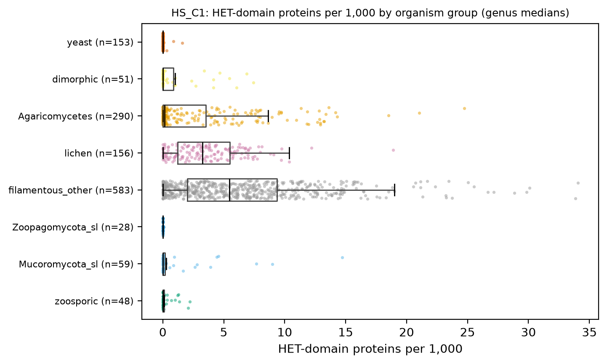
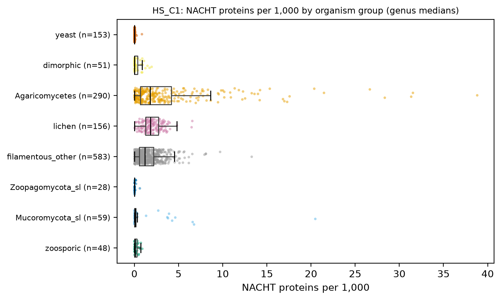
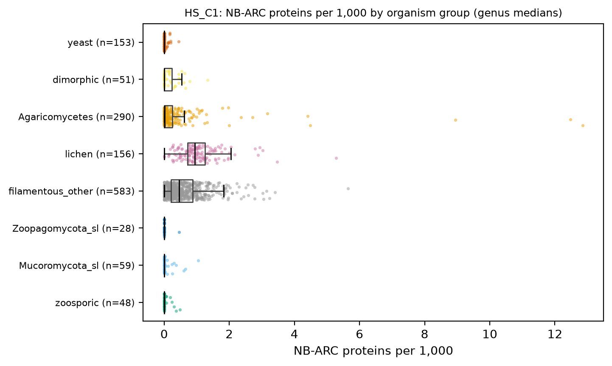
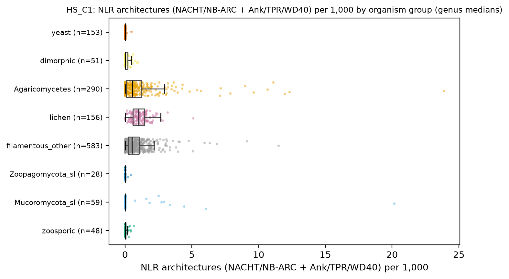
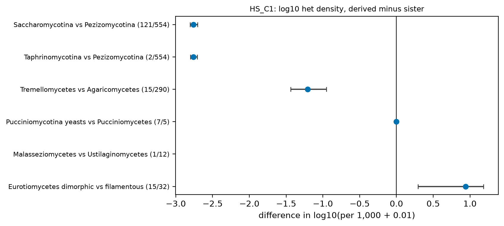
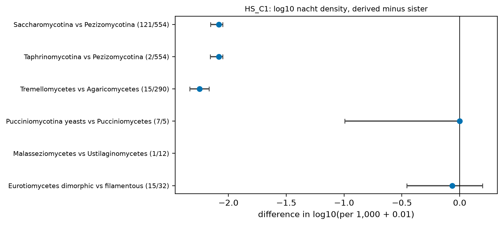
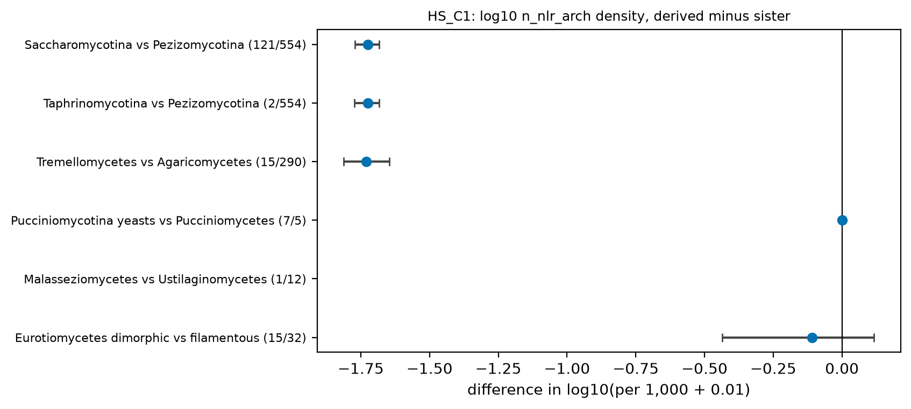
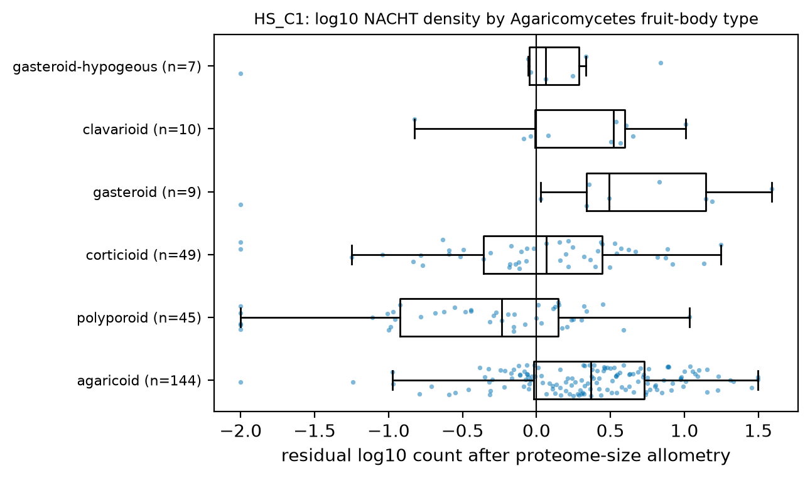

# HS_C1. NLR allorecognition repertoires and the septate heterokaryotic habit

Hypothesis C1: NLR-type allorecognition repertoires (HET, NACHT, NB-ARC) track septate heterokaryotic hyphae and collapse in every yeast origin, in coenocytic lineages and in dikaryon-forming Agaricomycetes. Expected: filamentous Pezizomycotina > lichens > Agaricomycetes > Mucoromycota s.l. ~ yeasts ~ 0; within Pezizomycotina, dimorphic Eurotiomycetes below filamentous Eurotiomycetes.

[Back to index](index.md) · [Hypothesis text](HYPOTHESES_size_transitions.md)

### HS_C1a Density by organism group

   

- n = 5,657 genomes / 5,657 species / 1,372 genera. Filters: hs_keep. Counts from A3 Pfam architectures (one count per protein). `present` = fraction of genera (genus-level mean of per-genome presence). Unit = genus.

| hs_group | n_genera | het_per1000 | nacht_per1000 | nbarc_per1000 | n_nlr_arch_per1000 | n_het_nlr_per1000 | n_het_only_per1000 | n_sesa_per1000 | n_hets_per1000 | het_present | nacht_present | nbarc_present | n_nlr_arch_present |
|---|---|---|---|---|---|---|---|---|---|---|---|---|---|
| zoosporic | 48 | 0.000 | 0.073 | 0.000 | 0.000 | 0.000 | 0.000 | 0.000 | 0.000 | 0.312 | 0.562 | 0.156 | 0.240 |
| Mucoromycota_sl | 59 | 0.000 | 0.070 | 0.000 | 0.000 | 0.000 | 0.000 | 0.000 | 0.000 | 0.364 | 0.593 | 0.229 | 0.186 |
| Zoopagomycota_sl | 28 | 0.000 | 0.000 | 0.000 | 0.000 | 0.000 | 0.000 | 0.000 | 0.000 | 0.036 | 0.214 | 0.036 | 0.071 |
| filamentous_other | 583 | 5.464 | 1.172 | 0.462 | 0.508 | 0.041 | 5.182 | 0.114 | 0.000 | 0.945 | 0.953 | 0.907 | 0.899 |
| lichen | 156 | 3.248 | 1.816 | 0.945 | 1.022 | 0.000 | 3.248 | 0.510 | 0.000 | 0.949 | 0.987 | 0.984 | 0.974 |
| Agaricomycetes | 290 | 0.151 | 1.770 | 0.015 | 0.527 | 0.000 | 0.151 | 0.000 | 0.000 | 0.588 | 0.957 | 0.483 | 0.783 |
| dimorphic | 51 | 0.000 | 0.000 | 0.000 | 0.000 | 0.000 | 0.000 | 0.000 | 0.000 | 0.353 | 0.392 | 0.422 | 0.294 |
| yeast | 153 | 0.000 | 0.000 | 0.000 | 0.000 | 0.000 | 0.000 | 0.000 | 0.000 | 0.026 | 0.023 | 0.059 | 0.010 |

- Composition per 1,000 proteins (genus medians): HET without an NTPase, HET fused to NACHT/NB-ARC, NLR architectures (NTPase + repeat), SesA, HET-s:

| hs_group | het_only | het_nlr | nlr_arch | sesa | hets |
|---|---|---|---|---|---|
| zoosporic | 0.000 | 0.000 | 0.000 | 0.000 | 0.000 |
| Mucoromycota_sl | 0.000 | 0.000 | 0.000 | 0.000 | 0.000 |
| Zoopagomycota_sl | 0.000 | 0.000 | 0.000 | 0.000 | 0.000 |
| filamentous_other | 5.182 | 0.041 | 0.508 | 0.114 | 0.000 |
| lichen | 3.248 | 0.000 | 1.022 | 0.510 | 0.000 |
| Agaricomycetes | 0.151 | 0.000 | 0.527 | 0.000 | 0.000 |
| dimorphic | 0.000 | 0.000 | 0.000 | 0.000 | 0.000 |
| yeast | 0.000 | 0.000 | 0.000 | 0.000 | 0.000 |

- Tables: `tables/HS_C1_group_medians.tsv`, `tables/HS_C1_composition.tsv`.

### HS_C1b Yeast origins and the dimorphic within-class contrast

**HET.**

| pair | n_derived | n_sister | median_derived | median_sister | diff | ci_lo | ci_hi | cliffs_delta | mw_p |
|---|---|---|---|---|---|---|---|---|---|
| Saccharomycotina vs Pezizomycotina | 121 | 554 | -2.000 | 0.762 | -2.762 | -2.806 | -2.704 | -0.981 | 1.17e-64 |
| Taphrinomycotina vs Pezizomycotina | 2 | 554 | -2.000 | 0.762 | -2.762 | -2.801 | -2.706 | -0.982 | 0.017 |
| Tremellomycetes vs Agaricomycetes | 15 | 290 | -2.000 | -0.794 | -1.206 | -1.436 | -0.951 | -0.603 | 4.11e-05 |
| Pucciniomycotina yeasts vs Pucciniomycetes | 7 | 5 | -2.000 | -2.000 | 0.000 | 0.000 | 0.000 | 0.143 | 0.499 |
| Malasseziomycetes vs Ustilaginomycetes | 1 | 12 | -2.000 | -2.000 | NA | NA | NA | NA | NA |
| Eurotiomycetes dimorphic vs filamentous | 15 | 32 | 0.533 | -0.407 | 0.940 | 0.295 | 1.185 | 0.650 | 3.87e-04 |

- Sister pairs (log10(het per 1,000 + 0.01); unit = genus; difference = derived median minus sister median, bootstrap 95 % CI). Sign across the 4 yeast-origin pairs with data: 3 of 3 below zero (binomial p = 0.250). Pairs with < 3 genera on one side have no CI.
- Mixed model `log_het ~ gf_yeast + busco_complete + frac_with_pfam + (1|CLASS/ORDER_)` (n = 1,091 genera, 49 classes, converged = True): yeast effect -0.278 (95 % CI -0.735 to 0.178), p = 0.232. PGLS, phylogenetic signal (lambda, K) and ancestral states: pending tree (atlas_data/phylo).

**NACHT.**

| pair | n_derived | n_sister | median_derived | median_sister | diff | ci_lo | ci_hi | cliffs_delta | mw_p |
|---|---|---|---|---|---|---|---|---|---|
| Saccharomycotina vs Pezizomycotina | 121 | 554 | -2.000 | 0.083 | -2.083 | -2.155 | -2.050 | -0.974 | 7.33e-64 |
| Taphrinomycotina vs Pezizomycotina | 2 | 554 | -2.000 | 0.083 | -2.083 | -2.157 | -2.050 | -0.975 | 0.017 |
| Tremellomycetes vs Agaricomycetes | 15 | 290 | -2.000 | 0.250 | -2.250 | -2.335 | -2.168 | -0.962 | 3.36e-10 |
| Pucciniomycotina yeasts vs Pucciniomycetes | 7 | 5 | -2.000 | -2.000 | 0.000 | -0.995 | 0.000 | -0.200 | 0.310 |
| Malasseziomycetes vs Ustilaginomycetes | 1 | 12 | -2.000 | -2.000 | NA | NA | NA | NA | NA |
| Eurotiomycetes dimorphic vs filamentous | 15 | 32 | -0.096 | -0.032 | -0.063 | -0.458 | 0.198 | -0.154 | 0.405 |

- Sister pairs (log10(nacht per 1,000 + 0.01); unit = genus; difference = derived median minus sister median, bootstrap 95 % CI). Sign across the 4 yeast-origin pairs with data: 3 of 3 below zero (binomial p = 0.250). Pairs with < 3 genera on one side have no CI.
- Mixed model `log_nacht ~ gf_yeast + busco_complete + frac_with_pfam + (1|CLASS/ORDER_)` (n = 1,091 genera, 49 classes, converged = True): yeast effect -0.520 (95 % CI -0.895 to -0.145), p = 0.007. PGLS, phylogenetic signal (lambda, K) and ancestral states: pending tree (atlas_data/phylo).

**NLR architectures.**

| pair | n_derived | n_sister | median_derived | median_sister | diff | ci_lo | ci_hi | cliffs_delta | mw_p |
|---|---|---|---|---|---|---|---|---|---|
| Saccharomycotina vs Pezizomycotina | 121 | 554 | -2.000 | -0.276 | -1.724 | -1.772 | -1.684 | -0.926 | 3.38e-58 |
| Taphrinomycotina vs Pezizomycotina | 2 | 554 | -2.000 | -0.276 | -1.724 | -1.773 | -1.684 | -0.926 | 0.024 |
| Tremellomycetes vs Agaricomycetes | 15 | 290 | -2.000 | -0.270 | -1.730 | -1.812 | -1.645 | -0.800 | 1.45e-07 |
| Pucciniomycotina yeasts vs Pucciniomycetes | 7 | 5 | -2.000 | -2.000 | 0.000 | 0.000 | 0.000 | 0.000 | NA |
| Malasseziomycetes vs Ustilaginomycetes | 1 | 12 | -2.000 | -2.000 | NA | NA | NA | NA | NA |
| Eurotiomycetes dimorphic vs filamentous | 15 | 32 | -0.398 | -0.289 | -0.109 | -0.436 | 0.117 | -0.271 | 0.141 |

- Sister pairs (log10(n_nlr_arch per 1,000 + 0.01); unit = genus; difference = derived median minus sister median, bootstrap 95 % CI). Sign across the 4 yeast-origin pairs with data: 3 of 3 below zero (binomial p = 0.250). Pairs with < 3 genera on one side have no CI.

### HS_C1c Agaricomycetes by fruit-body type

| fruitbody_type | n_genera | median_log10_density | ci_lo | ci_hi |
|---|---|---|---|---|
| agaricoid | 144 | 0.369 | 0.297 | 0.469 |
| polyporoid | 45 | -0.234 | -0.483 | -4.21e-05 |
| corticioid | 49 | 0.065 | -0.141 | 0.321 |
| gasteroid | 9 | 0.489 | 0.027 | 1.186 |
| clavarioid | 10 | 0.522 | -0.040 | 0.607 |
| gasteroid-hypogeous | 7 | 0.063 | -0.057 | 0.333 |

- Kruskal-Wallis (screen): p = 1.22e-08. Table: `tables/HS_C1_agaricomycetes_fruitbody_nacht.tsv`.

### Evolutionary framing

- Polarity: HET density per 1,000 (genus medians): zoosporic 0.00 (present in 31 % of genera), Mucoromycota s.l. 0.00 (36 %), Zoopagomycota s.l. 0.00, filamentous non-Agaricomycetes 5.46, lichen 3.25, Agaricomycetes 0.15, yeast 0.00. NACHT: zoosporic 0.07 (56 %), Mucoromycota s.l. 0.07 (59 %), filamentous non-Agaricomycetes 1.17, Agaricomycetes 1.77, yeast 0.00. So the HET-domain expansion is a derived gain on the Pezizomycotina stem (not a loss elsewhere), NACHT is present at low copy outside Dikarya and expanded in both Dikarya subphyla, and the yeast values are derived losses within Dikarya. Outgroups available in this frame (genera): zoosporic 48, Mucoromycota s.l. 59, Zoopagomycota s.l. 28; Dikarya: filamentous non-Agaricomycetes 583, Agaricomycetes 290, lichen 156, dimorphic 51, yeast 153. Microsporidia are excluded (PI decision 2026-11-08) unless the page says otherwise.
- Placement: HET gain = one event inherited by Pezizomycotina (no replication); NACHT expansion at the Dikarya node or twice (Ascomycota and Basidiomycota) needs ancestral counts; losses on the 5 yeast stems and the Onygenales dimorphic branches are the replicated part (HS_C1b).
- Mode: family expansion by duplication and domain shuffling along Pezizomycotina branches (gradual; genus counts vary widely), loss as a burst on yeast stems; wgd.ks young nodes inside HET/NACHT families not tested here.
- What the tree adds: `phylosig` (high lambda expected), PGLS on growth form, `bayou` shift branches on log density, CAFE-style after dating, ancestral HET count along the Eurotiomycetes path to dimorphic Onygenales to order NLR contraction and the yeast phase. PGLS, phylogenetic signal (lambda, K) and ancestral states: pending tree (atlas_data/phylo).
- Caveats: HET and NACHT HMMs are clade-sensitive (`frac_with_pfam` is a covariate in the mixed model); strain variation in *Neurospora* and *Podospora* (genus medians); Pezizomycotina stem is one branch.

## Verdict

**Supported across organism groups and in 3 of 5 yeast origins (2 origins have zero HET on both sides); the within-class dimorphic prediction fails: dimorphic Eurotiomycetes carry more HET proteins than filamentous Eurotiomycetes.** HET per 1,000 proteins (genus medians): filamentous non-Agaricomycetes 5.46, lichen 3.25, Agaricomycetes 0.15, Mucoromycota s.l. 0.00, yeast 0.00. Yeast origins (log10 density difference to sister, 95 % CI): Saccharomycotina vs Pezizomycotina -2.76 (-2.81 to -2.70); Taphrinomycotina vs Pezizomycotina -2.76 (-2.80 to -2.71); Tremellomycetes vs Agaricomycetes -1.21 (-1.44 to -0.95); Pucciniomycotina yeasts vs Pucciniomycetes 0.00 (0.00 to 0.00); Malasseziomycetes vs Ustilaginomycetes NA (NA to NA). Eurotiomycetes dimorphic vs filamentous: HET 0.94 (0.29 to 1.19), NACHT -0.06 (-0.46 to 0.20). NACHT is not lower in Agaricomycetes (1.77 vs 1.17 per 1,000), so the Agaricomycetes collapse holds for HET, not for NACHT-type NLRs. PGLS, phylogenetic signal (lambda, K) and ancestral states: pending tree (atlas_data/phylo).
