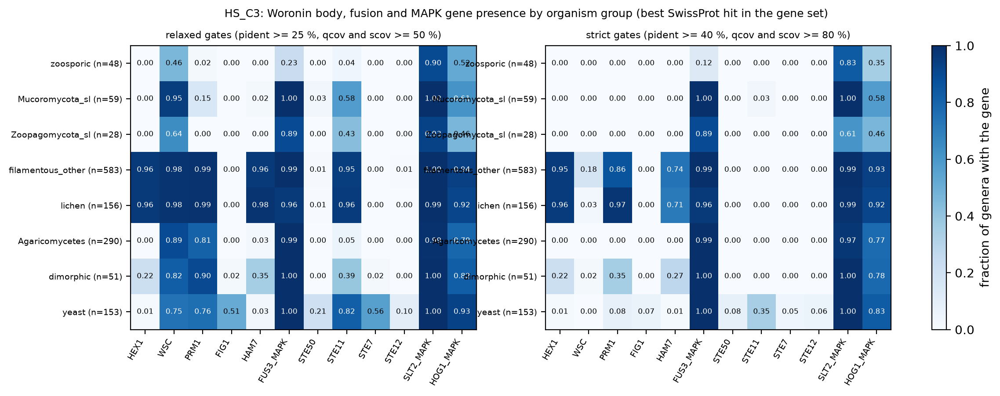
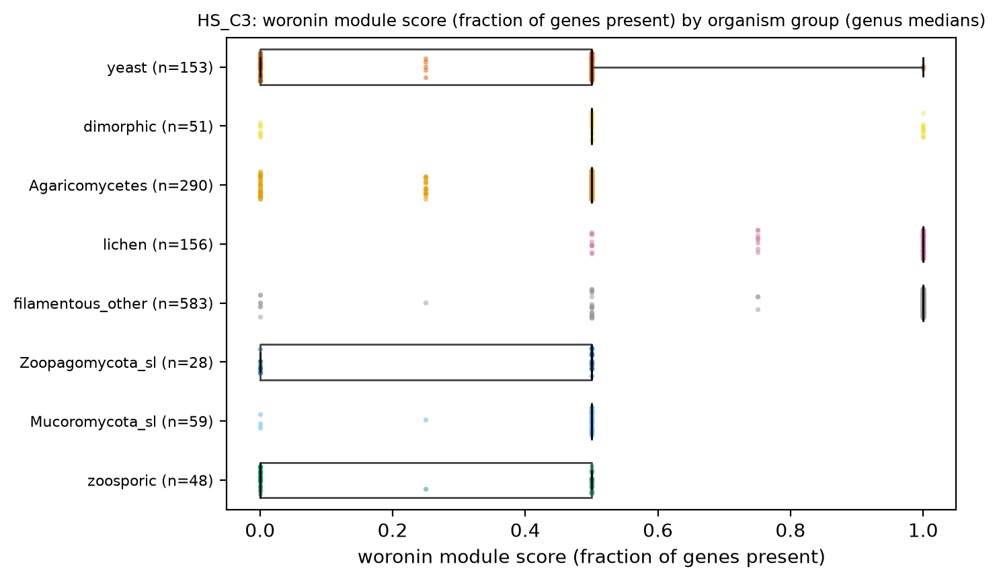
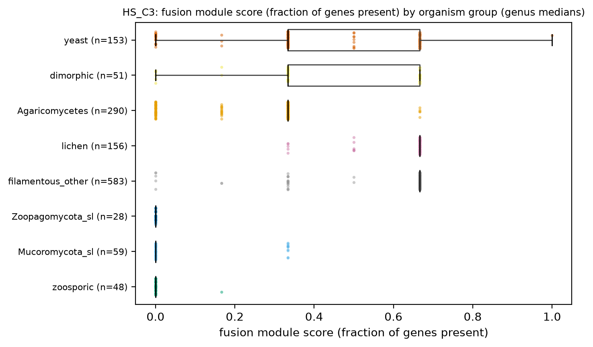
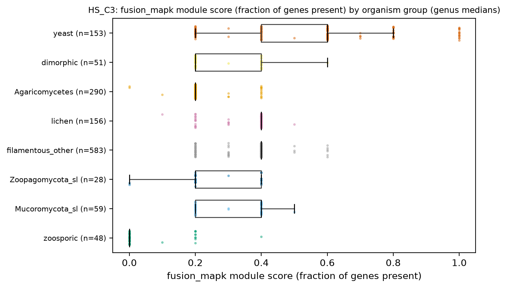
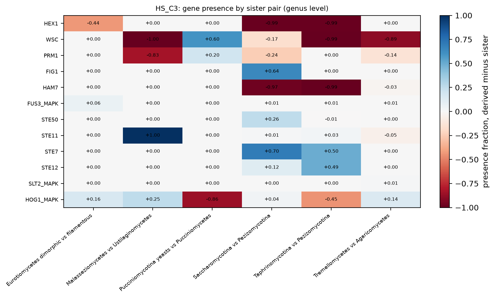

# HS_C3. Woronin-body and cell-fusion gene sets across organization shifts

Hypothesis C3: Woronin-body and cell-fusion gene sets are present only in lineages with septate, fusing hyphae; Agaricomycetes replace the Pezizomycotina Woronin set rather than lack fusion machinery. Design change from the hypothesis text: SwissProt holds no *N. crassa* septal-pore (SPA) or HAM-5/HAM-6/HAM-8 proteins and only three of the planned Woronin/fusion proteins for NEUCR (HEX-1, WSC, PRM-1), so the gene set uses SwissProt entries from several fungi (HEX1 from *N. crassa* and *A. nidulans*, WSC, PRM1 from four reference species, FIG1, HAM-7, the FUS3/KSS1/SPK1 MAPK with STE50/STE11/STE7/STE12) and two control MAPKs (SLT2/SPM1 cell-wall integrity, HOG1). Presence = a protein whose best hit inside one of the four reference proteomes (A9 anchors: *S. cerevisiae*, *N. crassa*, *S. pombe*, *A. nidulans*) is the gene's entry, with relaxed gates (pident >= 25 %, reference coverage >= 50 %; no query-coverage gate, because HEX-1 orthologs carry N-terminal extensions: mean query coverage 58 % on the 176-aa HEX1_NEUCR) and strict gates (pident >= 40 %, reference coverage >= 80 %). The best-SwissProt-hit detector (A11/c3_gene_presence) was tried first and rejected: it finds HOG1 in only 16 % of filamentous non-Agaricomycetes genera, because the best hit of an ortholog is usually an entry from another species. The septal-pore module is not testable with the tables on disk.

[Back to index](index.md) · [Hypothesis text](HYPOTHESES_size_transitions.md)

### HS_C3a Presence matrix

- n = 5,657 genomes / 5,657 species / 1,372 genera. Filters: hs_keep. Genus presence = >= 50 % of the genus's representative genomes have >= 1 anchored hit. Cell = fraction of genera.

| hs_group | HEX1 | WSC | PRM1 | FIG1 | HAM7 | FUS3_MAPK | STE50 | STE11 | STE7 | STE12 | SLT2_MAPK | HOG1_MAPK |
|---|---|---|---|---|---|---|---|---|---|---|---|---|
| zoosporic | 0.000 | 0.458 | 0.021 | 0.000 | 0.000 | 0.229 | 0.000 | 0.042 | 0.000 | 0.000 | 0.896 | 0.521 |
| Mucoromycota_sl | 0.000 | 0.949 | 0.153 | 0.000 | 0.017 | 1.000 | 0.034 | 0.576 | 0.000 | 0.000 | 1.000 | 0.610 |
| Zoopagomycota_sl | 0.000 | 0.643 | 0.000 | 0.000 | 0.000 | 0.893 | 0.000 | 0.429 | 0.000 | 0.000 | 0.929 | 0.464 |
| filamentous_other | 0.959 | 0.981 | 0.988 | 0.000 | 0.964 | 0.993 | 0.009 | 0.947 | 0.002 | 0.005 | 1.000 | 0.937 |
| lichen | 0.962 | 0.981 | 0.987 | 0.000 | 0.981 | 0.962 | 0.006 | 0.955 | 0.000 | 0.000 | 0.994 | 0.917 |
| Agaricomycetes | 0.000 | 0.893 | 0.807 | 0.000 | 0.028 | 0.993 | 0.000 | 0.052 | 0.000 | 0.000 | 0.990 | 0.790 |
| dimorphic | 0.216 | 0.824 | 0.902 | 0.020 | 0.353 | 1.000 | 0.000 | 0.392 | 0.020 | 0.000 | 1.000 | 0.824 |
| yeast | 0.013 | 0.745 | 0.758 | 0.510 | 0.033 | 1.000 | 0.209 | 0.817 | 0.562 | 0.105 | 1.000 | 0.928 |

- SwissProt coverage and module scores by group (a low `n_strict_hits` means absence may be detection failure; `frac_with_swissprot` = fraction of proteins with any SwissProt hit):

| hs_group | n_genera | frac_with_swissprot | n_strict_hits | score_woronin | score_fusion | score_fusion_mapk |
|---|---|---|---|---|---|---|
| zoosporic | 48 | 0.554 | 1232.000 | 0.000 | 0.000 | 0.000 |
| Mucoromycota_sl | 59 | 0.599 | 1954.000 | 0.500 | 0.000 | 0.400 |
| Zoopagomycota_sl | 28 | 0.627 | 1235.000 | 0.500 | 0.000 | 0.200 |
| filamentous_other | 583 | 0.649 | 2551.000 | 1.000 | 0.667 | 0.400 |
| lichen | 156 | 0.617 | 1933.500 | 1.000 | 0.667 | 0.400 |
| Agaricomycetes | 290 | 0.500 | 1557.500 | 0.500 | 0.333 | 0.200 |
| dimorphic | 51 | 0.687 | 1432.000 | 0.500 | 0.333 | 0.200 |
| yeast | 153 | 0.824 | 2006.000 | 0.500 | 0.333 | 0.600 |

- Tables: `tables/HS_C3_presence_relaxed.tsv`, `tables/HS_C3_presence_strict.tsv`, `tables/HS_C3_coverage_and_scores.tsv`.

### HS_C3b Module scores

  

- Module score = fraction of the module's genes with >= 1 relaxed hit in the genome, then genus median.

### HS_C3c Sister pairs

| pair | gene | n_derived | n_sister | frac_derived | frac_sister | diff |
|---|---|---|---|---|---|---|
| Eurotiomycetes dimorphic vs filamentous | FIG1 | 15 | 32 | 0.000 | 0.000 | 0.000 |
| Malasseziomycetes vs Ustilaginomycetes | FIG1 | 1 | 12 | 0.000 | 0.000 | 0.000 |
| Pucciniomycotina yeasts vs Pucciniomycetes | FIG1 | 7 | 5 | 0.000 | 0.000 | 0.000 |
| Saccharomycotina vs Pezizomycotina | FIG1 | 121 | 554 | 0.645 | 0.000 | 0.645 |
| Taphrinomycotina vs Pezizomycotina | FIG1 | 2 | 554 | 0.000 | 0.000 | 0.000 |
| Tremellomycetes vs Agaricomycetes | FIG1 | 15 | 290 | 0.000 | 0.000 | 0.000 |
| Eurotiomycetes dimorphic vs filamentous | FUS3_MAPK | 15 | 32 | 1.000 | 0.938 | 0.062 |
| Malasseziomycetes vs Ustilaginomycetes | FUS3_MAPK | 1 | 12 | 1.000 | 1.000 | 0.000 |
| Pucciniomycotina yeasts vs Pucciniomycetes | FUS3_MAPK | 7 | 5 | 1.000 | 1.000 | 0.000 |
| Saccharomycotina vs Pezizomycotina | FUS3_MAPK | 121 | 554 | 1.000 | 0.993 | 0.007 |
| Taphrinomycotina vs Pezizomycotina | FUS3_MAPK | 2 | 554 | 1.000 | 0.993 | 0.007 |
| Tremellomycetes vs Agaricomycetes | FUS3_MAPK | 15 | 290 | 1.000 | 0.993 | 0.007 |
| Eurotiomycetes dimorphic vs filamentous | HAM7 | 15 | 32 | 1.000 | 1.000 | 0.000 |
| Malasseziomycetes vs Ustilaginomycetes | HAM7 | 1 | 12 | 0.000 | 0.000 | 0.000 |
| Pucciniomycotina yeasts vs Pucciniomycetes | HAM7 | 7 | 5 | 0.000 | 0.000 | 0.000 |
| Saccharomycotina vs Pezizomycotina | HAM7 | 121 | 554 | 0.025 | 0.995 | -0.970 |
| Taphrinomycotina vs Pezizomycotina | HAM7 | 2 | 554 | 0.000 | 0.995 | -0.995 |
| Tremellomycetes vs Agaricomycetes | HAM7 | 15 | 290 | 0.000 | 0.028 | -0.028 |
| Eurotiomycetes dimorphic vs filamentous | HEX1 | 15 | 32 | 0.533 | 0.969 | -0.435 |
| Malasseziomycetes vs Ustilaginomycetes | HEX1 | 1 | 12 | 0.000 | 0.000 | 0.000 |
| Pucciniomycotina yeasts vs Pucciniomycetes | HEX1 | 7 | 5 | 0.000 | 0.000 | 0.000 |
| Saccharomycotina vs Pezizomycotina | HEX1 | 121 | 554 | 0.000 | 0.989 | -0.989 |
| Taphrinomycotina vs Pezizomycotina | HEX1 | 2 | 554 | 0.000 | 0.989 | -0.989 |
| Tremellomycetes vs Agaricomycetes | HEX1 | 15 | 290 | 0.000 | 0.000 | 0.000 |
| Eurotiomycetes dimorphic vs filamentous | PRM1 | 15 | 32 | 1.000 | 1.000 | 0.000 |
| Malasseziomycetes vs Ustilaginomycetes | PRM1 | 1 | 12 | 0.000 | 0.833 | -0.833 |
| Pucciniomycotina yeasts vs Pucciniomycetes | PRM1 | 7 | 5 | 1.000 | 0.800 | 0.200 |
| Saccharomycotina vs Pezizomycotina | PRM1 | 121 | 554 | 0.752 | 0.996 | -0.244 |
| Taphrinomycotina vs Pezizomycotina | PRM1 | 2 | 554 | 1.000 | 0.996 | 0.004 |
| Tremellomycetes vs Agaricomycetes | PRM1 | 15 | 290 | 0.667 | 0.807 | -0.140 |
| Eurotiomycetes dimorphic vs filamentous | STE12 | 15 | 32 | 0.000 | 0.000 | 0.000 |
| Malasseziomycetes vs Ustilaginomycetes | STE12 | 1 | 12 | 0.000 | 0.000 | 0.000 |
| Pucciniomycotina yeasts vs Pucciniomycetes | STE12 | 7 | 5 | 0.000 | 0.000 | 0.000 |
| Saccharomycotina vs Pezizomycotina | STE12 | 121 | 554 | 0.124 | 0.005 | 0.119 |
| Taphrinomycotina vs Pezizomycotina | STE12 | 2 | 554 | 0.500 | 0.005 | 0.495 |
| Tremellomycetes vs Agaricomycetes | STE12 | 15 | 290 | 0.000 | 0.000 | 0.000 |
| Eurotiomycetes dimorphic vs filamentous | WSC | 15 | 32 | 1.000 | 1.000 | 0.000 |
| Malasseziomycetes vs Ustilaginomycetes | WSC | 1 | 12 | 0.000 | 1.000 | -1.000 |
| Pucciniomycotina yeasts vs Pucciniomycetes | WSC | 7 | 5 | 1.000 | 0.400 | 0.600 |
| Saccharomycotina vs Pezizomycotina | WSC | 121 | 554 | 0.826 | 0.993 | -0.166 |
| Taphrinomycotina vs Pezizomycotina | WSC | 2 | 554 | 0.000 | 0.993 | -0.993 |
| Tremellomycetes vs Agaricomycetes | WSC | 15 | 290 | 0.000 | 0.893 | -0.893 |

- Table: `tables/HS_C3_pairs_presence.tsv`.

### Evolutionary framing

- Polarity: HEX1 presence (fraction of genera): filamentous non-Agaricomycetes 0.96, lichen 0.96, dimorphic 0.22, yeast 0.01, Agaricomycetes 0.00, Mucoromycota s.l. 0.00, zoosporic 0.00; PRM1: filamentous non-Agaricomycetes 0.99, Agaricomycetes 0.81, yeast 0.76, Mucoromycota s.l. 0.15, zoosporic 0.02. The Woronin set is a Pezizomycotina gain if absent from all outgroups; the fusion/MAPK set is ancestral if present in the early-diverging groups. Outgroups available in this frame (genera): zoosporic 48, Mucoromycota s.l. 59, Zoopagomycota s.l. 28; Dikarya: filamentous non-Agaricomycetes 583, Agaricomycetes 290, lichen 156, dimorphic 51, yeast 153. Microsporidia are excluded (PI decision 2026-11-08) unless the page says otherwise.
- Placement: Woronin gain on the Pezizomycotina stem (one event); fusion-gene losses on yeast stems are the replicated part (HS_C3c).
- Mode: gene birth (Woronin) and gene loss (fusion genes in yeasts); no expansion expected.
- What the tree adds: `make.simmap` per gene, `fitPagel` growth form vs module presence, phylogenetic logistic regression with `n_strict_hits` as covariate; ancestral presence along the Saccharomycotina path to order fusion-gene loss against growth-form change. PGLS, phylogenetic signal (lambda, K) and ancestral states: pending tree (atlas_data/phylo).
- Caveats: best-hit presence fades with distance from the reference organisms (coverage table above); absence in Basidiomycota and early-diverging lineages can be divergence; SwissProt lacks the septal-pore proteins; the gene set is small. STE50, STE7 and STE12 have anchors only in *S. cerevisiae* and *S. pombe*, and their relaxed-gate presence outside yeasts is near zero even in Pezizomycotina, so those three rows measure anchor reach, not gene loss; HOG1 and SLT2 (anchors in all four references) are the detection controls.

## Verdict

**Woronin module: supported (Pezizomycotina gain, absent from Agaricomycetes, yeasts and all outgroups). Fusion module: PRM1 is shared by Dikarya hyphal forms and yeasts and is rare outside Dikarya; HAM-7 is Pezizomycotina-restricted (96 % filamentous non-Agaricomycetes, 3 % Agaricomycetes, 3 % yeast); the FUS3-type MAPK module is universal where detection allows.** HEX1 present in 96 % of filamentous non-Agaricomycetes genera, 96 % of lichen, 22 % of dimorphic, 1 % of yeast, 0 % of Agaricomycetes, 0 % of Mucoromycota s.l. and 0 % of zoosporic genera. PRM1: 99 % / 81 % / 76 % / 15 % / 2 % (filamentous / Agaricomycetes / yeast / Mucoromycota s.l. / zoosporic). FUS3-type MAPK: 99 % / 99 % / 100 % / 100 % / 23 %. Control MAPKs (HOG1): filamentous 94 %, zoosporic 52 %, which bounds the detection rate in distant clades. The septal-pore module is not testable with the tables on disk. PGLS, phylogenetic signal (lambda, K) and ancestral states: pending tree (atlas_data/phylo).
