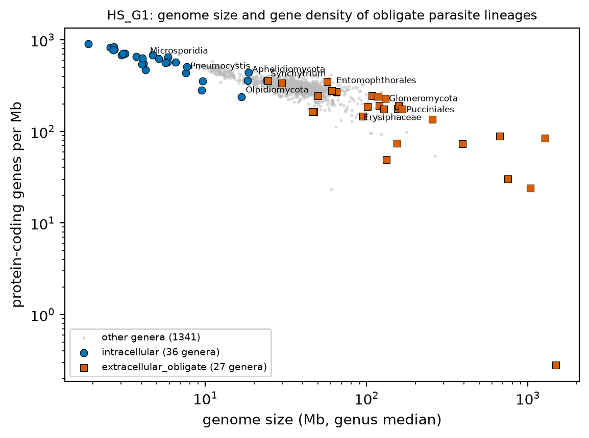
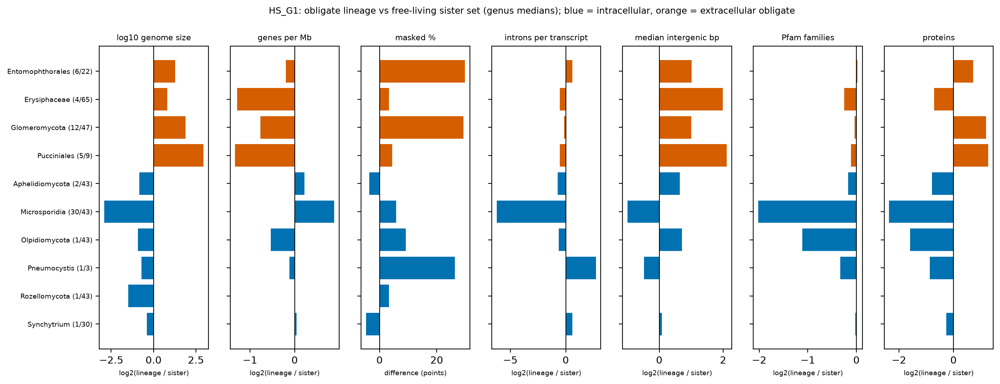
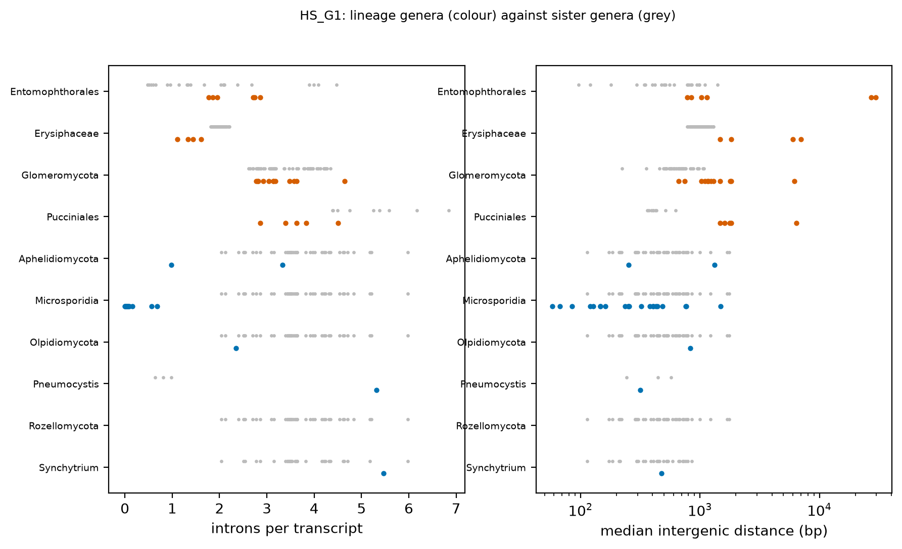
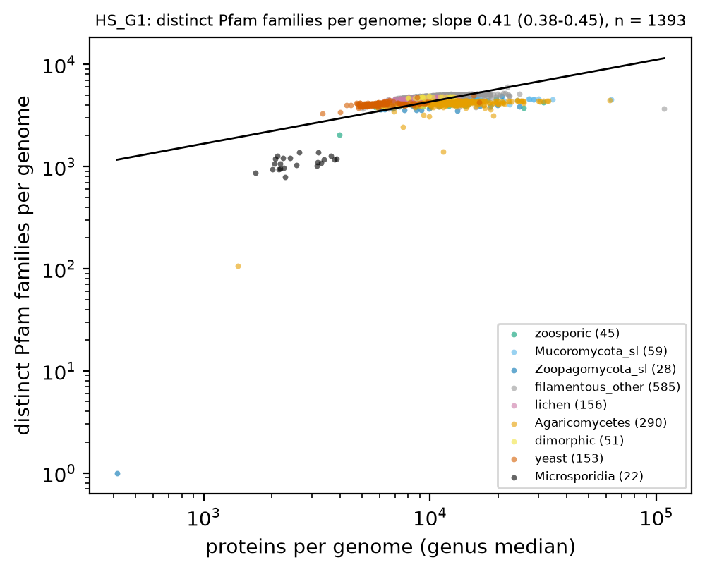

# HS_G1. Two directions of genome size under obligate parasitism

Hypothesis G1: obligate parasitism moves genome size in two directions set by the host-cell boundary. Intracellular parasites shrink (small genomes, high gene density, few introns); haustorial or hemocoel-living extracellular obligate biotrophs expand through repeats; both lose gene content (Pfam family richness). Expected: a bimodal genome-size distribution among obligate lineages.

[Back to index](index.md) · [Hypothesis text](HYPOTHESES_size_transitions.md)

### HS_G1a Genome size and gene density

- n = 5,737 genomes / 5,737 species / 1,404 genera after the G1 filter: representative, annotated, class-relative BUSCO or (obligate lineage with BUSCO >= 90 %), Microsporidia only < 10 Mb (30 genera). Obligate lineages (hand list, `hs_labels.py`): intracellular = Microsporidia, Rozellomycota, Aphelidiomycota, Olpidiomycota, *Pneumocystis*, *Synchytrium*; extracellular obligate = Pucciniales, Erysiphaceae, Glomeromycota, Entomophthorales. Unit = genus (median of representative genomes). Lineages present after the filter: 10.

| lineage | mode | n_genera | n_sister_genera | genome_mb_lineage | genome_mb_sister | size_ratio | busco_duplicated_lineage | genes_per_mb_lineage | genes_per_mb_sister | masked_pct_lineage | masked_pct_sister | introns_per_transcript_lineage | introns_per_transcript_sister | n_pfam_families_lineage | n_pfam_families_sister | pfam_richness_residual |
|---|---|---|---|---|---|---|---|---|---|---|---|---|---|---|---|---|
| Entomophthorales | extracellular_obligate | 6 | 22 | 60.901 | 24.518 | 2.413 | 14.950 | 302.808 | 347.745 | 45.290 | 15.400 | 2.333 | 1.531 | 3888.250 | 3834.000 | -0.144 |
| Erysiphaceae | extracellular_obligate | 4 | 65 | 89.982 | 45.211 | 1.747 | 0.625 | 119.303 | 290.863 | 17.240 | 13.940 | 1.389 | 2.027 | 4173.500 | 4970.000 | 0.019 |
| Glomeromycota | extracellular_obligate | 12 | 47 | 129.308 | 34.766 | 3.719 | 0.800 | 191.877 | 326.406 | 46.990 | 17.580 | 3.141 | 3.470 | 4528.500 | 4660.000 | -0.157 |
| Pucciniales | extracellular_obligate | 5 | 9 | 166.060 | 21.620 | 7.681 | 29.100 | 145.479 | 366.231 | 25.080 | 20.680 | 3.625 | 5.251 | 3814.000 | 4114.000 | -0.140 |
| Aphelidiomycota | intracellular | 2 | 43 | 18.344 | 31.927 | 0.562 | 7.425 | 400.136 | 344.604 | 11.135 | 14.680 | 2.158 | 3.600 | 3918.000 | 4408.000 | 0.026 |
| Microsporidia | intracellular | 30 | 43 | 4.259 | 31.927 | 0.133 | 0.025 | 636.769 | 344.604 | 20.520 | 14.680 | 0.048 | 3.600 | 1089.000 | 4408.000 | -0.376 |
| Olpidiomycota | intracellular | 1 | 43 | 16.735 | 31.927 | 0.524 | 0.900 | 238.486 | 344.604 | 23.830 | 14.680 | 2.343 | 3.600 | 2035.000 | 4408.000 | -0.162 |
| Pneumocystis | intracellular | 1 | 3 | 7.581 | 12.422 | 0.611 | 0.050 | 434.897 | 471.731 | 34.835 | 8.450 | 5.321 | 0.811 | 3291.500 | 4149.000 | 0.078 |
| Rozellomycota | intracellular | 1 | 43 | 11.322 | 31.927 | 0.355 | 0.400 | NA | 344.604 | 17.930 | 14.680 | NA | 3.600 | NA | 4408.000 | NA |
| Synchytrium | intracellular | 1 | 30 | 23.831 | 31.345 | 0.756 | 1.050 | 358.945 | 348.765 | 9.195 | 13.965 | 5.467 | 3.600 | 4415.000 | 4477.500 | 0.038 |

- `size_ratio` = lineage genome size / sister genome size (genus medians). Table: `tables/HS_G1_lineage_vs_sister.tsv`.

### HS_G1b Lineage versus sister, trait by trait

- Bars are log2 ratios of genus medians (lineage / its free-living sister set); masked % is a difference in points. Sister sets: Microsporidia, Rozellomycota, Aphelidiomycota, Olpidiomycota -> zoosporic genera; *Synchytrium* -> other Chytridiomycetes; *Pneumocystis* -> *Schizosaccharomyces* + *Taphrina*; Pucciniales -> other Pucciniomycotina; Erysiphaceae -> other Helotiales; Glomeromycota -> Mortierellomycota + Mucoromycota; Entomophthorales -> Basidiobolomycota + Kickxellomycota + Zoopagomycota.
- Intracellular vs extracellular lineages (unit = lineage; Mann-Whitney has very low power at these n and is a screen only):

| trait | median_intracellular | median_extracellular | mw_p_all | median_intracellular_noMicro | mw_p_noMicro | n_lineages |
|---|---|---|---|---|---|---|
| log10 genome size | 7.139 | 8.005 | 0.010 | 7.224 | 0.016 | 6+4 |
| genes per Mb | 400.136 | 168.678 | 0.032 | 379.540 | 0.057 | 5+4 |
| masked % | 19.225 | 35.185 | 0.171 | 17.930 | 0.190 | 6+4 |
| introns per transcript | 2.343 | 2.737 | 0.905 | 3.832 | 0.486 | 5+4 |
| Pfam families | 3291.500 | 4030.875 | 0.286 | 3604.750 | 0.486 | 5+4 |

- Table: `tables/HS_G1_mode_test.tsv`.

### HS_G1c Introns and intergenic distance

- Coloured points = genera of the obligate lineage; grey = genera of its sister set. Q-n50 is not applied here (it would remove most rust and AM assemblies); intergenic distances in fragmented assemblies are biased downward.

### HS_G1d Pfam family richness after proteome-size allometry

- Log-log slope of distinct Pfam families on proteins per genome, all genera in the frame: 0.411 (95 % CI 0.376 to 0.446, n = 1393). Per-lineage median residual is in the table above (`pfam_richness_residual`, log10 units; negative = fewer families than expected for the proteome size). Lineages with fewer families than their sister (raw genus medians): 8 of 10 (Erysiphaceae, Glomeromycota, Pucciniales, Aphelidiomycota, Microsporidia, Olpidiomycota, Pneumocystis, Synchytrium).

### Evolutionary framing

- Polarity: the ancestral fungal genome in this frame is 25-40 Mb (genus medians: zoosporic 30.9 Mb, Mucoromycota s.l. 37.7 Mb, filamentous Pezizomycotina-type 38.0 Mb). Reduction (intracellular lineages) and expansion (extracellular obligate lineages) are both derived. Outgroups available in this frame (genera): zoosporic 48, Mucoromycota s.l. 59, Zoopagomycota s.l. 28; Dikarya: filamentous non-Agaricomycetes 585, Agaricomycetes 290, lichen 156, dimorphic 51, yeast 153. Microsporidia are kept here as one replicate (30 genera, < 10 Mb), and the mode test is reported with and without them.
- Placement: each lineage is one origin (single origin inherited by its genera); the replication is across lineages (6 intracellular, 4 extracellular). Rozellomycota and Aphelidiomycota are already small, so part of the Microsporidia reduction may predate Microsporidia; a 1-2 genus outgroup gives weak polarization.
- Mode: reduction = gene loss plus intergenic deletion; expansion = repeat accumulation (masked %) with gene count roughly kept; family richness loss in both. wgd.ks is not used here (rust and AM duplication is an assembly property).
- What the tree adds: `bayou`/`OUwie` shift placement on log genome size, `fitPagel` between obligate mode and size class, ancestral size and richness along each stem to order gene loss and size change. PGLS, phylogenetic signal (lambda, K) and ancestral states: pending tree (atlas_data/phylo).
- Caveats: Erysiphaceae pass only with the relaxed BUSCO filter; rust assemblies may be dikaryotic (`busco_duplicated` is in the genus table); Microsporidia fungi_odb12 BUSCO is not a valid completeness measure; *Synchytrium* and Entomophthorales classification as intracellular / extracellular is a hand assignment (to check).

## Verdict

**Direction: supported.** 6 of 6 intracellular lineages are smaller than their sister set and 4 of 4 extracellular obligate lineages are larger (genome size ratios: intracellular Aphelidiomycota 0.56, Microsporidia 0.13, Olpidiomycota 0.52, Pneumocystis 0.61, Rozellomycota 0.35, Synchytrium 0.76; extracellular Entomophthorales 2.41, Erysiphaceae 1.75, Glomeromycota 3.72, Pucciniales 7.68). Gene density: intracellular median 400 vs extracellular 169 genes per Mb (unit = lineage, Mann-Whitney p = 0.032; without Microsporidia p = 0.057). Pfam family richness is below the sister in 8 of 10 lineages. Low lineage counts (n = 6 + 4) make every p-value a screen; the effect sizes are the result. PGLS, phylogenetic signal (lambda, K) and ancestral states: pending tree (atlas_data/phylo).
