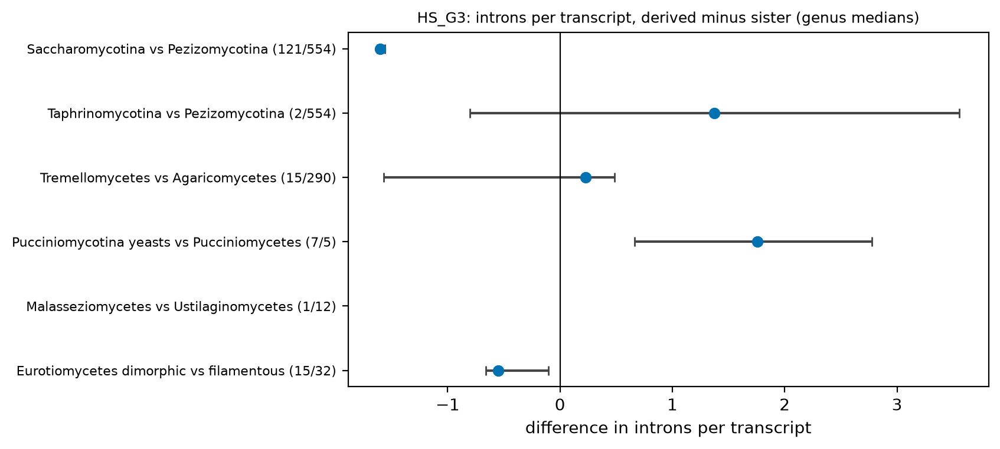
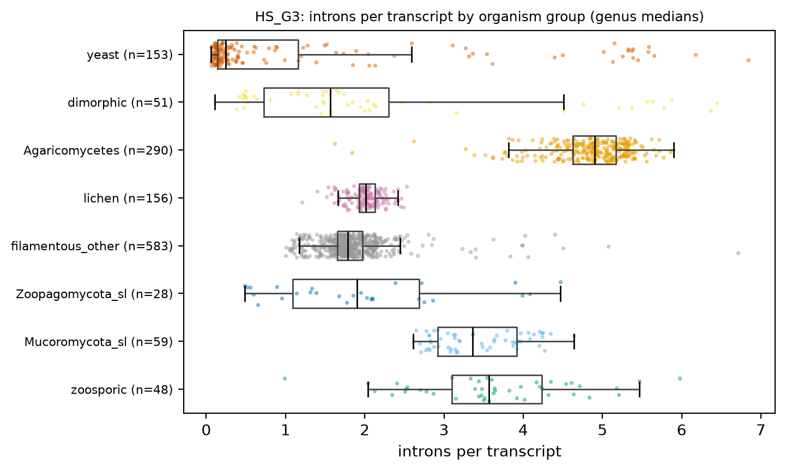
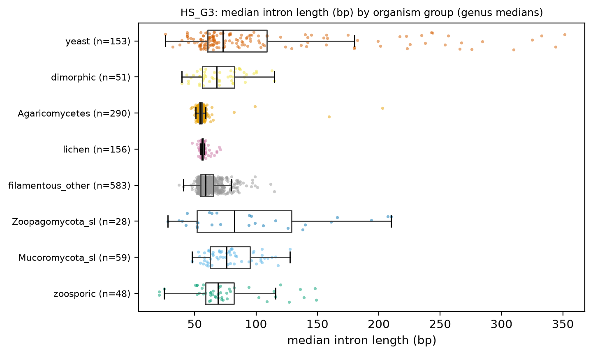

# HS_G3. Intron loss by independent yeast origin (falsification test)

Hypothesis G3 (falsification test): unicellular growth does not by itself drive intron loss. Prediction that supports the popular reading of H3: every yeast origin has fewer introns per transcript than its sister. Prediction that falsifies it: the basidiomycete yeast origins (Tremellomycetes, Pucciniomycotina yeasts, Malasseziomycetes) and the Pezizomycotina dimorphic genera keep sister-like intron densities, so the loss is a Saccharomycotina (and Taphrinomycotina) event.

[Back to index](index.md) · [Hypothesis text](HYPOTHESES_size_transitions.md)

### HS_G3a Intron density by yeast origin, derived minus sister

- n = 5,657 genomes / 5,657 species / 1,372 genera. Filters: Q-ann, Q-rep, Q-busco-rel, Microsporidia excluded (hs_keep). Unit = genus.

| pair | n_derived | n_sister | median_derived | median_sister | diff | ci_lo | ci_hi | cliffs_delta | mw_p |
|---|---|---|---|---|---|---|---|---|---|
| Saccharomycotina vs Pezizomycotina | 121 | 554 | 0.181 | 1.780 | -1.599 | -1.627 | -1.560 | -0.940 | 4.03e-59 |
| Taphrinomycotina vs Pezizomycotina | 2 | 554 | 3.154 | 1.780 | 1.374 | -0.804 | 3.556 | 0.000 | 1.000 |
| Tremellomycetes vs Agaricomycetes | 15 | 290 | 5.131 | 4.905 | 0.226 | -1.569 | 0.484 | 0.029 | 0.849 |
| Pucciniomycotina yeasts vs Pucciniomycetes | 7 | 5 | 5.381 | 3.625 | 1.756 | 0.664 | 2.778 | 0.886 | 0.010 |
| Malasseziomycetes vs Ustilaginomycetes | 1 | 12 | 1.278 | 0.480 | NA | NA | NA | NA | NA |
| Eurotiomycetes dimorphic vs filamentous | 15 | 32 | 1.562 | 2.110 | -0.548 | -0.658 | -0.104 | -0.637 | 5.01e-04 |

- Sister pairs (introns per transcript; unit = genus; difference = derived median minus sister median, bootstrap 95 % CI). Sign across the 4 yeast-origin pairs with data: 1 of 4 below zero (binomial p = 0.625). Pairs with < 3 genera on one side have no CI.
- Mixed model `introns_per_transcript ~ gf_yeast + log_n50 + busco_complete + (1|CLASS/ORDER_)` (n = 1,091 genera, 49 classes, converged = True): yeast effect 0.001 (95 % CI -0.386 to 0.389), p = 0.994. PGLS, phylogenetic signal (lambda, K) and ancestral states: pending tree (atlas_data/phylo).
- Table: `tables/HS_G3_pairs_introns.tsv`.

### HS_G3b Intron density and intron length by organism group

| hs_group | n_genera | introns_per_transcript | frac_intronless | median_intron_len |
|---|---|---|---|---|
| zoosporic | 48 | 3.570 | 0.186 | 69.000 |
| Mucoromycota_sl | 59 | 3.360 | 0.166 | 76.000 |
| Zoopagomycota_sl | 28 | 1.903 | 0.443 | 82.500 |
| filamentous_other | 583 | 1.787 | 0.247 | 59.000 |
| lichen | 156 | 2.015 | 0.230 | 56.000 |
| Agaricomycetes | 290 | 4.905 | 0.099 | 55.000 |
| dimorphic | 51 | 1.562 | 0.303 | 68.000 |
| yeast | 153 | 0.244 | 0.814 | 73.000 |

- Table: `tables/HS_G3_group_medians.tsv`. Extends V15 (which is by class) with the zoosporic and coenocytic groups.

### HS_G3c Intronless fraction and intron length by pair

| pair | n_derived | n_sister | median_derived | median_sister | diff | ci_lo | ci_hi | cliffs_delta | mw_p |
|---|---|---|---|---|---|---|---|---|---|
| Saccharomycotina vs Pezizomycotina | 121 | 554 | 0.855 | 0.247 | 0.607 | 0.584 | 0.624 | 0.940 | 4.31e-59 |
| Taphrinomycotina vs Pezizomycotina | 2 | 554 | 0.295 | 0.247 | 0.048 | -0.200 | 0.295 | 0.000 | 1.000 |
| Tremellomycetes vs Agaricomycetes | 15 | 290 | 0.076 | 0.099 | -0.023 | -0.033 | 0.035 | -0.208 | 0.175 |
| Pucciniomycotina yeasts vs Pucciniomycetes | 7 | 5 | 0.044 | 0.163 | -0.119 | -0.201 | -0.024 | -1.000 | 0.003 |
| Malasseziomycetes vs Ustilaginomycetes | 1 | 12 | 0.388 | 0.705 | NA | NA | NA | NA | NA |
| Eurotiomycetes dimorphic vs filamentous | 15 | 32 | 0.307 | 0.211 | 0.096 | 0.011 | 0.153 | 0.625 | 6.45e-04 |

| pair | n_derived | n_sister | median_derived | median_sister | diff | ci_lo | ci_hi | cliffs_delta | mw_p |
|---|---|---|---|---|---|---|---|---|---|
| Saccharomycotina vs Pezizomycotina | 121 | 554 | 85.000 | 59.000 | 26.000 | 13.500 | 35.000 | 0.618 | 1.47e-26 |
| Taphrinomycotina vs Pezizomycotina | 2 | 554 | 49.250 | 59.000 | -9.750 | -15.500 | -5.000 | -0.872 | 0.033 |
| Tremellomycetes vs Agaricomycetes | 15 | 290 | 52.000 | 55.000 | -3.000 | -10.000 | 0.150 | -0.269 | 0.077 |
| Pucciniomycotina yeasts vs Pucciniomycetes | 7 | 5 | 68.000 | 83.000 | -15.000 | -29.000 | 3.000 | -0.714 | 0.050 |
| Malasseziomycetes vs Ustilaginomycetes | 1 | 12 | 26.000 | 93.500 | NA | NA | NA | NA | NA |
| Eurotiomycetes dimorphic vs filamentous | 15 | 32 | 59.000 | 63.000 | -4.000 | -7.000 | 10.000 | -0.083 | 0.656 |

- Tables: `tables/HS_G3_pairs_intronless.tsv`, `tables/HS_G3_pairs_intron_len.tsv`.

### Evolutionary framing

- Polarity: the ancestral fungal gene is intron-rich. Genus-median introns per transcript: zoosporic 3.57, Mucoromycota s.l. 3.36, Agaricomycetes 4.91, filamentous non-Agaricomycetes 1.79, yeast 0.24. Outgroups available in this frame (genera): zoosporic 48, Mucoromycota s.l. 59, Zoopagomycota s.l. 28; Dikarya: filamentous non-Agaricomycetes 583, Agaricomycetes 290, lichen 156, dimorphic 51, yeast 153. Microsporidia are excluded (PI decision 2026-11-08) unless the page says otherwise.
- Placement: the pairs test whether the drop sits on the Saccharomycotina stem only (one event inherited by 121 genera) or repeats on the basidiomycete yeast stems. Result above: 0 of 3 basidiomycete yeast origins have a lower median than the sister, 0 with a CI that excludes zero.
- Mode: intron loss; a stem burst vs crown decline needs `bayou` on the genus tree. No WGD link tested.
- What the tree adds: `phylosig` (lambda expected near 1), PGLS on growth form, `fitPagel` for growth form vs intron class, ancestral density at the Ascomycota, Pezizomycotina and Saccharomycotina nodes. PGLS, phylogenetic signal (lambda, K) and ancestral states: pending tree (atlas_data/phylo).
- Caveats: ab initio intron prediction without RNA-seq (D8); Taphrinomycotina is 3 genera; the Saccharomycotina branch is long; Pezizomycotina (1.8 per transcript) are already reduced relative to the early-diverging groups, so the filamentous sister is not the ancestral state.

## Verdict

**Falsification test: the popular reading fails.** Saccharomycotina genera have 0.18 introns per transcript against 1.78 in Pezizomycotina (difference -1.60, 95 % CI -1.63 to -1.56). Basidiomycete yeast origins: Tremellomycetes vs Agaricomycetes 5.13 vs 4.91 (diff 0.23, CI -1.57 to 0.48; n = 15 / 290); Pucciniomycotina yeasts vs Pucciniomycetes 5.38 vs 3.62 (diff 1.76, CI 0.66 to 2.78; n = 7 / 5); Malasseziomycetes vs Ustilaginomycetes 1.28 vs 0.48 (diff NA, CI NA to NA; n = 1 / 12). Eurotiomycetes dimorphic vs filamentous: 1.56 vs 2.11 (diff -0.55). 0 of 3 basidiomycete origins show a loss with a CI excluding zero, so intron loss is not a general property of the yeast transition in this data. PGLS, phylogenetic signal (lambda, K) and ancestral states: pending tree (atlas_data/phylo).
