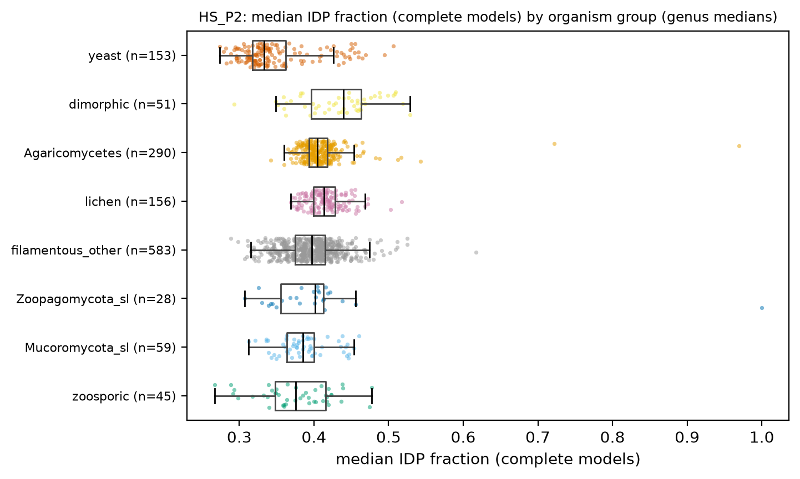
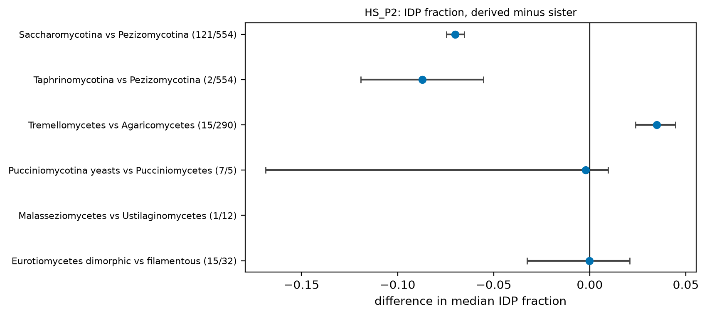
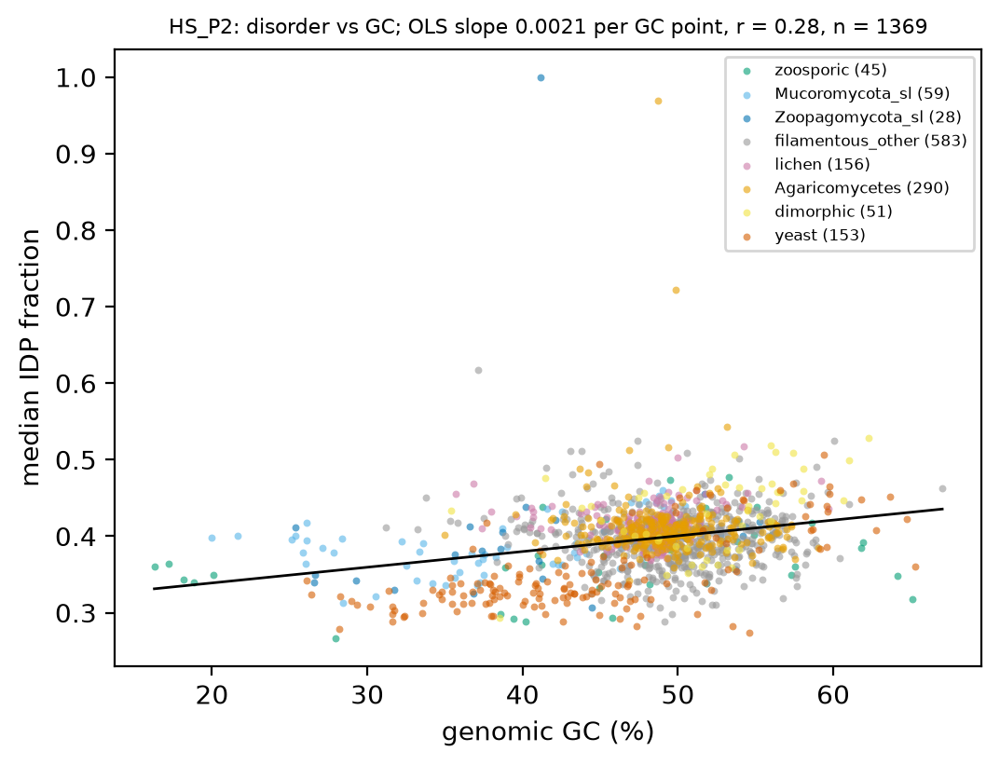
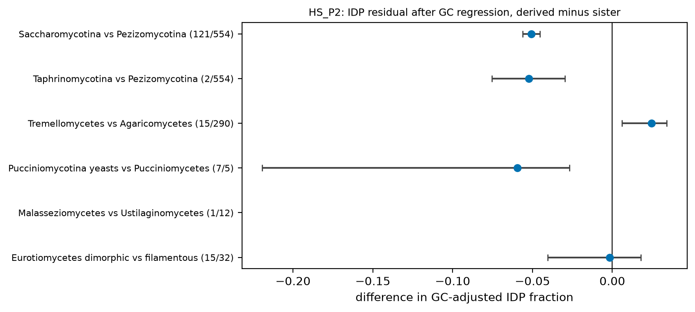
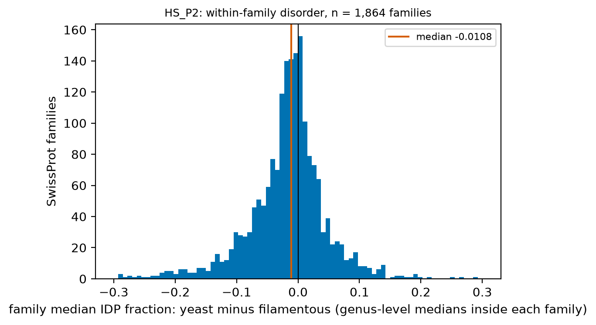

# HS_P2. Intrinsic disorder across yeast origins, with GC control

Hypothesis P2: intrinsic disorder is lower in every independent yeast origin and in reduced parasites than in filamentous sisters, after GC control. Disorder predictors respond to amino-acid composition, which tracks GC (H6), so the GC-adjusted residual and the within-family contrast are the stated tests.

[Back to index](index.md) · [Hypothesis text](HYPOTHESES_size_transitions.md)

### HS_P2a Disorder by organism group

- n = 5,657 genomes / 5,657 species / 1,372 genera. Filters: hs_keep (Q-ann, Q-rep, Q-busco-rel, Microsporidia excluded). Trait: median per-protein disorder fraction over complete gene models (A11); `med_idp_nonsecreted` excludes the strict secreted set. Unit = genus.

| hs_group | n_genera | med_idp | med_idp_nonsecreted | gc_pct | idp_res_gc |
|---|---|---|---|---|---|
| zoosporic | 45 | 0.376 | 0.377 | 48.170 | -0.008 |
| Mucoromycota_sl | 59 | 0.385 | 0.385 | 37.550 | 0.004 |
| Zoopagomycota_sl | 28 | 0.401 | 0.399 | 41.190 | 0.004 |
| filamentous_other | 583 | 0.397 | 0.402 | 50.030 | -0.003 |
| lichen | 156 | 0.414 | 0.417 | 48.460 | 0.018 |
| Agaricomycetes | 290 | 0.405 | 0.408 | 49.070 | 0.005 |
| dimorphic | 51 | 0.439 | 0.442 | 52.570 | 0.030 |
| yeast | 153 | 0.333 | 0.334 | 42.820 | -0.049 |

- Table: `tables/HS_P2_group_medians.tsv`.

### HS_P2b Disorder by yeast origin, derived minus sister

| pair | n_derived | n_sister | median_derived | median_sister | diff | ci_lo | ci_hi | cliffs_delta | mw_p |
|---|---|---|---|---|---|---|---|---|---|
| Saccharomycotina vs Pezizomycotina | 121 | 554 | 0.326 | 0.396 | -0.070 | -0.075 | -0.065 | -0.887 | 7.94e-53 |
| Taphrinomycotina vs Pezizomycotina | 2 | 554 | 0.309 | 0.396 | -0.087 | -0.119 | -0.055 | -0.949 | 0.020 |
| Tremellomycetes vs Agaricomycetes | 15 | 290 | 0.439 | 0.405 | 0.035 | 0.024 | 0.045 | 0.754 | 8.54e-07 |
| Pucciniomycotina yeasts vs Pucciniomycetes | 7 | 5 | 0.449 | 0.451 | -0.002 | -0.169 | 0.009 | -0.486 | 0.202 |
| Malasseziomycetes vs Ustilaginomycetes | 1 | 12 | 0.383 | 0.459 | NA | NA | NA | NA | NA |
| Eurotiomycetes dimorphic vs filamentous | 15 | 32 | 0.395 | 0.395 | -1.63e-04 | -0.033 | 0.021 | -0.033 | 0.864 |

- Sister pairs (median IDP fraction; unit = genus; difference = derived median minus sister median, bootstrap 95 % CI). Sign across the 4 yeast-origin pairs with data: 3 of 4 below zero (binomial p = 0.625). Pairs with < 3 genera on one side have no CI.
- Mixed model `med_idp_model ~ gf_yeast + gc_pct + busco_complete + frac_with_pfam + (1|CLASS/ORDER_)` (n = 1,091 genera, 49 classes, converged = True): yeast effect 0.005 (95 % CI -0.015 to 0.024), p = 0.628. PGLS, phylogenetic signal (lambda, K) and ancestral states: pending tree (atlas_data/phylo).
- Table: `tables/HS_P2_pairs_idp.tsv`.

### HS_P2c GC control

- OLS of the genus-median IDP fraction on genomic GC over all genera: slope 0.0021 per GC point (r = 0.28, n = 1369). Residuals from this line, derived minus sister:

| pair | n_derived | n_sister | median_derived | median_sister | diff | ci_lo | ci_hi | cliffs_delta | mw_p |
|---|---|---|---|---|---|---|---|---|---|
| Saccharomycotina vs Pezizomycotina | 121 | 554 | -0.055 | -0.004 | -0.051 | -0.056 | -0.045 | -0.758 | 4.26e-39 |
| Taphrinomycotina vs Pezizomycotina | 2 | 554 | -0.056 | -0.004 | -0.052 | -0.075 | -0.030 | -0.785 | 0.047 |
| Tremellomycetes vs Agaricomycetes | 15 | 290 | 0.030 | 0.005 | 0.025 | 0.006 | 0.034 | 0.409 | 0.008 |
| Pucciniomycotina yeasts vs Pucciniomycetes | 7 | 5 | 0.024 | 0.083 | -0.059 | -0.219 | -0.027 | -1.000 | 0.003 |
| Malasseziomycetes vs Ustilaginomycetes | 1 | 12 | -0.036 | 0.045 | NA | NA | NA | NA | NA |
| Eurotiomycetes dimorphic vs filamentous | 15 | 32 | -0.003 | -0.001 | -0.002 | -0.041 | 0.018 | -0.037 | 0.846 |

- Sister pairs (IDP residual after GC; unit = genus; difference = derived median minus sister median, bootstrap 95 % CI). Sign across the 4 yeast-origin pairs with data: 3 of 4 below zero (binomial p = 0.625). Pairs with < 3 genera on one side have no CI.
- Table: `tables/HS_P2_pairs_idp_gc_residual.tsv`.

### HS_P2d Within-family disorder contrast

- Family = SwissProt best-hit family (P-A proxy as V08: qcov, scov >= 80 %, pident >= 40 %, complete models). Per family: genus-median of the per-genome median IDP fraction; difference derived minus sister; families need the stated minimum genera per side. Unit = family.

| contrast | min_genera_per_side | n_families | median_diff_idp | ci_lo | ci_hi | frac_derived_lower | binom_p |
|---|---|---|---|---|---|---|---|
| all yeast origins vs filamentous | 10 | 1,864 | -0.011 | -0.013 | -0.009 | 0.628 | 2.84e-28 |
| Saccharomycotina vs Pezizomycotina | 10 | 907 | -0.035 | -0.039 | -0.032 | 0.828 | 5.98e-93 |
| Tremellomycetes vs Agaricomycetes | 3 | 1,250 | 0.017 | 0.014 | 0.020 | 0.351 | 6.06e-26 |
| Pucciniomycotina yeasts vs Pucciniomycetes | 3 | 314 | 0.012 | 0.005 | 0.018 | 0.399 | 4.40e-04 |
| Eurotiomycetes dimorphic vs filamentous | 3 | 2,403 | 0.004 | 0.002 | 0.005 | 0.435 | 2.27e-10 |

- This test removes gene content: it compares disorder in the same protein family. Table: `tables/HS_P2_family_contrast.tsv`.

### Evolutionary framing

- Polarity: genus-median IDP fraction in the early-diverging groups (zoosporic 0.376, Mucoromycota s.l. 0.385, Zoopagomycota s.l. 0.401) sets the ancestral value; yeasts (0.333) are derived decreases where the pairs show it, dimorphic Pezizomycotina (0.439) a derived increase. Outgroups available in this frame (genera): zoosporic 45, Mucoromycota s.l. 59, Zoopagomycota s.l. 28; Dikarya: filamentous non-Agaricomycetes 583, Agaricomycetes 290, lichen 156, dimorphic 51, yeast 153. Microsporidia are excluded (PI decision 2026-11-08) unless the page says otherwise.
- Placement: 5 yeast-origin stems plus the Onygenales dimorphic branches; the sign across origins above is the no-tree placement test.
- Mode: loss of disordered sequence inside proteins (H2b: 188 of 301 Saccharomycotina shrinker families lose >= 10 disordered residues), tested here within families (HS_P2d), not gene loss.
- What the tree adds: `phylosig` on IDP and on GC, PGLS with GC as covariate, `OUwie` two-regime, ancestral IDP and GC on the same branches to see whether disorder changes where GC does not. PGLS, phylogenetic signal (lambda, K) and ancestral states: pending tree (atlas_data/phylo).
- Caveats: predictor composition bias (GC residual applied; the predictor is AIUPred-type per `BFD_function/results/function/aiupred`, to check); Saccharomycotina annotation completeness; truncated models lose termini (complete models only).

## Verdict

**Not a general yeast trait: 2 of 5 yeast origins are lower with a CI excluding zero (3 after GC adjustment), 1 is higher; the drop is a Saccharomycotina (and Taphrinomycotina, 2 genera) result.** Saccharomycotina genera: median IDP fraction 0.326 vs 0.396 in Pezizomycotina (difference -0.070, 95 % CI -0.075 to -0.065; GC-adjusted -0.051, CI -0.056 to -0.045). Basidiomycete yeast origins: Tremellomycetes vs Agaricomycetes 0.035 (CI 0.024 to 0.045; n = 15 / 290); Pucciniomycotina yeasts vs Pucciniomycetes -0.002 (CI -0.169 to 0.009; n = 7 / 5); Malasseziomycetes vs Ustilaginomycetes NA (CI NA to NA; n = 1 / 12). Eurotiomycetes dimorphic vs filamentous -1.63e-04 (CI -0.033 to 0.021). Within families (P-A proxy, 1,864 families), the yeast copy has a median IDP difference of -0.0108 (95 % CI -0.0133 to -0.0090; 63 % of families yeast-lower). The within-family contrasts (HS_P2d) show the same split: Saccharomycotina lower, Tremellomycetes and Pucciniomycotina yeasts higher. The reduced-parasite part of P2 is not tested (Microsporidia excluded by PI decision). PGLS, phylogenetic signal (lambda, K) and ancestral states: pending tree (atlas_data/phylo).
