# HS_S1. Signaling-gene counts scale with proteome size, not with fruit-body complexity (falsification test)

Hypothesis S1 (falsification test): complex multicellularity does not require more signaling genes. The popular idea predicts positive residuals of kinase, small-GTPase, GPCR and two-component counts (after proteome-size allometry) in fruit-body-forming Agaricomycetes and Pezizomycotina relative to genera without a fruit body in the same class. Residuals near zero or negative falsify it. Counts are proteins with >= 1 domain of the set (A3 Pfam architectures, domain e-value <= 1e-5), one count per protein.

[Back to index](index.md) · [Hypothesis text](HYPOTHESES_size_transitions.md)

### HS_S1a Allometry of signaling-gene counts on proteome size

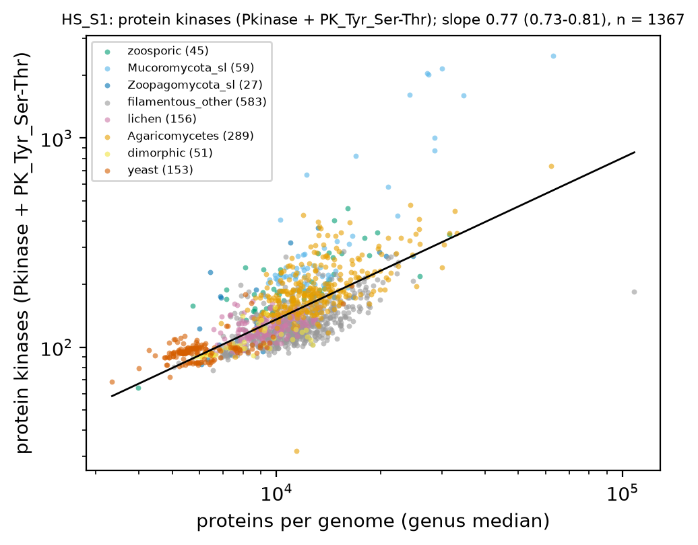 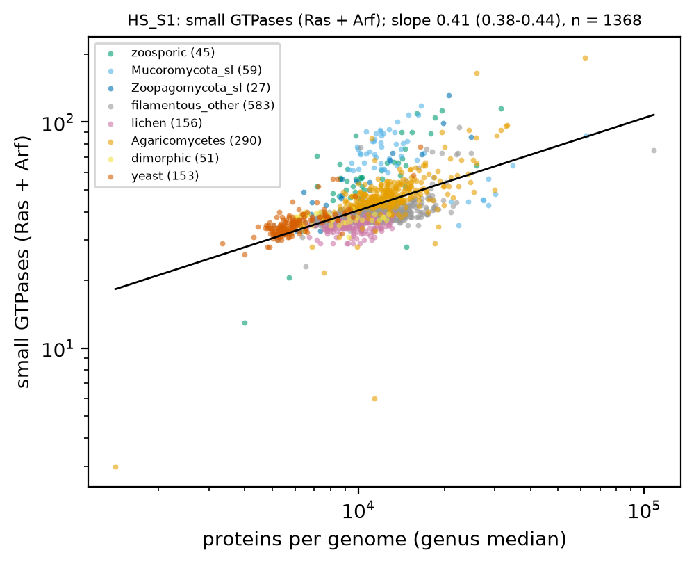 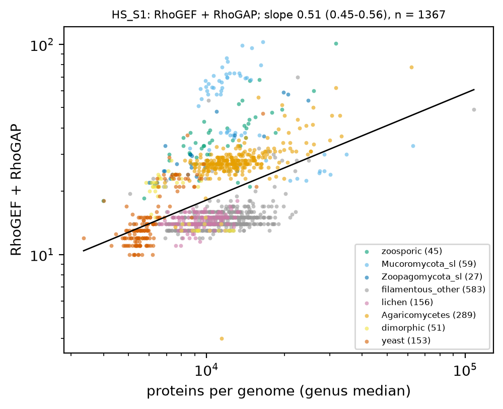 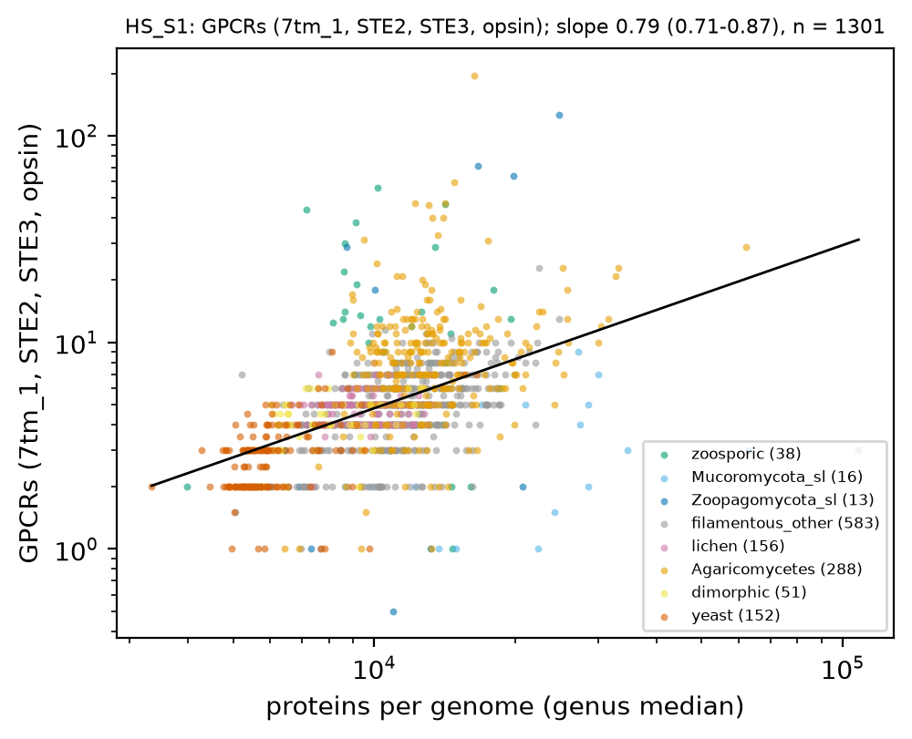 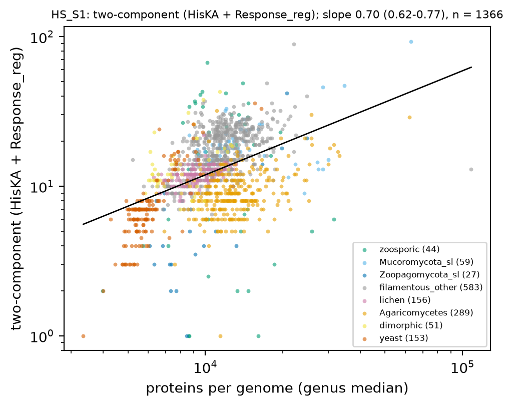 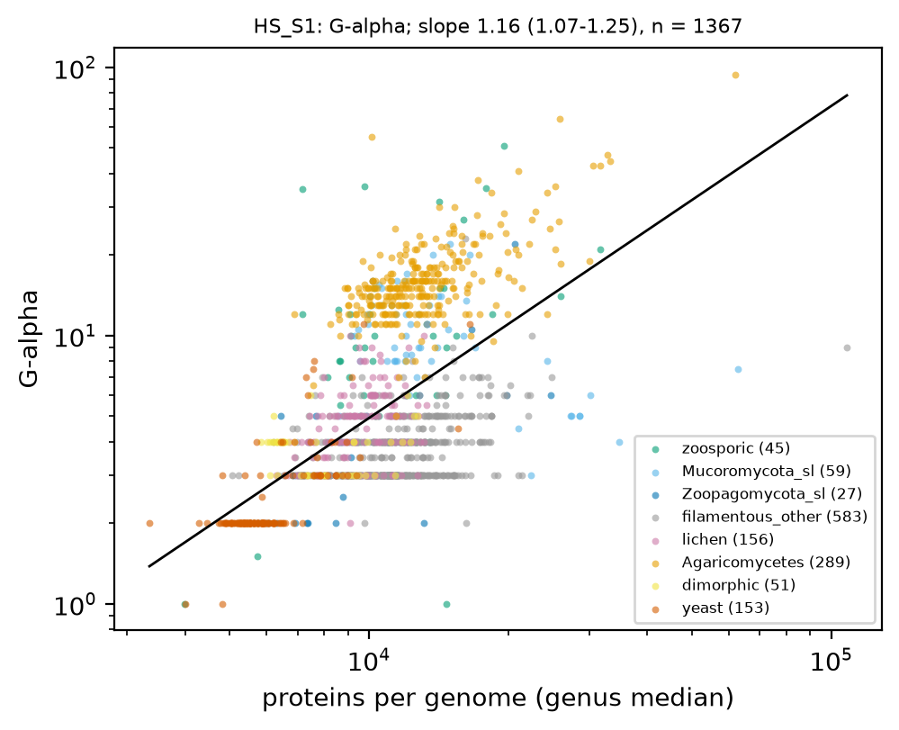 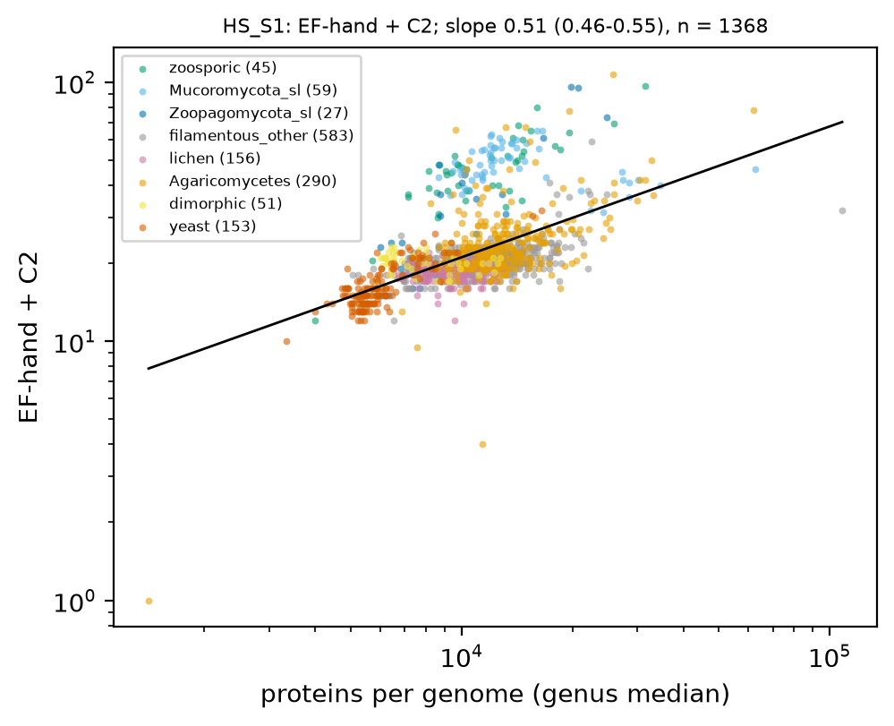 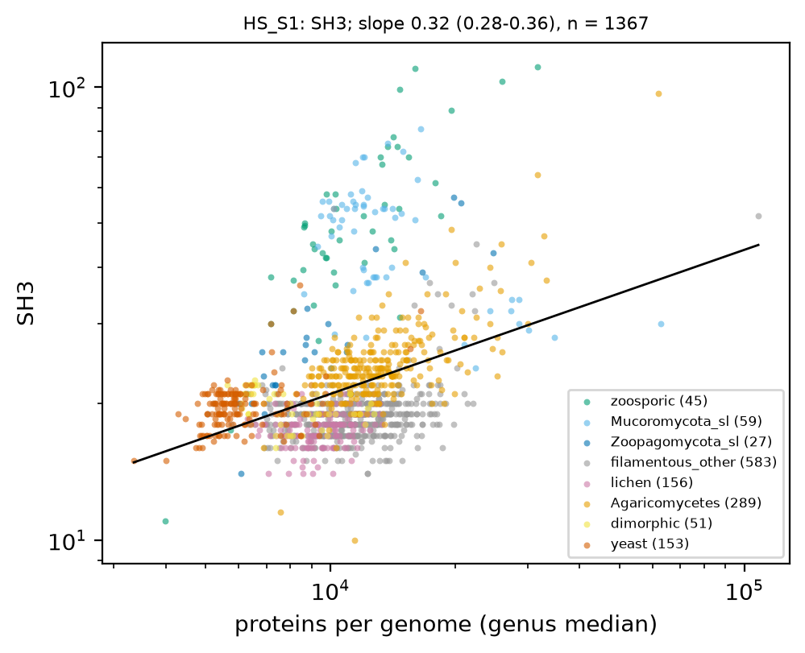 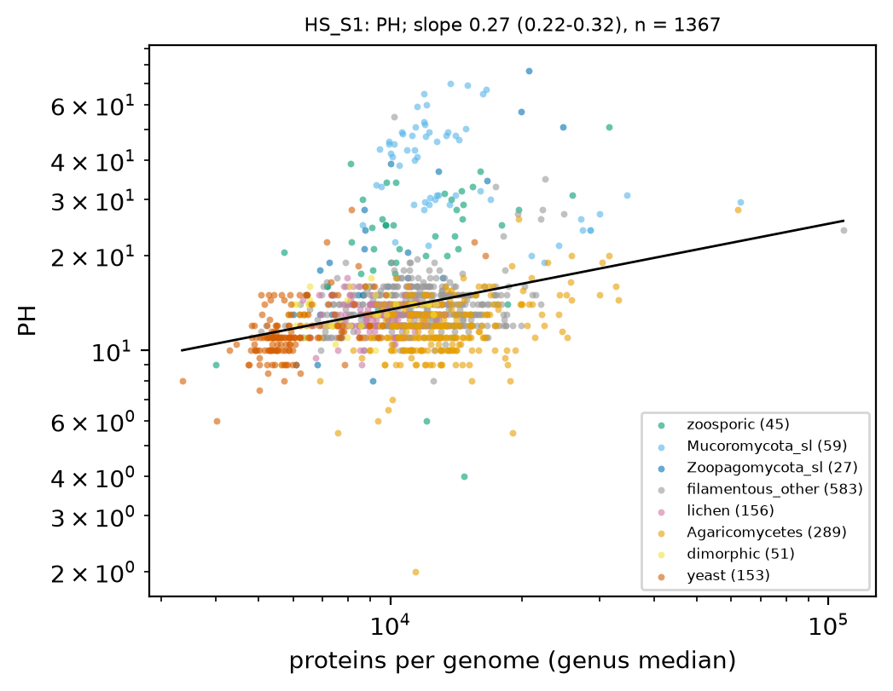

- n = 5,657 genomes / 5,657 species / 1,372 genera. Filters: hs_keep. Unit = genus. Log-log OLS of genus-median count on genus-median proteins per genome; slope < 1 = sub-linear.

| set | label | n_genera | slope | slope_ci_lo | slope_ci_hi | r2 |
|---|---|---|---|---|---|---|
| kinase | protein kinases (Pkinase + PK_Tyr_Ser-Thr) | 1,367 | 0.772 | 0.731 | 0.814 | 0.494 |
| ras_arf | small GTPases (Ras + Arf) | 1,368 | 0.409 | 0.379 | 0.440 | 0.336 |
| rho_reg | RhoGEF + RhoGAP | 1,367 | 0.508 | 0.451 | 0.565 | 0.184 |
| gpcr | GPCRs (7tm_1, STE2, STE3, opsin) | 1,301 | 0.790 | 0.710 | 0.869 | 0.225 |
| two_comp | two-component (HisKA + Response_reg) | 1,366 | 0.696 | 0.622 | 0.770 | 0.200 |
| g_alpha | G-alpha | 1,367 | 1.164 | 1.073 | 1.254 | 0.318 |
| calcium | EF-hand + C2 | 1,368 | 0.505 | 0.463 | 0.547 | 0.290 |
| sh3 | SH3 | 1,367 | 0.318 | 0.275 | 0.361 | 0.134 |
| ph | PH | 1,367 | 0.272 | 0.224 | 0.319 | 0.085 |

- Absolute counts and copies per 1,000 proteins by organism group (genus medians):

| hs_group | n_genera | n_proteins | kinase | ras_arf | rho_reg | gpcr | two_comp | g_alpha | calcium | sh3 | ph | kinase_per1000 | ras_arf_per1000 | rho_reg_per1000 | gpcr_per1000 | two_comp_per1000 | g_alpha_per1000 | calcium_per1000 | sh3_per1000 | ph_per1000 |
|---|---|---|---|---|---|---|---|---|---|---|---|---|---|---|---|---|---|---|---|---|
| zoosporic | 48 | 10299.000 | 185.500 | 56.250 | 34.000 | 6.500 | 13.500 | 8.500 | 45.000 | 47.000 | 21.500 | 17.389 | 5.441 | 3.312 | 0.628 | 1.233 | 0.771 | 4.089 | 4.499 | 2.001 |
| Mucoromycota_sl | 59 | 12231.000 | 223.000 | 72.000 | 58.000 | 0.000 | 18.000 | 10.000 | 47.500 | 51.000 | 41.000 | 20.059 | 6.082 | 5.251 | 0.000 | 1.543 | 0.822 | 3.993 | 4.052 | 3.519 |
| Zoopagomycota_sl | 28 | 8691.500 | 128.750 | 45.000 | 26.000 | 0.000 | 5.500 | 3.000 | 23.500 | 25.500 | 16.500 | 14.120 | 5.237 | 3.117 | 0.000 | 0.628 | 0.331 | 2.831 | 2.945 | 1.948 |
| filamentous_other | 583 | 11178.000 | 124.000 | 39.000 | 14.000 | 5.000 | 17.000 | 3.500 | 20.000 | 19.000 | 13.000 | 11.142 | 3.490 | 1.298 | 0.428 | 1.476 | 0.329 | 1.800 | 1.638 | 1.201 |
| lichen | 156 | 9562.000 | 126.000 | 35.000 | 14.500 | 5.000 | 12.000 | 5.000 | 18.500 | 18.000 | 13.000 | 13.199 | 3.670 | 1.492 | 0.497 | 1.234 | 0.478 | 1.917 | 1.838 | 1.318 |
| Agaricomycetes | 290 | 12564.500 | 180.500 | 47.000 | 27.000 | 8.000 | 9.000 | 15.000 | 23.000 | 23.500 | 12.000 | 14.373 | 3.785 | 2.193 | 0.577 | 0.688 | 1.229 | 1.791 | 1.855 | 0.907 |
| dimorphic | 51 | 7472.500 | 99.000 | 38.000 | 21.000 | 4.000 | 12.000 | 4.000 | 20.000 | 20.000 | 13.000 | 13.943 | 5.084 | 2.874 | 0.525 | 1.686 | 0.431 | 2.755 | 2.507 | 1.632 |
| yeast | 153 | 5727.000 | 95.000 | 34.500 | 13.000 | 3.000 | 7.000 | 2.000 | 15.500 | 20.000 | 11.000 | 17.045 | 5.964 | 2.347 | 0.470 | 1.180 | 0.369 | 2.658 | 3.433 | 1.908 |

- Tables: `tables/HS_S1_allometry_slopes.tsv`, `tables/HS_S1_group_medians.tsv`.

### HS_S1b Residuals by Agaricomycetes fruit-body and hymenium type

- Residual = log10(count) minus the allometric prediction from HS_S1a. Fruit-body and hymenium types are FungalTraits genus labels. Unit = genus.

**kinase.** 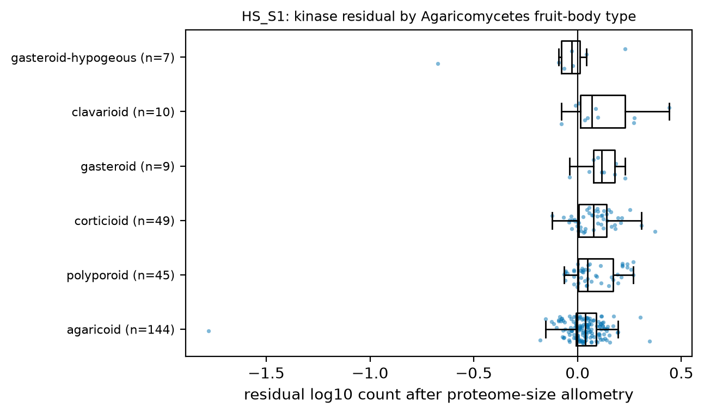 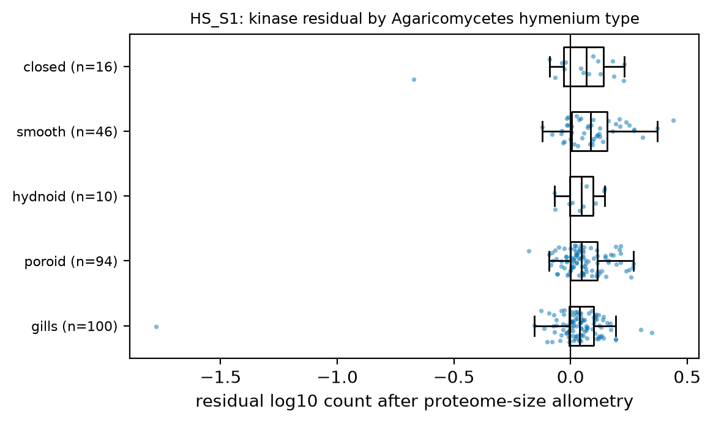

| fruitbody_type | n_genera | median_residual | ci_lo | ci_hi | set |
|---|---|---|---|---|---|
| agaricoid | 144 | 0.036 | 0.022 | 0.045 | kinase |
| polyporoid | 45 | 0.049 | 0.026 | 0.092 | kinase |
| corticioid | 49 | 0.076 | 0.036 | 0.113 | kinase |
| gasteroid | 9 | 0.117 | 0.055 | 0.186 | kinase |
| clavarioid | 10 | 0.068 | 0.005 | 0.272 | kinase |
| gasteroid-hypogeous | 7 | -0.028 | -0.090 | 0.044 | kinase |

| hymenium_type | n_genera | median_residual | ci_lo | ci_hi | set |
|---|---|---|---|---|---|
| gills | 100 | 0.040 | 0.021 | 0.046 | kinase |
| poroid | 94 | 0.046 | 0.026 | 0.058 | kinase |
| hydnoid | 10 | 0.047 | -0.036 | 0.106 | kinase |
| smooth | 46 | 0.085 | 0.040 | 0.118 | kinase |
| closed | 16 | 0.066 | -0.028 | 0.127 | kinase |

- Kruskal-Wallis across fruit-body types (screen): H = 19.178, p = 0.002; across hymenium types: p = 0.180. Agaricoid vs corticioid residual: -0.040 (95 % CI -0.081 to 0.002, n = 144 / 49); gills vs smooth: -0.045 (CI -0.082 to 0.002). mixed model residual ~ fb_complex (agaricoid/polyporoid/gasteroid/clavarioid = 1, corticioid = 0) + busco (1|ORDER/FAMILY), n = 285: effect -0.015 (95 % CI -0.057 to 0.028).

**ras_arf.** 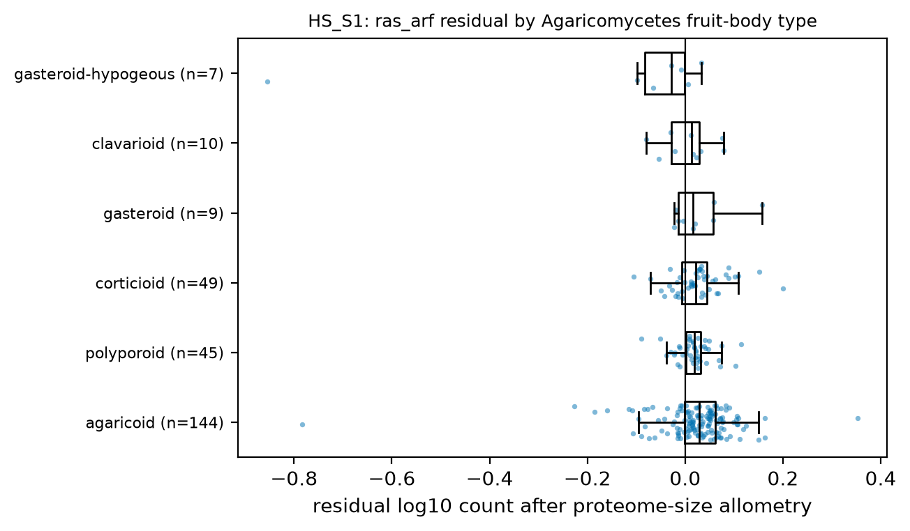 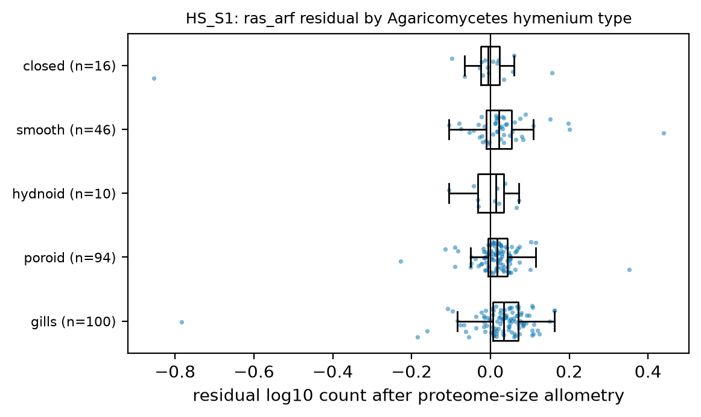

| fruitbody_type | n_genera | median_residual | ci_lo | ci_hi | set |
|---|---|---|---|---|---|
| agaricoid | 144 | 0.029 | 0.016 | 0.044 | ras_arf |
| polyporoid | 45 | 0.018 | 0.009 | 0.026 | ras_arf |
| corticioid | 49 | 0.021 | 0.012 | 0.034 | ras_arf |
| gasteroid | 9 | 0.016 | -0.020 | 0.059 | ras_arf |
| clavarioid | 10 | 0.014 | -0.042 | 0.049 | ras_arf |
| gasteroid-hypogeous | 7 | -0.028 | -0.098 | 0.007 | ras_arf |

| hymenium_type | n_genera | median_residual | ci_lo | ci_hi | set |
|---|---|---|---|---|---|
| gills | 100 | 0.035 | 0.025 | 0.050 | ras_arf |
| poroid | 94 | 0.017 | 0.010 | 0.026 | ras_arf |
| hydnoid | 10 | 0.014 | -0.032 | 0.044 | ras_arf |
| smooth | 46 | 0.021 | 0.013 | 0.034 | ras_arf |
| closed | 16 | -0.006 | -0.023 | 0.020 | ras_arf |

- Kruskal-Wallis across fruit-body types (screen): H = 10.715, p = 0.057; across hymenium types: p = 0.012. Agaricoid vs corticioid residual: 0.008 (95 % CI -0.010 to 0.026, n = 144 / 49); gills vs smooth: 0.013 (CI -0.002 to 0.032). mixed model residual ~ fb_complex (agaricoid/polyporoid/gasteroid/clavarioid = 1, corticioid = 0) + busco (1|ORDER/FAMILY), n = 285: effect -0.023 (95 % CI -0.053 to 0.007).

**gpcr.** 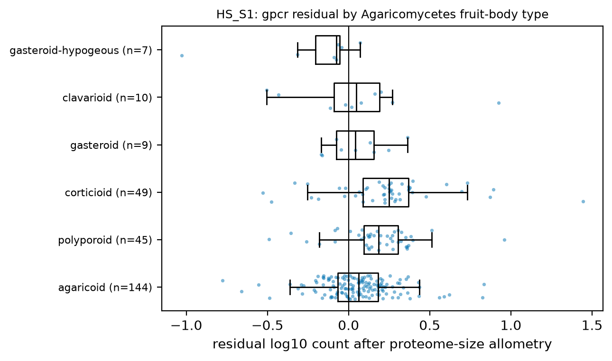 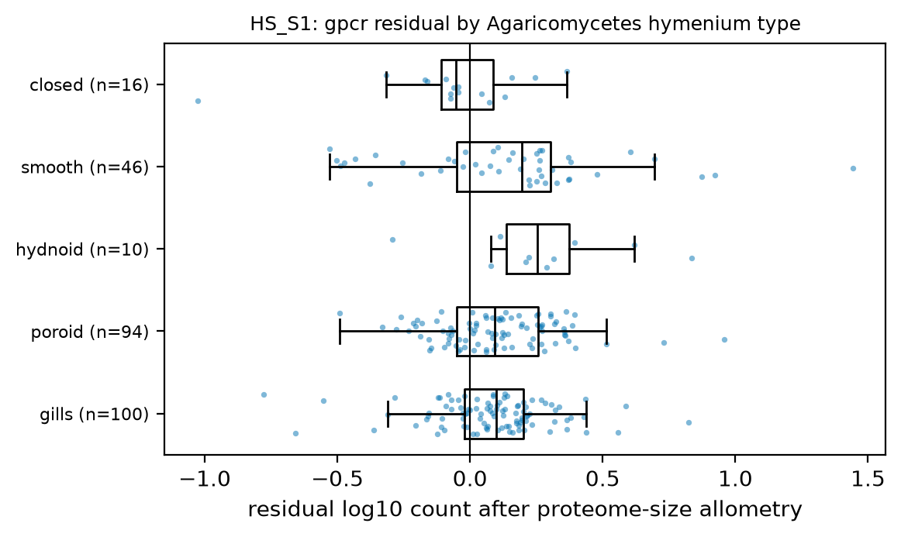

| fruitbody_type | n_genera | median_residual | ci_lo | ci_hi | set |
|---|---|---|---|---|---|
| agaricoid | 144 | 0.062 | 0.024 | 0.089 | gpcr |
| polyporoid | 45 | 0.184 | 0.128 | 0.270 | gpcr |
| corticioid | 49 | 0.250 | 0.214 | 0.284 | gpcr |
| gasteroid | 9 | 0.042 | -0.162 | 0.159 | gpcr |
| clavarioid | 10 | 0.047 | -0.225 | 0.201 | gpcr |
| gasteroid-hypogeous | 7 | -0.074 | -0.315 | -0.044 | gpcr |

| hymenium_type | n_genera | median_residual | ci_lo | ci_hi | set |
|---|---|---|---|---|---|
| gills | 100 | 0.099 | 0.064 | 0.136 | gpcr |
| poroid | 94 | 0.093 | 0.043 | 0.129 | gpcr |
| hydnoid | 10 | 0.255 | 0.114 | 0.467 | gpcr |
| smooth | 46 | 0.195 | 0.074 | 0.262 | gpcr |
| closed | 16 | -0.054 | -0.091 | 0.072 | gpcr |

- Kruskal-Wallis across fruit-body types (screen): H = 34.741, p = 1.69e-06; across hymenium types: p = 0.016. Agaricoid vs corticioid residual: -0.188 (95 % CI -0.239 to -0.133, n = 144 / 49); gills vs smooth: -0.096 (CI -0.177 to 0.038). mixed model residual ~ fb_complex (agaricoid/polyporoid/gasteroid/clavarioid = 1, corticioid = 0) + busco (1|ORDER/FAMILY), n = 285: effect -0.055 (95 % CI -0.126 to 0.017).

**two_comp.** 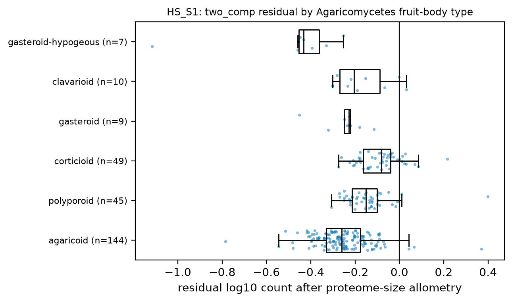 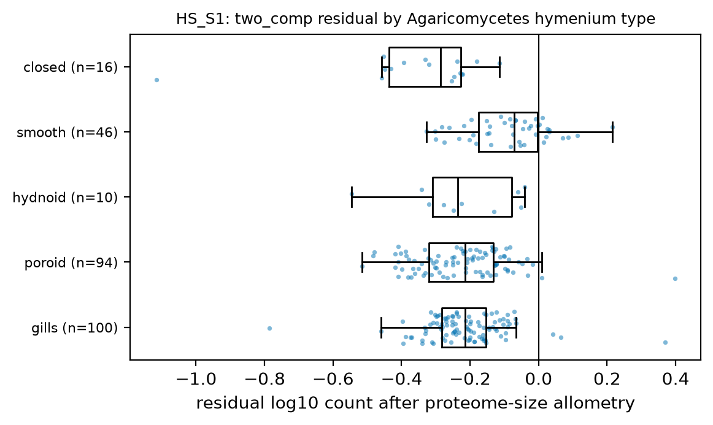

| fruitbody_type | n_genera | median_residual | ci_lo | ci_hi | set |
|---|---|---|---|---|---|
| agaricoid | 144 | -0.260 | -0.282 | -0.243 | two_comp |
| polyporoid | 45 | -0.151 | -0.184 | -0.127 | two_comp |
| corticioid | 49 | -0.081 | -0.131 | -0.056 | two_comp |
| gasteroid | 9 | -0.229 | -0.320 | -0.180 | two_comp |
| clavarioid | 10 | -0.205 | -0.282 | -0.067 | two_comp |
| gasteroid-hypogeous | 7 | -0.432 | -0.458 | -0.330 | two_comp |

| hymenium_type | n_genera | median_residual | ci_lo | ci_hi | set |
|---|---|---|---|---|---|
| gills | 100 | -0.214 | -0.247 | -0.198 | two_comp |
| poroid | 94 | -0.214 | -0.251 | -0.183 | two_comp |
| hydnoid | 10 | -0.237 | -0.320 | -0.060 | two_comp |
| smooth | 46 | -0.072 | -0.139 | -0.040 | two_comp |
| closed | 16 | -0.287 | -0.432 | -0.229 | two_comp |

- Kruskal-Wallis across fruit-body types (screen): H = 94.635, p = 7.13e-19; across hymenium types: p = 1.71e-09. Agaricoid vs corticioid residual: -0.179 (95 % CI -0.212 to -0.127, n = 144 / 49); gills vs smooth: -0.143 (CI -0.194 to -0.085). mixed model residual ~ fb_complex (agaricoid/polyporoid/gasteroid/clavarioid = 1, corticioid = 0) + busco (1|ORDER/FAMILY), n = 285: effect -0.054 (95 % CI -0.091 to -0.016).

**g_alpha.** 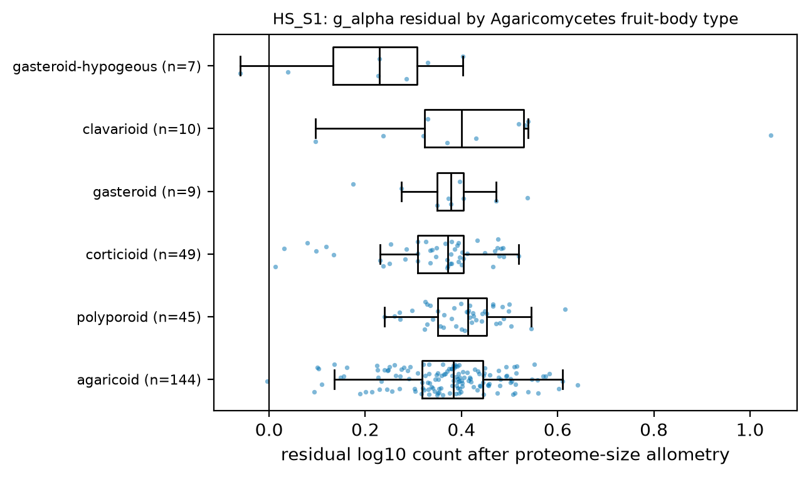 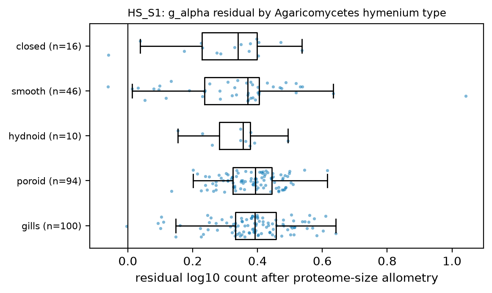

| fruitbody_type | n_genera | median_residual | ci_lo | ci_hi | set |
|---|---|---|---|---|---|
| agaricoid | 144 | 0.384 | 0.360 | 0.393 | g_alpha |
| polyporoid | 45 | 0.413 | 0.384 | 0.431 | g_alpha |
| corticioid | 49 | 0.371 | 0.335 | 0.393 | g_alpha |
| gasteroid | 9 | 0.378 | 0.350 | 0.472 | g_alpha |
| clavarioid | 10 | 0.400 | 0.283 | 0.535 | g_alpha |
| gasteroid-hypogeous | 7 | 0.230 | 0.039 | 0.330 | g_alpha |

| hymenium_type | n_genera | median_residual | ci_lo | ci_hi | set |
|---|---|---|---|---|---|
| gills | 100 | 0.392 | 0.374 | 0.404 | g_alpha |
| poroid | 94 | 0.393 | 0.359 | 0.413 | g_alpha |
| hydnoid | 10 | 0.356 | 0.260 | 0.384 | g_alpha |
| smooth | 46 | 0.370 | 0.309 | 0.385 | g_alpha |
| closed | 16 | 0.340 | 0.230 | 0.397 | g_alpha |

- Kruskal-Wallis across fruit-body types (screen): H = 14.222, p = 0.014; across hymenium types: p = 0.032. Agaricoid vs corticioid residual: 0.013 (95 % CI -0.018 to 0.049, n = 144 / 49); gills vs smooth: 0.022 (CI -0.002 to 0.085). mixed model residual ~ fb_complex (agaricoid/polyporoid/gasteroid/clavarioid = 1, corticioid = 0) + busco (1|ORDER/FAMILY), n = 285: effect 0.027 (95 % CI -0.008 to 0.063).

- Table: `tables/HS_S1_residuals_agaricomycetes.tsv`.

### HS_S1c Residuals by Ascomycota fruit-body type within class

| class | fruitbody | set | n_fruitbody | n_none | median_res_fruitbody | median_res_none | diff | ci_lo | ci_hi |
|---|---|---|---|---|---|---|---|---|---|
| Sordariomycetes | perithecium | kinase | 117 | 41 | -0.086 | -0.069 | -0.017 | -0.040 | 0.006 |
| Sordariomycetes | perithecium | ras_arf | 117 | 41 | -0.019 | -0.017 | -0.002 | -0.016 | 0.011 |
| Sordariomycetes | perithecium | gpcr | 117 | 41 | 0.046 | 0.015 | 0.031 | -0.008 | 0.086 |
| Sordariomycetes | perithecium | two_comp | 117 | 41 | 0.037 | -0.012 | 0.049 | -0.007 | 0.071 |
| Leotiomycetes | apothecium | kinase | 39 | 5 | -0.095 | -0.079 | -0.016 | -0.042 | 0.063 |
| Leotiomycetes | apothecium | ras_arf | 39 | 5 | -0.058 | -0.063 | 0.005 | -0.030 | 0.053 |
| Leotiomycetes | apothecium | gpcr | 39 | 5 | -0.073 | -0.056 | -0.017 | -0.365 | 0.130 |
| Leotiomycetes | apothecium | two_comp | 39 | 5 | 0.232 | 0.251 | -0.019 | -0.155 | 0.070 |
| Dothideomycetes | perithecium | kinase | 94 | 0 | -0.087 | NA | NA | NA | NA |
| Dothideomycetes | perithecium | ras_arf | 94 | 0 | -0.053 | NA | NA | NA | NA |
| Dothideomycetes | perithecium | gpcr | 94 | 0 | -0.029 | NA | NA | NA | NA |
| Dothideomycetes | perithecium | two_comp | 94 | 0 | 0.214 | NA | NA | NA | NA |

- Table: `tables/HS_S1_residuals_ascomycota_fruitbody.tsv`. 'none' is the FungalTraits label; it mixes asexual-only genera and unknowns.

### HS_S1d Kinase residual and absolute count by yeast origin

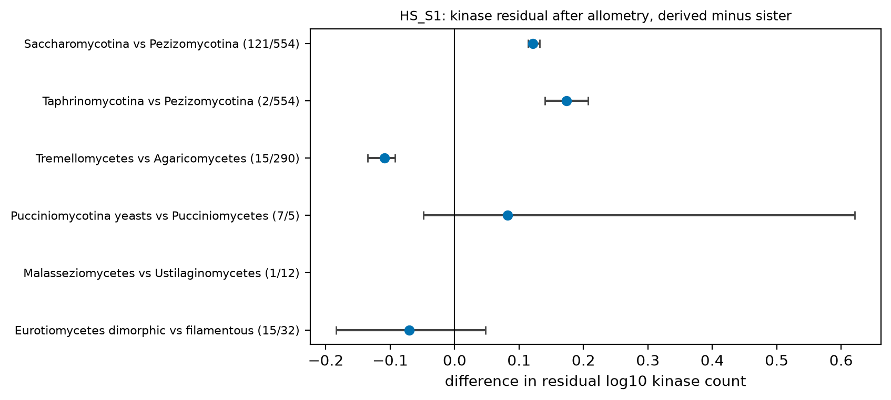

| pair | n_derived | n_sister | median_derived | median_sister | diff | ci_lo | ci_hi | cliffs_delta | mw_p |
|---|---|---|---|---|---|---|---|---|---|
| Saccharomycotina vs Pezizomycotina | 121 | 554 | 0.046 | -0.075 | 0.121 | 0.114 | 0.132 | 0.757 | 6.23e-39 |
| Taphrinomycotina vs Pezizomycotina | 2 | 554 | 0.098 | -0.075 | 0.173 | 0.140 | 0.207 | 0.924 | 0.006 |
| Tremellomycetes vs Agaricomycetes | 15 | 290 | -0.065 | 0.044 | -0.109 | -0.135 | -0.093 | -0.828 | 6.55e-08 |
| Pucciniomycotina yeasts vs Pucciniomycetes | 7 | 5 | -0.045 | -0.128 | 0.082 | -0.049 | 0.621 | 0.600 | 0.106 |
| Malasseziomycetes vs Ustilaginomycetes | 1 | 12 | 0.071 | -0.024 | NA | NA | NA | NA | NA |
| Eurotiomycetes dimorphic vs filamentous | 15 | 32 | -0.078 | -0.007 | -0.071 | -0.184 | 0.048 | -0.396 | 0.031 |

- Sister pairs (kinase residual; unit = genus; difference = derived median minus sister median, bootstrap 95 % CI). Sign across the 4 yeast-origin pairs with data: 1 of 4 below zero (binomial p = 0.625). Pairs with < 3 genera on one side have no CI.

| pair | n_derived | n_sister | median_derived | median_sister | diff | ci_lo | ci_hi | cliffs_delta | mw_p |
|---|---|---|---|---|---|---|---|---|---|
| Saccharomycotina vs Pezizomycotina | 121 | 554 | 95.000 | 124.000 | -29.000 | -32.000 | -26.994 | -0.866 | 2.06e-50 |
| Taphrinomycotina vs Pezizomycotina | 2 | 554 | 86.750 | 124.000 | -37.250 | -57.500 | -17.000 | -0.855 | 0.037 |
| Tremellomycetes vs Agaricomycetes | 15 | 290 | 98.000 | 180.500 | -82.500 | -87.000 | -78.000 | -0.973 | 2.15e-10 |
| Pucciniomycotina yeasts vs Pucciniomycetes | 7 | 5 | 104.000 | 155.000 | -51.000 | -152.000 | -21.500 | -0.771 | 0.030 |
| Malasseziomycetes vs Ustilaginomycetes | 1 | 12 | 79.000 | 92.000 | NA | NA | NA | NA | NA |
| Eurotiomycetes dimorphic vs filamentous | 15 | 32 | 118.000 | 129.500 | -11.500 | -26.500 | 5.000 | -0.275 | 0.135 |

- Sister pairs (absolute kinase count; unit = genus; difference = derived median minus sister median, bootstrap 95 % CI). Sign across the 4 yeast-origin pairs with data: 4 of 4 below zero (binomial p = 0.125). Pairs with < 3 genera on one side have no CI.
- Tables: `tables/HS_S1_pairs_kinase_residual.tsv`, `tables/HS_S1_pairs_kinase_count.tsv`.

### Evolutionary framing

- Polarity: kinase density is highest in the early-diverging groups (per 1,000 proteins: zoosporic 17.4, Mucoromycota s.l. 20.1, Zoopagomycota s.l. 14.1) and lowest in filamentous non-Agaricomycetes (11.1); absolute kinase counts (genus medians): zoosporic 186, Mucoromycota s.l. 223, filamentous non-Agaricomycetes 124, Agaricomycetes 180, yeast 95. The polarized question is therefore whether Dikarya lineages diluted or lost kinases, not whether complex forms gained them. Outgroups available in this frame (genera): zoosporic 48, Mucoromycota s.l. 59, Zoopagomycota s.l. 28; Dikarya: filamentous non-Agaricomycetes 583, Agaricomycetes 290, lichen 156, dimorphic 51, yeast 153. Microsporidia are excluded (PI decision 2026-11-08) unless the page says otherwise.
- Placement: no-tree version = residual contrasts by fruit-body type (several Agaricomycetes orders, HS_S1b) and by class (HS_S1c); a single Dikarya-wide shift vs separate shifts at fruit-body origins needs ancestral counts at the Dikarya, Agaricomycetes and fruit-body nodes.
- Mode: expected dilution (proteome growth by non-signaling families) rather than kinome change; Mucoromycota kinome expansion may be duplication-driven (wgd.ks young nodes in kinase families: not tested here).
- What the tree adds: PGLS of log count on log proteome size with fruit-body type; `phylosig`; `bayou` on the residual; CAFE-style on kinase family size after dating. PGLS, phylogenetic signal (lambda, K) and ancestral states: pending tree (atlas_data/phylo).
- Caveats: subfamily turnover is invisible to counts; the deep order of Mucoromycota and Zoopagomycota is uncertain; fragmented models split kinases (complete-model filter not applied to Pfam counts); FungalTraits 'none' fruit body includes unknowns.

## Verdict

**Falsification test: the popular idea is not supported: inside Agaricomycetes, genera with complex fruit bodies do not carry more kinases than corticioid genera after proteome-size allometry.** Kinase count scales with slope 0.77 (95 % CI 0.73 to 0.81) on proteome size (sub-linear). Agaricomycetes as a class sit above the all-fungi allometric line (residuals by fruit-body type, median and 95 % CI: agaricoid +0.036 (+0.022 to +0.045, n = 144); polyporoid +0.049 (+0.026 to +0.092, n = 45); corticioid +0.076 (+0.036 to +0.113, n = 49); gasteroid +0.117 (+0.055 to +0.186, n = 9); clavarioid +0.068 (+0.005 to +0.272, n = 10); gasteroid-hypogeous -0.028 (-0.090 to +0.044, n = 7)), so the test is the within-class contrast: agaricoid minus corticioid residual -0.040 (95 % CI -0.081 to 0.002; n = 144 / 49); gills minus smooth hymenium -0.045 (CI -0.082 to 0.002); mixed model fb_complex effect -0.015 (CI -0.057 to 0.028, ORDER/FAMILY random intercepts). Absolute kinase counts are 95 in yeast genera and 124 in filamentous non-Agaricomycetes genera; the Saccharomycotina residual is above its sister (+0.121, CI 0.114 to 0.132), so the unicellular proteome keeps more kinases than its size predicts. Other signaling classes: see HS_S1b and HS_S1c. PGLS, phylogenetic signal (lambda, K) and ancestral states: pending tree (atlas_data/phylo).
